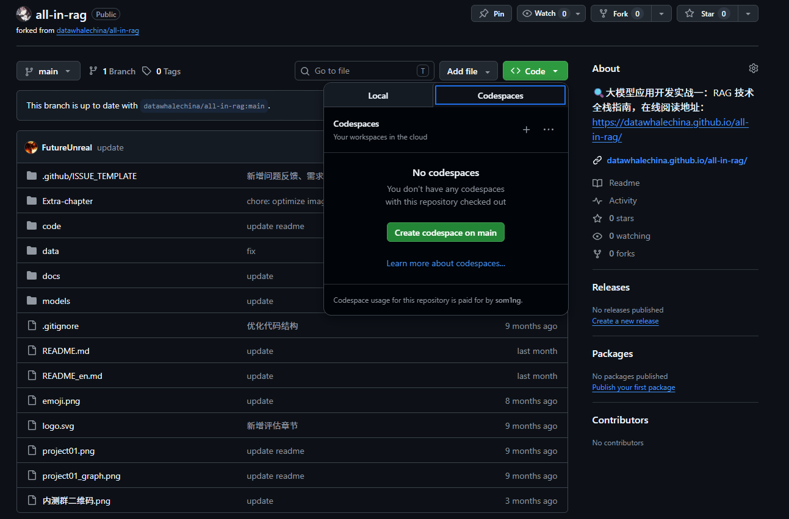
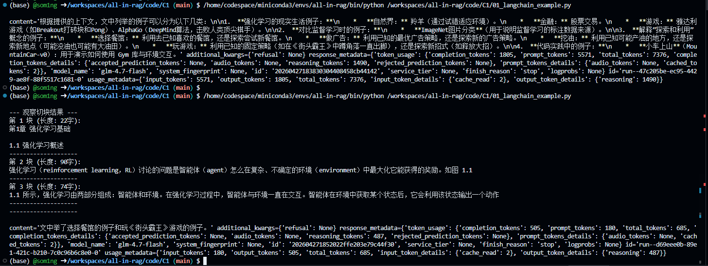

# 前言：

本节学习windows全环境RAG项目学习配置，配置完后就可以开始正式学习了


# 大模型 API 配置

## AIHubmix API 申请

AIHubmix 是一个美国平台，公司注册在美国的特拉华州，一站式聚合了全球主流的 AI 模型，最新的模型通常能在发布当天最晚不超过 1 周就会支持。完全对接相关模型的云厂商（OpenAI 对接的是 Azure 云，Gemini 对接的 Google 官方，Claude 对接的是 AWS，其他开源等模型是对接到各大知名云厂商或者推理公司）。AIHubmix 的服务器是在美国谷歌云上采用集群部署，同时因为完全对接云厂商，所以稳定性非常好，有多端点路由机制，可以达到比直连官方更稳定的效果。

> AIHubmix 提供的免费模型足够我们完成项目的学习。

**1.访问 AIHubmix 平台**

打开浏览器，访问 [AIHubmix](https://aihubmix.com/?aff=anNj)。


**2.登录或注册账号**

如果已有账号，可以直接登录。如果没有，请点击页面右上角的注册按钮，使用邮箱或手机号完成注册。


**3.模型筛选**

可以看到有很多模型的api我们可以免费白嫖，选好一个想要白嫖的api模型就可以到下一步了


**4.管理 API 密钥**接着进入[密钥管理页面](https://console.aihubmix.com/token)，可以点击 `创建 Key` 填写名称后创建一个自己的api key。


# GitHub Codespaces 环境配置

GitHub Codespaces 是 GitHub 提供的一项服务，允许开发者在云端创建、编辑和运行代码。它提供了一个预配置的开发环境，包括代码编辑器、终端、调试工具等，可以直接在浏览器中使用。

## 创建Codespaces

1. **访问项目地址**
   打开浏览器，访问 [all-in-rag](https://github.com/datawhalechina/all-in-rag)

2. **创建新分支** 在项目页面的右上角，点击 `Fork` 按钮，创建一个新的分支。稍等一会儿即可创建成功。

3. **创建Codespaces** 在项目页面的右上角，点击 `Code` 按钮，然后选择 `Codespaces` 选项卡。点击 `New codespace` 按钮，等待新的 Codespaces 环境创建成功。
   

4. 点击create codespace后会打开一个云端编辑器，然后我们就可以在对应项目文件夹里随意开工了

5. 如果我们退出后想再回到这个编辑器页面，我们可以按照上图同样的位置打开，点击对应项目就能打开了

6. **额度设置** 找到 GitHub 的账户设置中的 codespace 设置，挂起时间建议根据自己情况调整（时间过长会浪费额度，免费账号提供了单核120小时的额度）
   
   
   

# python环境配置：

有了云端代码编辑器后我们直接在对应服务器内下载就好了，我们先回到上面配置的codespace代码编辑器

然后点击一下下面的终端

1. **更新系统软件包**
   在终端输入下面指令
   
   ```bash
   sudo apt update 
   sudo apt upgrade -y
   ```

2. **安装Miniconda**
   
   ```bash
   wget https://repo.anaconda.com/miniconda/Miniconda3-latest-Linux-x86_64.sh -O ~/miniconda.sh 
   bash ~/miniconda.sh
   ```
   
   * 按 Enter 阅读许可协议
   
   * 输入 `yes` 同意协议
   
   * 安装路径提示时直接按 Enter（使用默认路径 /home/ubuntu/miniconda3）
   
   * 是否初始化Miniconda：输入 `yes` 将Miniconda添加到您的PATH环境变量中。
     
     ```bash
     source ~/.bashrc conda --version
     ```
   
   如果显示版本号，说明安装成功。
   
   

# API配置

使用 `vim` 编辑器打开你的 shell 配置文件。

```bash
vim ~/.bashrc
```

输入 `i` 进入编辑模式，在文件末尾添加以下行，将 `你的大模型 API 密钥` 替换为你自己的密钥：

我这里用的是https://api.aihubmix.com/v1的接口，如果用的是其他厂家的api需要把openai_api_base字段改一下

```bash
export OPENAI_API_KEY=你的大模型密钥
export OPENAI_API_BASE="https://api.aihubmix.com/v1"
```

保存并退出 在 vim 中，按 Esc 键进入命令模式，然后输入 `:wq` 并按 Enter 键保存文件并退出。

使配置生效 执行以下命令来立即加载更新后的配置，让环境变量生效：

```bash
source ~/.bashrc
```


# 创建并激活虚拟环境

1. **创建虚拟环境**
   
   ```bash
   conda create --name all-in-rag python=3.12.7
   ```
   
   出现选项直接回车即可。

2. **激活虚拟环境**
   使用以下命令激活虚拟环境：
   
   ```bash
   conda activate all-in-rag
   ```

3. **依赖安装** 如果严格安装上述流程当前应该在项目根目录，进入code目录安装依赖库
   
   ```bash
   cd code pip install -r requirements.txt
   ```
   
   > 如果出现关于grpcio的版本错误无需在意。
   
   

# 运行RAG示例代码

1. 激活环境（已经激活的不用激活）
   
   ```bash
   conda activate all-in-rag
   ```

2. 切换到项目目录
   
   ```bash
   # 假设当前在 all-in-rag 项目的根目录下
   cd code/C1
   ```

3. 完成上述所有设置后，就可以运行RAG示例了。
   打开终端，确保虚拟环境已激活，然后执行以下命令：
   
   ```bash
   python 01_langchain_example.py
   ```
   
   这里要注意，如果**跟着之前官方文档配置这里可能会报错**，因为代码写死了是openai的api，具体怎么配置看我上面的[API配置](#API配置)

4. 代码运行后，可以看到类似下面的输出（格式化后）：
   
   ```bash
   Downloading Model from https://www.modelscope.cn to directory: Path\to\all-in-rag\models\bge-small-zh-v1.5
   2025-06-08 02:36:19,318 - modelscope - INFO - Target directory already exists, skipping creation.
   content='
   基于提供的上下文，文中列举了以下例子：
   
   1.  **Atar 游戏 Breakout（打砖块）**：用于说明强化学习与监督学习的区别，以及数据非独立同分布、延迟反馈和延迟奖励等问题。
   2.  **Pong 游戏**：用于说明强化学习智能体的决策过程以及策略网络（输出动作概率）。
   3.  **自然界中的羚羊**：用于说明生物通过试错（通过不断探索站立和奔跑）来适应环境。
   4.  **股票交易**：用于说明在金融市场中如何通过买卖股票并根据市场反馈来学习最大化奖励。
   5.  **电子游戏**：用于说明通过不断试错来学会如何通关。
   6.  **MountainCar-v0**：用于具体演示如何使用 Gym 库，包括观测空间、动作空间的定义以及代码实现。
   7.  **Atar 游戏 Space Invaders**：用于说明免模型强化学习需要大量样本（如约两亿帧）才能取得理想效果。
   8.  **选择餐馆**：用于类比“利用”（去熟悉的餐馆）和“探索”（尝试新餐馆）。
   9.  **做广告**：用于类比“利用”（采取最优广告策略）和“探索”（尝试新的广告策略）。
   10. **挖油**：用于类比“利用”（在已知的地方挖油）和“探索”（在新的地方挖油）。
   11. **玩《街头霸王》游戏**：用于类比“利用”（采取某种固定策略）和“探索”（尝试新招式）。
   '
   additional_kwargs={'refusal': None}
   response_metadata={
       'token_usage': {
           'completion_tokens': 209,
           'prompt_tokens': 5576,
           'total_tokens': 5785,
           'completion_tokens_details': None,
           'prompt_tokens_details': {'audio_tokens': None, 'cached_tokens': 5568},
           'prompt_cache_hit_tokens': 5568,
           'prompt_cache_miss_tokens': 8
       },
       'model_name': 'deepseek-chat',
       'system_fingerprint': 'fp_8802369eaa_prod0425fp8',
       'id': '67a0580d-78b1-44d6-bccf-f654ae0e9bba',
       'service_tier': None,
       'finish_reason': 'stop',
       'logprobs': None
   }
   id='run--919cedcd-771e-4aed-8dfd-cf436795792e-0'
   usage_metadata={
       'input_tokens': 5576,
       'output_tokens': 209,
       'total_tokens': 5785,
       'input_token_details': {'cache_read': 5568},
       'output_token_details': {}
   }
   ```
   
   输出参数解析：
   
   * **`content`**: 这是最核心的部分，即大型语言模型（LLM）根据你的问题和提供的上下文生成的具体回答。
   * **`additional_kwargs`**: 包含一些额外的参数，在这个例子中是 `{'refusal': None}`，表示模型没有拒绝回答。
   * **`response_metadata`**: 包含了关于LLM响应的元数据。
     * `token_usage`: 显示了本次调用消耗的token数量，包括完成（completion_tokens）、提示（prompt_tokens）和总量（total_tokens）。
     * `model_name`: 使用的LLM模型名称，当前是 `deepseek-chat`。
     * `system_fingerprint`, `id`, `service_tier`, `finish_reason`, `logprobs`: 这些是更详细的API响应信息，例如 `finish_reason: 'stop'` 表示模型正常完成了生成。
   * **`id`**: 本次运行的唯一标识符。
   * **`usage_metadata`**: 与 `response_metadata` 中的 `token_usage` 类似，提供了输入和输出token的统计。
     
     

# 详解代码逻辑：

原教程是把langchain和LlamaIndex的代码都拉出来对比了一下，我认为初学就掌握好langchain就够用了，而且时间可以最大化利用，所以这里只给出langchain的代码逻辑

在第一节中，我们知道四步构建最小可行系统分别是**数据准备、索引构建、检索优化和生成集成**。我们刚才运行的示例代码也正是基于这四步的逻辑构建的一个**MVP(Minimum Viable Product（最小可行性产品）)**


## 第一步：数据准备与清洗 (Data Prep & Chunking)

这一步的核心任务是：把本地人类能看懂的文件，切成一块块大小合适、语义完整的碎片，准备喂给机器。

```python
import os
from dotenv import load_dotenv
from langchain_community.document_loaders import UnstructuredMarkdownLoader
from langchain_text_splitters import RecursiveCharacterTextSplitter

load_dotenv() # 加载 .env 文件中的隐藏环境变量（如 API Key）

markdown_path = "../../data/C1/markdown/easy-rl-chapter1.md"

# 1. 加载本地文件
# 【AI 术语】：Loader（加载器）。它的作用是把各种奇奇怪怪的格式（PDF, MD, HTML）
# 统统扒掉格式外衣，变成纯文本（Plain Text）字符串。
loader = UnstructuredMarkdownLoader(markdown_path)
docs = loader.load()

# 2. 文本分块
# 【AI 术语】：Chunking（切块）。大模型记性有限（Token 窗口限制），整本书喂不进去。
# 这里的 Recursive (递归) 意思是：它会聪明地先尝试按段落切，不行再按句子切，
# 最大程度保证每一句话的意思不被从中间生生劈断。
text_splitter = RecursiveCharacterTextSplitter() 
chunks = text_splitter.split_documents(docs) # 此时，一整篇文章变成了很多个小 Chunk
```


## 第二步：索引构建 (Indexing & Vectorization)

这一步是 RAG 最具魔法感的一环：把纯文字变成高维数学数组，并存入数据库。

```python
from langchain_huggingface import HuggingFaceEmbeddings
from langchain_core.vectorstores import InMemoryVectorStore

# 3. 实例化中文嵌入模型
# 【AI 术语】：Embedding（嵌入/向量化）。这是大模型理解世界的底层语言。
# 它能把“苹果”变成 [0.1, 0.5, -0.2...] 这样的浮点数数组。
# 这里我们用的是 BAAI（北京智源人工智能研究院）开源的 bge-small 模型。
embeddings = HuggingFaceEmbeddings(
    model_name="BAAI/bge-small-zh-v1.5", 
    model_kwargs={'device': 'cpu'}, # 强制用电脑 CPU 跑这个小模型，不挑显卡
    encode_kwargs={'normalize_embeddings': True} # 归一化：让算相似度（查距离）变得更准更快
)

# 4. 构建向量数据库并存入
# 【AI 术语】：Vector Store（向量库）。传统数据库搜关键词，向量库搜“意思相近”。
# InMemory 表示存放在电脑运行内存里，程序一关数据就没。只适合做极简 Demo。
vectorstore = InMemoryVectorStore(embeddings) 

# 把第一步切好的 chunks，经过 embeddings 变成一堆数字，存进数据库里！
vectorstore.add_documents(chunks)
```


## 第三步：检索优化与召回 (Retrieval)

当用户提出问题时，如何从数据库里把最相关的几块文本“捞”出来。

```python
# 用户查询
question = "文中举了哪些例子？"

# 5. 在向量存储中查询相关文档
# 【AI 术语】：Similarity Search（相似度搜索）与 Top-K。
# 内部逻辑：先把 question 也 Embedding 成向量，然后去库里算距离（通常是余弦距离）。
# k=3 表示只把距离最近、最相关的 3 个 Chunk 捞出来，多了大模型看不过来，少了信息不够。
retrieved_docs = vectorstore.similarity_search(question, k=3)

# 6. 把捞出来的 3 块碎片，用双换行符(\n\n)缝合拼接成一段长字符串
docs_content = "\n\n".join(doc.page_content for doc in retrieved_docs)
```


## 第四步：生成与提示工程 (Generation & Prompting)

将捞出来的知识与用户的问题打包在一起，用一种“命令”的口吻发给生成式大模型。

```bash
from langchain_core.prompts import ChatPromptTemplate
from langchain_openai import ChatOpenAI

# 7. 提示词模板设定
# 【AI 术语】：Prompt Engineering（提示工程）与 Grounding（信息挂载）。
# 大模型爱胡说八道（幻觉）。所以我们必须在模板里用强硬的语气要求它：
# “必须完全基于上下文！”、“找不到就说不知道！”
prompt = ChatPromptTemplate.from_template("""请根据下面提供的上下文信息来回答问题。
请确保你的回答完全基于这些上下文。
如果上下文中没有足够的信息来回答问题，请直接告知：“抱歉，我无法根据提供的上下文找到相关信息来回答此问题。”

上下文:
{context}

问题: {question}

回答:"""
)

# 8. 配置大语言模型 (生成器)
# 【AI 术语】：LLM（大型语言模型）。负责最后的阅读理解和归纳总结。
llm = ChatOpenAI(
    model="glm-4.7-flash-free", # 指定用哪家公司的哪个版本的模型脑子
    temperature=0.7, # 【重要参数】温度值。0.0 最严谨保守，1.0 脑洞最大。RAG 场景通常设得低一点以求严谨。
    max_tokens=4096, # 允许模型一口气最多吐出多少字，防账单爆炸。
    api_key=os.getenv("OPENAI_API_KEY"), # 从环境中偷拿刚才我们设置好的大门钥匙
    base_url="[https://api.aihubmix.com/v1](https://api.aihubmix.com/v1)" # 告诉它别连美国，去连中转代理服务器
)

# 9. 最终调用与输出
# 将第 3 步拼接好的上下文(docs_content) 和问题(question) 填入模板，发给 LLM。
answer = llm.invoke(prompt.format(question=question, context=docs_content))

# 只打印模型吐出的纯净文本，剥离 Token 消耗等杂乱的元数据。
print(answer.content)
```


# 练习（可利用大模型辅助完成）

## Q1:

> LangChain代码最终得到的输出携带了各种参数，查询相关资料尝试把这些参数过滤掉得到`content`里的具体回答。


很简单，把最后的`print(answer)`改为`print(answer.content)`即可，这样输出结果只有大模型的输出内容

## Q2:

> 修改Langchain代码中`RecursiveCharacterTextSplitter()`的参数`chunk_size`和`chunk_overlap`，观察输出结果有什么变化。


LangChain 默认的 `chunk_size` 通常是 4000，`chunk_overlap` 是 200。如果你不在括号里写，它就按默认的来。

```py
# 文本分块
text_splitter = RecursiveCharacterTextSplitter()
```

**修改后：**

```py
# 文本分块：明确指定参数
text_splitter = RecursiveCharacterTextSplitter(
    chunk_size=100,      # 【改动1】：限制每个“块”最多只能有 100 个字符
    chunk_overlap=20     # 【改动2】：让相邻的两个“块”之间保留 20 个字的重叠
)

chunks = text_splitter.split_documents(docs)

# 【附加代码】：为了观察变化，我们可以打印前 3 个切块出来看看
print("\n--- 观察切块结果 ---")
for i in range(min(3, len(chunks))):
    print(f"第 {i+1} 块 (长度: {len(chunks[i].page_content)}字):")
    print(chunks[i].page_content)
    print("-" * 20)
print("--------------------\n")
```

### 这两个参数是什么意思

* **`chunk_size` (切块大小)**：也就是“你的框有多大”。
  
  * **如果设得太大（比如 2000）**：大模型一次性吃进太多文字，容易犯迷糊（专业术语叫“注意力涣散”），找不到重点。
  
  * **如果设得太小（比如 50）**：一句话还没说完就被切断了。比如上一块写了“孙悟空”，下一块只切到了“打妖怪”，大模型就不知道是谁在打妖怪了（专业术语叫“上下文语义丢失”）。

* **`chunk_overlap` (重叠大小)**：也就是“承上启下的胶水”。
  
  * 就像你翻页看书，通常会扫一眼上一页的最后半句话，才能连贯起来。
  
  * 设置 Overlap 就是为了防止一刀切在关键句子的中间。这 20 个字的重叠，能让前后两个 Chunk 保持语义的连贯。

### 输出结果：



我们很明显看到输出不全，而且只输出了“街头霸王这一个例子”，下面我们分析一下：

### 为什么会这样？（RAG 漏斗原理解析）

还记得我们代码里的【第三步：检索优化与召回】吗？有这样一行极其关键的代码： `retrieved_docs = vectorstore.similarity_search(question, k=3)`

这里的 **`k=3`** 就是导致“只剩街头霸王”的罪魁祸首！你的 RAG 系统经历了一个漏斗：

1. **第一步（切得太碎）**：你把一整篇文章，用 `chunk_size=100` 切成了几百个极其细小的碎纸片。

2. **第二步（只捞 3 块）**：系统拿着你的问题“文中举了哪些例子？”，去这几百个碎纸片里找最相关的。因为它规定了 **`k=3`**，所以它**只拿出了得分最高的前 3 张小纸片**。

3. **第三步（喂给模型）**：这 3 张小纸片加起来一共也就不到 300 个字。恰好，这 3 张纸片上写的是“选餐馆”和“街头霸王”。那些写着“羚羊”、“股票”的纸片虽然也是例子，但没挤进前 3 名，直接被扔在了数据库里

4. **第四步（模型作答）**：我们在 Prompt 里严厉警告过大模型：“_请确保你的回答完全基于这些上下文_”。大模型很听话，它看了看这 3 张纸片，发现只有两个例子，于是就只回答了这两个。


