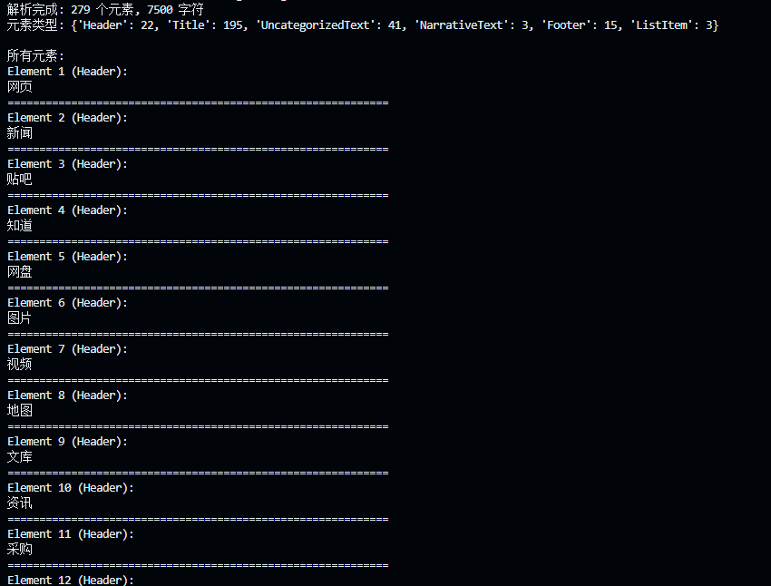

# 前言：

虽然本节内容在实际应用中非常重要，但是由于各种文档加载器的迭代更新，以及各类 AI 应用的不同需求，具体选择需要根据实际情况。本节仅作简单引入，但请务必**重视数据加载**环节，**“垃圾进，垃圾出 (Garbage In, Garbage Out)”** ——高质量输入是高质量输出的前提。


# 文档加载器

## 主要功能

RAG 系统中，**数据加载**是整个流水线的第一步，也是不可或缺的一步。文档加载器负责将各种格式的非结构化文档（如PDF、Word、Markdown、HTML等）转换为程序可以处理的结构化数据。数据加载的质量会直接影响后续的索引构建、检索效果和最终的生成质量。


文档加载器在 RAG 的数据管道中一般需要完成三个核心任务，一是**解析不同格式的原始文档**，将 PDF、Word、Markdown 等内容提取为可处理的纯文本，二是在**解析过程中同时抽取文档来源、页码、作者等关键信息作为元数据**，三是**把文本和元数据整理成统一的数据结构**，方便后续进行切分、向量化和入库，其整体流程与传统数据工程中的抽取、转换、加载相似，目标都是把杂乱的原始文档清洗并对齐为适合检索和建模的标准化语料。


## 当前主流RAG文档加载器

| 工具名称                | 特点                      | 适用场景           | 性能表现                     |
| ------------------- | ----------------------- | -------------- | ------------------------ |
| **PyMuPDF4LLM**     | PDF→Markdown转换，OCR+表格识别 | 科研文献、技术手册      | 开源免费，GPU加速               |
| **TextLoader**      | 基础文本文件加载                | 纯文本处理          | 轻量高效                     |
| **DirectoryLoader** | 批量目录文件处理                | 混合格式文档库        | 支持多格式扩展                  |
| **Unstructured**    | 多格式文档解析                 | PDF、Word、HTML等 | 统一接口，智能解析                |
| **FireCrawlLoader** | 网页内容抓取                  | 在线文档、新闻        | 实时内容获取                   |
| **LlamaParse**      | 深度PDF结构解析               | 法律合同、学术论文      | 解析精度高，商业API              |
| **Docling**         | 模块化企业级解析                | 企业合同、报告        | IBM生态兼容                  |
| **Marker**          | PDF→Markdown，GPU加速      | 科研文献、书籍        | 专注PDF转换                  |
| **MinerU**          | 多模态集成解析                 | 学术文献、财务报表      | 集成<br/>LayoutLMv3+YOLOv8 |

需要注意的只有两个：

### 本教程选：Unstructured

* **优点：** 真正的瑞士军刀。只要你学会了它的 API，无论是 PDF、Word、Excel 还是 HTML，统统可以用同一套代码加载。

* **缺点：** 安装很麻烦

### 企业级应用开发选：**LlamaParse**

当你在未来遇到了那种排版极其变态的 PDF（比如双栏排版、中间还插着极其复杂的财务报表图片），本地开源的 Loader 基本上都会把文字提取成一团乱码。

* **优点：** 它是专门为 RAG 时代打造的商业级解析器。解析极其精准，连复杂的图表都能看懂。

* **缺点：** 它是云端 API 接口，需要注册账号拿 Key，而且免费额度有限（每天免费 1000 页）。
  
  
  
  

## Unstructured支持的文档元素类型

Unstructured 能够识别和分类以下文档元素

| 元素类型                | 描述                              |
| ------------------- | ------------------------------- |
| `Title`             | 文档标题                            |
| `NarrativeText`     | 由多个完整句子组成的正文文本，不包括标题、页眉、页脚和说明文字 |
| `ListItem`          | 列表项，属于列表的正文文本元素                 |
| `Table`             | 表格                              |
| `Image`             | 图像元数据                           |
| `Formula`           | 公式                              |
| `Address`           | 物理地址                            |
| `EmailAddress`      | 邮箱地址                            |
| `FigureCaption`     | 图片标题/说明文字                       |
| `Header`            | 文档页眉                            |
| `Footer`            | 文档页脚                            |
| `CodeSnippet`       | 代码片段                            |
| `PageBreak`         | 页面分隔符                           |
| `PageNumber`        | 页码                              |
| `UncategorizedText` | 未分类的自由文本                        |
| `CompositeElement`  | 分块处理时产生的复合元素*                   |


## 从 LangChain 封装到原始 Unstructured

在第一章的示例中，我们使用了LangChain的`UnstructuredMarkdownLoader`，它是 LangChain 对 Unstructured 库的封装。接下来展示如何直接使用 Unstructured 库，这样可以获得更大的灵活性和控制力。


代码在仓库的C2文件夹下：


1. 先安装依赖：
   
   ```bash
   sudo apt-get install python3-opencv
   ```

2. 执行
   
   ```bash
   python3 01_unstructured_example.py
   ```
   
   

### 代码解析：

```py
# 1. 导入 Unstructured 的核心“智能分区”模块
from unstructured.partition.auto import partition
from collections import Counter

# 2. 设置目标 PDF 文件的路径 (请确保终端当前所在目录正确)
pdf_path = "../../data/C2/pdf/rag.pdf"

# 核心动作：解析文档
# partition 函数会像庖丁解牛一样，把 PDF 切解成一个个结构化的元素(Elements)
elements = partition(
    filename=pdf_path,
    content_type="application/pdf" # 显式告诉解析器这是 PDF 文件，加快处理速度
)

# 结果分析与展示
# 1. 打印宏观统计：一共切出了多少块？总字数是多少？
# len(elements) 表示解析出了几个结构块
# sum(...) 则是把每个块转成字符串后计算总长度
print(f"解析完成: {len(elements)} 个元素, {sum(len(str(e)) for e in elements)} 字符")

# 2. 统计元素类型 (看看这篇文档里到底有哪些“零部件”)
# e.category 是 Unstructured 赋予每个块的标签，比如 'Title'(标题), 'NarrativeText'(正文段落) 等
types = Counter(e.category for e in elements)
print(f"元素类型: {dict(types)}")

# 3. 逐个展示解析出来的元素
print("\n所有元素:")
# enumerate(elements, 1) 让序号从 1 开始计数
for i, element in enumerate(elements, 1):
    # 打印元素的序号和它的身份标签 (Category)
    print(f"Element {i} ({element.category}):")
    # 打印这个元素里具体的文本内容
    print(element)
    # 打印一条华丽的分割线，方便终端肉眼观察
    print("=" * 60)
```

其中最关键的就是**partition**

**partition 函数参数解析：**

* `filename`: 文档文件路径，支持本地文件路径；
* `content_type`: 可选参数，指定MIME类型（如"application/pdf"），可绕过自动文件类型检测；
* `file`: 可选参数，文件对象，与 filename 二选一使用；
* `url`: 可选参数，远程文档 URL，支持直接处理网络文档；
* `include_page_breaks`: 布尔值，是否在输出中包含页面分隔符；
* `strategy`: 处理策略，可选 "auto"、"fast"、"hi_res" 等；
* `encoding`: 文本编码格式，默认自动检测。

`partition`函数使用自动文件类型检测，内部会根据文件类型路由到对应的专用函数（如PDF文件会调用`partition_pdf`）。如果需要更专业的PDF处理，可以直接使用`from unstructured.partition.pdf import partition_pdf`，它提供更多PDF特有的参数选项，如OCR语言设置、图像提取、表格结构推理等高级功能，同时性能更优。


### 输出结果：




## 练习：

> 使用`partition_pdf`替换当前`partition`函数并分别尝试用`hi_res`和`ocr_only`进行解析，观察输出结果有何变化。


1. 写新的脚本到/code/C2/05_test01.py：
   
   ```py
   from unstructured.partition.pdf import partition_pdf
   from collections import Counter
   import time
   
   # 设置目标 PDF 文件的路径 (确保在 code/C2 目录下运行)
   pdf_path = "../../data/C2/pdf/rag.pdf"
   
   def analyze_pdf_strategy(strategy_name):
       print(f"\n{'='*15} 🚀 正在测试策略: 【{strategy_name}】 {'='*15}")
       start_time = time.time()
   
       # 构建参数字典
       kwargs = {
           "filename": pdf_path,
           "strategy": strategy_name
       }
       # ocr_only 和 hi_res 依赖 OCR，最好指定语言提高中文准确度
       if strategy_name in ["hi_res", "ocr_only"]:
           kwargs["languages"] = ["chi_sim", "eng"]
   
       try:
           # 核心：调用专业的 partition_pdf
           elements = partition_pdf(**kwargs)
           end_time = time.time()
   
           # 打印宏观统计
           print(f"⏱️ 耗时: {end_time - start_time:.2f} 秒")
           print(f"📦 成果: 解析出 {len(elements)} 个元素, 总字数 {sum(len(str(e)) for e in elements)}")
   
           # 打印元素分类（直观看出有没有识别出表格、标题等）
           types = Counter(e.category for e in elements)
           print(f"🗂️ 元素类别: {dict(types)}")
   
           # 打印前3个元素预览，观察切分精细度
           print("👀 前 3 个元素预览:")
           for i, element in enumerate(elements[:3], 1):
               # 只截取前 50 个字符展示，避免刷屏
               content_preview = str(element).replace('\n', ' ')[:50]
               print(f"  [{i}] <{element.category}>: {content_preview}...")
   
       except Exception as e:
           print(f"❌ 该策略运行失败，报错信息: {e}")
   
   print("开始进行 Unstructured PDF 解析策略大比武！\n")
   
   # 1. fast: 极速模式（仅提取纯文本，无视大部分复杂排版）
   analyze_pdf_strategy("fast")
   
   # 2. ocr_only: 纯扫描模式（把PDF当图片扫，容易破坏左右双栏等排版）
   analyze_pdf_strategy("ocr_only")
   
   # 3. hi_res: 高分辨率布局模式（调用视觉大模型认表格、看多栏，最慢但最准）
   analyze_pdf_strategy("hi_res")
   
   print("\n🎉 对比测试结束！")
   ```

2. 运行后**结果及分析**：
   
   ```ini
   🏎️ 1. fast 模式：快是真的快，瞎也是真的瞎
   ⏱️ 耗时：2.36 秒（一骑绝尘，绝对的秒杀）
   
   🗂️ 类别：认出了 195 个 Title(标题)，但完全没有看到表格和图片。
   
   字数总量：7500 字。
   
   点评：
   你发现总字数只有 7500，比后面的 8200 多字少了整整 700 个字！为什么？因为 fast 模式直接提取了 PDF 底层的纯文本层。那些被嵌在图片里的字、复杂表格里的字，它全部丢弃了。
   更搞笑的是，它把 195 句话都当成了 Title(标题)，这说明它完全不懂排版，把稍微大一点、或者换行的文本都当成了标题。这在 RAG 里是灾难，会导致后续切块逻辑大乱。
   
   🖨️ 2. ocr_only 模式：大力出悲剧，满屏火星文
   ⏱️ 耗时：28.62 秒（时间翻了 10 倍以上，因为它在逐页扫描图片）
   
   🗂️ 类别：只剩下了可怜的 Title、NarrativeText 等 4 种基础类别。依然没有表格！
   
   字数总量：8266 字（那些图片和表格里的字被抠出来了，所以字数涨了）。
   
   👀 预览灾难：你注意看它的第一个预览元素：Bh fe Se «8 Be BR 8H 4...
   
   点评：
   这就是典型的“纯 OCR 灾难”。它就像一个不懂中文的老外，拿着放大镜死磕页面上的像素。遇到网页的水印、Logo、或者复杂的双栏，它就强行识别出一堆毫无逻辑的火星文（乱码）。把这种垃圾数据喂给大模型，大模型会直接疯掉（这就是所谓的 Garbage In, Garbage Out）。
   
   💎 3. hi_res 模式：慢工出细活，真正的 RAG 杀手锏
   ⏱️ 耗时：37.82 秒（最慢，因为它动用了深度学习视觉大模型）
   
   🗂️ 类别核心亮点：识别出了 Image: 21，Table: 4，FigureCaption: 4 
   
   字数总量：8277 字。
   
   点评：
   这 37 秒花得太值了！在 RAG 领域，“解析 PDF 里的表格” 是公认的世界级难题。传统的解析会把表格拆成一行行的碎字，大模型根本看不懂行列对应关系。
   而 hi_res 模式不仅成功找出了文档里的 4 个表格（Table），连图片（Image）和图片下方的图注（FigureCaption）都精准扒出来了！有了这些带有身份标签的数据，你后续就可以写代码：“如果是表格，我就单独用特殊方式喂给大模型”。
   ```
   
   

# 总结：

以后做真实项目如果要**用unstructured来做数据加载**：

* **如果老板让你 10 分钟弄个纯文字文档的问答** 👉 选 `fast`（配合 **PyMuPDF** 更好）。

* **如果是财报、研报、学术论文，里面有一堆表格** 👉 毫不犹豫用 `hi_res`（宁可多等半分钟，也要保证数据质量）。
