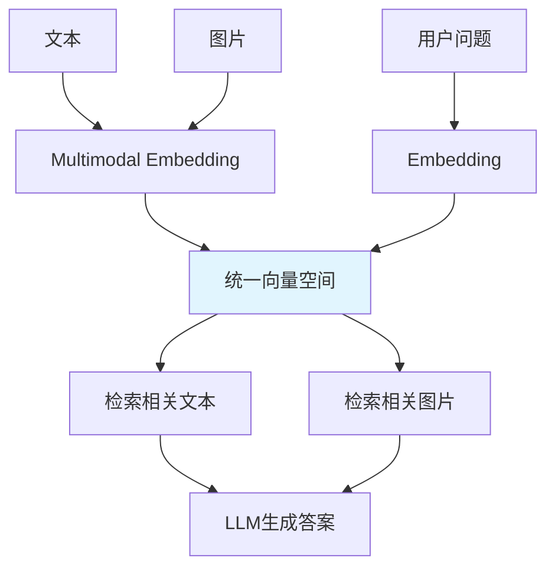

# 多模态嵌入（Multimodal Embedding）
> 多模态 RAG 的核心不是存储图片，而是让文本和图片进入同一个语义空间，实现跨模态检索。

---
## 本质  
  
多模态 RAG = 统一语义表示（Unified Representation）  
  
 ```
 文本 ──► Embedding ──┐  
                      ├── 统一向量空间  
 图片 ──► Embedding ──┘
 ```


目标：

- 文搜文（Text → Text）
- 文搜图（Text → Image）
- 图搜文（Image → Text）
- 图搜图（Image → Image）

---

## 为什么需要多模态嵌入

传统 RAG问题：

- 图表信息丢失
- 布局信息丢失
- 视觉特征丢失
- OCR错误影响检索效果

---

## 多模态 RAG
特点：
- 保留视觉特征
- 保留结构信息
- 支持跨模态检索
- 图表/表格理解能力更强

---

## 核心条件

文本向量和图片向量必须位于同一语义空间。

```
"苹果公司营收增长"        ≈苹果财报柱状图.png
```

只有在统一向量空间中：

- 相似内容距离近
- 不同模态可以直接比较

---

## 适用场景

收益最大的内容：

- 图表（Chart）
- 表格（Table）
- 流程图（Flowchart）
- 架构图（Architecture Diagram）
- 截图（Screenshot）
- PDF页面（Document Page）

---

## 做 RAG 时记住


---

## 最重要的一句话

> 多模态注入最关键的不是“把图片交给大模型”，而是在索引阶段将图文编码到同一个向量空间，从而实现跨模态检索。

