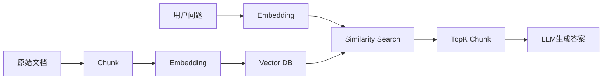
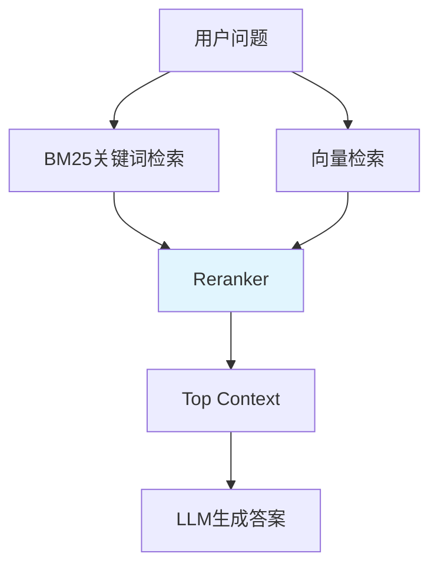
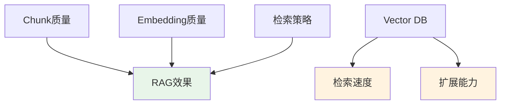

---

title: RAG底层原理8:向量数据库  
date: 2026-04-25 17:00:00  
tags:
- AI开发 
- RAG
- 向量数据库
- VectorDB  
categories:
- AI
- 开发
- RAG

---

# 向量数据库（Vector Database）

> 向量数据库的本质不是存储向量，而是在海量向量中快速找到最相似的向量。

---

## 本质

在 RAG 系统中，文档和用户问题都会经过 Embedding 模型转换成向量。此时，检索问题就从“查找关键词”变成了“寻找最相似的向量”。

Embedding 负责将文本映射到语义空间，而向量数据库负责在这个语义空间中快速完成相似度搜索。因此，向量数据库解决的核心问题并不是存储，而是高效检索。

```text
文档
 ↓
Embedding
 ↓
向量

用户问题
 ↓
Embedding
 ↓
向量

计算相似度
 ↓
返回最相关Chunk
```

---

## 在 RAG 中的位置

向量数据库位于索引和检索阶段之间，负责连接知识库与用户查询。



当用户提问时，系统首先将问题转换为向量，然后在向量数据库中寻找距离最近的若干个 Chunk，再将这些内容作为上下文提供给大模型生成答案。

---

## 为什么需要向量数据库

如果知识库中只有几十或几百个 Chunk，那么直接遍历所有向量并计算相似度即可完成检索。

但在真实场景中，一个企业知识库可能包含几十万甚至上百万个 Chunk。此时每次查询都遍历全部向量，计算成本会迅速增加，检索速度也会明显下降。

因此，向量数据库引入了专门的索引结构，通过近似搜索代替暴力搜索，在保证召回效果的同时大幅提升检索效率。

---

## 核心概念：ANN

ANN（Approximate Nearest Neighbor，近似最近邻搜索）是现代向量数据库的核心思想。

它追求的目标并不是找到绝对最相似的向量，而是在极短时间内找到足够接近的结果。

例如：

```text
暴力搜索 = 100%准确 + 极高计算成本
ANN = 99%准确 + 极快搜索速度
```

对于 RAG 而言，能够在毫秒级返回高质量结果，通常比追求理论上的绝对最优更有价值。

---

## 常见索引结构

### HNSW

HNSW（分层可导航小世界图）是目前最主流的向量索引结构之一。

可以把它理解为现实中的导航系统。当我们寻找某个地点时，不会从所有道路中逐条尝试，而是先走高速公路，再进入城市道路，最后抵达具体街道。

```text
高速路
 ↓
主干道
 ↓
支路
 ↓
目标节点
```

特点：

- 检索速度快
    
- 检索精度高
    
- 内存占用较大
    

目前大多数现代向量数据库都默认采用 HNSW 作为核心索引结构。

---

### IVF

IVF（Inverted File Index）采用的是“先分类，再搜索”的思路。

可以理解为查找一个人时，不会直接在全国范围内搜索，而是先确定所在省份，再缩小到城市和区域。

```text
全国
 ↓
山东
 ↓
济南
 ↓
历下区
```

特点：

- 内存占用较低
    
- 构建速度较快
    
- 检索精度略低于 HNSW
    

在超大规模向量场景中经常与其他索引技术组合使用。

---

## 常见向量数据库

目前主流向量数据库的区别主要体现在部署规模和工程能力上，而不是检索原理。

### FAISS

FAISS 是 Meta 开源的向量检索库，本质上不是数据库，而是一个高性能向量搜索引擎。

适合：

- 本地实验
    
- 课程项目
    
- 小型知识库
    
- RAG原型验证
    

---

### Chroma

Chroma 是目前 AI Agent 和 RAG 项目中最常见的轻量级向量数据库之一。

特点：

- 开箱即用
    
- Python友好
    
- 与 LangChain、LlamaIndex 集成方便
    

适合：

- 个人知识库
    
- AI Agent
    
- 中小型RAG系统
    

---

### Qdrant

Qdrant 采用 Rust 实现，在性能和易用性之间取得了较好的平衡。

特点：

- 性能优秀
    
- 支持元数据过滤
    
- 部署简单
    

适合：

- 中大型RAG项目
    
- 生产环境知识库
    

---

### Milvus

Milvus 是面向企业级场景设计的分布式向量数据库。

特点：

- 支持海量向量存储
    
- 支持分布式扩展
    
- 支持多节点部署
    

适合：

- 企业知识库
    
- 百万级以上文档检索
    
- 多用户系统
    

---

## 向量数据库不决定 RAG 效果

很多人在 RAG 项目中遇到检索效果不佳时，第一反应是更换向量数据库。

实际上，大多数情况下问题并不在数据库，而在数据本身。

真正影响 RAG 效果的因素通常是：

```text
Chunk质量
    ↓
Embedding质量
    ↓
检索策略
    ↓
向量数据库
```

向量数据库主要影响的是：

- 检索速度
    
- 存储规模
    
- 系统扩展能力
    

而不是答案本身的准确率。

---

## 现代 RAG 的发展趋势

早期 RAG 通常只依赖向量搜索完成召回，但现代系统越来越倾向于混合检索架构。

关键词搜索负责精确匹配，向量搜索负责语义匹配，而 Reranker 负责最终排序。



这种方式能够同时兼顾关键词匹配能力和语义理解能力，通常比单纯依赖向量搜索获得更好的效果。

---

## 做 RAG 时记住



---

## 最重要的一句话

> 向量数据库解决的是“如何快速找到相关内容”，而不是“如何让答案更准确”。在绝大多数 RAG 项目中，Chunk 与 Embedding 的重要性远高于 Vector Database。