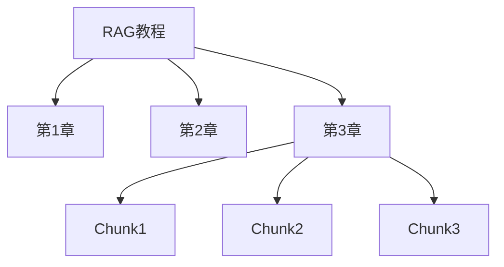
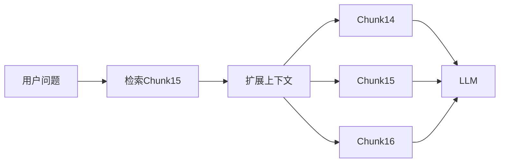
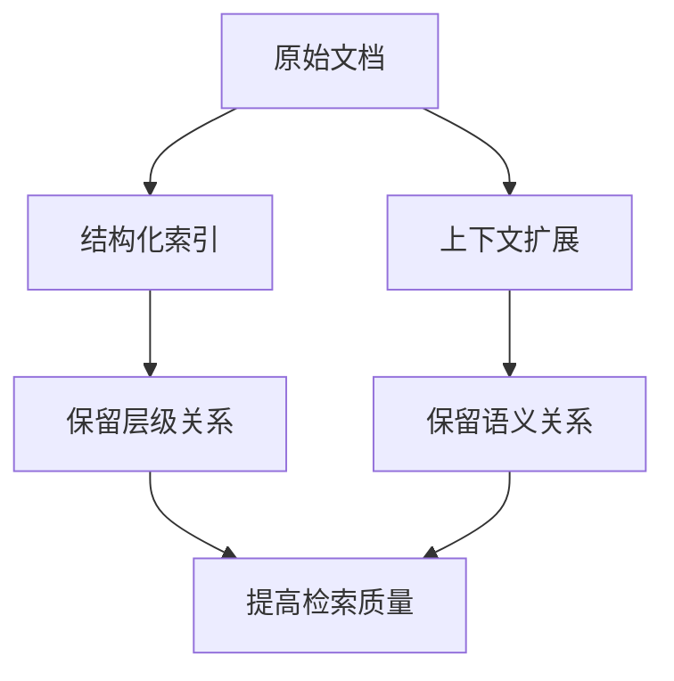

# 前言：

> 索引优化的核心目标不是让检索更快，而是让知识更容易被正确检索到。

---

## 本质

在传统 RAG 中，文档经过 Chunk 切分和 Embedding 编码后，会被存入向量数据库。虽然这种方式能够完成语义检索，但文档原有的结构信息和上下文关系往往会在索引过程中被削弱甚至丢失。

因此，索引优化关注的问题是：

```text
如何让知识在进入向量库后
仍然保留足够的结构和语义信息
```

从而提高后续检索和问答的效果。

---

## 为什么需要索引优化

普通向量索引存在一个天然问题：

```text
文档
 ↓
Chunk
 ↓
Embedding
 ↓
向量库
```

进入向量库之后，每个 Chunk 更像是一个独立的数据点。

例如：

```text
第一章
第二章
第三章
```

经过切分后可能变成：

```text
Chunk A
Chunk B
Chunk C
```

这些 Chunk 在向量库中彼此独立，原本的章节关系、上下文关系已经无法直接体现。

因此即使检索到了正确 Chunk，也可能缺少足够的上下文支撑。

---
# 索引优化的两种方式
## 结构化索引（Structured Index）

结构化索引的核心思想是：

> 不仅存储内容本身，还保留文档的结构信息。

---

例如一份技术文档：

```text
RAG教程
 ├─ 第1章 基础概念
 ├─ 第2章 Embedding
 ├─ 第3章 检索优化
```

普通向量索引中：

```text
Chunk1
Chunk2
Chunk3
```

只是独立向量。

---

而结构化索引会额外保存：

```text
Chunk3

属于：
RAG教程
 → 第3章
 → 检索优化
```

形成层级关系。

---

这样做的好处是，当系统检索到某个 Chunk 时，不仅知道内容本身，还能知道它所在的位置和上下文。



这种结构在长文档、法律法规、技术手册等场景中尤其重要。

---

## 上下文扩展（Context Enrichment）

除了结构关系之外，Chunk 之间还存在上下文关系。

例如检索结果：

```text
退款将在5个工作日内到账
```

虽然这句话本身是正确的，但缺少上下文：

- 什么情况下退款？
    
- 如何申请退款？
    
- 是否存在特殊情况？
    

单独返回这一段信息可能不足以支撑大模型生成完整答案。

---

因此可以采用上下文扩展策略。

当检索到目标 Chunk 时，同时获取其邻近内容。

例如：

```text
Chunk14
Chunk15 ← 命中
Chunk16
```

最终返回：

```text
Chunk14
+
Chunk15
+
Chunk16
```

而不是只返回：

```text
Chunk15
```

---

流程如下：



这样能够让模型获得更完整的语义信息。

---

## 两种优化方式的区别

结构化索引和上下文扩展经常一起出现，但解决的问题并不相同。

|方法|解决问题|
|---|---|
|结构化索引|保留文档层级关系|
|上下文扩展|保留邻近语义关系|

可以简单理解为：

```text
结构化索引
解决：
"它属于哪里"

上下文扩展
解决：
"它前后说了什么"
```

---
# 总结
## 工程实践中的价值

在小型知识库中，这些优化带来的收益可能并不明显。

但随着文档规模增加，尤其是：

- 技术文档
    
- 企业知识库
    
- 法律法规
    
- 学术论文
    

仅依赖单个 Chunk 往往难以获得理想效果。

此时：

```text
结构化索引
+
上下文扩展
```

通常能够显著提高检索质量。

很多现代 RAG 框架中的 Parent Document Retriever、GraphRAG、Hierarchical Retrieval 等方案，本质上都在尝试保留文档之间的关系，而不仅仅是存储孤立向量。

---

## 做 RAG 时记住



---

## 最重要的一句话

> 索引优化的核心不是改进搜索算法，而是在索引阶段尽可能保留文档的结构关系和上下文关系，让知识进入向量库后不再成为孤立的 Chunk。