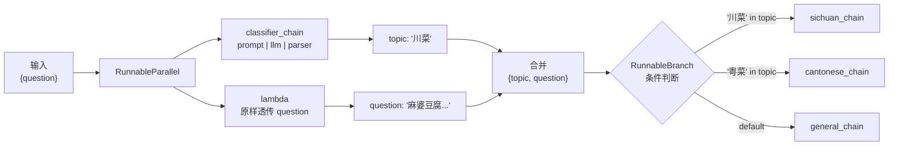
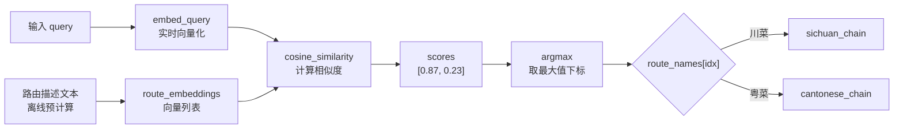

# 前言：

用户的原始问题往往不是最优的检索输入——可能太复杂、有歧义，或者和文档的实际措辞对不上。所以在检索前需要对 query 做预处理，也就是这一节的内容。

这一节分两块：

- **查询翻译（Query Translation）**：把原始问题变成更适合检索的形式
- **查询路由（Query Routing）**：根据问题性质，把它分发到最合适的数据源

---

# 查询翻译

目标就是弥合"用户怎么问"和"文档怎么写"之间的语义鸿沟。

## 提示工程

最直接的方式，用精心设计的 Prompt 让 LLM 把原始 query 改写得更清晰，或者转换成结构化指令。

在RAG底层原理12:查询构建中：`SelfQueryRetriever` 处理不了"时间最短的视频"这种需要排序的查询。解法是让 LLM 直接输出 JSON 格式的排序指令，然后代码拿到指令再执行排序：

```python
# 让 LLM 生成排序指令
prompt = f"""将用户问题转换为 JSON 排序指令。
- sort_by: 'view_count' 或 'length'
- order: 'asc' 或 'desc'

问题: "{query}"
JSON 指令:"""

response = client.chat.completions.create(
    model="deepseek-chat",
    messages=[{"role": "user", "content": prompt}],
    temperature=0,
    response_format={"type": "json_object"}  # 强制 JSON 输出
)

instruction = json.loads(response.choices[0].message.content)
# {"sort_by": "length", "order": "asc"}

# 拿到指令后自己做排序
sorted_docs = sorted(
    all_documents,
    key=lambda doc: doc.metadata.get(instruction['sort_by'], 0),
    reverse=(instruction['order'] == 'desc')
)
```

本质上是把 LLM 从"文本改写员"升级成了"能生成可执行计划的智能代理"。

---

## 多查询分解（Multi-query）

复杂问题直接检索效果不好，因为它可能包含多个子主题。做法是把一个大问题拆成多个小问题，分别检索，结果合并去重。

示例：

- 原始问题："《流浪地球》中刘慈欣对 AI 和未来社会有何看法？"
- 拆分后：
    - "《流浪地球》中的 AI 技术有哪些？"
    - "《流浪地球》描绘的未来社会是怎样的？"
    - "刘慈欣关于 AI 的观点是什么？"

LangChain 里直接用 `MultiQueryRetriever`，内部会自动做拆分+并行检索+去重合并。

---

## 退步提示（Step-Back Prompting）

Google DeepMind 提出的方法。面对细节繁多的具体问题，先让 LLM "退一步"，生成一个更高层次的抽象问题，先获取通用原理，再结合具体问题推理。

两步走：

1. **抽象化**：从具体问题提炼出背后的通用原理/核心概念（退步问题）
2. **推理**：用退步问题的答案作为上下文，再回答原始具体问题

示例：

- 原始问题："理想气体温度增加2倍、体积增加8倍，压力怎么变？"
- 退步问题："这个问题背后的物理原理是什么？"
- 先得到 `PV=nRT`，再代入具体数值 → 压力变为原来的 1/4

先建立通用知识基础，再具体推理，准确率比直接作答高不少。

---

## 假设性文档嵌入（HyDE）

Luyu Gao 等人提出的方法，解决 query 和文档之间的"语义鸿沟"：

- query 通常很短、关键词有限
- 文档内容详实、上下文丰富

两者的向量在语义空间里距离较远，直接用 query 向量检索效果不佳。

HyDE 的思路：**不直接用 query 向量检索，而是先让 LLM 生成一个"假设性答案文档"，再用这个文档的向量去检索**。

三步走：

1. **生成**：LLM 根据 query 生成一个详细的假设性答案文档（不需要完全准确，语义相关就行）
2. **编码**：把这个假设性文档用 embedding 模型向量化
3. **检索**：用这个向量去数据库里做相似性搜索

相当于把"query → 文档"的难题，转化成了"文档 → 文档"的匹配问题，后者容易得多。

---

# 查询路由

系统接入了多个数据源或有多种处理能力时，需要一个"智能调度中心"根据 query 的意图动态选择处理路径。本质是用语义理解替代硬编码规则。**根据输入的语义，决定调用哪个处理单元**。这一点和agent 的skills编写中的语义分发路由很像

## 应用场景

**数据源路由**（最常见）：

- "最新的 iPhone 有什么功能？" → 产品文档向量数据库
- "我上次订了什么？" → 用户历史 SQL 数据库（Text-to-SQL）
- "A 公司和 B 公司的投资关系？" → 企业知识图谱数据库

**组件路由**（按复杂度分流）：

- 简单 FAQ → 直接向量检索（速度快、成本低）
- 复杂任务/需要外部 API → 调用 Agent

**提示模板路由**：

- 数学问题 → 分步思考（Step-by-Step）模板
- 代码生成 → 代码优化模板

---

## 实现方法

### 基于 LLM 的意图识别

让 LLM 对 query 分类，输出路由标签，再根据标签分发。

数据流：


LangChain 实现（以菜系问答为例）：
**第一步：定义分类器**

```python
from langchain_core.prompts import ChatPromptTemplate
from langchain_core.output_parsers import StrOutputParser

classifier_prompt = ChatPromptTemplate.from_template(
    """将用户问题分类为：['川菜', '粤菜', 或 '其他']。
    只返回一个词，不要解释。
    问题: {question}"""
)
# ChatPromptTemplate.from_template() 把字符串变成模板对象
# {question} 是占位符，invoke 时会被替换成实际问题

classifier_chain = classifier_prompt | llm | StrOutputParser()
# LCEL 管道，等价于：
#   step1 = classifier_prompt.format_messages(question=q)  # 渲染模板
#   step2 = llm.invoke(step1)                              # 调 LLM，返回 AIMessage 对象
#   step3 = StrOutputParser().invoke(step2)                # 从 AIMessage 里取出纯文本
# StrOutputParser 就是取 .content，不做其他处理
```

**第二步：定义路由分支**

`RunnableBranch` 相当于 `if-elif-else`：

```python
from langchain_core.runnables import RunnableBranch

# sichuan_chain / cantonese_chain / general_chain 是三个已定义好的 chain
# 每个 chain 内部是 prompt | llm | parser，只是 prompt 不同

router_branch = RunnableBranch(
    # 每个元组是 (条件函数, 对应 chain)，条件返回 True 就走这个分支
    (lambda x: "川菜" in x["topic"], sichuan_chain),
    (lambda x: "粤菜" in x["topic"], cantonese_chain),
    general_chain   # 没有条件的最后一个是 default，相当于 else
)
# RunnableBranch.invoke(x) 内部逻辑：
#   for (condition, chain) in branches:
#       if condition(x): return chain.invoke(x)
#   return default_chain.invoke(x)
#
# 注意：x 是整个 dict，不只是 topic
# 所以子 chain 的 prompt 里可以同时用 {question} 和 {topic}
```

**第三步：组合**

```python
full_router_chain = (
    {
        "topic": classifier_chain,          # question 送进分类器，得到 "川菜"/"粤菜"/"其他"
        "question": lambda x: x["question"] # 原始问题原样透传，子 chain 的 prompt 要用
    }
    | router_branch
)
# 这个 dict 是 RunnableParallel 的语法糖
# 两路并行执行，合并成 {"topic": "川菜", "question": "麻婆豆腐怎么做？"}
# 再送进 RunnableBranch 做条件判断

result = full_router_chain.invoke({"question": "麻婆豆腐怎么做？"})
# 执行顺序：
#   1. 输入 {"question": "麻婆豆腐怎么做？"}
#   2. 并行：classifier_chain → "川菜"，lambda → 原题
#   3. 合并：{"topic": "川菜", "question": "麻婆豆腐怎么做？"}
#   4. RunnableBranch：命中第一个条件，走 sichuan_chain
```

---
### 嵌入相似性路由

不用 LLM 分类，延迟更低。直接算 query 向量和"路由描述文本"向量的余弦相似度，选最近的路由。

数据流：


**第一步：定义路由描述并向量化**

python

```python
# 路由描述文本——质量直接决定路由准确率
# 写法：用目标领域的典型词汇堆叠，让 embedding 空间里的语义尽量集中
sichuan_route  = "处理川菜问题：麻辣、辛香、水煮鱼、麻婆豆腐、花椒等"
cantonese_route = "处理粤菜问题：清淡、鲜美、白切鸡、老火靓汤、虾饺等"

route_prompts    = [sichuan_route, cantonese_route]
route_names      = ["川菜", "粤菜"]  # 和 route_prompts 一一对应，顺序不能乱

route_embeddings = embeddings.embed_documents(route_prompts)
# embed_documents 接受 List[str]，返回 List[List[float]]
# route_embeddings[0] = 川菜描述的向量
# route_embeddings[1] = 粤菜描述的向量
#
# 这步离线做一次就行，结果可以缓存，不用每次请求重新算
```

**第二步：路由函数**

python

```python
from sklearn.metrics.pairwise import cosine_similarity
import numpy as np
from langchain_core.runnables import RunnableLambda

def route(info):
    query_embedding = embeddings.embed_query(info["query"])
    # embed_query 接受单个字符串，返回 List[float]
    # 注意：bge 系列区分 embed_query 和 embed_documents
    # embed_query 会自动加 "query: " 前缀，两者不能混用

    scores = cosine_similarity(
        [query_embedding],   # shape: [1, dim]，外层要套 list
        route_embeddings     # shape: [2, dim]
    )[0]
    # cosine_similarity 返回 [1, 2] 矩阵，[0] 取第一行
    # scores = [与川菜描述的相似度, 与粤菜描述的相似度]，值域 [-1, 1]

    chosen = route_names[np.argmax(scores)]
    # argmax 取最大值下标，对应 route_names 里的路由名

    return route_map[chosen].invoke(info)
    # route_map 预先定义好：{"川菜": sichuan_chain, "粤菜": cantonese_chain}

full_chain = RunnableLambda(route)
# RunnableLambda 把普通函数包装成 Runnable
# 这样 route 函数就支持 .invoke() / .stream() / .batch() 接口
# 也可以接 | 操作符继续往后串
```

两种方法对比：

| |LLM 意图识别|嵌入相似性路由|
|---|---|---|
|灵活性|高，能处理复杂语义|低，依赖描述文本质量|
|延迟|高（需要 LLM 调用）|低（纯向量计算）|
|适用场景|路由逻辑复杂|路由类别清晰、延迟敏感|

核心差异就一句话：LLM 意图识别是**生成式决策**（让 LLM 理解语义后输出标签），嵌入相似性路由是**检索式决策**（算向量距离直接判断）。前者多一次 LLM 调用，贵但准；后者只有一次 embedding，快但依赖描述文本写得好不好。

---

## LlamaIndex 的实现

思路和 LangChain 类似，把不同数据源/策略包装成 `Tool`，再用 `RouterQueryEngine` 做调度。

- `LLMSingleSelector` / `PydanticSingleSelector`：让 LLM 根据 Tool 的描述文本选择
- 没有独立的"嵌入相似性路由"组件——它的语义路由是融合在 LLM 意图识别里的，让 LLM 理解每个 Tool 描述的语义再决策

---

# 总结：

这一节的两个技术点定位很清楚：

- **查询翻译**解决的是"用户说的话和文档里的话对不上"的问题，手段是改写/分解/抽象/生成假设文档
- **查询路由**解决的是"去哪里找"的问题，手段是意图分类+分发

四种查询翻译技术里，HyDE（假设性文档嵌入） 最有意思，本质上是用生成模型来"桥接"向量空间里的鸿沟；多查询分解和退步提示更偏提示工程范畴，适合复杂推理场景。