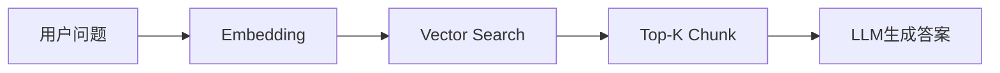
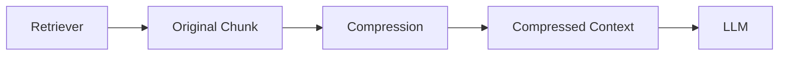
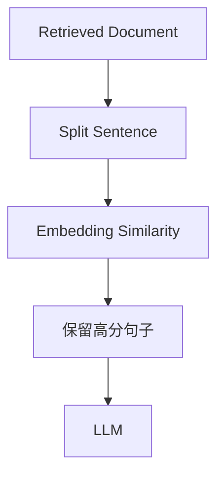
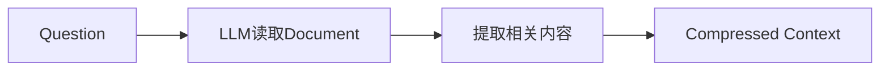

# 为什么需要检索优化

在前面的章节中，我们已经学习了最基本的 RAG 流程：用户问题首先经过 Embedding 编码，然后利用向量数据库检索与问题最相似的文档片段（Chunk），最后将检索结果作为上下文输入大模型生成最终回答。

整个流程如下：


这种方式实现简单，也是目前大多数 RAG 系统的基础架构。然而，在真实业务场景中，仅依赖向量相似度进行检索仍然存在许多不足。

首先，Embedding 模型只能计算语义相似度，并不能真正理解用户的问题意图。当多个文档都具有较高的语义相似性时，向量检索容易返回内容相关但答案错误的文档。

其次，对于需要多步推理（Multi-hop）的复杂问题，仅依赖一次向量检索往往无法获得完整信息。例如：

> CUDA 的开发公司现任 CEO 是谁？

系统需要先检索到 CUDA 属于 NVIDIA，再进一步结合 NVIDIA 的信息才能得到最终答案。

此外，大量业务文档通常包含较长的上下文，而真正能够回答问题的内容可能只占其中很小一部分。如果直接将整个 Chunk 输入大模型，不仅增加 Token 消耗，还可能引入大量无关信息，影响模型生成质量。

因此，在实际项目中，通常会在 Retriever 前后增加多个优化模块，以提升系统的召回率（Recall）和准确率（Precision）。


---

# Reranker（重排序）

## 为什么需要 Reranker

向量数据库的主要优势在于检索速度快，但其排序依据仅为向量之间的距离，因此返回的 Top-K 结果并不一定真正符合用户的问题。

例如，系统首先检索出 20 个候选文档，其中真正能够回答问题的文档可能只排在第 15 位。如果直接将前几个结果输入 LLM，模型就可能无法获得最佳上下文。

因此，工业界通常采用**两阶段检索（Two-stage Retrieval）**：

1. 第一阶段使用向量数据库快速召回大量候选文档；
2. 第二阶段使用更精确的排序模型重新计算相关性，仅保留最相关的少量文档。

整个流程如下：


第一阶段关注**召回率**，尽可能找到所有可能相关的文档；第二阶段关注**准确率**，进一步筛选真正有价值的内容。

## 工作原理

目前最常见的 Reranker 是 **Cross Encoder**。

它的工作原理是将查询（Query）和每个候选文档（Document）**拼接**成一个单一的输入（例如，`[CLS] query [SEP] document [SEP]`），然后将这个整体输入到一个预训练的 Transformer 模型（如 BERT）中，模型最终会输出一个单一的分数（通常在 0 到 1 之间），这个分数直接代表了文档与查询的**相关性**。


模型直接输出两者之间的相关性分数，再按照得分重新排序。

由于模型能够同时理解问题和文档之间的关系，因此排序效果通常优于仅依赖向量距离的方式，但计算成本也更高。

## 优缺点

**优点：**

- 提高检索准确率
- 有效过滤无关文档
- 提升最终回答质量

**缺点：**

- 推理速度较慢
- 无法直接对大规模数据排序
- 通常仅用于 Top-K 候选结果的重排序


---

# Contextual Compression（上下文压缩）

## 为什么需要上下文压缩

Retriever 返回的 Chunk 往往包含大量无关内容，而真正能够回答问题的信息可能只有几句话。

例如，一个 1000 Token 的文档中，真正有价值的内容可能只有几十个 Token。如果将完整文档全部输入大模型，不仅浪费上下文窗口，还可能降低回答质量。

因此，可以在 Retriever 与 LLM 之间增加**上下文压缩器（Contextual Compression）**。

流程如下：

压缩器的作用不是总结全文，而是**保留与当前问题最相关的内容**，删除无关信息。

## Compression 的实现方式

Compression 并不是一种固定算法，而是一类思想。目前工程中主要有三种实现方式。

### Embedding Filter

Embedding Filter 是最轻量级的实现方式。

Retriever 返回文档后，将文档再次划分为更细粒度的句子或段落，计算每个片段与 Query 的向量相似度，仅保留相似度较高的部分。

流程如下：


**优点：**

- 不需要再次调用 LLM；
- 计算速度快；
- 成本最低。

**缺点：**

- 只能依据向量相似度进行过滤；
- 对复杂语义理解能力有限。

**适用场景：**

- AI 客服；
- 企业 FAQ；
- 大规模知识库；
- 高并发在线服务。

如果每天需要处理数十万次检索请求，通常优先选择 Embedding Filter。

---

### LLM Extractor

另一种方式是利用 LLM 直接阅读 Retriever 返回的文档，并根据用户问题提取真正相关的信息。

例如：

用户问题：

> CUDA 的作者是谁？

原始文档：

```
CUDA 是 NVIDIA 于 2007 年推出的并行计算平台……

作者为 Mark Harris……

CUDA 支持 GPU 并行计算……
```

压缩后：

```
CUDA 作者：Mark Harris
```

整体流程如下：


由于 LLM 能够理解上下文，因此压缩效果通常优于 Embedding Filter。

**优点：**

- 理解能力最强；
- 能处理复杂语义；
- 压缩效果最好。

**缺点：**

- 需要额外调用一次 LLM；
- 推理成本较高；
- 响应速度较慢。

**适用场景：**

- 法律合同；
- 医疗知识库；
- 科研论文；
- 企业内部知识管理。

这些场景更加关注回答质量，而不是推理速度。

---

### Pipeline Compression

工业界通常不会只采用一种压缩方式，而是组合多种方法形成 Pipeline。

例如：

```
Retriever
      │
Embedding Filter
      │
LLM Extractor
      │
Compressed Context
```

先利用 Embedding Filter 删除明显无关的内容，再由 LLM 对剩余文本进行精细提取。

这样能够兼顾推理成本与压缩效果，也是目前较为常见的工程实践。

---

## 工程实践如何选择

Compression 没有统一的最佳方案，应根据业务特点进行选择。

|场景|推荐方案|原因|
|---|---|---|
|企业 AI 客服|Embedding Filter|请求量大，成本低|
|公司知识库|Embedding Filter + LLM Extractor|兼顾成本与准确率|
|法律合同分析|LLM Extractor|强调语义理解能力|
|医疗知识库|LLM Extractor|不能遗漏关键信息|
|技术文档|Pipeline|长文档较多，效果更稳定|

> **经验总结：**  
> **如果系统首先关注吞吐量，优先选择 Embedding Filter；如果首先关注回答质量，则优先选择 LLM Extractor。企业级 RAG 更多采用 Pipeline，将两者结合使用。**

---


# Retrieval Correction（检索校正）

## 为什么需要 Retrieval Correction

在传统 RAG 中，通常默认 Retriever 能够返回与用户问题高度相关的文档，因此系统会直接将检索结果作为上下文输入 LLM。

这种方式有一个隐含假设：**检索到的文档一定是正确且足够回答问题的。**

然而，在真实项目中，这个假设并不总是成立。Retriever 的能力受 Embedding 模型、Chunk 划分方式以及知识库质量等因素影响，即使返回了语义相似的文档，也可能出现以下情况：
- 检索结果与问题相关，但并未真正回答问题；
- 检索到的是过期或错误的信息；
- 多篇文档存在冲突，无法判断哪一篇更可信；
- 知识库中根本不存在对应内容。
如果直接将这些文档交给 LLM，模型通常不会意识到"知识有问题"，而是会基于已有上下文继续推理，从而产生**幻觉（Hallucination）**。

因此，Corrective RAG（C-RAG）的核心思想就是：

> **不要盲目信任 Retriever，而是在生成答案之前，先判断检索结果是否值得相信。**

---

## C-RAG 的核心思想

C-RAG 在传统 RAG 的基础上增加了一个**检索结果评估（Retrieval Evaluator）**模块。

整体流程如下：

整个流程可以概括为三个阶段：
### Retrieve（检索）

与普通 RAG 相同，根据用户问题从知识库中检索相关文档。

---

### Assess（评估）

这是 C-RAG 最核心的一步。
系统不会立即使用 Retriever 返回的文档，而是首先评估这些文档是否真正能够回答当前问题。
评估结果通常分为三类：

|评估结果|含义|
|---|---|
|Correct|检索结果足够回答问题|
|Incorrect|检索结果错误或完全无关|
|Ambiguous|部分相关，但信息不足或存在冲突|

相比于传统 RAG，C-RAG 增加了一层"事实核查"，避免模型建立在错误上下文之上进行推理。

---

### Act（行动）

根据评估结果，系统采取不同策略。

#### Correct

说明 Retriever 已经找到了正确知识。

此时无需重新检索，而是进一步对文档进行**Knowledge Refinement（知识精炼）**。

Knowledge Refinement 的目标是删除无关内容，仅保留真正能够回答问题的信息。

实际上，它与上一节介绍的 **Compression（检索压缩）** 思想非常接近。

流程如下：

```
Retriever
    │
Correct
    │
Knowledge Refinement
    │
LLM
```

因此，在很多工程实现中，Knowledge Refinement 往往直接采用 Compression 模块完成。

---

#### Incorrect

说明当前知识库无法回答问题。

此时继续使用已有文档只会增加幻觉风险，因此系统通常会放弃当前检索结果，转而获取新的知识来源。

最常见的方法包括：
- Web Search（搜索引擎）
- 企业内部搜索系统
- 外部 API
- Agent 工具调用
例如：

```
Question
    │
Retriever
    │
Incorrect
    │
Web Search
    │
LLM
```

Datawhale 原文中提到，在进行 Web Search 前，通常还会进行 **Query Rewriting**，将用户问题改写成更适合搜索引擎检索的形式，以提高搜索效果。

---

#### Ambiguous

如果评估器认为文档只有部分相关，或者不同文档之间存在冲突，则说明当前信息不足。
此时系统通常不会直接回答，而是继续补充外部知识，例如再次进行 Web Search，或者增加新的 Retriever。

这种策略能够有效减少由于信息缺失导致的错误回答。

---

## Retrieval Evaluator 如何实现

C-RAG 的关键在于 **Retriever Evaluator**。

工程上并没有固定实现方式，目前主要有以下几种方案。

### LLM Judge（推荐）

利用 LLM 判断文档是否能够回答问题。

输入：

```
Question

Document
```

输出：

```
Correct

Incorrect

Ambiguous
```

**优点：**

- 理解能力最强；
- 能处理复杂语义关系；
- 适用于开放领域知识库。

**缺点：**

- 需要额外调用一次 LLM；
- 推理成本较高。

---

### Cross Encoder

利用 Cross Encoder 对 Question 与 Document 进行相关性评分。
当评分低于阈值时，认为检索失败。
这种方法速度快、成本低，但无法像 LLM 一样理解复杂推理关系。

---

### 规则判断（Rule-based）

对于一些固定业务，例如企业 FAQ 或客服系统，也可以根据规则直接判断：
- 相似度低于阈值；
- Retriever Score 太低；
- Top-K 全部低于最低分。
直接认为：
> 检索失败。
这种方式实现简单，也是很多工业系统常见的第一层过滤。

---

## 工程实践如何选择

并不是所有 RAG 系统都需要引入 C-RAG。
是否增加检索校正，应根据业务对**准确率**和**成本**的要求进行权衡。

|场景|是否推荐|原因|
|---|---|---|
|企业 FAQ|⭐|问题固定，Retriever 通常足够稳定|
|AI 客服|⭐⭐⭐|用户表达多样，建议增加简单评估机制|
|企业知识库|⭐⭐⭐⭐|文档数量较大，容易出现误检索|
|法律知识库|⭐⭐⭐⭐⭐|错误回答风险高，建议增加 C-RAG|
|医疗问答|⭐⭐⭐⭐⭐|必须保证检索结果可靠|
|Agent 系统|⭐⭐⭐⭐⭐|通常需要结合 Web Search 与工具调用|

对于多数企业项目，可以采用**渐进式优化策略**：
1. **首先优化 Retriever 本身**（Embedding、Chunk、Reranker）。
2. **如果仍然经常检索失败**，再引入 Retrieval Evaluator。
3. **只有当知识库覆盖率不足时**，才进一步接入 Web Search 或 Agent，实现完整的 C-RAG 流程。
这种方式能够在准确率、响应速度和系统复杂度之间取得较好的平衡。

---

## 我的理解

我认为，**C-RAG 并不是一种新的检索算法，而是在传统 RAG 流程中增加了一个"决策层"。**

普通 RAG 的思想是：

> **检索到了，就相信它。**

而 C-RAG 的思想则是：

> **检索到了，不一定相信它；先评估，再决定下一步应该生成答案、精炼知识，还是继续搜索。**

因此，C-RAG 更像是一个**检索质量控制（Retrieval Quality Control）模块，而不是对 Retriever 本身的改进。

随着 Agent 技术的发展，这种"评估 → 决策 → 执行"的思想也越来越普遍。很多现代 Agent 在调用工具后都会先验证工具返回结果是否可信，再决定是否继续调用其他工具或生成最终回答。从这个角度来看，**C-RAG 可以看作是 Agent 决策思想在 RAG 检索阶段的一种具体应用。**