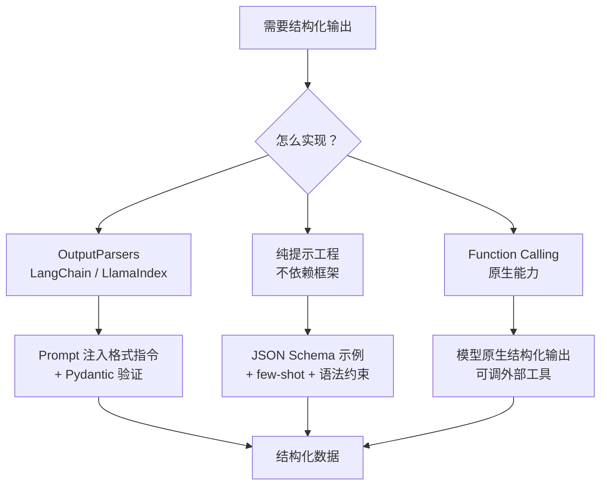
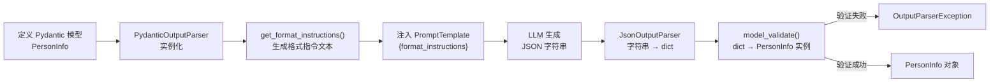
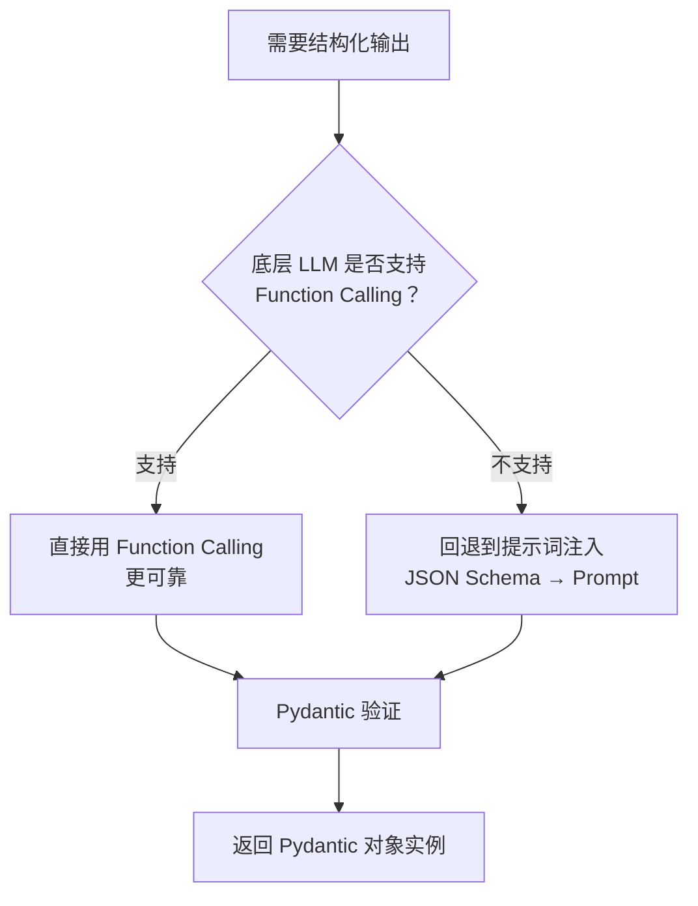
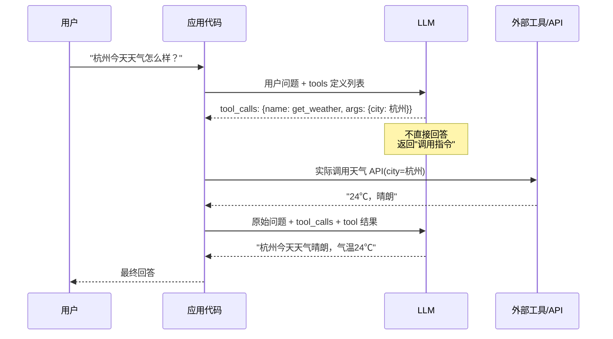

# 前言：

RAG 检索到了内容，LLM 也理解了，但最后生成一大段自然语言文字——很多场景下这不够用。电商客服要返回商品卡片、自动化流程要调 API、数据管道要入库，都需要结构化输出。这一节讲**怎么让 LLM 老老实实输出 JSON**。

# 为什么需要格式化生成？

三个典型场景：

- **电商客服**：用户问"推荐几款程序员键盘"，前端要的是商品卡片，不是一段描述文字 → 需要返回包含 `name/price/features/url` 的 JSON 列表
- **自然语言转 API**："帮我查明天上海到北京的航班" → 需要解析成 `{"departure": "上海", "destination": "北京", "date": "2025-07-18"}`
- **数据抽取**：从新闻里提取事件/时间/地点/人物，写入数据库

格式化生成就是 LLM 自然语言能力和下游程序化逻辑之间的桥。

---

# 格式化生成的三种实现方式



---

## Output Parsers（LangChain）

核心思路：**在 Prompt 里自动注入"怎么格式化"的指令，得到结果后再解析+验证成 Python 对象**

LangChain 内置了三种解析器：

- **StrOutputParser**：最基础的输出解析器，它简单地将 LLM 的输出作为字符串返回。
- **JsonOutputParser**：可以解析包含嵌套结构和列表的复杂 JSON 字符串。
- **PydanticOutputParser**：通过与 Pydantic 模型结合，可以实现对输出格式最严格的定义和验证。

### PydanticOutputParser 工作流：



代码：

```python
# 1. 定义期望的数据结构
class PersonInfo(BaseModel):
    """用于存储个人信息的数据结构。"""
    name: str = Field(description="人物姓名")    # description 直接变成给 LLM 的指令，写清楚
    age: int = Field(description="人物年龄")
    skills: List[str] = Field(description="技能列表")

# 2. 创建解析器
parser = PydanticOutputParser(pydantic_object=PersonInfo)
# 内部会调用 PersonInfo.model_json_schema() 提取 JSON Schema
# 再把 Schema 嵌入预设模板，生成格式指令文本

# 3. 创建提示模板，注入格式指令
prompt = PromptTemplate(
    template="请根据以下文本提取信息。\n{format_instructions}<br>{text}\n",
    input_variables=["text"],
    partial_variables={"format_instructions": parser.get_format_instructions()},
    # partial_variables 是固定变量，不用每次 invoke 传
)

# 4. 组建 LCEL 链
chain = prompt | llm | parser
# parser 先走 JsonOutputParser 把字符串 → dict
# 再走 model_validate() 把 dict → PersonInfo 实例
# 验证失败抛 OutputParserException

# 5. 执行
result = chain.invoke({"text": "张三今年30岁，他擅长Python和Go语言。"})
print(result)
# name='张三' age=30 skills=['Python', 'Go语言']
```

---

## LlamaIndex 的输出解析

LlamaIndex 的结构化输出主要靠 **Pydantic Programs**，思路和 LangChain 基本一致。

多了一个 RAG 特有的组件：**Response Synthesizer**（响应合成器）。

检索器召回一堆 Nodes 之后不是直接拼起来，而是先经过 Response Synthesizer 处理再送给 LLM：

- `refine` 模式：逐块处理，迭代优化答案
- `compact` 模式：尽量把更多文本块压进单次 LLM 调用

当需要结构化输出时，LlamaIndex 有一个优先级策略：



---

## 不依赖框架的简单实现

不想引入框架的话，纯提示工程也能做，但可靠性低于 Function Calling。几个实用技巧：

- **明确强硬要求**：`"必须返回一个 JSON 对象，不要包含任何解释性文字，只返回 JSON"`
- **提供 JSON Schema**：在 Prompt 里贴出期望的数据结构，描述每个键的含义和类型
- **few-shot 示例**：给 1-2 个 `用户输入 → 期望 JSON 输出` 的完整示例
- **语法约束（本地模型）**：`llama.cpp` 支持 GBNF (GGML BNF) 语法文件，在 token 级别强制约束输出格式，相当于硬编码 JSON 语法——最严格但只能本地用

---

# Function Calling

Function Calling（也叫 Tool Calling）是 LLM 原生支持的能力，比纯提示工程更可靠，也是构建 Agent 的核心基础。

## 工作流程



六步走：定义工具 → 用户提问 → 模型决策（返回 `tool_calls`）→ 代码执行工具 → 结果反馈给模型 → 模型生成最终回答。

注意：模型**不执行**工具，它只是输出"应该调用哪个工具、传什么参数"的指令，真正执行在应用代码里。

## 代码实现

```python
# 1. 定义工具（JSON Schema 格式）
tools = [
    {
        "type": "function",
        "function": {
            "name": "get_weather",
            "description": "获取指定城市的天气",  # 这段描述的质量决定模型能否正确选择工具
            "parameters": {
                "type": "object",
                "properties": {
                    "city": {"type": "string", "description": "城市名称"}
                },
                "required": ["city"]
            }
        }
    }
]

# 2. 第一次调用：用户问题 + tools 一起发给模型
messages = [{"role": "user", "content": "杭州今天天气怎么样？"}]
message = send_messages(messages, tools=tools)
# 模型不直接回答，返回 tool_calls

# 3. 代码层执行工具
if message.tool_calls:
    tool_call = message.tool_calls[0]
    messages.append(message)              # 把模型的 tool_calls 响应加入历史

    tool_output = "24℃，晴朗"             # 真实场景这里是真实 API 调用
    messages.append({
        "role": "tool",
        "tool_call_id": tool_call.id,     # 必须对应上，模型靠 id 关联结果
        "content": tool_output
    })

# 4. 第二次调用：把工具结果喂给模型，获取最终回答
final_message = send_messages(messages, tools=tools)
print(final_message.content)
# → "杭州今天天气晴朗，气温24℃，适合出行。"
```

## Function Calling vs 提示工程

| |提示工程（注入 JSON Schema）|Function Calling|
|---|---|---|
|可靠性|中，LLM 可能不遵守格式|高，原生支持|
|意图识别|无，只是格式化输出|有，模型主动选择工具|
|外部交互|不支持|核心能力，可调 API/数据库|
|适用场景|简单结构化抽取|Agent、工具调用|

---
# 总结：

这一节三个层次很清晰：
- **框架 OutputParsers**（LangChain `PydanticOutputParser` / LlamaIndex Pydantic Programs）：适合 RAG pipeline 里需要结构化输出的场景，Pydantic 验证保证了数据可靠
- **纯提示工程**：无依赖，灵活，但输出稳定性差，本地模型可以用 GBNF 打补丁
- **Function Calling**：可靠性最高，本质上不只是"格式化"，而是"意图→工具调用"，是 Agent 的基础能力

三者不是互斥的——LlamaIndex 的 Pydantic Programs 底层优先调 Function Calling 就是最好的例子。