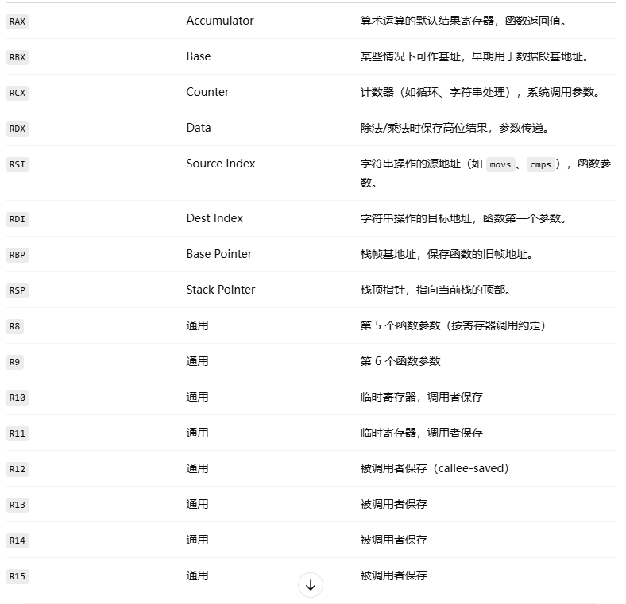
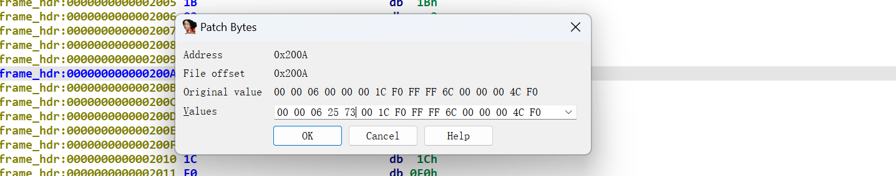
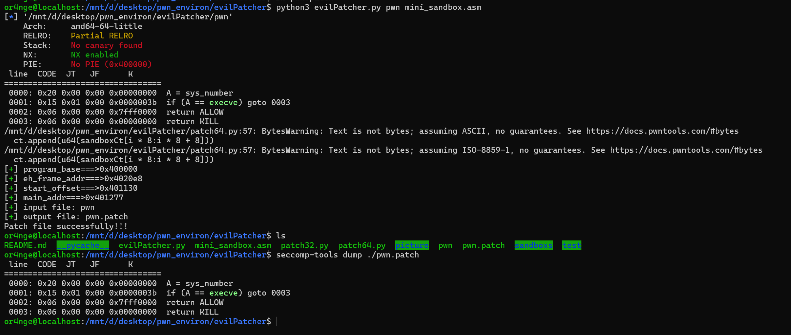

# 前言：

圈神的笔记，简单总结一下

https://github.com/Qanux

# 漏洞修复

## 修补基础知识

在 AWDP 或 B&F（Break & Fix）赛制中，防守的唯一方式就是将漏洞二进制文件（ELF）下载到本地，用 IDA 进行汇编级别的修改（Patch），然后再上传回比赛平台。

**防守最高铁律：** 官方的 Check 机器人会疯狂测试你的程序。你**绝对不能**破坏程序原有的正常功能，**绝对不能**改变输出的格式（哪怕多一个空格或换行），否则直接判定防守失败（DOWN）并扣分！

**必备工具：IDA Pro 9.1 (无需 Keypatch)**

得益于 IDA 9.x 极其强大的原生汇编器，我们不再需要安装繁琐的第三方插件。 **原生 Patch 核心三步曲：**

1. **修改指令**：选中要修改的汇编行 -> 菜单栏 `Edit` -> `Patch program` -> **`Assemble...`**（或者配置快捷键）。

2. **修改字节**（改字符串常用）：选中数据 -> 菜单栏 `Edit` -> `Patch program` -> **`Change bytes...`**。

3. **保存生效**：全部改完后 -> 菜单栏 `Edit` -> `Patch program` -> **`Apply patches to input file...`** -> 勾选 Create backup -> OK

## 打包基础知识：

awdp/awd是需要打包修好的可执行文件传回比赛平台的，这里需要两个常用的压缩解压缩命令

```bash
# 压缩（把东西打包成.tar.gz）
tar -czvf 名字.tar.gz 要打包的
# 压缩为.tar.xz
tar -Jcvf <文件名>.tar.xz <目标文件夹>


# 解压（万能解压方案）
7z x 文件名

```

**文件名乱码**：从 Windows 传来的 `.zip` 在 Linux 解压常出现中文乱码。 **规范命令**：`unzip -O CP936 <文件名>.zip`


## 寄存器基础知识

  


## 常见漏洞修复

### 整数溢出漏洞

在进行修复前要先了解一下各种跳转指令：  
无符号跳转： 

| 汇编指令 | 描述               |
| ---- | ---------------- |
| JA   | 无符号大于则跳转         |
| JNA  | 无符号不大于则跳转        |
| JAE  | 无符号大于等于则跳转（同JNB） |
| JNAE | 无符号不大于等于则跳转（同JB） |
| JB   | 无符号小于则跳转         |
| JNB  | 无符号不小于则跳转        |
| JBE  | 无符号小于等于则跳转（同JNA） |
| JBNE | 无符号不小于等于则跳转（同JA） |

有符号跳转： 

| 汇编指令 | 描述               |
| ---- | ---------------- |
| JG   | 有符号大于则跳转         |
| JNG  | 有符号不大于则跳转        |
| JGE  | 有符号大于等于则跳转（同JNL） |
| JNGE | 有符号不大于等于则跳转（同JL） |
| JL   | 有符号小于则跳转         |
| JNL  | 有符号不小于则跳转        |
| JLE  | 有符号小于等于则跳转（同JNG） |
| JNLE | 有符号不小于等于则跳转（同JG） |

首先看看这段有整数溢出的代码：  

```C
# include <stdio.h>

char buf[0x10];

void vuln(){
    unsigned int num;
    scanf("%u", &num);
    if((int)num < 0x10){
        read(0, buf, num);
    }
}

int main(){
    vuln();

    return 0;
}
```

其漏洞出的汇编如下：  

```
.text:00000000000011BF 8B 45 F4                      mov     eax, dword ptr [rbp+nbytes]
.text:00000000000011C2 83 F8 0F                      cmp     eax, 0Fh
.text:00000000000011C5 7F 1E                         jg      short loc_11E5
```

可以看到这里的比较用的是 ```jg```，即有符号大于则跳转，我们可以将其 ```patch``` 为 ```JA```（无符号大于则跳转） ，如下： 

```
.text:00000000000011BF 8B 45 F4                      mov     eax, dword ptr [rbp+nbytes]
.text:00000000000011C2 83 F8 0F                      cmp     eax, 0Fh
.text:00000000000011C5 77 1E                         ja      short loc_11E5                  ; Keypatch modified this from:
.text:00000000000011C5                                                                       ;   jg short loc_11E5
```

此时伪代码变成：  

```c
unsigned __int64 vuln()
{
  _DWORD nbytes[3]; // [rsp+4h] [rbp-Ch] BYREF

  *(_QWORD *)&nbytes[1] = __readfsqword(0x28u);
  __isoc99_scanf(&unk_2004, nbytes);
  if ( nbytes[0] <= 0xFu )
    read(0, &buf, nbytes[0]);
  return *(_QWORD *)&nbytes[1] - __readfsqword(0x28u);
}
```

可见漏洞已经成功修复  

### 栈溢出漏洞

栈溢出的修复相对来说比较简单，漏洞代码如下：  

```C
# include <stdio.h>

char buf[0x10];

void vuln(){
    read(0, buf, 0x100);
}

int main(){
    vuln();

    return 0;
}
```

查看 ```vuln``` 函数汇编代码：  

```
.text:0000000000001149                               ; ssize_t vuln()
.text:0000000000001149                               public vuln
.text:0000000000001149                               vuln proc near                          ; CODE XREF: main+D↓p
.text:0000000000001149                               ; __unwind {
.text:0000000000001149 F3 0F 1E FA                   endbr64
.text:000000000000114D 55                            push    rbp
.text:000000000000114E 48 89 E5                      mov     rbp, rsp
.text:0000000000001151 BA 00 01 00 00                mov     edx, 100h                       ; nbytes
.text:0000000000001156 48 8D 05 C3 2E 00 00          lea     rax, buf
.text:000000000000115D 48 89 C6                      mov     rsi, rax                        ; buf
.text:0000000000001160 BF 00 00 00 00                mov     edi, 0                          ; fd
.text:0000000000001165 B8 00 00 00 00                mov     eax, 0
.text:000000000000116A E8 E1 FE FF FF                call    _read
.text:000000000000116A
.text:000000000000116F 90                            nop
.text:0000000000001170 5D                            pop     rbp
.text:0000000000001171 C3                            retn
```

可见 ```read``` 函数的第三个参数是由 ```mov edx,100h```，这一句汇编决定的，我们可以将 ```100h``` 修改为 ```10h```，如下：  

```
.text:0000000000001149 F3 0F 1E FA                   endbr64
.text:000000000000114D 55                            push    rbp
.text:000000000000114E 48 89 E5                      mov     rbp, rsp
.text:0000000000001151 BA 10 00 00 00                mov     edx, 10h                        ; nbytes
.text:0000000000001151                                                                       ; Keypatch modified this from:
.text:0000000000001151                                                                       ;   mov edx, 100h
.text:0000000000001156 48 8D 05 C3 2E 00 00          lea     rax, buf
.text:000000000000115D 48 89 C6                      mov     rsi, rax                        ; buf
.text:0000000000001160 BF 00 00 00 00                mov     edi, 0                          ; fd
.text:0000000000001165 B8 00 00 00 00                mov     eax, 0
.text:000000000000116A E8 E1 FE FF FF                call    _read
.text:000000000000116A
.text:000000000000116F 90                            nop
.text:0000000000001170 5D                            pop     rbp
.text:0000000000001171 C3                            retn
```

此时的伪代码为：  

```c
ssize_t vuln()
{
  return read(0, &buf, 0x10uLL);
}
```

### 格式化字符串漏洞

相对来说格式化字符串漏洞比较难修，漏洞代码如下：  

```c
# include <stdio.h>

char buf[0x10];

void vuln(){
    read(0, buf, 0x10);
    printf(buf);
}

int main(){
    vuln();

    return 0;
}
```

查看漏洞出的汇编代码：  

```
.text:0000000000001169 F3 0F 1E FA                   endbr64
.text:000000000000116D 55                            push    rbp
.text:000000000000116E 48 89 E5                      mov     rbp, rsp
.text:0000000000001171 BA 10 00 00 00                mov     edx, 10h                        ; nbytes
.text:0000000000001176 48 8D 05 A3 2E 00 00          lea     rax, buf
.text:000000000000117D 48 89 C6                      mov     rsi, rax                        ; buf
.text:0000000000001180 BF 00 00 00 00                mov     edi, 0                          ; fd
.text:0000000000001185 B8 00 00 00 00                mov     eax, 0
.text:000000000000118A E8 E1 FE FF FF                call    _read
.text:000000000000118A
.text:000000000000118F 48 8D 05 8A 2E 00 00          lea     rax, buf
.text:0000000000001196 48 89 C7                      mov     rdi, rax                        ; format
.text:0000000000001199 B8 00 00 00 00                mov     eax, 0
.text:000000000000119E E8 BD FE FF FF                call    _printf
.text:000000000000119E
.text:00000000000011A3 90                            nop
.text:00000000000011A4 5D                            pop     rbp
.text:00000000000011A5 C3                            retn
```

我们要把 ```printf(fmt)``` 修改为 ```printf("%s", fmt)```。由于在这个 ```demo``` 中不存在 ```%s``` 这一个字符串，所以我直接在 ```.eh_frame``` 段上写入 ```%s```，效果如下：  

```
.eh_frame_hdr:000000000000200B 00                            db    0
.eh_frame_hdr:000000000000200C 06                            db    6
.eh_frame_hdr:000000000000200D 25                            db  25h ; %
.eh_frame_hdr:000000000000200E 73                            db  73h ; s
.eh_frame_hdr:000000000000200F 00                            db    0
```

选中 ```Edit->Patch program->Change bytes...```  

接下来就要修改 ```printf``` 前面的传参指令，效果如下：  

```
.text:0000000000001169 F3 0F 1E FA                   endbr64
.text:000000000000116D 55                            push    rbp
.text:000000000000116E 48 89 E5                      mov     rbp, rsp
.text:0000000000001171 BA 10 00 00 00                mov     edx, 10h                        ; nbytes
.text:0000000000001176 48 8D 05 A3 2E 00 00          lea     rax, buf
.text:000000000000117D 48 89 C6                      mov     rsi, rax                        ; buf
.text:0000000000001180 BF 00 00 00 00                mov     edi, 0                          ; format
.text:0000000000001185 B8 00 00 00 00                mov     eax, 0
.text:000000000000118A E8 E1 FE FF FF                call    _read
.text:000000000000118A
.text:000000000000118F 48 C7 C6 20 40 00 00          mov     rsi, offset buf                 ; Keypatch modified this from:
.text:000000000000118F                                                                       ;   lea rax, buf
.text:0000000000001196 48 C7 C7 0D 20 00 00          mov     rdi, offset format              ; format
.text:0000000000001196                                                                       ; Keypatch modified this from:
.text:0000000000001196                                                                       ;   mov rdi, rax
.text:0000000000001196                                                                       ; Keypatch modified this from:
.text:0000000000001196                                                                       ;   mov rsi, rax
.text:0000000000001196                                                                       ;   mov eax, 0
.text:0000000000001196                                                                       ; Keypatch padded NOP to next boundary: 1 bytes
.text:000000000000119D 90                            nop
.text:000000000000119E E8 BD FE FF FF                call    _printf
.text:000000000000119E
.text:00000000000011A3 90                            nop
.text:00000000000011A4 5D                            pop     rbp
.text:00000000000011A5 C3                            retn
```

此时伪代码为：  

```c
int vuln()
{
  read(0, buf, 0x10uLL);
  return printf("%s", buf);
}
```

### UAF漏洞

个人认为这种漏洞最难修，漏洞 ```demo``` 代码如下：  

```C
# include <stdio.h>

char *ptr;

void vuln(){
    free(ptr);
}

int main(){
    ptr = (char *)malloc(0x20);
    vuln();

    return 0;
}
```

漏洞汇编代码为：  

```
.text:0000000000001169 F3 0F 1E FA                   endbr64
.text:000000000000116D 55                            push    rbp
.text:000000000000116E 48 89 E5                      mov     rbp, rsp
.text:0000000000001171 48 8B 05 A0 2E 00 00          mov     rax, cs:ptr
.text:0000000000001178 48 89 C7                      mov     rdi, rax                        ; ptr
.text:000000000000117B E8 E0 FE FF FF                call    _free
.text:000000000000117B
.text:0000000000001180 90                            nop
.text:0000000000001181 5D                            pop     rbp
.text:0000000000001182 C3                            retn
```

我问过很多师傅，几乎所有人都和我说直接将 ```free``` 给 ```nop``` 就行了，因为这个不好检测，可是我总是感觉这样做不太好，因为在某种层面上来说这个操作已经损坏了程序原有的功能，而且对于一些比较大型的比赛这种做法可能会过不了 ```check```，所以我去学习了一下正常的做法。  
由于空间有限，直接在原有的汇编代码上通过加几句汇编来实现令 ```ptr``` 为零不太现实，所以这里我是在 ```.eh_frame``` 段上写上令 ```ptr``` 为零的汇编代码，然后在 ```0x117B``` 地址处用 ```jmp``` 指令将 ```rip``` 跳转至我写入的汇编代码然后执行，最后再次利用 ```jmp``` 指令将 ```rip``` 跳转至 ```0x1178``` 地址处继续执行从而实现漏洞的修复，其修复后的汇编代码如下：  

```
.text:0000000000001169 F3 0F 1E FA                   endbr64
.text:000000000000116D 55                            push    rbp
.text:000000000000116E 48 89 E5                      mov     rbp, rsp
.text:0000000000001171 48 8B 05 A0 2E 00 00          mov     rax, cs:ptr
.text:0000000000001178 E9 C3 0E 00 00                jmp     sub_2040
.text:0000000000001178
.text:0000000000001178                               vuln endp
.text:0000000000001178
.text:0000000000001178                               ; ---------------------------------------------------------------------------
.text:000000000000117D 90 90 90 90                   db 4 dup(90h)
.text:0000000000001181                               ; ---------------------------------------------------------------------------
.text:0000000000001181                               ; START OF FUNCTION CHUNK FOR sub_2040
.text:0000000000001181
.text:0000000000001181                               loc_1181:                               ; CODE XREF: sub_2040+13↓j
.text:0000000000001181 5D                            pop     rbp
.text:0000000000001182 C3                            retn

......

.eh_frame:0000000000002040                               sub_2040 proc near                      ; CODE XREF: vuln+F↑j
.eh_frame:0000000000002040
.eh_frame:0000000000002040                               ; FUNCTION CHUNK AT .text:0000000000001181 SIZE 00000002 BYTES
.eh_frame:0000000000002040
.eh_frame:0000000000002040 48 89 C7                      mov     rdi, rax                        ; ptr
.eh_frame:0000000000002043 E8 18 F0 FF FF                call    _free
.eh_frame:0000000000002043
.eh_frame:0000000000002048 48 C7 05 C5 1F 00 00 00 00 00+mov     cs:ptr, 0
.eh_frame:0000000000002048 00
.eh_frame:0000000000002053 E9 29 F1 FF FF                jmp     loc_1181
.eh_frame:0000000000002053
.eh_frame:0000000000002053                               sub_2040 endp ; sp-analysis failed
```

此时漏洞函数的伪代码为：  

```C
__int64 vuln()
{
  return sub_2040();
}

// positive sp value has been detected, the output may be wrong!
void __fastcall sub_2040()
{
  void *v0; // rax

  free(v0);
  ptr = 0LL;
}
```

在进行 ```patch``` 时有几个需要注意的点：  

- `call _free`这一句汇编无法被 `keypatch`识别，所以我们可以改成 `call 0x1060`，直接 call一个地址

- `mov cs:ptr, 0` 这句汇编如果直接在 `keypatch`中输入会给识别成别的指令，我这里输入的是 `mov qword ptr cs:0x4018,0`

接下来还有最后一个问题需要解决，那就是 ```.eh_frame``` 段并没有可执行权限，我们可以通过修改 ```elf``` 的头部来更改这里的权限，关键部分如下：  

```
LOAD:00000000000000B0 01 00 00 00                   dd 1                                    ; Type: LOAD
LOAD:00000000000000B4 04 00 00 00                   dd 4                                    ; Flags
LOAD:00000000000000B8 00 00 00 00 00 00 00 00       dq 0                                    ; File offset
LOAD:00000000000000C0 00 00 00 00 00 00 00 00       dq 0                                    ; Virtual address
LOAD:00000000000000C8 00 00 00 00 00 00 00 00       dq 0                                    ; Physical address
LOAD:00000000000000D0 60 06 00 00 00 00 00 00       dq 660h                                 ; Size in file image
LOAD:00000000000000D8 60 06 00 00 00 00 00 00       dq 660h                                 ; Size in memory image
LOAD:00000000000000E0 00 10 00 00 00 00 00 00       dq 1000h                                ; Alignment
LOAD:00000000000000E8                               ; PHT Entry 3
LOAD:00000000000000E8 01 00 00 00                   dd 1                                    ; Type: LOAD
LOAD:00000000000000EC 05 00 00 00                   dd 5                                    ; Flags
LOAD:00000000000000F0 00 10 00 00 00 00 00 00       dq 1000h                                ; File offset
LOAD:00000000000000F8 00 10 00 00 00 00 00 00       dq offset _init_proc                    ; Virtual address
LOAD:0000000000000100 00 10 00 00 00 00 00 00       dq 1000h                                ; Physical address
LOAD:0000000000000108 BD 01 00 00 00 00 00 00       dq 1BDh                                 ; Size in file image
LOAD:0000000000000110 BD 01 00 00 00 00 00 00       dq 1BDh                                 ; Size in memory image
LOAD:0000000000000118 00 10 00 00 00 00 00 00       dq 1000h                                ; Alignment
LOAD:0000000000000120                               ; PHT Entry 4
LOAD:0000000000000120 01 00 00 00                   dd 1                                    ; Type: LOAD
LOAD:0000000000000124 07 00 00 00                   dd 7                                    ; Flags
LOAD:0000000000000128 00 20 00 00 00 00 00 00       dq 2000h                                ; File offset
LOAD:0000000000000130 00 20 00 00 00 00 00 00       dq offset _IO_stdin_used                ; Virtual address
LOAD:0000000000000138 00 20 00 00 00 00 00 00       dq 2000h                                ; Physical address
LOAD:0000000000000140 0C 01 00 00 00 00 00 00       dq 10Ch                                 ; Size in file image
LOAD:0000000000000148 0C 01 00 00 00 00 00 00       dq 10Ch                                 ; Size in memory image
LOAD:0000000000000150 00 10 00 00 00 00 00 00       dq 1000h                                ; Alignment
LOAD:0000000000000158                               ; PHT Entry 5
LOAD:0000000000000158 01 00 00 00                   dd 1                                    ; Type: LOAD
LOAD:000000000000015C 06 00 00 00                   dd 6                                    ; Flags
LOAD:0000000000000160 B0 2D 00 00 00 00 00 00       dq 2DB0h                                ; File offset
LOAD:0000000000000168 B0 3D 00 00 00 00 00 00       dq offset __frame_dummy_init_array_entry ; Virtual address
LOAD:0000000000000170 B0 3D 00 00 00 00 00 00       dq 3DB0h                                ; Physical address
LOAD:0000000000000178 60 02 00 00 00 00 00 00       dq 260h                                 ; Size in file image
LOAD:0000000000000180 70 02 00 00 00 00 00 00       dq 270h                                 ; Size in memory image
LOAD:0000000000000188 00 10 00 00 00 00 00 00       dq 1000h                                ; Alignment
```

我们要修改的是 ```Type``` 为 ```LOAD``` 的部分，通过 ```ida``` 我们可以看到 ```.eh_frame``` 段的其实地址为 ```0x2040```，也就是第三个 ```LOAD``` 所管理的区域（我是看 ```File offset``` 的，不知道对不对）。其中 ```Flags``` 标志位代表的是权限，我们将其改为 ```7``` （可读、可写、可执行），这里我已经进行修改，修改后我们对这个 ```UAF``` 漏洞的修复就正式结束拉！

### 使用的危险函数

有时候漏洞是开发者使用了危险函数，类似于 ```gets``` 这种，而此时程序并没有其他可以用于替换的函数，这时我们的做法和上面的 ```UAF``` 漏洞修复差不多，也是修改 ```.eh_frame``` 段的权限，并在上面利用 ```syscall``` 来调用其他的安全函数来代替原来的危险函数，让 ```rip``` 跳转至 ```.eh_frame``` 再跳转回去实现漏洞的修复，这里就不给出 ```demo``` 了，读者可以去自行编写 ```demo``` 并进行尝试，同时也可以加深读者们对修复这一块知识的印象  

### awd小技巧

我们可能会想，如果给程序上了个沙箱，那就能大大降低我们被获取 ```flag``` 的概率，这里就有一个工具能够帮助我们快速上沙箱  
https://github.com/TTY-flag/evilPatcher  
用法已经在链接中给出，我觉得可以在比赛一开始时就上一个沙箱，然后漏洞后面慢慢修，毕竟沙箱还是有各种绕过方法的  

