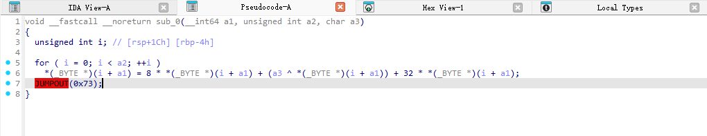

# 前言：

通过一道例题学习一下pyd逆向，pyd就是动态链接库，和dll一样，在linux平台以.so命名

# 做题流程：

## 获取方法：

先用die打开pyd看py编译版本，然后在命令行对应环境运行python交互环境

```bash
(py39) C:\Users\Lenovo\OneDrive\Desktop\chal>python
Python 3.9.23 | packaged by conda-forge | (main, Jun  4 2025, 17:49:16) [MSC v.1929 64 bit (AMD64)] on win32
Type "help", "copyright", "credits" or "license" for more information.
>>> import init
>>> x=dir(init)
>>> print(x)
['__builtins__', '__doc__', '__file__', '__loader__', '__name__', '__package__', '__spec__', '__test__', 'a2b_hex', 'b', 'c', 'e', 'exec', 'exit', 'i', 'int', 'm', 'p']
>>>
```

先用dir看一下导入的init.pyd都有什么方法，前面以"____"开头和结尾的是python环境内置方法，我们只需要关注a2b_hex，b，c，e，exec，exit，i，int，m，p就可以

## 获取pyd方法源码

我们可以用inspect这个模块来获取方法的源码和属性，但只有def 方式声明的函数可以出现源码，如果是cpython方式编译的源码就会报错，只能另做分析

```py
#!/usr/bin/env python3
# -*- coding: utf-8 -*-
"""
inspect_extract.py
自动提取模块中可读取的源码，正常显示换行，并为每个对象生成独立源码文件。
"""

import sys
import os
import inspect
import importlib
import traceback
import json
from textwrap import indent

def safe_get_source(obj):
    try:
        return True, inspect.getsource(obj)
    except Exception as e:
        return False, f"{e.__class__.__name__}: {e}"

def safe_getfile(obj):
    try:
        return inspect.getfile(obj)
    except Exception:
        return None

def safe_signature(obj):
    try:
        if callable(obj):
            return str(inspect.signature(obj))
        return None
    except Exception as e:
        return f"<签名不可用: {e}>"

def summarize_doc(doc, limit=200):
    if not doc:
        return None
    doc = doc.strip().replace("\r\n", "\n")
    if len(doc) > limit:
        return doc[:limit] + "...\n[文档省略]"
    return doc

def sanitize_filename(name):
    for ch in "\\/:*?\"<>|":
        name = name.replace(ch, "_")
    return name

def inspect_member(name, member, output_dir):
    info = {
        "name": name,
        "type": type(member).__name__,
        "signature": safe_signature(member),
        "file": safe_getfile(member),
        "doc": summarize_doc(inspect.getdoc(member)),
        "source_saved": False,
        "source_file": None,
        "note": None
    }

    ok, src = safe_get_source(member)
    if ok:
        filename = sanitize_filename(name) + ".py"
        filepath = os.path.join(output_dir, filename)
        with open(filepath, "w", encoding="utf-8") as f:
            f.write(f"# Source for {name}\n\n")
            f.write(src)
        info["source_saved"] = True
        info["source_file"] = filepath
        print(f"{name}: 源码已保存到 {filepath}")
    else:
        info["note"] = f"无法获取源码: {src}"
        print(f"{name}: {src}")

    return info

def inspect_module(mod_name):
    module = importlib.import_module(mod_name)
    members = inspect.getmembers(module)

    output_dir = f"{mod_name}_source"
    os.makedirs(output_dir, exist_ok=True)

    results = []
    for name, member in members:
        try:
            info = inspect_member(name, member, output_dir)
            results.append(info)
        except Exception as e:
            results.append({
                "name": name,
                "error": f"{e.__class__.__name__}: {e}",
                "traceback": traceback.format_exc()
            })

    json_path = f"{mod_name}_inspect.json"
    with open(json_path, "w", encoding="utf-8") as f:
        json.dump(results, f, ensure_ascii=False, indent=2)

    print(f"\n所有源码已保存到文件夹: {output_dir}")
    print(f"详细信息已写入: {json_path}")

if __name__ == "__main__":
    if len(sys.argv) < 2:
        print("用法: python inspect_extract.py <模块名>") 
        sys.exit(1)
    inspect_module(sys.argv[1])
```

然后发现只有三个方法可以看源码，

b方法：

```py
# Source for b

def b64encode(s, altchars=None):
    """Encode the bytes-like object s using Base64 and return a bytes object.

    Optional altchars should be a byte string of length 2 which specifies an
    alternative alphabet for the '+' and '/' characters.  This allows an
    application to e.g. generate url or filesystem safe Base64 strings.
    """
    encoded = binascii.b2a_base64(s, newline=False)
    if altchars is not None:
        assert len(altchars) == 2, repr(altchars)
        return encoded.translate(bytes.maketrans(b'+/', altchars))
    return encoded

```

c方法：

```py
# Source for c

class Uc(RegStateManager):
    """Unicorn Engine class.
    """

    @staticmethod
    def __is_compliant() -> bool:
        """Checks whether Unicorn binding version complies with Unicorn library.

        Returns: `True` if versions match, `False` otherwise
        """

        uc_maj, uc_min, _ = uc_version()
        bnd_maj, bnd_min, _ = version_bind()

        return (uc_maj, uc_min) == (bnd_maj, bnd_min)

    def __new__(cls, arch: int, mode: int, cpu: Optional[int] = None):
        # verify version compatibility with the core before doing anything
        if not Uc.__is_compliant():
            raise UcError(uc.UC_ERR_VERSION)

        import importlib

        def __uc_subclass(pkgname: str, clsname: str):
            """Use a lazy subclass instantiation to avoid importing unnecessary arch
            classes.
            """

            def __wrapped() -> Type[Uc]:
                archmod = importlib.import_module(f'.arch.{pkgname}', 'unicorn.unicorn_py3')

                return getattr(archmod, clsname)

            return __wrapped

        def __uc_generic():
            return Uc

        wrapped: Callable[[], Type[Uc]] = {
            uc.UC_ARCH_ARM     : __uc_subclass('arm', 'UcAArch32'),
            uc.UC_ARCH_ARM64   : __uc_subclass('arm64', 'UcAArch64'),
            uc.UC_ARCH_MIPS    : __uc_generic,
            uc.UC_ARCH_X86     : __uc_subclass('intel', 'UcIntel'),
            uc.UC_ARCH_PPC     : __uc_generic,
            uc.UC_ARCH_SPARC   : __uc_generic,
            uc.UC_ARCH_M68K    : __uc_generic,
            uc.UC_ARCH_RISCV   : __uc_generic,
            uc.UC_ARCH_S390X   : __uc_generic,
            uc.UC_ARCH_TRICORE : __uc_generic
        }[arch]

        subclass = wrapped()

        # return the appropriate unicorn subclass type
        return super(Uc, cls).__new__(subclass)

    def __init__(self, arch: int, mode: int, cpu: Optional[int] = None) -> None:
        """Initialize a Unicorn engine instance.

        Args:
            arch: emulated architecture identifier (see UC_ARCH_* constants)
            mode: emulated processor mode (see UC_MODE_* constants)
            cpu: emulated cpu model (see UC_CPU_* constants) [optional]
        """

        self._arch = arch
        self._mode = mode

        # initialize the unicorn instance
        self._uch = uc_engine()
        status = uclib.uc_open(arch, mode, ctypes.byref(self._uch))

        if status != uc.UC_ERR_OK:
            self._uch = None
            raise UcError(status)

        if cpu is not None:
            self.ctl_set_cpu_model(cpu)

        # we have to keep a reference to the callbacks so they do not get gc-ed
        # see: https://docs.python.org/3/library/ctypes.html#callback-functions
        self._callbacks: Dict[int, ctypes._FuncPointer] = {}
        self._mmio_callbacks: Dict[Tuple[int, int], Tuple[Optional[MMIO_READ_CFUNC], Optional[MMIO_WRITE_CFUNC]]] = {}

        self._hook_exception: Optional[Exception] = None

        # create a finalizer object that will appropriately free up resources when
        # this instance undergoes garbage collection.
        self.__finalizer = weakref.finalize(self, Uc.release_handle, self._uch)

    @staticmethod
    def release_handle(uch: uc_engine) -> None:
        # this method and its arguments must not have any reference to the Uc instance being
        # destroyed. namely, this method cannot be a bound method.

        if uch:
            try:
                status = uclib.uc_close(uch)

            # _uc might be pulled from under our feet
            except:
                pass

            else:
                if status != uc.UC_ERR_OK:
                    raise UcError(status)

    @property
    def errno(self) -> int:
        """Get last error number.

        Returns: error number (see: UC_ERR_*)
        """

        return uclib.uc_errno(self._uch)

    ###########################
    #  Emulation controllers  #
    ###########################

    def emu_start(self, begin: int, until: int, timeout: int = 0, count: int = 0) -> None:
        """Start emulation from a specified address to another.

        Args:
            begin   : emulation starting address
            until   : emulation ending address
            timeout : limit emulation to a certain amount of time (milliseconds)
            count   : limit emulation to a certain amount of instructions

        Raises:
            `UcError`   : in case emulation could not be started properly
            `Exception` : in case an error has been encountered during emulation
        """

        self._hook_exception = None
        status = uclib.uc_emu_start(self._uch, begin, until, timeout, count)

        if status != uc.UC_ERR_OK:
            raise UcError(status)

        if self._hook_exception is not None:
            raise self._hook_exception

    def emu_stop(self) -> None:
        """Stop emulation.

        Raises: `UcError` in case emulation could not be stopped properly
        """

        status = uclib.uc_emu_stop(self._uch)

        if status != uc.UC_ERR_OK:
            raise UcError(status)

    ###########################
    #  CPU state accessors    #
    ###########################

    def _do_reg_read(self, reg_id: int, reg_obj) -> int:
        """Private register read implementation.
        Do not call directly.
        """

        return uclib.uc_reg_read(self._uch, reg_id, reg_obj)

    def _do_reg_write(self, reg_id: int, reg_obj) -> int:
        """Private register write implementation.
        Do not call directly.
        """

        return uclib.uc_reg_write(self._uch, reg_id, reg_obj)

    def _do_reg_read_batch(self, reglist, vallist, count) -> int:
        """Private batch register read implementation.
        Do not call directly.
        """

        return uclib.uc_reg_read_batch(self._uch, reglist, vallist, count)

    def _do_reg_write_batch(self, reglist, vallist, count) -> int:
        """Private batch register write implementation.
        Do not call directly.
        """

        return uclib.uc_reg_write_batch(self._uch, reglist, vallist, count)

    ###########################
    #  Memory management      #
    ###########################

    def mem_map(self, address: int, size: int, perms: int = uc.UC_PROT_ALL) -> None:
        """Map a memory range.

        Args:
            address : range base address
            size    : range size (in bytes)
            perms   : access protection bitmask

        Raises: `UcError` in case memory could not be mapped
        """

        assert (perms & ~uc.UC_PROT_ALL) == 0, 'unexpected perms bitmask'

        status = uclib.uc_mem_map(self._uch, address, size, perms)

        if status != uc.UC_ERR_OK:
            raise UcError(status)

    def mem_map_ptr(self, address: int, size: int, perms: int, ptr: int) -> None:
        """Map a memory range and point to existing data on host memory.

        Args:
            address : range base address
            size    : range size (in bytes)
            perms   : access protection bitmask
            ptr     : address of data on host memory

        Raises: `UcError` in case memory could not be mapped
        """

        assert (perms & ~uc.UC_PROT_ALL) == 0, 'unexpected perms bitmask'

        status = uclib.uc_mem_map_ptr(self._uch, address, size, perms, ptr)

        if status != uc.UC_ERR_OK:
            raise UcError(status)

    def mem_unmap(self, address: int, size: int) -> None:
        """Reclaim a mapped memory range.

        Args:
            address : range base address
            size    : range size (in bytes)

        Raises: `UcError` in case memory could not be unmapped
        """

        status = uclib.uc_mem_unmap(self._uch, address, size)

        if status != uc.UC_ERR_OK:
            raise UcError(status)

        # TODO: this is where mmio callbacks need to be released from cache,
        # but we cannot tell whether this is an mmio range. also, memory ranges
        # might be split by 'map_protect' after they were mapped, so the
        # (start, end) tuple may not be suitable for retrieving the callbacks.
        #
        # here we try to do that on a best-effort basis:

        rng = (address, address + size)

        if rng in self._mmio_callbacks:
            del self._mmio_callbacks[rng]

    def mem_protect(self, address: int, size: int, perms: int = uc.UC_PROT_ALL) -> None:
        """Modify access protection bitmask of a mapped memory range.

        Args:
            address : range base address
            size    : range size (in bytes)
            perms   : new access protection bitmask

        Raises: `UcError` in case access protection bitmask could not be changed
        """

        assert (perms & ~uc.UC_PROT_ALL) == 0, 'unexpected perms bitmask'

        status = uclib.uc_mem_protect(self._uch, address, size, perms)

        if status != uc.UC_ERR_OK:
            raise UcError(status)

    def mmio_map(self, address: int, size: int,
            read_cb: Optional[UC_MMIO_READ_TYPE], read_ud: Any,
            write_cb: Optional[UC_MMIO_WRITE_TYPE], write_ud: Any) -> None:
        """Map an MMIO range. This method binds a memory range to read and write accessors
        to simulate a hardware device. Unicorn does not allocate memory to back this range.

        Args:
            address  : range base address
            size     : range size (in bytes)
            read_cb  : read callback to invoke upon read access. if not specified, reads \
                       from the mmio range will be silently dropped
            read_ud  : optional context object to pass on to the read callback
            write_cb : write callback to invoke upon a write access. if not specified, writes \
                       to the mmio range will be silently dropped
            write_ud : optional context object to pass on to the write callback
        """

        @uccallback(self, MMIO_READ_CFUNC)
        def __mmio_map_read_cb(uc: Uc, offset: int, size: int, key: int) -> int:
            assert read_cb is not None

            return read_cb(uc, offset, size, read_ud)

        @uccallback(self, MMIO_WRITE_CFUNC)
        def __mmio_map_write_cb(uc: Uc, offset: int, size: int, value: int, key: int) -> None:
            assert write_cb is not None

            write_cb(uc, offset, size, value, write_ud)

        read_cb_fptr = read_cb and __mmio_map_read_cb
        write_cb_fptr = write_cb and __mmio_map_write_cb

        status = uclib.uc_mmio_map(self._uch, address, size, read_cb_fptr, 0, write_cb_fptr, 0)

        if status != uc.UC_ERR_OK:
            raise UcError(status)

        # hold a reference to mmio callbacks
        rng = (address, address + size)

        self._mmio_callbacks[rng] = (read_cb_fptr, write_cb_fptr)

    def mem_regions(self) -> Iterator[Tuple[int, int, int]]:
        """Iterate through mapped memory regions.

        Returns: an iterator whose elements contain begin, end and perms  properties of each range

        Raises: `UcError` in case an internal error has been encountered
        """

        regions = ctypes.POINTER(uc_mem_region)()
        count = ctypes.c_uint32()
        status = uclib.uc_mem_regions(self._uch, ctypes.byref(regions), ctypes.byref(count))

        if status != uc.UC_ERR_OK:
            raise UcError(status)

        try:
            for i in range(count.value):
                yield regions[i].value

        finally:
            uclib.uc_free(regions)

    def mem_read(self, address: int, size: int) -> bytearray:
        """Read data from emulated memory subsystem.

        Args:
            address : source memory location
            size    : amount of bytes to read

        Returns: data bytes

        Raises: `UcError` in case of an invalid memory access
        """

        data = ctypes.create_string_buffer(size)
        status = uclib.uc_mem_read(self._uch, address, data, size)

        if status != uc.UC_ERR_OK:
            raise UcError(status, address, size)

        return bytearray(data)

    def mem_write(self, address: int, data: bytes) -> None:
        """Write data to emulated memory subsystem.

        Args:
            address : target memory location
            data    : data bytes to write

        Raises: `UcError` in case of an invalid memory access
        """

        size = len(data)
        status = uclib.uc_mem_write(self._uch, address, data, size)

        if status != uc.UC_ERR_OK:
            raise UcError(status, address, size)

    ###########################
    #  Event hooks management #
    ###########################

    def __do_hook_add(self, htype: int, fptr: ctypes._FuncPointer, begin: int, end: int, *args: ctypes.c_int) -> int:
        handle = uc_hook_h()

        # we do not need a callback counter to reference the callback and user data anymore,
        # so just pass a dummy value. that value will become the unused 'key' argument
        dummy = 0

        status = uclib.uc_hook_add(
            self._uch,
            ctypes.byref(handle),
            htype,
            fptr,
            ctypes.cast(dummy, ctypes.c_void_p),
            ctypes.c_uint64(begin),
            ctypes.c_uint64(end),
            *args
        )

        if status != uc.UC_ERR_OK:
            raise UcError(status)

        # hold a reference to the function pointer to prevent it from being gc-ed
        self._callbacks[handle.value] = fptr

        return handle.value

    def hook_add(self, htype: int, callback: Callable, user_data: Any = None, begin: int = 1, end: int = 0, aux1: int = 0, aux2: int = 0) -> int:
        """Hook emulated events of a certain type.

        Args:
            htype     : event type(s) to hook (see UC_HOOK_* constants)
            callback  : a method to call each time the hooked event occurs
            user_data : an additional context to pass to the callback when it is called
            begin     : address where hook scope starts
            end       : address where hook scope ends
            aux1      : auxiliary parameter; needed for some hook types
            aux2      : auxiliary parameter; needed for some hook types

        Returns: hook handle

        Raises: `UcError` in case of an invalid htype value
        """

        def __hook_intr():
            @uccallback(self, HOOK_INTR_CFUNC)
            def __hook_intr_cb(uc: Uc, intno: int, key: int) -> None:
                callback(uc, intno, user_data)

            return (__hook_intr_cb,)

        def __hook_insn():
            # each arch is expected to overload hook_add and implement this handler on their own.
            # if we got here, it means this particular architecture does not support hooking any
            # instruction, and so we fail
            raise UcError(uc.UC_ERR_ARG)

        def __hook_code():
            @uccallback(self, HOOK_CODE_CFUNC)
            def __hook_code_cb(uc: Uc, address: int, size: int, key: int) -> None:
                callback(uc, address, size, user_data)

            return (__hook_code_cb,)

        def __hook_invalid_mem():
            @uccallback(self, HOOK_MEM_INVALID_CFUNC)
            def __hook_mem_invalid_cb(uc: Uc, access: int, address: int, size: int, value: int, key: int) -> bool:
                return callback(uc, access, address, size, value, user_data)

            return (__hook_mem_invalid_cb,)

        def __hook_mem():
            @uccallback(self, HOOK_MEM_ACCESS_CFUNC)
            def __hook_mem_access_cb(uc: Uc, access: int, address: int, size: int, value: int, key: int) -> None:
                callback(uc, access, address, size, value, user_data)

            return (__hook_mem_access_cb,)

        def __hook_invalid_insn():
            @uccallback(self, HOOK_INSN_INVALID_CFUNC)
            def __hook_insn_invalid_cb(uc: Uc, key: int) -> bool:
                return callback(uc, user_data)

            return (__hook_insn_invalid_cb,)

        def __hook_edge_gen():
            @uccallback(self, HOOK_EDGE_GEN_CFUNC)
            def __hook_edge_gen_cb(uc: Uc, cur: ctypes._Pointer[uc_tb], prev: ctypes._Pointer[uc_tb], key: int) -> None:
                callback(uc, cur.contents, prev.contents, user_data)

            return (__hook_edge_gen_cb,)

        def __hook_tcg_opcode():
            @uccallback(self, HOOK_TCG_OPCODE_CFUNC)
            def __hook_tcg_op_cb(uc: Uc, address: int, arg1: int, arg2: int, size: int, key: int) -> None:
                callback(uc, address, arg1, arg2, size, user_data)

            opcode = ctypes.c_uint64(aux1)
            flags = ctypes.c_uint64(aux2)

            return (__hook_tcg_op_cb, opcode, flags)

        def __hook_tlb_fill():
            @uccallback(self, HOOK_TLB_FILL_CFUNC)
            def __hook_tlb_fill_cb(uc: Uc, vaddr: int, access: int, entry: ctypes._Pointer[uc_tlb_entry], key: int) -> bool:
                return callback(uc, vaddr, access, entry.contents, user_data)

            return (__hook_tlb_fill_cb,)

        handlers: Dict[int, Callable[[], Tuple]] = {
            uc.UC_HOOK_INTR               : __hook_intr,
            uc.UC_HOOK_INSN               : __hook_insn,
            uc.UC_HOOK_CODE               : __hook_code,
            uc.UC_HOOK_BLOCK              : __hook_code,
            uc.UC_HOOK_MEM_READ_UNMAPPED  : __hook_invalid_mem,
            uc.UC_HOOK_MEM_WRITE_UNMAPPED : __hook_invalid_mem,
            uc.UC_HOOK_MEM_FETCH_UNMAPPED : __hook_invalid_mem,
            uc.UC_HOOK_MEM_READ_PROT      : __hook_invalid_mem,
            uc.UC_HOOK_MEM_WRITE_PROT     : __hook_invalid_mem,
            uc.UC_HOOK_MEM_FETCH_PROT     : __hook_invalid_mem,
            uc.UC_HOOK_MEM_READ           : __hook_mem,
            uc.UC_HOOK_MEM_WRITE          : __hook_mem,
            uc.UC_HOOK_MEM_FETCH          : __hook_mem,
            # uc.UC_HOOK_MEM_READ_AFTER
            uc.UC_HOOK_INSN_INVALID       : __hook_invalid_insn,
            uc.UC_HOOK_EDGE_GENERATED     : __hook_edge_gen,
            uc.UC_HOOK_TCG_OPCODE         : __hook_tcg_opcode,
            uc.UC_HOOK_TLB_FILL           : __hook_tlb_fill
        }

        # the same callback may be registered for multiple hook types if they
        # share the same handling method. here we iterate through htype set bits
        # and collect all unique handlers it refers to (no duplicates)
        matched = set(handlers.get(1 << n) for n in range(32) if htype & (1 << n))

        # the set of matched handlers is expected to include exactly one element.
        # more than one member indicates that htype refers to more than one handler
        # at the same time, whereas callbacks cannot be assigned to different handlers.
        # an empty set indicates a matching handler was not found, probably due to
        # an invalid htype value
        if len(matched) != 1:
            raise UcError(uc.UC_ERR_ARG)

        handler = matched.pop()

        # a None element indicates that htype has an unrecognized bit set
        if handler is None:
            raise UcError(uc.UC_ERR_ARG)

        fptr, *aux = handler()

        return self.__do_hook_add(htype, fptr, begin, end, *aux)

    def hook_del(self, handle: int) -> None:
        """Remove an existing hook.

        Args:
            handle: hook handle
        """

        h = uc_hook_h(handle)
        status = uclib.uc_hook_del(self._uch, h)

        if status != uc.UC_ERR_OK:
            raise UcError(status)

        del self._callbacks[handle]

    def query(self, prop: int) -> int:
        """Query an internal Unicorn property.

        Args:
            prop: property identifier (see: UC_QUERY_* constants)

        Returns: property value
        """

        result = ctypes.c_size_t()
        status = uclib.uc_query(self._uch, prop, ctypes.byref(result))

        if status != uc.UC_ERR_OK:
            raise UcError(status, prop)

        return result.value

    def context_save(self) -> UcContext:
        """Save Unicorn instance internal context.

        Returns: unicorn context instance
        """

        context = UcContext(self._uch, self._arch, self._mode)
        status = uclib.uc_context_save(self._uch, context.context)

        if status != uc.UC_ERR_OK:
            raise UcError(status)

        return context

    def context_update(self, context: UcContext) -> None:
        """Update Unicorn instance internal context.

        Args:
            context : unicorn context instance to copy data from
        """

        status = uclib.uc_context_save(self._uch, context.context)

        if status != uc.UC_ERR_OK:
            raise UcError(status)

    def context_restore(self, context: UcContext) -> None:
        """Overwrite Unicorn instance internal context.

        Args:
            context : unicorn context instance to copy data from
        """

        status = uclib.uc_context_restore(self._uch, context.context)

        if status != uc.UC_ERR_OK:
            raise UcError(status)

    @staticmethod
    def __ctl_encode(ctl: int, op: int, nargs: int) -> int:
        assert check_maxbits(nargs, 4), f'nargs must not exceed value of 15 (got {nargs})'
        assert op and check_maxbits(op, 2), f'op must not exceed value of 3 (got {op})'

        return (op << 30) | (nargs << 26) | ctl

    def ctl(self, ctl: int, op: int, *args):
        code = Uc.__ctl_encode(ctl, op, len(args))

        status = uclib.uc_ctl(self._uch, code, *args)

        if status != uc.UC_ERR_OK:
            raise UcError(status)

    Arg = Tuple[Type, Optional[int]]

    def __ctl_r(self, ctl: int, arg0: Arg):
        atype, _ = arg0
        carg = atype()

        self.ctl(ctl, uc.UC_CTL_IO_READ, ctypes.byref(carg))

        return carg.value

    def __ctl_w(self, ctl: int, *args: Arg):
        cargs = (atype(avalue) for atype, avalue in args)

        self.ctl(ctl, uc.UC_CTL_IO_WRITE, *cargs)

    def __ctl_wr(self, ctl: int, arg0: Arg, arg1: Arg):
        atype, avalue = arg0
        carg0 = atype(avalue)

        atype, _ = arg1
        carg1 = atype()

        self.ctl(ctl, uc.UC_CTL_IO_READ_WRITE, carg0, ctypes.byref(carg1))

        return carg1.value

    def ctl_get_mode(self) -> int:
        """Retrieve current processor mode.

        Returns: current mode (see UC_MODE_* constants)
        """

        return self.__ctl_r(uc.UC_CTL_UC_MODE,
            (ctypes.c_int, None)
        )

    def ctl_get_page_size(self) -> int:
        """Retrieve target page size.

        Returns: page size in bytes
        """

        return self.__ctl_r(uc.UC_CTL_UC_PAGE_SIZE,
            (ctypes.c_uint32, None)
        )

    def ctl_set_page_size(self, val: int) -> None:
        """Set target page size.

        Args:
            val: page size to set (in bytes)

        Raises: `UcError` in any of the following cases:
          - Unicorn architecture is not ARM
          - Unicorn has already completed its initialization
          - Page size is not a power of 2
        """

        self.__ctl_w(uc.UC_CTL_UC_PAGE_SIZE,
            (ctypes.c_uint32, val)
        )

    def ctl_get_arch(self) -> int:
        """Retrieve target architecture.

        Returns: current architecture (see UC_ARCH_* constants)
        """

        return self.__ctl_r(uc.UC_CTL_UC_ARCH,
            (ctypes.c_int, None)
        )

    def ctl_get_timeout(self) -> int:
        """Retrieve emulation timeout.

        Returns: timeout value set on emulation start
        """

        return self.__ctl_r(uc.UC_CTL_UC_TIMEOUT,
            (ctypes.c_uint64, None)
        )

    def ctl_exits_enabled(self, enable: bool) -> None:
        """Instruct Unicorn whether to respect emulation exit points or ignore them.

        Args:
            enable: `True` to enable exit points, `False` to ignore them
        """

        self.__ctl_w(uc.UC_CTL_UC_USE_EXITS,
            (ctypes.c_int, enable)
        )

    def ctl_get_exits_cnt(self) -> int:
        """Retrieve emulation exit points count.

        Returns: number of emulation exit points

        Raises: `UcErro` if Unicorn is set to ignore exits
        """

        return self.__ctl_r(uc.UC_CTL_UC_EXITS_CNT,
            (ctypes.c_size_t, None)
        )

    def ctl_get_exits(self) -> Sequence[int]:
        """Retrieve emulation exit points.

        Returns: a tuple of all emulation exit points

        Raises: `UcErro` if Unicorn is set to ignore exits
        """

        count = self.ctl_get_exits_cnt()
        arr = (ctypes.c_uint64 * count)()

        self.ctl(uc.UC_CTL_UC_EXITS, uc.UC_CTL_IO_READ, ctypes.cast(arr, ctypes.c_void_p), ctypes.c_size_t(count))

        return tuple(arr)

    def ctl_set_exits(self, exits: Sequence[int]) -> None:
        """Set emulation exit points.

        Args:
            exits: a list of emulation exit points to set

        Raises: `UcErro` if Unicorn is set to ignore exits
        """

        arr = (ctypes.c_uint64 * len(exits))(*exits)

        self.ctl(uc.UC_CTL_UC_EXITS, uc.UC_CTL_IO_WRITE, ctypes.cast(arr, ctypes.c_void_p), ctypes.c_size_t(len(arr)))

    def ctl_get_cpu_model(self) -> int:
        """Retrieve target processor model.

        Returns: target cpu model (see UC_CPU_* constants)
        """

        return self.__ctl_r(uc.UC_CTL_CPU_MODEL,
            (ctypes.c_int, None)
        )

    def ctl_set_cpu_model(self, model: int) -> None:
        """Set target processor model.

        Args:
            model: cpu model to set (see UC_CPU_* constants)

        Raises: `UcError` in any of the following cases:
          - `model` is not a valid cpu model
          - Requested cpu model is incompatible with current mode
          - Unicorn has already completed its initialization
        """

        self.__ctl_w(uc.UC_CTL_CPU_MODEL,
            (ctypes.c_int, model)
        )

    def ctl_remove_cache(self, lbound: int, ubound: int) -> None:
        """Invalidate translation cache for a specified region.

        Args:
            lbound: region lower bound
            ubound: region upper bound

        Raises: `UcError` in case the provided range bounds are invalid
        """

        self.__ctl_w(uc.UC_CTL_TB_REMOVE_CACHE,
            (ctypes.c_uint64, lbound),
            (ctypes.c_uint64, ubound)
        )

    def ctl_request_cache(self, addr: int) -> TBStruct:
        """Get translation cache info for a specified address.

        Args:
            addr: address to get its translation cache info

        Returns: a 3-tuple containing the base address, instructions count and
                size of the translation block containing the specified address
        """

        return self.__ctl_wr(uc.UC_CTL_TB_REQUEST_CACHE,
            (ctypes.c_uint64, addr),
            (uc_tb, None)
        )

    def ctl_flush_tb(self) -> None:
        """Flush the entire translation cache.
        """

        self.__ctl_w(uc.UC_CTL_TB_FLUSH)

    def ctl_set_tlb_mode(self, mode: int) -> None:
        """Set TLB mode.

        Args:
            mode: tlb mode to use (see UC_TLB_* constants)
        """

        self.__ctl_w(uc.UC_CTL_TLB_TYPE,
            (ctypes.c_uint, mode)
        )

    # For backward compatibility...
    def ctl_tlb_mode(self, mode: int) -> None:
        """Deprecated, please use ctl_set_tlb_mode instead.

        Args:
            mode: tlb mode to use (see UC_TLB_* constants)
        """
        warnings.warn('Deprecated method, use ctl_set_tlb_mode', DeprecationWarning)
        self.ctl_set_tlb_mode(mode)

    def ctl_get_tcg_buffer_size(self) -> int:
        """Retrieve TCG buffer size.

        Returns: buffer size (in bytes)
        """

        return self.__ctl_r(uc.UC_CTL_TCG_BUFFER_SIZE,
            (ctypes.c_uint32, None)
        )

    def ctl_set_tcg_buffer_size(self, size: int) -> None:
        """Set TCG buffer size.

        Args:
            size: new size to set
        """

        self.__ctl_w(uc.UC_CTL_TCG_BUFFER_SIZE,
            (ctypes.c_uint32, size)
        )
```

m方法：

```py
# Source for m

class methodcaller:
    """
    Return a callable object that calls the given method on its operand.
    After f = methodcaller('name'), the call f(r) returns r.name().
    After g = methodcaller('name', 'date', foo=1), the call g(r) returns
    r.name('date', foo=1).
    """
    __slots__ = ('_name', '_args', '_kwargs')

    def __init__(self, name, /, *args, **kwargs):
        self._name = name
        if not isinstance(self._name, str):
            raise TypeError('method name must be a string')
        self._args = args
        self._kwargs = kwargs

    def __call__(self, obj):
        return getattr(obj, self._name)(*self._args, **self._kwargs)

    def __repr__(self):
        args = [repr(self._name)]
        args.extend(map(repr, self._args))
        args.extend('%s=%r' % (k, v) for k, v in self._kwargs.items())
        return '%s.%s(%s)' % (self.__class__.__module__,
                              self.__class__.__name__,
                              ', '.join(args))

    def __reduce__(self):
        if not self._kwargs:
            return self.__class__, (self._name,) + self._args
        else:
            from functools import partial
            return partial(self.__class__, self._name, **self._kwargs), self._args
```

其他的cpython编译的源码虽然看不到，但我们可以看它其他的信息

```json
[
  {
    "name": "__builtins__",
    "type": "module",
    "signature": null,
    "file": null,
    "doc": "Built-in functions, exceptions, and other objects.\n\nNoteworthy: None is the `nil' object; Ellipsis represents `...' in slices.",
    "source_saved": false,
    "source_file": null,
    "note": "无法获取源码: TypeError: <module 'builtins' (built-in)> is a built-in module"
  },
  {
    "name": "__doc__",
    "type": "NoneType",
    "signature": null,
    "file": null,
    "doc": null,
    "source_saved": false,
    "source_file": null,
    "note": "无法获取源码: TypeError: module, class, method, function, traceback, frame, or code object was expected, got NoneType"
  },
  {
    "name": "__file__",
    "type": "str",
    "signature": null,
    "file": null,
    "doc": "str(object='') -> str\nstr(bytes_or_buffer[, encoding[, errors]]) -> str\n\nCreate a new string object from the given object. If encoding or\nerrors is specified, then the object must expose a data buffer...\n[文档省略]",
    "source_saved": false,
    "source_file": null,
    "note": "无法获取源码: TypeError: module, class, method, function, traceback, frame, or code object was expected, got str"
  },
  {
    "name": "__loader__",
    "type": "ExtensionFileLoader",
    "signature": null,
    "file": null,
    "doc": "Loader for extension modules.\n\nThe constructor is designed to work with FileFinder.",
    "source_saved": false,
    "source_file": null,
    "note": "无法获取源码: TypeError: module, class, method, function, traceback, frame, or code object was expected, got ExtensionFileLoader"
  },
  {
    "name": "__name__",
    "type": "str",
    "signature": null,
    "file": null,
    "doc": "str(object='') -> str\nstr(bytes_or_buffer[, encoding[, errors]]) -> str\n\nCreate a new string object from the given object. If encoding or\nerrors is specified, then the object must expose a data buffer...\n[文档省略]",
    "source_saved": false,
    "source_file": null,
    "note": "无法获取源码: TypeError: module, class, method, function, traceback, frame, or code object was expected, got str"
  },
  {
    "name": "__package__",
    "type": "str",
    "signature": null,
    "file": null,
    "doc": "str(object='') -> str\nstr(bytes_or_buffer[, encoding[, errors]]) -> str\n\nCreate a new string object from the given object. If encoding or\nerrors is specified, then the object must expose a data buffer...\n[文档省略]",
    "source_saved": false,
    "source_file": null,
    "note": "无法获取源码: TypeError: module, class, method, function, traceback, frame, or code object was expected, got str"
  },
  {
    "name": "__spec__",
    "type": "ModuleSpec",
    "signature": null,
    "file": null,
    "doc": "The specification for a module, used for loading.\n\nA module's spec is the source for information about the module.  For\ndata associated with the module, including source, use the spec's\nloader.\n\n`name...\n[文档省略]",
    "source_saved": false,
    "source_file": null,
    "note": "无法获取源码: TypeError: module, class, method, function, traceback, frame, or code object was expected, got ModuleSpec"
  },
  {
    "name": "__test__",
    "type": "dict",
    "signature": null,
    "file": null,
    "doc": "dict() -> new empty dictionary\ndict(mapping) -> new dictionary initialized from a mapping object's\n    (key, value) pairs\ndict(iterable) -> new dictionary initialized as if via:\n    d = {}\n    for k, ...\n[文档省略]",
    "source_saved": false,
    "source_file": null,
    "note": "无法获取源码: TypeError: module, class, method, function, traceback, frame, or code object was expected, got dict"
  },
  {
    "name": "a2b_hex",
    "type": "builtin_function_or_method",
    "signature": "(hexstr, /)",
    "file": null,
    "doc": "Binary data of hexadecimal representation.\n\nhexstr must contain an even number of hex digits (upper or lower case).\nThis function is also available as \"unhexlify()\".",
    "source_saved": false,
    "source_file": null,
    "note": "无法获取源码: TypeError: module, class, method, function, traceback, frame, or code object was expected, got builtin_function_or_method"
  },
  {
    "name": "b",
    "type": "function",
    "signature": "(s, altchars=None)",
    "file": "D:\\anaconda\\envs\\py39\\lib\\base64.py",
    "doc": "Encode the bytes-like object s using Base64 and return a bytes object.\n\nOptional altchars should be a byte string of length 2 which specifies an\nalternative alphabet for the '+' and '/' characters.  T...\n[文档省略]",
    "source_saved": true,
    "source_file": "init_source\\b.py",
    "note": null
  },
  {
    "name": "c",
    "type": "type",
    "signature": "(arch: 'int', mode: 'int', cpu: 'Optional[int]' = None)",
    "file": "D:\\anaconda\\envs\\py39\\lib\\site-packages\\unicorn\\unicorn_py3\\unicorn.py",
    "doc": "Unicorn Engine class.",
    "source_saved": true,
    "source_file": "init_source\\c.py",
    "note": null
  },
  {
    "name": "e",
    "type": "UcIntel",
    "signature": null,
    "file": null,
    "doc": "Unicorn subclass for Intel architecture.",
    "source_saved": false,
    "source_file": null,
    "note": "无法获取源码: TypeError: module, class, method, function, traceback, frame, or code object was expected, got UcIntel"
  },
  {
    "name": "exec",
    "type": "cython_function_or_method",
    "signature": "(x)",
    "file": null,
    "doc": null,
    "source_saved": false,
    "source_file": null,
    "note": "无法获取源码: TypeError: module, class, method, function, traceback, frame, or code object was expected, got cython_function_or_method"
  },
  {
    "name": "exit",
    "type": "builtin_function_or_method",
    "signature": "(source, globals=None, locals=None, /)",
    "file": null,
    "doc": "Evaluate the given source in the context of globals and locals.\n\nThe source may be a string representing a Python expression\nor a code object as returned by compile().\nThe globals must be a dictionary...\n[文档省略]",
    "source_saved": false,
    "source_file": null,
    "note": "无法获取源码: TypeError: module, class, method, function, traceback, frame, or code object was expected, got builtin_function_or_method"
  },
  {
    "name": "i",
    "type": "builtin_function_or_method",
    "signature": "(prompt=None, /)",
    "file": null,
    "doc": "Read a string from standard input.  The trailing newline is stripped.\n\nThe prompt string, if given, is printed to standard output without a\ntrailing newline before reading input.\n\nIf the user hits EOF...\n[文档省略]",
    "source_saved": false,
    "source_file": null,
    "note": "无法获取源码: TypeError: module, class, method, function, traceback, frame, or code object was expected, got builtin_function_or_method"
  },
  {
    "name": "int",
    "type": "type",
    "signature": "<签名不可用: no signature found for builtin type <class 'str'>>",
    "file": null,
    "doc": "str(object='') -> str\nstr(bytes_or_buffer[, encoding[, errors]]) -> str\n\nCreate a new string object from the given object. If encoding or\nerrors is specified, then the object must expose a data buffer...\n[文档省略]",
    "source_saved": false,
    "source_file": null,
    "note": "无法获取源码: TypeError: <class 'str'> is a built-in class"
  },
  {
    "name": "m",
    "type": "type",
    "signature": "<签名不可用: no signature found for builtin type <class 'operator.methodcaller'>>",
    "file": "D:\\anaconda\\envs\\py39\\lib\\operator.py",
    "doc": "methodcaller(name, ...) --> methodcaller object\n\nReturn a callable object that calls the given method on its operand.\nAfter f = methodcaller('name'), the call f(r) returns r.name().\nAfter g = methodca...\n[文档省略]",
    "source_saved": true,
    "source_file": "init_source\\m.py",
    "note": null
  },
  {
    "name": "p",
    "type": "builtin_function_or_method",
    "signature": "<签名不可用: no signature found for builtin <built-in function print>>",
    "file": null,
    "doc": "print(value, ..., sep=' ', end='\\n', file=sys.stdout, flush=False)\n\nPrints the values to a stream, or to sys.stdout by default.\nOptional keyword arguments:\nfile:  a file-like object (stream); defaults...\n[文档省略]",
    "source_saved": false,
    "source_file": null,
    "note": "无法获取源码: TypeError: module, class, method, function, traceback, frame, or code object was expected, got builtin_function_or_method"
  }
]
```

比如说可以看到p是print()，i是input()等等

| 名称          | 实际对象                          | 含义                               |
| ----------- | ----------------------------- | -------------------------------- |
| **a2b_hex** | built-in                      | 用于十六进制转字节。无关。                    |
| **b**       | `base64.b64encode`            | Base64 编码函数。                     |
| **c**       | `unicorn.Uc`                  | 模拟器类。                            |
| **e**       | `UcIntel()`                   | 模拟器实例。                           |
| **exec**    | 自定义（Cython 实现）                | 类似 `exec()` 执行字符串代码。             |
| **exit**    | 其实是 Python 内置 `eval()`（看 doc） | 所以 `exit("1+2") == eval("1+2")`。 |
| **i**       | `input()`                     | 读取输入。                            |
| **int**     | 实际是 **`str()`**（伪装成 int）      | 所以 `int(30)` 返回 `'30'`！          |
| **m**       | `operator.methodcaller`       | 调用某个对象的方法的工厂函数。                  |
| **p**       | `print()`                     | 打印函数。                            |

## 简化：

现在把这些扔给ai用正则表达式对plus.py简化

```py
# Deobfuscated / formatted (text-only transform)
# Mappings:
# m -> operator.methodcaller
# b -> base64.b64encode (b)
# c -> unicorn.Uc
# e -> unicorn instance (uc)
# exec -> exec-like function (kept as exec placeholder)
# exit -> converted by concatenating int(...) digits into integer literal
# i -> input
# int -> behaves as str(...) in init, replaced accordingly
# p -> print
#
from init import *;m(exec(30792292888306032), 16777216, 2097152)(e);
m(exec(30792292888306032), 18874368, 65536)(e);
m(exec(2018003706771258569829),16777216,exec(2154308209104587365050518702243508477825638429417674506...60128987662749468317325542233718690074933730651941880380559453),)(e);
m(exec(2110235738289946063973), 44, 18939903)(e);
m(exec(2018003706771258569829), 18878464, i(exec(520485229507545392928716380743873332979750615584)).encode())(e);
m(exec(2110235738289946063973), 39, 18878464)(e);
m(exec(2110235738289946063973), 43, 44)(e);
m(exec(2110235738289946063973), 40, 7)(e);
m(exec(18710084667165524261000), 16777216, 16777332)(e);
p(exec(17353562600)) if (b(m(exec(7882826979490488676), 18878464, 44)(e))
.decode()== exec(63649679746492988981901858995847426189422638088...77866432975817021)) else p(exec(31084432670685473)) #type:ignore
```

由于`methodcaller()` 的第一个参数必须是字符串，说明 `exec()` 方法是一个把 "int" 转 "str" 的方法

```bash
(py39) C:\Users\Lenovo\OneDrive\Desktop\chal>python
Python 3.9.23 | packaged by conda-forge | (main, Jun  4 2025, 17:49:16) [MSC v.1929 64 bit (AMD64)] on win32
Type "help", "copyright", "credits" or "license" for more information.
>>> import init
>>> print(init.exec(7882826979490488676))
mem_read
>>>
```

继续替换：

```py
# plus.exec.py

import base64

from operator import methodcaller

from unicorn import Uc, UC_ARCH_X86, UC_MODE_64

e = Uc(UC_ARCH_X86, UC_MODE_64)

methodcaller("mem_map", 16777216, 2097152)(e)

methodcaller("mem_map", 18874368, 65536)(e)

methodcaller("mem_write", 16777216, 
b"\xf3\x0f\x1e\xfaUH\x89\xe5H\x89}\xe8\x89u\xe4\x89\xd0\x88E\xe0\xc7E\xfc\x00\x00\x00\x00\xebL\x8bU\xfcH\x8bE\xe8H\x01\xd0\x0f\xb6\x00\x8d\x0c\xc5\x00\x00\x00\x00\x8bU\xfcH\x8bE\xe8H\x01\xd0\x0f\xb6\x002E\xe0\x8d4\x01\x8bU\xfcH\x8bE\xe8H\x01\xd0\x0f\xb6\x00\xc1\xe0\x05\x89\xc1\x8bU\xfcH\x8bE\xe8H\x01\xd0\x8d\x14\x0e\x88\x10\x83E\xfc\x01\x8bE\xfc;E\xe4r\xac\x90\x90]",
)(e)

methodcaller("reg_write", 44, 18939903)(e)

methodcaller("mem_write", 18878464, input("[+]input your flag: ").encode())(e)

methodcaller("reg_write", 39, 18878464)(e)

methodcaller("reg_write", 43, 44)(e)

methodcaller("reg_write", 40, 7)(e)

methodcaller("emu_start", 16777216, 16777332)(e)

(
print("good")
if (
        base64.b64encode(e.mem_read(18878464, 44)).decode() == "425MvHMxtLqZ3ty3RZkw3mwwulNRjkswbpkDMK+3CDCOtbe6kzAqPyrcEAI="
    )
elseprint("no way!")
)
```

再把methodcaller去了

```py
# plus.exec.py

import base64

from unicorn import Uc, UC_ARCH_X86, UC_MODE_64

e = Uc(UC_ARCH_X86, UC_MODE_64) #说明：用 Unicorn 创建 x86_64 的仿真器实例 e。
e.mem_map(16777216, 2097152)
e.mem_map(18874368, 65536) #说明：在虚拟地址 0x1000000（16777216）和 0x1200000（18874368）分别映射一段内存，长度分别是 0x200000（2097152）和 0x10000（65536）。这些是写入 shellcode/数据和 flag 的内存区域。
e.mem_write(16777216, b"\xf3\x0f\x1e\xfaUH\x89\xe5H\x89}\xe8\x89u\xe4\x89\xd0\x88E\xe0\xc7E\xfc\x00\x00\x00\x00\xebL\x8bU\xfcH\x8bE\xe8H\x01\xd0\x0f\xb6\x00\x8d\x0c\xc5\x00\x00\x00\x00\x8bU\xfcH\x8bE\xe8H\x01\xd0\x0f\xb6\x002E\xe0\x8d4\x01\x8bU\xfcH\x8bE\xe8H\x01\xd0\x0f\xb6\x00\xc1\xe0\x05\x89\xc1\x8bU\xfcH\x8bE\xe8H\x01\xd0\x8d\x14\x0e\x88\x10\x83E\xfc\x01\x8bE\xfc;E\xe4r\xac\x90\x90]")
#把一段“字节串”写到 0x1000000
e.reg_write(44, 18939903) #把数值 18939903 写到寄存器编号 44
e.mem_write(18878464, input("[+]input your flag: ").encode())
e.reg_write(39, 18878464) # input
e.reg_write(43, 44) # length
e.reg_write(40, 7) # key  #把相关寄存器设置为相应地址/值（39、43、40 为寄存器 id）。
e.emu_start(16777216, 16777332) #从 0x1000000 执行到 0x1000000 + ?（结束地址 16777332），在这段内执行之前写入的 shellcode。
(
print("good")
if (
        base64.b64encode(e.mem_read(18878464, 44)).decode() == "425MvHMxtLqZ3ty3RZkw3mwwulNRjkswbpkDMK+3CDCOtbe6kzAqPyrcEAI="
    )
elseprint("no way!")
)
```

现在分析那段字节串代表的指令：

```py
data = b"\xf3\x0f\x1e\xfaUH\x89\xe5H\x89}\xe8\x89u\xe4\x89\xd0\x88E\xe0\xc7E\xfc\x00\x00\x00\x00\xebL\x8bU\xfcH\x8bE\xe8H\x01\xd0\x0f\xb6\x00\x8d\x0c\xc5\x00\x00\x00\x00\x8bU\xfcH\x8bE\xe8H\x01\xd0\x0f\xb6\x002E\xe0\x8d4\x01\x8bU\xfcH\x8bE\xe8H\x01\xd0\x0f\xb6\x00\xc1\xe0\x05\x89\xc1\x8bU\xfcH\x8bE\xe8H\x01\xd0\x8d\x14\x0e\x88\x10\x83E\xfc\x01\x8bE\xfc;E\xe4r\xac\x90\x90"

with open(r"C:\Users\Lenovo\OneDrive\Desktop\chal\code.bin", "wb") as f:
    f.write(data)
```

然后用ida打开这个code.bin就可以看到反汇编逻辑了




## 获取函数参数

那怎么看这个反汇编传的参数都是什么呢？

```py
e.reg_write(39, 18878464) # input
e.reg_write(43, 44) # length
e.reg_write(40, 7) # key  #把相关寄存器设置为相应地址/值（39、43、40 为寄存器 id）。
```

这里它把对应寄存器编号赋值，我们可以打印一下这些编号对应寄存器

Unicorn 使用 **统一的常量命名**，`UC_X86_REG_*` 代表 x86/x86-64 的寄存器。

```py
import unicorn.x86_const as xc
import unicorn
import json
from pprint import pprint

# unicorn 版本信息（可选）
try:
    ver = unicorn.__version__
except Exception:
    ver = "<unknown>"

# 收集 UC_X86_REG_* 常量
consts = {name: getattr(xc, name) for name in dir(xc) if name.startswith("UC_X86_REG_")}

# 反查表： value -> name (若有冲突，保留列表)
inv = {}
for name, val in consts.items():
    inv.setdefault(val, []).append(name)

# 输出信息
print("unicorn version:", ver)
print("Total UC_X86_REG_* constants:", len(consts))
print("\n-- 常量按数值排序（value -> name） --\n")
for val in sorted(inv):
    names = ", ".join(inv[val])
    print(f"{val:4d} -> {names}")(43))
```

```bash
(py39) C:\Users\Lenovo\OneDrive\Desktop\chal>python 2.py
unicorn version: 2.1.4
Total UC_X86_REG_* constants: 240

-- 常量按数值排序（value -> name） --

   0 -> UC_X86_REG_INVALID
   1 -> UC_X86_REG_AH
   2 -> UC_X86_REG_AL
   3 -> UC_X86_REG_AX
   4 -> UC_X86_REG_BH
   5 -> UC_X86_REG_BL
   6 -> UC_X86_REG_BP
   7 -> UC_X86_REG_BPL
   8 -> UC_X86_REG_BX
   9 -> UC_X86_REG_CH
  10 -> UC_X86_REG_CL
  11 -> UC_X86_REG_CS
  12 -> UC_X86_REG_CX
  13 -> UC_X86_REG_DH
  14 -> UC_X86_REG_DI
  15 -> UC_X86_REG_DIL
  16 -> UC_X86_REG_DL
  17 -> UC_X86_REG_DS
  18 -> UC_X86_REG_DX
  19 -> UC_X86_REG_EAX
  20 -> UC_X86_REG_EBP
  21 -> UC_X86_REG_EBX
  22 -> UC_X86_REG_ECX
  23 -> UC_X86_REG_EDI
  24 -> UC_X86_REG_EDX
  25 -> UC_X86_REG_EFLAGS
  26 -> UC_X86_REG_EIP
  28 -> UC_X86_REG_ES
  29 -> UC_X86_REG_ESI
  30 -> UC_X86_REG_ESP
  31 -> UC_X86_REG_FPSW
  32 -> UC_X86_REG_FS
  33 -> UC_X86_REG_GS
  34 -> UC_X86_REG_IP
  35 -> UC_X86_REG_RAX
  36 -> UC_X86_REG_RBP
  37 -> UC_X86_REG_RBX
  38 -> UC_X86_REG_RCX
  39 -> UC_X86_REG_RDI
  40 -> UC_X86_REG_RDX
  41 -> UC_X86_REG_RIP
  43 -> UC_X86_REG_RSI
  44 -> UC_X86_REG_RSP
  45 -> UC_X86_REG_SI
  46 -> UC_X86_REG_SIL
  47 -> UC_X86_REG_SP
  48 -> UC_X86_REG_SPL
  49 -> UC_X86_REG_SS
  50 -> UC_X86_REG_CR0
  51 -> UC_X86_REG_CR1
  52 -> UC_X86_REG_CR2
  53 -> UC_X86_REG_CR3
  54 -> UC_X86_REG_CR4
  58 -> UC_X86_REG_CR8
  66 -> UC_X86_REG_DR0
  67 -> UC_X86_REG_DR1
  68 -> UC_X86_REG_DR2
  69 -> UC_X86_REG_DR3
  70 -> UC_X86_REG_DR4
  71 -> UC_X86_REG_DR5
  72 -> UC_X86_REG_DR6
  73 -> UC_X86_REG_DR7
  82 -> UC_X86_REG_FP0
  83 -> UC_X86_REG_FP1
  84 -> UC_X86_REG_FP2
  85 -> UC_X86_REG_FP3
  86 -> UC_X86_REG_FP4
  87 -> UC_X86_REG_FP5
  88 -> UC_X86_REG_FP6
  89 -> UC_X86_REG_FP7
  90 -> UC_X86_REG_K0
  91 -> UC_X86_REG_K1
  92 -> UC_X86_REG_K2
  93 -> UC_X86_REG_K3
  94 -> UC_X86_REG_K4
  95 -> UC_X86_REG_K5
  96 -> UC_X86_REG_K6
  97 -> UC_X86_REG_K7
  98 -> UC_X86_REG_MM0
  99 -> UC_X86_REG_MM1
 100 -> UC_X86_REG_MM2
 101 -> UC_X86_REG_MM3
 102 -> UC_X86_REG_MM4
 103 -> UC_X86_REG_MM5
 104 -> UC_X86_REG_MM6
 105 -> UC_X86_REG_MM7
 106 -> UC_X86_REG_R8
 107 -> UC_X86_REG_R9
 108 -> UC_X86_REG_R10
 109 -> UC_X86_REG_R11
 110 -> UC_X86_REG_R12
 111 -> UC_X86_REG_R13
 112 -> UC_X86_REG_R14
 113 -> UC_X86_REG_R15
 114 -> UC_X86_REG_ST0
 115 -> UC_X86_REG_ST1
 116 -> UC_X86_REG_ST2
 117 -> UC_X86_REG_ST3
 118 -> UC_X86_REG_ST4
 119 -> UC_X86_REG_ST5
 120 -> UC_X86_REG_ST6
 121 -> UC_X86_REG_ST7
 122 -> UC_X86_REG_XMM0
 123 -> UC_X86_REG_XMM1
 124 -> UC_X86_REG_XMM2
 125 -> UC_X86_REG_XMM3
 126 -> UC_X86_REG_XMM4
 127 -> UC_X86_REG_XMM5
 128 -> UC_X86_REG_XMM6
 129 -> UC_X86_REG_XMM7
 130 -> UC_X86_REG_XMM8
 131 -> UC_X86_REG_XMM9
 132 -> UC_X86_REG_XMM10
 133 -> UC_X86_REG_XMM11
 134 -> UC_X86_REG_XMM12
 135 -> UC_X86_REG_XMM13
 136 -> UC_X86_REG_XMM14
 137 -> UC_X86_REG_XMM15
 138 -> UC_X86_REG_XMM16
 139 -> UC_X86_REG_XMM17
 140 -> UC_X86_REG_XMM18
 141 -> UC_X86_REG_XMM19
 142 -> UC_X86_REG_XMM20
 143 -> UC_X86_REG_XMM21
 144 -> UC_X86_REG_XMM22
 145 -> UC_X86_REG_XMM23
 146 -> UC_X86_REG_XMM24
 147 -> UC_X86_REG_XMM25
 148 -> UC_X86_REG_XMM26
 149 -> UC_X86_REG_XMM27
 150 -> UC_X86_REG_XMM28
 151 -> UC_X86_REG_XMM29
 152 -> UC_X86_REG_XMM30
 153 -> UC_X86_REG_XMM31
 154 -> UC_X86_REG_YMM0
 155 -> UC_X86_REG_YMM1
 156 -> UC_X86_REG_YMM2
 157 -> UC_X86_REG_YMM3
 158 -> UC_X86_REG_YMM4
 159 -> UC_X86_REG_YMM5
 160 -> UC_X86_REG_YMM6
 161 -> UC_X86_REG_YMM7
 162 -> UC_X86_REG_YMM8
 163 -> UC_X86_REG_YMM9
 164 -> UC_X86_REG_YMM10
 165 -> UC_X86_REG_YMM11
 166 -> UC_X86_REG_YMM12
 167 -> UC_X86_REG_YMM13
 168 -> UC_X86_REG_YMM14
 169 -> UC_X86_REG_YMM15
 170 -> UC_X86_REG_YMM16
 171 -> UC_X86_REG_YMM17
 172 -> UC_X86_REG_YMM18
 173 -> UC_X86_REG_YMM19
 174 -> UC_X86_REG_YMM20
 175 -> UC_X86_REG_YMM21
 176 -> UC_X86_REG_YMM22
 177 -> UC_X86_REG_YMM23
 178 -> UC_X86_REG_YMM24
 179 -> UC_X86_REG_YMM25
 180 -> UC_X86_REG_YMM26
 181 -> UC_X86_REG_YMM27
 182 -> UC_X86_REG_YMM28
 183 -> UC_X86_REG_YMM29
 184 -> UC_X86_REG_YMM30
 185 -> UC_X86_REG_YMM31
 186 -> UC_X86_REG_ZMM0
 187 -> UC_X86_REG_ZMM1
 188 -> UC_X86_REG_ZMM2
 189 -> UC_X86_REG_ZMM3
 190 -> UC_X86_REG_ZMM4
 191 -> UC_X86_REG_ZMM5
 192 -> UC_X86_REG_ZMM6
 193 -> UC_X86_REG_ZMM7
 194 -> UC_X86_REG_ZMM8
 195 -> UC_X86_REG_ZMM9
 196 -> UC_X86_REG_ZMM10
 197 -> UC_X86_REG_ZMM11
 198 -> UC_X86_REG_ZMM12
 199 -> UC_X86_REG_ZMM13
 200 -> UC_X86_REG_ZMM14
 201 -> UC_X86_REG_ZMM15
 202 -> UC_X86_REG_ZMM16
 203 -> UC_X86_REG_ZMM17
 204 -> UC_X86_REG_ZMM18
 205 -> UC_X86_REG_ZMM19
 206 -> UC_X86_REG_ZMM20
 207 -> UC_X86_REG_ZMM21
 208 -> UC_X86_REG_ZMM22
 209 -> UC_X86_REG_ZMM23
 210 -> UC_X86_REG_ZMM24
 211 -> UC_X86_REG_ZMM25
 212 -> UC_X86_REG_ZMM26
 213 -> UC_X86_REG_ZMM27
 214 -> UC_X86_REG_ZMM28
 215 -> UC_X86_REG_ZMM29
 216 -> UC_X86_REG_ZMM30
 217 -> UC_X86_REG_ZMM31
 218 -> UC_X86_REG_R8B
 219 -> UC_X86_REG_R9B
 220 -> UC_X86_REG_R10B
 221 -> UC_X86_REG_R11B
 222 -> UC_X86_REG_R12B
 223 -> UC_X86_REG_R13B
 224 -> UC_X86_REG_R14B
 225 -> UC_X86_REG_R15B
 226 -> UC_X86_REG_R8D
 227 -> UC_X86_REG_R9D
 228 -> UC_X86_REG_R10D
 229 -> UC_X86_REG_R11D
 230 -> UC_X86_REG_R12D
 231 -> UC_X86_REG_R13D
 232 -> UC_X86_REG_R14D
 233 -> UC_X86_REG_R15D
 234 -> UC_X86_REG_R8W
 235 -> UC_X86_REG_R9W
 236 -> UC_X86_REG_R10W
 237 -> UC_X86_REG_R11W
 238 -> UC_X86_REG_R12W
 239 -> UC_X86_REG_R13W
 240 -> UC_X86_REG_R14W
 241 -> UC_X86_REG_R15W
 242 -> UC_X86_REG_IDTR
 243 -> UC_X86_REG_GDTR
 244 -> UC_X86_REG_LDTR
 245 -> UC_X86_REG_TR
 246 -> UC_X86_REG_FPCW
 247 -> UC_X86_REG_FPTAG
 248 -> UC_X86_REG_MSR
 249 -> UC_X86_REG_MXCSR
 250 -> UC_X86_REG_FS_BASE
 251 -> UC_X86_REG_GS_BASE
 252 -> UC_X86_REG_FLAGS
 253 -> UC_X86_REG_RFLAGS
 254 -> UC_X86_REG_FIP
 255 -> UC_X86_REG_FCS
 256 -> UC_X86_REG_FDP
 257 -> UC_X86_REG_FDS
 258 -> UC_X86_REG_FOP
 259 -> UC_X86_REG_ENDINGRSI
```

64 位下：函数参数主要是 通过寄存器传递 的，而不是栈。前 6 个参数分别放在：

- rdi → 第 1 个参数

- rsi → 第 2 个参数

- rdx → 第 3 个参数

- rcx → 第 4 个参数

- r8 → 第 5 个参数

- r9 → 第 6 个参数

所以a3就是key也就是7

## exp：

```py
import base64

def decrypt(data: bytes, key: int) -> bytes:
    result = bytearray()
    for e in data:
        for b in range(256):
            if (40 * b + (key ^ b)) & 0xFF == e:
                    result.append(b)
                    break
    return bytes(result)

if __name__ == "__main__":
    enc = "425MvHMxtLqZ3ty3RZkw3mwwulNRjkswbpkDMK+3CDCOtbe6kzAqPyrcEAI="
    b = base64.b64decode(enc)
    dec = decrypt(b, 7)
try:
    print(dec.decode("utf-8"))
except UnicodeDecodeError as e:
    print(e)or as e:
print(e)
```

flag：DASCTF{un1c0rn_1s_u4fal_And_h0w_ab0ut_exec?}


# reference：

[2025 羊城杯网络安全大赛 线上初赛 逆向 PLUS Writeup | CN-SEC 中文网](https://cn-sec.com/archives/4619296.html)
