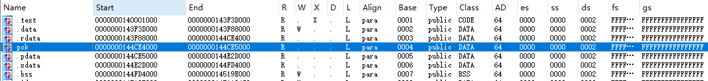
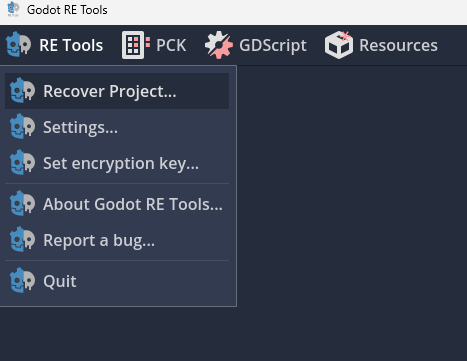
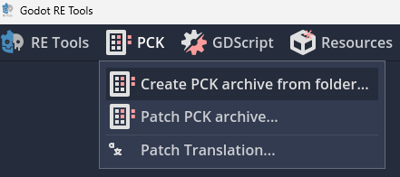

# 题型识别：

- ida 打开搜索字符串，看有没有godot字段

- ida看段表，如果有.pck段就是godot engine题型

# 解包：

用这个工具：[GitHub - GDRETools/gdsdecomp: Godot reverse engineering tools](https://github.com/GDRETools/gdsdecomp)

下载后运行文件夹里的exe文件

点击图示recover project

文件路径选择我们要解包的程序

点下面的extract就可以看到解包文件夹了

# 分析：

脚本后缀都是 `.gd`：

这是 godot 自己实现的一种脚本语言，叫 [GDScript](https://docs.godotengine.org/zh-cn/4.x/tutorials/scripting/gdscript/gdscript_basics.html)

可以把main.gd扔给chatgpt，然后让他分析就可以了，不用特别掌握语法

# 更改代码逻辑后应用

如果我们更改里边的代码逻辑（比如直接输出flag）怎么实现呢？

## 重新打包回.pck文件

点这个之后文件夹路径放我们刚才改完的文件夹，下面的embed pck指要把pck嵌入到exe中替换吗，我们这里选要替换，把exe文件路径填上就可以实现自实现逻辑了

## frida直接hook

frida是基于动态插桩的hook脚本工具，是用js写的，可以直接让ai帮你写frida脚本，这个东西非常强大，可以hook安卓apk，win中exe等程序，我会放在安卓逆向中讲用法
