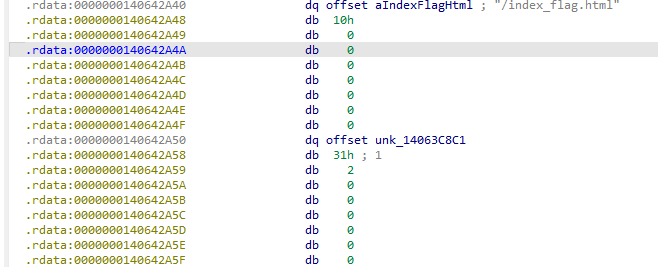
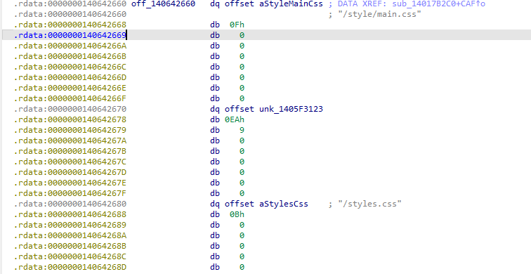
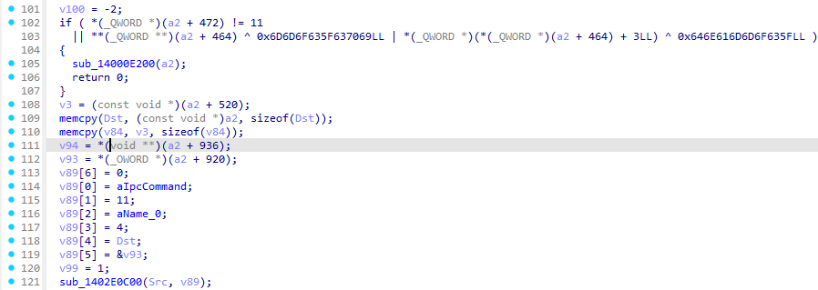

# 什么是tauri框架？

Tauri 是一个用于构建桌面应用的开源框架：前端用任意会输出 HTML/JS/CSS 的框架（如 React/Vue/Svelte），后端用 Rust（或平台原生）打包成本地可执行文件。它通过 WebView 显示前端页面，并通过安全的 IPC（消息调用）把前端和 Rust 后端连接起来。

简单来说就是tarti框架构建出来的exe文件，集成了前端和后端代码，打包进了exe。运行这个exe，前端代码通过系统webview就可以在界面显示而不需要借助任何浏览器


通常tauri框架写出的app长上面那样

# tauri框架逆向：

## 运行逻辑：

- 你双击 `.exe`；

- Rust 程序启动；

- 创建一个原生窗口；

- 在窗口中加载 WebView；

- WebView 渲染 HTML/JS（从内嵌或外部资源读取）；

- JS 通过 IPC 调用 Rust 函数，Rust 返回数据给前端。
  
  

## 逆向步骤：

一般flag都放在exe的静态资源部分。Tauri 会根据配置文件中是否开启压缩来打包静态资源文件，若压缩选项开启（默认情况），其会使用 brotli 算法对资源进行压缩后再打包。

我们可以找到静态资源所在地，然后dump下来用brotli解密后分析静态资源

拿2025年羊城杯的easyTauri.exe举例

### 定位静态资源：

先shift+f12搜flag，如果没有就去找index.html，index.html就是最开始的web页面

定位到这个字符串后交叉引用，找到一个形似文件表结构的部分



其中

- 0x0000000140642A40是文件名

- 0x0000000140642A48 ~ 0x0000000140642A4F是文件名长度，正好"/index_flag.html"就是16字节

- 0x0000000140642A50存储文件内容

- 0x0000000140642A58 ~ 0x0000000140642A5F是文件内容长度

我们找到这个结构之后就把文件内容dump下来解密就好了

**注意 brotli 对文件的完整性要求似乎很高，多一个或少一个字节都会报错。**

这里给一个ida python的dump脚本：

```py
import os, idc

start_ea = 0x14063C8C1
size = 0x231

out_path = os.path.join(os.path.dirname(idc.get_idb_path()) or os.getcwd(), "dump.bin") //拼接ida分析程序地址和自定义的文件名

data = idc.get_bytes(start_ea, size)
with open(out_path, "wb") as f:
    if isinstance(data, str): //这里if分支是在处理python2中get_bytes函数返回str类型的问题
        f.write(data.encode('latin-1')) //latin-1是 1 字节一对一映射，如果用utf-8可能报错
    else:
        f.write(data)
print("Wrote:", out_path)
```


然后拿到这个新的dump.bin文件后再用brotli算法解密

```py
import brotli
a = open(r"C:\Users\Lenovo\OneDrive\Desktop\dump.bin", "rb").read()
print(len(a))
decompressed = brotli.decompress(a)
open("dump", "wb").write(decompressed)
```


然后就拿到js写的前端文件了


### 前端分析

```js
<!doctype html>
<html lang="en">
  <head>
    <meta charset="UTF-8" />
    <link rel="stylesheet" href="styles.css" />
    <meta name="viewport" content="width=device-width, initial-scale=1.0" />
    <title>Tauri App</title>
    <script type="module" src="js/main.js" defer></script>
  </head>

  <body>
    <main class="container">

      <div class="row">
        <a href="https://tauri.app" target="_blank">
          <h1>Welcome to Tauri 2.0</h1>
        </a>
      </div>

      <p>你知道的，这个文件往往是测试的时候使用的，当你找到了这个文件，说明你可以阅读以下hint：</p>
      <p>   1. 我混淆了js，当你觉得那是一大坨恶心玩意的时候，应该试试开发一个最简Tauri项目</p>
      <p>   2. 出题人吃过release无pdb的这一坨，当你分析完js一定能找到对应的native函数</p>

      <form class="row" id="greet-form">
        <input id="greet-input" placeholder="Enter a Flag..." />
        <button type="submit">Check</button>
      </form>
      <p id="greet-msg"></p>
    </main>
  </body>
</html>
```


如果前端文件index没有flag，那就把所有js文件都dump下来看看



找到这种形似文件结构的最开始的地址，然后把他们全dump下来

把要求扔给ai写下面的脚本，但要求要说清楚

从0x140642660开始是文件结构，每个文件开始8个字节存储文件名地址，后8字节按小端序存储文件名对应字符串字节数，然后8个字节存文件内容地址，后8个字节存文件内容占大小，然后是下一个文件结构，帮我把所有的文件内容dump出来，然后通过brotli算法解密，还原js静态资源。只读js文件和html文件

```py
ag-0-1j8in2hh6ag-1-1j8in2hh6# dump_js_html_only.py
# 功能：仅从文件结构中导出 .js 和 .html 文件，并尝试 brotli 解压

import os, sys, idc, idaapi, subprocess, tempfile, shutil

TABLE_START = 0x140642660   # 文件表起始地址
ENTRY_SIZE = 32             # 每个条目大小：8+8+8+8
MAX_ENTRIES = 10000
OUT_DIR = os.path.join(os.path.dirname(idc.get_idb_path()) or os.getcwd(), "dump_js_html")

if not os.path.exists(OUT_DIR):
    os.makedirs(OUT_DIR)

def read_qword(ea):
    try:
        return idc.get_qword(ea)
    except:
        b = idc.get_bytes(ea, 8)
        if not b:
            return None
        v = 0
        for i, by in enumerate(b if isinstance(b, bytes) else b.encode('latin-1')):
            v |= (by & 0xFF) << (i*8)
        return v

def read_bytes(ea, size):
    return idc.get_bytes(ea, size)

# 尝试导入 brotli 模块或 CLI
brotli_decompress = None
try:
    import brotli
    brotli_decompress = brotli.decompress
    print("[*] Using Python brotli module.")
except:
    try:
        import brotlicffi as brotli
        brotli_decompress = brotli.decompress
        print("[*] Using brotlicffi module.")
    except:
        brotli_decompress = None

have_brotli_cli = shutil.which("brotli") is not None
if not brotli_decompress and have_brotli_cli:
    print("[*] Using brotli CLI for decompression.")
elif not brotli_decompress:
    print("[!] Warning: no brotli module/CLI found; will save raw data only.")

ea = TABLE_START
entry_idx = 0
results = []

for i in range(MAX_ENTRIES):
    name_addr = read_qword(ea)
    name_len  = read_qword(ea + 8)
    content_addr = read_qword(ea + 16)
    content_size = read_qword(ea + 24)

    if not name_addr or name_addr == 0:
        print(f"[*] End of table at {hex(ea)}")
        break

    name_bytes = read_bytes(name_addr, name_len)
    if not name_bytes:
        ea += ENTRY_SIZE
        continue

    try:
        filename = name_bytes.decode("utf-8")
    except:
        filename = name_bytes.decode("latin-1", errors="replace")

    filename_clean = filename.replace("\\", "_").replace("/", "_").strip()
    if not (filename_clean.endswith(".js") or filename_clean.endswith(".html")):
        ea += ENTRY_SIZE
        continue  # ⛔ 跳过非 js/html 文件

    print(f"[+] Dumping {filename_clean} ...")

    data = read_bytes(content_addr, content_size)
    if not data:
        print(f"    [!] Failed to read {filename_clean}")
        ea += ENTRY_SIZE
        continue

    # 尝试 brotli 解压
    decompressed = None
    if brotli_decompress:
        try:
            decompressed = brotli_decompress(data)
        except Exception as e:
            print(f"    [!] Brotli module failed: {e}")
    elif have_brotli_cli:
        try:
            with tempfile.NamedTemporaryFile(delete=False) as tmpf:
                tmpf.write(data)
                tmp_br = tmpf.name
            tmp_out = tmp_br + ".out"
            proc = subprocess.run(["brotli", "-d", "-o", tmp_out, tmp_br],
                                  stdout=subprocess.PIPE, stderr=subprocess.PIPE)
            if proc.returncode == 0 and os.path.exists(tmp_out):
                with open(tmp_out, "rb") as tf:
                    decompressed = tf.read()
            os.remove(tmp_br)
            if os.path.exists(tmp_out): os.remove(tmp_out)
        except Exception as e:
            print(f"    [!] CLI brotli failed: {e}")

    # 写出文件
    out_path = os.path.join(OUT_DIR, filename_clean)
    if decompressed:
        with open(out_path, "wb") as f:
            f.write(decompressed)
        print(f"    [+] Wrote decompressed -> {out_path}")
        results.append((filename_clean, "decompressed"))
    else:
        with open(out_path + ".br", "wb") as f:
            if isinstance(data, str):
                f.write(data.encode('latin-1'))
            else:
                f.write(data)
        print(f"    [-] Saved raw brotli file -> {out_path}.br")
        results.append((filename_clean, "raw_only"))

    ea += ENTRY_SIZE
    entry_idx += 1

print("\n=== Dump Finished ===")
for name, status in results:
    print(f"{status:12} {name}")
print(f"\nOutput folder: {OUT_DIR}")

```


出来的js文件里没有

```js
window.__TAURI__.core
```


的可以直接删了，因为最后逻辑要交给后端rust的话，必须要用win内核调用

```js
const { invoke } = window.__TAURI__.core;
```


通常设为变量名invoke，但也可能是自定义的调用名，所以只搜索` window.__TAURI__.core`就可以了

最后我们在html_actuator.js里找到get_flag的变量名

分析这个js文件：

用在线网站解混淆一下

[JS Deobfuscator](https://js-deobfuscator.vercel.app/#eNqdWQtT20gS/iuzutrCWoyR3wZCrngl4Srs7SWk9nLYx46ksa1FlnzSCHBY//fr7hlJI2GzZKmiSurXdH/d09MjP1medWhNs8iTQRyxD9dXH088mXEZJw2bPY2TccSYnAdpSwahOIsjyYNIJAz+jpkfe9lCRLL1v0wkq88iFB7qjS0S3vNy6bFlHxmWUi9OKqZeskTCW025IpWvdgqFt1paiDTlM8OtlyzN+ELsaY3cTj1AMOAQY51zTXBbyySWsVwtRYsTCeWLNDRmSeA32UJI7nPJi0Tc84SlIpyCLC6k/Q+mjVySPLO1NP55c+HdncaPL4ZDQnvTOFmUoJjKH+QiBAO/lRzG3qA480Kepsdji7vxvdjDxccWC3ygzBIhpLb51lQE1SBaZtIUIwJoLkPuiXkc+iIB3kUkIQ+cvQv5rNVqAX+/bsnNpAS8EEdQSDN3EYCdt2fo+Jt9xa3ovNlHlwzSbxvibQURVACmC6I2QdCyRUbV60MQ+fFDKxEAbCpPomDBMYvvEoCjUea0yCKjHLa8UPCkqLcG0SqbzKwrxrAkWp4Iw7QFIVxwb27Y9uIwW0TGChAMkTbJgo2KJFbQRrJ2lPv+NfilJAy4NBD6seTox0qw2RLKU3zGjVEWK+2TUs8QPAUga8K4e4lUtY6uFzJQL4sgAn2/EklFBgo1qcVJC+vt3JjyMIU12P4++xpnLIxTYUTJBHCrBh/iKvA1ezLJDHNQKz8Y5grIypA0eusiStDEkggiqC7Y9oLhNmMNN5ZzlgAoPJGMRz67E2KJO2gVRDP7hX6DHRCNvUczZtOp9nsqzysdRN2nbaYrJV0xXvTdYpWHORSVwWhNgwS6OVDN7JXsRCwgd8TfrGTuzj91VRd1xUfcfS/22pLzkPDlsn54eYmA2rsIBb5BY/WD+7Khohb1Fcr892gt4zQgB9EVcBGiEPdBnKW/5Iw//mBP7PFQcR+bbKUfV0zhULVzhk1bh9WqEBv5m7nHoP5+Fczj0Y5kGRQ/9fwwSCVzhceREkiWxgto3A9sFgYSOmYK2RURlCd2dKhHpSTS0hlNADduxhY6O7aaTD3tQaffVQHc8zATzarnE8M33IilIHvLOk5vZOfGW8ssnQOiZDTNIF8bDmvIY7giwyJt6LQ2cwumNCUPShwYHyF6rKDcNrHKpClJKR5pNoGs5okjLze5X8+osQEA/it+J1iawUwh51xSD0AtNhMyBYwjOC6FD6sSJzdVlg1tkdzc9x9WsAcVGDedCQRCza1aNdtqzzws1EnyMtYY6xfq/yoSvUjtXKl0YVpqIZKZ8N8l8cJsHBtqQAmaQ873lQBl4xMBXmQBezIkRZvOzVbd2nAKK2YF5sphq/n1Q7UI/sU4I/HwV4KsnEMQ6YnvU5iqbS3xoImnZfnJmJ61Ld3U1QuuBjCpZk3qtY7yCwyAhSGc4ODZjXmiEXx+46hY1Ku88lQyI6/0exiBseeWKOSoakYrFfJEyiSAQVIAtiSGfSrH/Pc4iIAOfct+pS8RTJ88DL6JonebDhXtN3ckETJLItXcc2brEbpjmzZaQVohSTf7P/Whfg68sH7RQ/Rp8cz92olReKwLMeeqll6JYGzViKvXeW9MkhXf1TD5fIQpJ+wNl0+zKvFU8oPpFJpp5KFtdY3bM+50z26xudTGG2BZu7WjoGqvPAqM1d8yx+gN6Bo0hjwVrxsdWKHy7NBSl+qcvVGl6vLY2qVklR5WuuKmmM39mlv9vhGtdhWoZLu8DVQyXvkeUIuhUHldnen5vbKqOepjTlBQTXPAYX8HmOjLALwAWof5K944xpYxiJWmc7XiaqDUaDRHNSDUS6v+oaKWXHTpxQ8bLZgadMWkp6trPvsZT/6xtYQyuHEmNdC09neM//rKsPlmAZ3/8gL6fbhiEoaaFB4FQIKzG5wmasJncJpyOBgWovW6sJUahFCC/zIC21RVouqdHP/hvgHz7hOchPcxzGJrTJ0apG5vr0++fLq8vYV7lbGhQyHhxg7fNi7x08aF+nJQEK/SmSbhfzEVNG6dx4MhF6LThKd2z+/6B/aTWhsJ/bbTHh7DU3fQdVGk4zrdAwcpSg3uaXSravzww83EfpLJqtTuuge+3zuGUzwVl9AtCoMN59F1bHsf3nc3crlH3M4WLidud3dvM9sldm8be0js/k+NzewRsQf2NnVB/OFPjS38AfFHW/V94h8cwTe0EqNjRFTD70KLvTuikasA/GYHh62dCarklHQeTCWQYBBYexzuQGSvNxoN4HvcqzXXa1LjjtuEqMXQ7enBothLF5GXrJYSpHi33XV6KN93um2320QHFdEomk7H5V6laPr+0B31jmFGZNew18FgDPNsw74ppBGYA5ucVKZtKjbf7bsHr9TTflAdT4fT0YD0vgSRHJ0kCV+BaNtx7CPcErjMoCP6nWPn0TmCUbmhqZ2exx2fqOXrG9I0CLu7BLBahpwh8gRjVo8UtVqBYqLH3U06SFT4lMQfq7Qi0qk9mdg/kjdN5DwzVgaPRLXqZHJcldXkqqw2MDla5/i43YHXRSQoE05feG3Cpchzr9fzpio7BspF2p65bptA9zvDDqQoB1q9vtmubEhp9LWDBC897kI8OTqly+QQPVbhVzpb4NTMGkRk5RmcmlyDXhmYlGh1O4NRV1XDM7FaYSiD2rOjAmlSIARUoRVAaeJ/K1bUepBPPR4XZo7Wxc7WW5QagBj6Q4c2dI93vNHI2NDYHNwBbWh4go5fmkT1Y/MwQUJ7quw4nb7Xplwpat4S2tM97JP5TuyOhtO+m5t3lfckNjFXIqmjNeJcc7r0uRYbeWvEMZy6bXF8s9PtjLpOvyO/nZ/cn+40d/o9wG/wD3/x7eff4bXXbncG/VFyvbr+97/gvT046Pfkl69L7sNbKKKZnKNYf9gedD8+vL/MvsBrZ3AwgFbLrz/gS7frdPv821TEJ/A6GMTvv16scC2YZKGJoYhz0OsOO3f/+ZRc8p0J5hkdLtG0n4zoyfWjtQmIykVxfy4iz4rNeB2f8lQMeg2Ob8VIpABx4bN1soKxgkRbU/hooOVaC75suCv8gegt+wyX0WhG7LM53m18QTzbVnfRnZ3aPcyVMW8o43quMccanq4ir5zTcI6A1MG5U05s5hDz0o9If6v8kpN7UU47r9BdpLNSk2YlIfG3H1A1vTC+ouXoecFyLhKcXEH22Qk5tj5z/zqOZl+Dk+DTWe/DB7zDa+PPPa1NwPyBw/dNNfiBqWDp3XrxYgFf3NHKE4tgcjzclObSKbv4qJ8Dr4dHGNgv7mEZnEUFXlHH1vk/r/TaH2Pu48eqJs7PkHudkALFco4/XV3ira7yM94m2/nvY2AR7k2lSfjgQV8gQfpcTHkWSv3BH1lmUeTXNx2NfWQ1rdg6fLKCFCoTEP5E87R1SD+iNK0gCmHg/lV9rUnPxVLOrcNO0/IFzQ4fY5iUoPCuhJzHPvwOnVJ5E4xgWUud8TA8i7NIWoftvtM0hdTuz+lQ8UvcEWCItNNgFp0rG3jHUeQgVT5qhnWIv880LfEoPL0I+BekVzy5u4i4G4KakrgTq4c48VPr8AZsu9lsBtoTlD3HtyJmqIwZauUQpFdBFEwD4efmiLFe/x9UYJJO)

```js
function HTMLActuator() {
  this.tileContainer = document.querySelector(".tile-container");
  this.scoreContainer = document.querySelector(".score-container");
  this.bestContainer = document.querySelector(".best-container");
  this.messageContainer = document.querySelector(".game-message");
  this.score = 0;
}
HTMLActuator.prototype.actuate = function (grid, metadata) {
  var self = this;
  if (metadata.game) {
    checkBox = document.querySelector(".check-form");
    checkBoxHtml = `
        <form class="above-game" id="greet-form">
          <input id="greet-input" placeholder="Enter a Flag..." />
          <button type="submit">Check</button>
        </form>
      `;
    checkBox.innerHTML = checkBoxHtml;
  }
  window.requestAnimationFrame(function () {
    self.clearContainer(self.tileContainer);
    grid.cells.forEach(function (column) {
      column.forEach(function (cell) {
        if (cell) {
          self.addTile(cell);
        }
      });
    });
    self.updateScore(metadata.score);
    self.updateBestScore(metadata.bestScore);
    if (metadata.terminated) {
      if (metadata.over) {
        self.message(false); // You lose
      } else if (metadata.won) {
        self.message(true); // You win!
      }
    }
  });
};

// Continues the game (both restart and keep playing)
HTMLActuator.prototype.continueGame = function () {
  this.clearMessage();
};
HTMLActuator.prototype.clearContainer = function (container) {
  while (container.firstChild) {
    container.removeChild(container.firstChild);
  }
};
HTMLActuator.prototype.addTile = function (tile) {
  var self = this;
  var wrapper = document.createElement("div");
  var inner = document.createElement("div");
  var position = tile.previousPosition || {
    x: tile.x,
    y: tile.y
  };
  var positionClass = this.positionClass(position);

  // We can't use classlist because it somehow glitches when replacing classes
  var classes = ["tile", "tile-" + tile.value, positionClass];
  if (tile.value > 2048) {
    classes.push("tile-super");
  }
  this.applyClasses(wrapper, classes);
  inner.classList.add("tile-inner");
  inner.textContent = tile.value;
  if (tile.previousPosition) {
    // Make sure that the tile gets rendered in the previous position first
    window.requestAnimationFrame(function () {
      classes[2] = self.positionClass({
        x: tile.x,
        y: tile.y
      });
      self.applyClasses(wrapper, classes); // Update the position
    });
  } else if (tile.mergedFrom) {
    classes.push("tile-merged");
    this.applyClasses(wrapper, classes);

    // Render the tiles that merged
    tile.mergedFrom.forEach(function (merged) {
      self.addTile(merged);
    });
  } else {
    classes.push("tile-new");
    this.applyClasses(wrapper, classes);
  }

  // Add the inner part of the tile to the wrapper
  wrapper.appendChild(inner);

  // Put the tile on the board
  this.tileContainer.appendChild(wrapper);
};
HTMLActuator.prototype.applyClasses = function (element, classes) {
  element.setAttribute("class", classes.join(" "));
};
HTMLActuator.prototype.normalizePosition = function (position) {
  return {
    x: position.x + 1,
    y: position.y + 1
  };
};
HTMLActuator.prototype.positionClass = function (position) {
  position = this.normalizePosition(position);
  return "tile-position-" + position.x + "-" + position.y;
};
HTMLActuator.prototype.updateScore = function (score) {
  this.clearContainer(this.scoreContainer);
  var difference = score - this.score;
  this.score = score;
  this.scoreContainer.textContent = this.score;
  if (difference > 0) {
    var addition = document.createElement("div");
    addition.classList.add("score-addition");
    addition.textContent = "+" + difference;
    this.scoreContainer.appendChild(addition);
  }
};
HTMLActuator.prototype.updateBestScore = function (bestScore) {
  this.bestContainer.textContent = bestScore;
};
HTMLActuator.prototype.message = function (won) {
  var type = won ? "game-won" : "game-over";
  var message = won ? "You win!" : "Game over!";
  this.messageContainer.classList.add(type);
  this.messageContainer.getElementsByTagName("p")[0].textContent = message;
};
HTMLActuator.prototype.clearMessage = function () {
  // IE only takes one value to remove at a time.
  this.messageContainer.classList.remove("game-won");
  this.messageContainer.classList.remove("game-over");
};
const {
  invoke
} = window.__TAURI__.core;
let greetInputEl;
let greetMsgEl;
(function (_0x97aee2, _0x14d3d9) {
  const _0x151017 = _0x363b;
  const _0x2b0390 = _0x97aee2();
  while (true) {
    try {
      const _0x3b9dd4 = parseInt(_0x151017(176)) / 1 + parseInt(_0x151017(172)) / 2 + parseInt(_0x151017(170)) / 3 + -parseInt(_0x151017(171)) / 4 + -parseInt(_0x151017(167)) / 5 * (parseInt(_0x151017(168)) / 6) + -parseInt(_0x151017(174)) / 7 * (-parseInt(_0x151017(166)) / 8) + -parseInt(_0x151017(173)) / 9;
      if (_0x3b9dd4 === _0x14d3d9) {
        break;
      } else {
        _0x2b0390.push(_0x2b0390.shift());
      }
    } catch (_0x34886e) {
      _0x2b0390.push(_0x2b0390.shift());
    }
  }
})(_0x3a0b, 452532);
function Encrypt_0xa31304(_0x5031b3, _0xa31304) {
  const _0x22bac7 = _0x363b;
  const _0x5d7b84 = new TextEncoder()[_0x22bac7(169)](_0x5031b3);
  const _0x2db5b9 = new TextEncoder()[_0x22bac7(169)](_0xa31304);
  const _0x1f7f86 = new Uint8Array(256);
  let _0x562e52 = 0;
  for (let _0x24ca0d = 0; _0x24ca0d < 256; _0x24ca0d++) {
    _0x1f7f86[_0x24ca0d] = _0x24ca0d;
    _0x562e52 = (_0x562e52 + _0x1f7f86[_0x24ca0d] + _0x5d7b84[_0x24ca0d % _0x5d7b84[_0x22bac7(175)]]) % 256;
    [_0x1f7f86[_0x24ca0d], _0x1f7f86[_0x562e52]] = [_0x1f7f86[_0x562e52], _0x1f7f86[_0x24ca0d]];
  }
  let _0x5b36c3 = 0;
  let _0x205ec1 = 0;
  const _0x444cf9 = new Uint8Array(_0x2db5b9[_0x22bac7(175)]);
  for (let _0x527286 = 0; _0x527286 < _0x2db5b9[_0x22bac7(175)]; _0x527286++) {
    _0x5b36c3 = (_0x5b36c3 + 1) % 256;
    _0x205ec1 = (_0x205ec1 + _0x1f7f86[_0x5b36c3]) % 256;
    [_0x1f7f86[_0x5b36c3], _0x1f7f86[_0x205ec1]] = [_0x1f7f86[_0x205ec1], _0x1f7f86[_0x5b36c3]];
    const _0x326832 = (_0x1f7f86[_0x5b36c3] + _0x1f7f86[_0x205ec1]) % 256;
    _0x444cf9[_0x527286] = _0x2db5b9[_0x527286] ^ _0x1f7f86[_0x326832];
  }
  return _0x444cf9;
}
function _0x363b(_0x3e7d70, _0x4a2c88) {
  const _0x3a0bb6 = _0x3a0b();
  _0x363b = function (_0x363b1f, _0x4025c1) {
    _0x363b1f = _0x363b1f - 166;
    let _0x387f5b = _0x3a0bb6[_0x363b1f];
    return _0x387f5b;
  };
  return _0x363b(_0x3e7d70, _0x4a2c88);
}
function _0x3a0b() {
  const _0x37fb1e = ["3283052tzDAvB", "542866JdmzNj", "4112658rTyTXQ", "16954tUYpad", "length", "457163LwGIuU", "2696pusaTH", "233035azfeoA", "66oGYEyB", "encode", "2094372kZRrIa"];
  _0x3a0b = function () {
    return _0x37fb1e;
  };
  return _0x3a0b();
}
function uint8ArrayToBase64(array) {
  const binary = Array.from(array).map(byte => String.fromCharCode(byte)).join("");
  return btoa(binary);
}
async function _0x9a2c6e7() {
  greetInputEl = document.querySelector("#greet-input");
  greetMsgEl = document.querySelector("#greet-msg");
  let getFlag = greetInputEl.value;
  const ciphertext = Encrypt_0xa31304("SadTongYiAiRC4HH", getFlag);
  greetMsgEl.textContent = await invoke("ipc_command", {
    name: uint8ArrayToBase64(ciphertext)
  });
}
window.addEventListener("DOMContentLoaded", () => {
  document.getElementById("check-form").addEventListener("submit", e => {
    e.preventDefault();
    _0x9a2c6e7();
  });
});
```


发现是先rc4加密，再base64后传给后端逻辑


然后rc4由于是流密码，拿到密钥流就可以异或回去，注意这里不能把加密当解密函数用，因为加密数据是可读字符串，但解密数据ascii可能>128

```js
const _0x5d7b84 = new TextEncoder().encode(key)
const _0x2db5b9 = new TextEncoder().encode(input)
```

在这个rc4实现中，>128的字符被当成两个utf-8ag-0-1j8in2hh6ag-1-1j8in2hh6

正确获取密钥流代码：

```js
// 原始混淆代码保持不变

(function(_0x97aee2,_0x14d3d9){const _0x151017=_0x363b,_0x2b0390=_0x97aee2();while(!![]){try{const _0x3b9dd4=parseInt(_0x151017(0xb0))/0x1+parseInt(_0x151017(0xac))/0x2+parseInt(_0x151017(0xaa))/0x3+-parseInt(_0x151017(0xab))/0x4+-parseInt(_0x151017(0xa7))/0x5*(parseInt(_0x151017(0xa8))/0x6)+-parseInt(_0x151017(0xae))/0x7*(-parseInt(_0x151017(0xa6))/0x8)+-parseInt(_0x151017(0xad))/0x9;if(_0x3b9dd4===_0x14d3d9)break;else _0x2b0390['push'](_0x2b0390['shift']());}catch(_0x34886e){_0x2b0390['push'](_0x2b0390['shift']());}}}(_0x3a0b,0x6e7b4));

function Encrypt_0x5031b3(_0x5031b3, _0xa31304){const _0x22bac7=_0x363b,_0x5d7b84=new TextEncoder()[_0x22bac7(0xa9)](_0x5031b3),_0x2db5b9=new TextEncoder()[_0x22bac7(0xa9)](_0xa31304),_0x1f7f86=new Uint8Array(0x100);let _0x562e52=0x0;for(let _0x24ca0d=0x0; _0x24ca0d<0x100; _0x24ca0d++){_0x1f7f86[_0x24ca0d]=_0x24ca0d,_0x562e52=(_0x562e52+_0x1f7f86[_0x24ca0d]+_0x5d7b84[_0x24ca0d%_0x5d7b84[_0x22bac7(0xaf)]])%0x100,[_0x1f7f86[_0x24ca0d],_0x1f7f86[_0x562e52]]=[_0x1f7f86[_0x562e52],_0x1f7f86[_0x24ca0d]];}let _0x5b36c3=0x0,_0x205ec1=0x0;const _0x444cf9=new Uint8Array(_0x2db5b9[_0x22bac7(0xaf)]);for(let _0x527286=0x0; _0x527286<_0x2db5b9[_0x22bac7(0xaf)]; _0x527286++){_0x5b36c3=(_0x5b36c3+0x1)%0x100,_0x205ec1=(_0x205ec1+_0x1f7f86[_0x5b36c3])%0x100,[_0x1f7f86[_0x5b36c3],_0x1f7f86[_0x205ec1]]=[_0x1f7f86[_0x205ec1],_0x1f7f86[_0x5b36c3]];const _0x326832=(_0x1f7f86[_0x5b36c3]+_0x1f7f86[_0x205ec1])%0x100;_0x444cf9[_0x527286]=_0x2db5b9[_0x527286]^_0x1f7f86[_0x326832];}return _0x444cf9;}function _0x363b(_0x3e7d70, _0x4a2c88){const _0x3a0bb6=_0x3a0b();return _0x363b=function(_0x363b1f, _0x4025c1){_0x363b1f=_0x363b1f-0xa6;let _0x387f5b=_0x3a0bb6[_0x363b1f];return _0x387f5b;},_0x363b(_0x3e7d70,_0x4a2c88);}function _0x3a0b(){const _0x37fb1e=['3283052tzDAvB','542866JdmzNj','4112658rTyTXQ','16954tUYpad','length','457163LwGIuU','2696pusaTH','233035azfeoA','66oGYEyB','encode','2094372kZRrIa'];_0x3a0b=function(){return _0x37fb1e;};return _0x3a0b();}
// 提取keystream的代码
const key = "SAdt0ngY1AIrC4hH";

const plaintext = 'a'.repeat(64);  // 64个'a'


// 使用原始函数加密

const encrypted = Encrypt_0x5031b3(key, plaintext);


// 提取keystream: ciphertext XOR plaintext = keystream

const keystream = [];

const aCharCode = 'a'.charCodeAt(0);  // 97


for (let i = 0; i < encrypted.length; i++) {

    keystream.push(encrypted[i] ^ aCharCode);

}
// 按要求的格式输出
console.log('KEYSTREAM = [', keystream.join(','), ']');
```

KEYSTREAM = [ 232,0,230,97,0,0,88,88,0,118,233,0,91,8,29,213,0,224,188,251,252,20,20,0,0,0,0,0,0,0,222,119,0,0,177,0,0,0,0,0,0,0,149,8,120,233,187,175,0,3,3,0,238,96,0,0,241,87,73,96,0,31,31,0 ]

### 后端分析：

定位关键函数：

由于我们传入参数时js代码是这样：

```js
  greetMsgEl.textContent = await invoke("ipc_command", {
    name: uint8ArrayToBase64(ciphertext)
  });
```

所以直接在ida pro找ipc_command和name字符串就能定位到后端逻辑函数了


找到后发现



把name（前端加密结果）传入v89，后边就分析v89就可以了


把这整个函数扔给ai，ai分析出是一个tea加密+一个base64加密


exp:

```py
import base64

# 后端 .rdata 那串 base64（你给出的）
b64 = "daF/DkQxixGmzn0aPFW2E2PhM8NabRtLjp6pI+c8TtY3WMuPxfnvlAsp9aluf8noZy/T6Sz9DJg="
ct = base64.b64decode(b64)

# 你给的 KEYSTREAM（RC4 xor 流）
KEYSTREAM = [232,0,230,97,0,0,88,88,0,118,233,0,91,8,29,213,0,224,188,251,252,20,20,0,0,0,0,0,0,0,222,119,0,0,177,0,0,0,0,0,0,0,149,8,120,233,187,175,0,3,3,0,238,96,0,0,241,87,73,96,0,31,31,0]
KS = bytes(KEYSTREAM)

# 从反编译还原的常数（对应 C++ 中出现的那些十进制常量）
C1 = 1668048215   # 0x636c6557
C2 = 1949527375   # 0x74336d4f
C3 = 1937076784   # 0x73757230
C4 = 1432441972   # 0x55615474
DELTA = 2117703607  # 0x7e3997b7

def swap32(x):
    return ((x & 0xFF) << 24) | ((x & 0xFF00) << 8) | ((x >> 8) & 0xFF00) | ((x >> 24) & 0xFF)

def decrypt_block(block8):
    # block8: 8 bytes (as stored in ct)
    a = int.from_bytes(block8[0:4], 'little')
    b = int.from_bytes(block8[4:8], 'little')
    v11 = swap32(a)
    v12 = swap32(b)
    sum_ = DELTA * 32
    for _ in range(32):
        v12 = (v12 - ( ((16 * v11 + C3) ^ (sum_ + v11)) ^ ((v11 >> 5) + C4) )) & 0xFFFFFFFF
        v11 = (v11 - ( ((16 * v12 + C1) ^ (v12 + sum_)) ^ ((v12 >> 5) + C2) )) & 0xFFFFFFFF
        sum_ = (sum_ - DELTA) & 0xFFFFFFFFFFFFFFFF
    return v11.to_bytes(4,'little') + v12.to_bytes(4,'little')

# 1) TEA-like 解密（对 ct 按 8 字节块）
plain = bytearray()
for i in range(0, len(ct), 8):
    block = ct[i:i+8]
    plain += decrypt_block(block)

# 2) 解出的是个 base64 字符串，去除尾部可能的 0x00，再 decode
plain_b64 = bytes(plain).rstrip(b'\x00')
middle = base64.b64decode(plain_b64)

# 3) 用你给的 KEYSTREAM 异或（取 middle 长度）
res = bytes(middle[i] ^ KS[i] for i in range(len(middle)))
print(res.decode())
# -> flag{cf8be09b1c8a415f8b5e8f1dac71d4af}
```


# reference:

[Tauri 框架的静态资源提取方法探究 | yllhwa&#39;s blog](https://blog.yllhwa.com/2023/05/09/Tauri%20%E6%A1%86%E6%9E%B6%E7%9A%84%E9%9D%99%E6%80%81%E8%B5%84%E6%BA%90%E6%8F%90%E5%8F%96%E6%96%B9%E6%B3%95%E6%8E%A2%E7%A9%B6/)

https://110.41.78.46/bk/index.php/archives/548/
