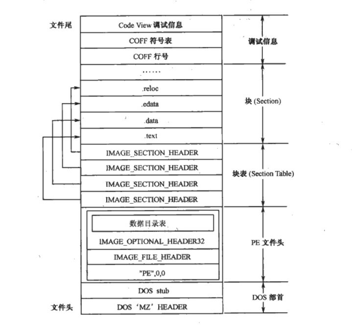
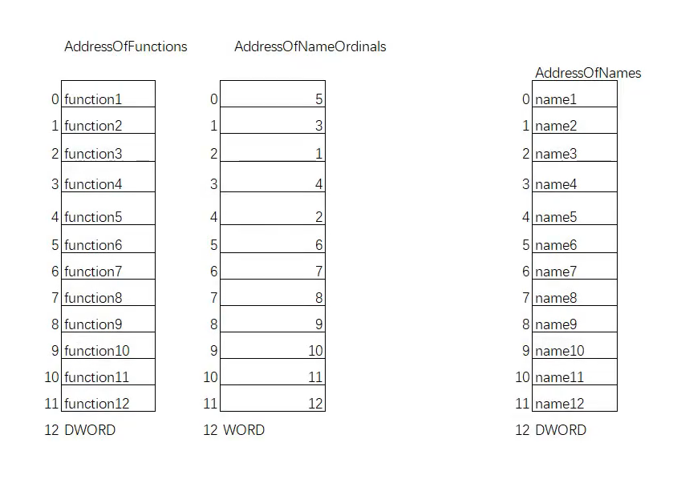
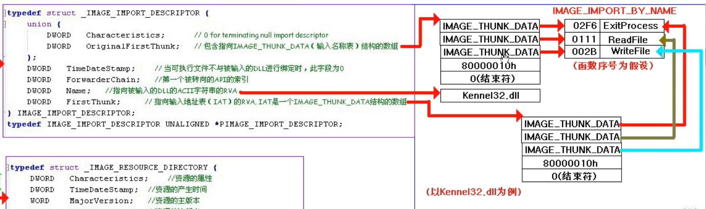
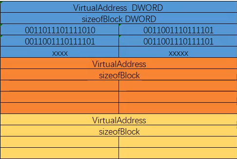

# 前言：

pe文件指在windows平台上的可执行文件(.exe，.dll，.com)了解他们的结构虽然对做题没什么用，但如果想开发新型外挂，防御新型外挂都是基于底层原理创新的

pe文件结构总览：



# 地址的基本概念

- VA（Virtual Address）：虚拟地址
  PE 文件映射到内存空间时，数据在内存空间中对应的地址。

- ImageBase：映射基址
  PE 文件在内存空间中的映射起始位置，是个 VA 地址。

- RVA（Relative Virtual Address）：相对虚拟地址
  PE 文件在内存中的 VA 相对于 ImageBase 的偏移量。

- FOA（File Offset Address，FOA）：文件偏移地址
  PE 文件在磁盘上存放时，数据相对于文件开头位置的偏移量，文件偏移地址等于文件地址。

转换关系：

- VA = ImageBase + RVA

- RVA-节区段首地址的RVA=FOA-节区段首地址的FOA

# pe文件格式

## DOS_HEADER

```c
typedef struct _IMAGE_DOS_HEADER {      // DOS .EXE header
    WORD   e_magic;                     // Magic number
    WORD   e_cblp;                      // Bytes on last page of file
    WORD   e_cp;                        // Pages in file
    WORD   e_crlc;                      // Relocations
    WORD   e_cparhdr;                   // Size of header in paragraphs
    WORD   e_minalloc;                  // Minimum extra paragraphs needed
    WORD   e_maxalloc;                  // Maximum extra paragraphs needed
    WORD   e_ss;                        // Initial (relative) SS value
    WORD   e_sp;                        // Initial SP value
    WORD   e_csum;                      // Checksum
    WORD   e_ip;                        // Initial IP value
    WORD   e_cs;                        // Initial (relative) CS value
    WORD   e_lfarlc;                    // File address of relocation table
    WORD   e_ovno;                      // Overlay number
    WORD   e_res[4];                    // Reserved words
    WORD   e_oemid;                     // OEM identifier (for e_oeminfo)
    WORD   e_oeminfo;                   // OEM information; e_oemid specific
    WORD   e_res2[10];                  // Reserved words
    LONG   e_lfanew;                    // File address of new exe header
} IMAGE_DOS_HEADER, *PIMAGE_DOS_HEADER;

```

这是dos头在微软的定义，我们只需要了解

（1）e_magic： DOS 映像文件格式标记，与 MS-DOS 兼容的 PE 文件都将该值设为 0x4D5A，对应的 ASCII 字符为：MZ。
（2）e_ip： DOS 代码的初始化指令入口。
（3）e_cs： DOS 代码的初始化代码段入口。
（4）e_lfanew：PE 文件头 _IMAGE_NT_HEADERS 结构的 FA 偏移地址，即指向 _IMAGE_NT_HEADERS 结构。

## DOS_STUB

该结构未在 winnt.h 中定义，其内容随着链接时使用的链接器不同而不同，通常用于保存在 DOS 环境中的可执行代码。  
例如：该结构中的代码用于显示字符串：“This program cannot run in DOS mode”。


## NT_HEADER

位于 `e_lfanew` 处，结构

```c
typedef struct _IMAGE_NT_HEADERS {
    DWORD Signature; // "PE\0\0"
    IMAGE_FILE_HEADER FileHeader;
    IMAGE_OPTIONAL_HEADER OptionalHeader;
} IMAGE_NT_HEADERS;
```

* `Signature` 必须是 `PE\0\0`（0x00004550）。

* `FileHeader` 是 pe文件头，`OptionalHeader`（尽管名字叫 optional）几乎对可执行文件必需，包含入口点、ImageBase、节对齐等。

## FILE_HEADER

```c
typedef struct _IMAGE_FILE_HEADER {
    WORD    Machine;
    WORD    NumberOfSections;
    DWORD   TimeDateStamp;
    DWORD   PointerToSymbolTable;
    DWORD   NumberOfSymbols;
    WORD    SizeOfOptionalHeader;
    WORD    Characteristics;
} IMAGE_FILE_HEADER, *PIMAGE_FILE_HEADER;

```

要掌握的只有：

（1）Machine：平台类型，映像文件只能在指定的平台或模拟指定平台的系统上运行。在 winnt.h 中定义的 Machine 如下：

```c
#define IMAGE_FILE_MACHINE_UNKNOWN           0
#define IMAGE_FILE_MACHINE_TARGET_HOST       0x0001  // Useful for indicating we want to interact with the host and not a WoW guest.
#define IMAGE_FILE_MACHINE_I386              0x014c  // Intel 386.
#define IMAGE_FILE_MACHINE_R3000             0x0162  // MIPS little-endian, 0x160 big-endian
#define IMAGE_FILE_MACHINE_R4000             0x0166  // MIPS little-endian
#define IMAGE_FILE_MACHINE_R10000            0x0168  // MIPS little-endian
#define IMAGE_FILE_MACHINE_WCEMIPSV2         0x0169  // MIPS little-endian WCE v2
#define IMAGE_FILE_MACHINE_ALPHA             0x0184  // Alpha_AXP
#define IMAGE_FILE_MACHINE_SH3               0x01a2  // SH3 little-endian
#define IMAGE_FILE_MACHINE_SH3DSP            0x01a3
#define IMAGE_FILE_MACHINE_SH3E              0x01a4  // SH3E little-endian
#define IMAGE_FILE_MACHINE_SH4               0x01a6  // SH4 little-endian
#define IMAGE_FILE_MACHINE_SH5               0x01a8  // SH5
#define IMAGE_FILE_MACHINE_ARM               0x01c0  // ARM Little-Endian
#define IMAGE_FILE_MACHINE_THUMB             0x01c2  // ARM Thumb/Thumb-2 Little-Endian
#define IMAGE_FILE_MACHINE_ARMNT             0x01c4  // ARM Thumb-2 Little-Endian
#define IMAGE_FILE_MACHINE_AM33              0x01d3
#define IMAGE_FILE_MACHINE_POWERPC           0x01F0  // IBM PowerPC Little-Endian
#define IMAGE_FILE_MACHINE_POWERPCFP         0x01f1
#define IMAGE_FILE_MACHINE_IA64              0x0200  // Intel 64
#define IMAGE_FILE_MACHINE_MIPS16            0x0266  // MIPS
#define IMAGE_FILE_MACHINE_ALPHA64           0x0284  // ALPHA64
#define IMAGE_FILE_MACHINE_MIPSFPU           0x0366  // MIPS
#define IMAGE_FILE_MACHINE_MIPSFPU16         0x0466  // MIPS
#define IMAGE_FILE_MACHINE_AXP64             IMAGE_FILE_MACHINE_ALPHA64
#define IMAGE_FILE_MACHINE_TRICORE           0x0520  // Infineon
#define IMAGE_FILE_MACHINE_CEF               0x0CEF
#define IMAGE_FILE_MACHINE_EBC               0x0EBC  // EFI Byte Code
#define IMAGE_FILE_MACHINE_AMD64             0x8664  // AMD64 (K8)
#define IMAGE_FILE_MACHINE_M32R              0x9041  // M32R little-endian
#define IMAGE_FILE_MACHINE_ARM64             0xAA64  // ARM64 Little-Endian
#define IMAGE_FILE_MACHINE_CEE               0xC0EE

```

（2）NumberOfSections：Section 的数目，即 Section Table 数组的元素个数。Windows Loader 限制 Section 的数目为 96 。
（3）TimeDateStamp：文件创建的日期和时间。
（4）PointerToSymbolTable：PE符号表的 RVA 偏移量，如果 PE符号表不存在，则该值为 0 。
（5）NumberOfSymbols：PE符号表中的符号个数。
（6）SizeOfOptionalHeader：_IMAGE_OPTIONAL_HEADER 结构的大小，对于 obj 文件，该值为 0 。
（7）Characteristics：PE 文件的属性。在 winnt.h 中定义的 Characteristics 如下：

```c
#define IMAGE_FILE_RELOCS_STRIPPED           0x0001  // Relocation info stripped from file.
#define IMAGE_FILE_EXECUTABLE_IMAGE          0x0002  // File is executable  (i.e. no unresolved external references).
#define IMAGE_FILE_LINE_NUMS_STRIPPED        0x0004  // Line nunbers stripped from file.
#define IMAGE_FILE_LOCAL_SYMS_STRIPPED       0x0008  // Local symbols stripped from file.
#define IMAGE_FILE_AGGRESIVE_WS_TRIM         0x0010  // Aggressively trim working set
#define IMAGE_FILE_LARGE_ADDRESS_AWARE       0x0020  // App can handle >2gb addresses
#define IMAGE_FILE_BYTES_REVERSED_LO         0x0080  // Bytes of machine word are reversed.
#define IMAGE_FILE_32BIT_MACHINE             0x0100  // 32 bit word machine.
#define IMAGE_FILE_DEBUG_STRIPPED            0x0200  // Debugging info stripped from file in .DBG file
#define IMAGE_FILE_REMOVABLE_RUN_FROM_SWAP   0x0400  // If Image is on removable media, copy and run from the swap file.
#define IMAGE_FILE_NET_RUN_FROM_SWAP         0x0800  // If Image is on Net, copy and run from the swap file.
#define IMAGE_FILE_SYSTEM                    0x1000  // System File.
#define IMAGE_FILE_DLL                       0x2000  // File is a DLL.
#define IMAGE_FILE_UP_SYSTEM_ONLY            0x4000  // File should only be run on a UP machine
#define IMAGE_FILE_BYTES_REVERSED_HI         0x8000  // Bytes of machine word are reversed.
```

## OPTIONAL_HEADER

```c
typedef struct _IMAGE_OPTIONAL_HEADER {
    //
    // Standard fields.
    //

    WORD    Magic;
    BYTE    MajorLinkerVersion;
    BYTE    MinorLinkerVersion;
    DWORD   SizeOfCode;
    DWORD   SizeOfInitializedData;
    DWORD   SizeOfUninitializedData;
    DWORD   AddressOfEntryPoint;
    DWORD   BaseOfCode;
    DWORD   BaseOfData;

    //
    // NT additional fields.
    //

    DWORD   ImageBase;
    DWORD   SectionAlignment;
    DWORD   FileAlignment;
    WORD    MajorOperatingSystemVersion;
    WORD    MinorOperatingSystemVersion;
    WORD    MajorImageVersion;
    WORD    MinorImageVersion;
    WORD    MajorSubsystemVersion;
    WORD    MinorSubsystemVersion;
    DWORD   Win32VersionValue;
    DWORD   SizeOfImage;
    DWORD   SizeOfHeaders;
    DWORD   CheckSum;
    WORD    Subsystem;
    WORD    DllCharacteristics;
    DWORD   SizeOfStackReserve;
    DWORD   SizeOfStackCommit;
    DWORD   SizeOfHeapReserve;
    DWORD   SizeOfHeapCommit;
    DWORD   LoaderFlags;
    DWORD   NumberOfRvaAndSizes;
    IMAGE_DATA_DIRECTORY DataDirectory[IMAGE_NUMBEROF_DIRECTORY_ENTRIES];
} IMAGE_OPTIONAL_HEADER32, *PIMAGE_OPTIONAL_HEADER32;

typedef struct _IMAGE_OPTIONAL_HEADER64 {
    WORD        Magic;
    BYTE        MajorLinkerVersion;
    BYTE        MinorLinkerVersion;
    DWORD       SizeOfCode;
    DWORD       SizeOfInitializedData;
    DWORD       SizeOfUninitializedData;
    DWORD       AddressOfEntryPoint;
    DWORD       BaseOfCode;
    ULONGLONG   ImageBase;
    DWORD       SectionAlignment;
    DWORD       FileAlignment;
    WORD        MajorOperatingSystemVersion;
    WORD        MinorOperatingSystemVersion;
    WORD        MajorImageVersion;
    WORD        MinorImageVersion;
    WORD        MajorSubsystemVersion;
    WORD        MinorSubsystemVersion;
    DWORD       Win32VersionValue;
    DWORD       SizeOfImage;
    DWORD       SizeOfHeaders;
    DWORD       CheckSum;
    WORD        Subsystem;
    WORD        DllCharacteristics;
    ULONGLONG   SizeOfStackReserve;
    ULONGLONG   SizeOfStackCommit;
    ULONGLONG   SizeOfHeapReserve;
    ULONGLONG   SizeOfHeapCommit;
    DWORD       LoaderFlags;
    DWORD       NumberOfRvaAndSizes;
    IMAGE_DATA_DIRECTORY DataDirectory[IMAGE_NUMBEROF_DIRECTORY_ENTRIES];
} IMAGE_OPTIONAL_HEADER64, *PIMAGE_OPTIONAL_HEADER64;

#ifdef _WIN64
typedef IMAGE_OPTIONAL_HEADER64             IMAGE_OPTIONAL_HEADER;
typedef PIMAGE_OPTIONAL_HEADER64            PIMAGE_OPTIONAL_HEADER;
#else
typedef IMAGE_OPTIONAL_HEADER32             IMAGE_OPTIONAL_HEADER;
typedef PIMAGE_OPTIONAL_HEADER32            PIMAGE_OPTIONAL_HEADER;
#endif

```


需要记的：

* `Magic` 指示 PE32（0x10b）或 PE32+（0x20b，用于 x64）。PE32+ 没有某些 32-bit 字段（如 `BaseOfData`）。

* 重要字段：
  
  * `AddressOfEntryPoint`（RVA） — 程序入口点（EP）。
  
  * `ImageBase` — 默认加载基址（x86 常 0x400000，x64 常 0x140000000）。
  
  * `SectionAlignment` 内存对齐粒度，即 PE 文件映射到内存时的对齐粒度；默认值为系统页面大小 0x1000（4KB）；该值必须大于或等于 FileAligment 的值。
  
  * `FileAlignment` — 磁盘对齐粒度，即 PE 文件在磁盘中存储时的对齐粒度；默认值为磁盘页面大小 0x200（512B）；如果 SectionAlignment 的值小于系统页面大小，则该值必须与 SectionAlignment 的值相同。
  
  * `SizeOfImage` — 映像在内存中的总大小（按 `SectionAlignment` 对齐）。
  
  * `SizeOfHeaders` — 所有头部（包括节表）在文件中的合占大小（按 `FileAlignment` 对齐）。
  
  * `DataDirectory[IMAGE_NUMBEROF_DIRECTORY_ENTRIES]` — 数据目录数组，指向导入表/导出表/资源/重定位/证书等。每个目录是 `(RVA, Size)`。这是进入各种表的门。

## Section Table（节表 / Section Headers）

在 `IMAGE_NT_HEADERS` 之后，紧跟 `NumberOfSections` 个 `IMAGE_SECTION_HEADER`。每个节描述文件和内存中的一个区域（例如 `.text`, `.rdata`, `.data`, `.rsrc` 等）。

```c
typedef struct _IMAGE_SECTION_HEADER {
    BYTE  Name[8];             // 节名（如 ".text"）
    union {
      DWORD PhysicalAddress;
      DWORD VirtualSize;
    } Misc;
    DWORD VirtualAddress;      // RVA（节在内存中的起始 RVA）
    DWORD SizeOfRawData;       // 文件中该节占用字节数（按 FileAlignment）
    DWORD PointerToRawData;    // 文件偏移（file offset）到节数据
    DWORD PointerToRelocations;
    DWORD PointerToLinenumbers;
    WORD  NumberOfRelocations;
    WORD  NumberOfLinenumbers;
    DWORD Characteristics;     // 可读/可写/可执行 等标志
} IMAGE_SECTION_HEADER;

```

常见节：

* `.text` — 代码段（可执行、只读）。

* `.rdata` — 只读数据（导出表、字符串、常量）。

* `.data` — 已初始化的可读写数据。

* `.bss` / uninitialized data — 在 PE 通常以 `VirtualSize` 指定但 `SizeOfRawData` 可能为 0。

* `.rsrc` — 资源（图标、对话框、版本信息等）。

* `.reloc` — 基址重定位表（如果启用了 ASLR 或 ImageBase 不是默认值时需要）。

* `.pdata` / `.xdata`（x64 异常/函数表）等。

## 可选文件头中的数据目录表：

**Data Directory** 位于 `IMAGE_OPTIONAL_HEADER` 内，是一个固定长度的数组（通常 16 项，`IMAGE_NUMBEROF_DIRECTORY_ENTRIES`）。每项结构如下：

```c
typedef struct _IMAGE_DATA_DIRECTORY {
    DWORD VirtualAddress; // RVA（或对于某些目录是 file offset 特例）
    DWORD Size;
} IMAGE_DATA_DIRECTORY;

```

我们只需要记住里面的导出表，导入表，重定位表

### 导出表：

位于 **数据目录表第 0 项**  
（`IMAGE_DIRECTORY_ENTRY_EXPORT = 0`）

```c
typedef struct _IMAGE_EXPORT_DIRECTORY {
    DWORD   Characteristics;       // 通常为0，保留字段
    DWORD   TimeDateStamp;         // 时间戳（编译时间）
    WORD    MajorVersion;          // 主版本号（可选）
    WORD    MinorVersion;          // 次版本号（可选）
    DWORD   Name;                  // 模块名字符串的 RVA（如 "KERNEL32.dll"）
    DWORD   Base;                  // 导出序号起始值（通常为1）
    DWORD   NumberOfFunctions;     // EAT (Export Address Table) 的函数总数
    DWORD   NumberOfNames;         // 按名称导出的函数数量
    DWORD   AddressOfFunctions;    // RVA → DWORD 数组（EAT），每项为函数的 RVA
    DWORD   AddressOfNames;        // RVA → DWORD 数组，保存函数名的 RVA
    DWORD   AddressOfNameOrdinals; // RVA → WORD 数组，保存函数名对应的序号索引
} IMAGE_EXPORT_DIRECTORY, *PIMAGE_EXPORT_DIRECTORY;
```

`Name` 导出表文件名首地址  
`Base` 导出函数起始序号  
`NumberOfFunctions`是dll文件中导出函数的个数：**最大的序号-最小序号+1**
`NumberOfNames`以名称导出函数的个数：即在dll文件中**函数后面不加noname的数量**

首先我们要知道dll文件通常怎么编写导出哪些函数，一般是用.def文件存储函数和序号,编译时指定这个def文件

```c
LIBRARY mydll
EXPORTS
    sum @2
    Add @3 NONAME
    mul @7
```

上面这个例子里NumberOfFunctions就是6=7-2+1；

NumberOfNames就是2

#### 在DLL文件中如何找到要用的函数呢？

**AddressOfNames存的是函数名称起始位置的偏移。  
AddressOfNameOrdinals存的是序号，加上Base等于dll文件中函数后面的序号。  
AddressOfFunctions存的是真正函数存储位置的偏移。**

从右向左看

要找到MessageBoxW的函数地址，首先从AddressOfNames在AddressOfNameOrdinals中的索引找到MessageBoxW的序号，在AddressOfFunctions按序号找到地址。



### 导入表

一个文件只有一个导出表，有多个导入表

INT：导入名称表，无论在文件中还是在内存中都是指向函数的名称

IAT: 导入地址表，在文件中时，与INT是一样的指向函数名称，在内存中保存的是函数实际地址

```c
typedef struct _IMAGE_IMPORT_DESCRIPTOR {
    union {
        DWORD   Characteristics;        // 原先叫 OriginalFirstThunk
        DWORD   OriginalFirstThunk;     // 指向 IMAGE_THUNK_DATA 数组
    } DUMMYUNIONNAME;
    DWORD   TimeDateStamp;              // 时间戳（若为绑定导入，则非零）
    DWORD   ForwarderChain;             // 转发器链表索引（一般为 0）
    DWORD   Name;                       // 导入模块名字符串的 RVA（如 "USER32.dll"）
    DWORD   FirstThunk;                 // 指向 IAT（IMAGE_THUNK_DATA 数组）
} IMAGE_IMPORT_DESCRIPTOR, *PIMAGE_IMPORT_DESCRIPTOR;

```

```c
typedef struct _IMAGE_THUNK_DATA32 {
    union {
        DWORD ForwarderString;      // 转发字符串 RVA
        DWORD Function;             // 实际函数地址（IAT 填充后）
        DWORD Ordinal;              // 按序号导入时，高位标志+序号
        DWORD AddressOfData;        // 指向 IMAGE_IMPORT_BY_NAME 的 RVA
    } u1;
} IMAGE_THUNK_DATA32;

```

```c
typedef struct _IMAGE_IMPORT_BY_NAME {
    WORD    Hint;       // 建议序号（可加快查找速度）
    CHAR    Name[1];    // 函数名字符串（以 '\0' 结束）
} IMAGE_IMPORT_BY_NAME, *PIMAGE_IMPORT_BY_NAME;

```

这三个结构体之间的关系可以用图表示




#### _IMAGE_THUNK_DATA32四个字段的工作方式：

##### u1.AddressOfData

 按名称导入时的初始状态。这是最常见的导入方式。它是一个 **RVA**，指向 `IMAGE_IMPORT_BY_NAME` 结构体。

Loader 执行时：

1. 检查高位标志（是否为按序号导入）

2. 如果按名称导入 → 从 `AddressOfData` 找到字符串 `"MessageBoxA"`

3. 调用 `GetProcAddress("MessageBoxA")`

4. 把查到的实际函数地址 **写回到同一个 thunk 里**  
   → 此时该 DWORD 的含义变成了 `Function`

##### u1.Function

| 阶段     | 字段含义                     |
| ------ | ------------------------ |
| 程序加载前  | `AddressOfData`（指向函数名结构） |
| 程序徐加载后 | `Function`（函数实际地址）       |

所以你用 IDA 或 PE-Bear 打开导入表时，  
可以看到一列是函数地址（已经被修正），那就是 `u1.Function` 的值。

##### u1.Ordinal

如果是 **按序号导入**（而不是按名称），  
那么 `IMAGE_THUNK_DATA` 的最高位会被置为 1,这个时候序号是ordinal的低16位

Loader 检查后，会直接按序号查找导出表中的对应函数。

##### u1.ForwarderString

**具体工作流程**

1. 程序启动，系统加载器解析其导入表。

2. 加载器看到需要从 `Old.dll` 导入一个函数。

3. 加载器检查该函数对应的 `IMAGE_THUNK_DATA` 结构。

4. 如果发现这个条目被标记为一个转发（Loader 看到字符串里有 `.`，就知道它是转发函数），那么 `u1.ForwarderString` 字段中存储的值就是一个 RVA。

5. 这个 RVA 指向 PE 文件内部的一个字符串，这个字符串就是转发的目标，例如 `"NewDLL.NewFunction"`。

6. 加载器于是会转而加载 `NewDLL.dll`，获取 `NewFunction` 的地址，并填充到程序的 IAT 中。

### 重定位表

#### 为什么需要重定位表：

假设你编译了一个 DLL：

```c
编译期设定的镜像基址 (ImageBase) = 0x10000000
```

代码里可能存在这样的指令：

```c
mov eax, [0x10003000]  ; 访问全局变量的绝对地址
```

但是当系统加载这个 DLL 时，如果地址 `0x10000000` 已经被别的模块占用， 
Windows 就会把它加载到另一个位置，比如 `0x20000000`。

 那么所有访问 `0x10003000` 的指令都错了！

**重定位表的任务：** 
告诉系统：“文件里哪些地方用了绝对地址”，好让 Loader 在加载时给它们加上偏移量修正

#### 重定位表的结构层级:

整体结构是由若干个 **重定位块 (Base Relocation Block)** 组成。

```c
typedef struct _IMAGE_BASE_RELOCATION {
    DWORD VirtualAddress; // 该块对应的页基址（相对整个镜像）
    DWORD SizeOfBlock;    // 该块的大小（包括头和所有偏移项）
    // 后面紧跟若干个 WORD 类型的重定位项（类型 + 偏移）
} IMAGE_BASE_RELOCATION;
//采取这种基址加偏移的存储结构优点是能节省空间，这种结构只需要8+4n字节可以存n个，但不是这种结构需要8n字节才能存n个
```

重定位项 (WORD) 结构

每个 `WORD` 包含两个部分（共 16 位）：

| 位段     | 名称     | 含义    |
| ------ | ------ | ----- |
| 高 4 位  | Type   | 重定位类型 |
| 低 12 位 | Offset | 该页内偏移 |

type类型在微软中的定义：

| Type 值 | 名称                         | 用途              |
| ------ | -------------------------- | --------------- |
| 0      | `IMAGE_REL_BASED_ABSOLUTE` | 无效项（跳过/对齐用）     |
| 1      | `IMAGE_REL_BASED_HIGH`     | 高16位修正（16位系统遗留） |
| 2      | `IMAGE_REL_BASED_LOW`      | 低16位修正          |
| 3      | `IMAGE_REL_BASED_HIGHLOW`  | 32位绝对地址修正（最常用）  |
| 10     | `IMAGE_REL_BASED_DIR64`    | 64位绝对地址修正       |

在内存中的结构：



#### 重定位表的工作原理（Windows Loader 处理流程）

**1.系统加载映像文件：**

* 期望基址 = `ImageBase`（例如 0x10000000）

* 实际加载地址 = `LoadBase`（例如 0x20000000）

**2.计算偏移差：**

```c
Delta = LoadBase - ImageBase;   // = 0x10000000
```

**3.遍历每个重定位块：**

* 找到 `IMAGE_BASE_RELOCATION.VirtualAddress`

* 遍历其中的所有 `WORD` 项

**4.按类型修正目标地址：**

* 如果类型是 `IMAGE_REL_BASED_HIGHLOW`：

```c
DWORD* pAddr = (DWORD*)(imageBase + VirtualAddress + Offset);
*pAddr += Delta;
```

**5.加载器修正完这些地址后：**

* 所有全局变量、函数指针都指向正确的绝对地址；

* `.reloc` 区域在内存中可以被释放（某些加载器会保留用于卸载）

| 阶段       | 内容                            |
| -------- | ----------------------------- |
| 编译期      | 生成以固定 ImageBase 链接的可执行文件      |
| 加载期      | 如果装入地址 ≠ ImageBase，则触发重定位     |
| `.reloc` | 记录所有需要修改绝对地址的地方               |
| Loader   | 根据差值修正每个位置的值                  |
| 类型       | `HIGHLOW`（32位） 或 `DIR64`（64位） |

### TLS表

什么是TLS?  
**TLS是 Thread Local Storage的缩写线程局部存储。主要是为了解决多线程中变量同步的问题。**

#### tls变量：

TLS变量只需要定义一次，类似全局变量，但定义完后每一个线程都能获取TLS变量的副本，解决了不能同步访问TLS的问题。节约了时间和成本。

#### tls回调函数：

```c
typedef VOID (NTAPI *PIMAGE_TLS_CALLBACK)(
    PVOID DllHandle,
    DWORD Reason,      // DLL_PROCESS_ATTACH / DLL_THREAD_ATTACH / DLL_THREAD_DETACH / DLL_PROCESS_DETACH
    PVOID Reserved
);
```

它会在进程附加（1），线程附加（2），线程脱离（3），进程脱离（0）时调用（小括号内数字指这四个状态对应整数）：

* **回调会在 Loader 设置好 TLS 数据后被调用**。因此回调内部可以读取/写入静态 TLS 变量（以每线程视图访问）。

* **调用时机**：
  
  * 当模块被装载（process attach）时，Loader 为当前存在的线程分配/初始化 TLS 模板（把模板拷贝给每个线程），然后调用模块的 TLS 回调，回调通常以 `DLL_PROCESS_ATTACH` 为 `Reason`。
  
  * 当一个新线程被创建时，Loader 会为该线程拷贝 TLS 模板并调用已加载模块的 TLS 回调（`DLL_THREAD_ATTACH`）。
  
  * 当线程退出时，Loader 会先调用 `DLL_THREAD_DETACH` 回调，然后释放该线程的 TLS 数据。
  
  * 当模块卸载或进程退出时，会按顺序调用 `DLL_PROCESS_DETACH` 回调。

* **执行时的约束**：
  
  * TLS 回调在 **Loader Lock** 下执行（与 DllMain 的执行约束类似），因此在回调中调用可能导致死锁的 API（如 `LoadLibrary`、某些同步函数）可能不安全。
  
  * 回调可能在非常早的阶段执行（在 DllMain 被调用之前），所以某些运行时/全局初始化可能尚未完成。

* **多个回调**：`AddressOfCallBacks` 指向的回调数组中回调按数组顺序被调用（从低地址到高地址），数组以 NULL 结束。多个模块的回调调用顺序涉及模块加载顺序。

#### 代码(包含tls变量和回调函数)

```c
#include<Windows.h>
#include<iostream>
#pragma comment(linker,"/INCLUDE:__tls_used") //要声明连接tls
_declspec(thread) int g_number = 100;  //tls变量
HANDLE hEvent = NULL;

DWORD WINAPI threadProc1(LPVOID lparam)
{
    g_number = 200;
    printf("threadProc1 g_number=%d\n", g_number);
    SetEvent(hEvent);
    return 0;
}

DWORD WINAPI threadProc2(LPVOID lparam)
{
    WaitForSingleObject(hEvent, -1);
    printf("threadProc2 g_number=%d\n", g_number);
    return 0;
}

void NTAPI t_TlsCallBack_A(PVOID DllHandle, DWORD Reason, PVOID Reserved)
{
    printf("TLS函数执行了\n");
}

#pragma data_seg(".CRT$XLX")
//存储回调函数地址
PIMAGE_TLS_CALLBACK pTLS_CALLBACKs[] = { t_TlsCallBack_A,0 };
#pragma data_seg()

int main()
{
    hEvent = CreateEventA(NULL, FALSE, FALSE, NULL);
    HANDLE hThread1 = CreateThread(NULL, NULL, threadProc1, NULL, NULL, NULL);
    HANDLE hThread2 = CreateThread(NULL, NULL, threadProc2, NULL, NULL, NULL);
    WaitForSingleObject(hThread1,-1);
    WaitForSingleObject(hThread2,-1);
    CloseHandle(hEvent);
    system("pause");
    return 0;
}


```

#### tls反调试：

既然我们知道了TLS是最先执行的，那么我们在TLS回调函数中加上判断是否被调试的API，若被调试直接在OEP之前终止程序，即可做到反调试。

```c
#include<Windows.h>
#include<iostream>
#pragma comment(linker,"/INCLUDE:__tls_used")
void NTAPI TLS_CALLBACK1(PVOID DllHandle, DWORD Reason, PVOID Reserved)
{
    if (Reason == DLL_PROCESS_ATTACH)
    {
        BOOL result = FALSE;
        HANDLE hNewHandle = 0;
        DuplicateHandle(GetCurrentProcess(), GetCurrentProcess(), GetCurrentProcess(), &hNewHandle, NULL, NULL, DUPLICATE_SAME_ACCESS);
        CheckRemoteDebuggerPresent(hNewHandle, &result);//微软提供的API 判断该文件有没有被调试
        if (result)
        {
            MessageBoxA(0, "程序被调试了！", "警告", MB_OK);
            ExitProcess(0);
        }
    }
    return;
}
#pragma data_seg(".CRT$XLX")
PIMAGE_TLS_CALLBACK pTLS_CALLBACKs[] = { TLS_CALLBACK1,0 }; 
#pragma data_seg()

int main()
{
    printf("main函数执行了");
    system("pause");
    return 0;
}

```

#### tls表

```c
typedef struct _IMAGE_TLS_DIRECTORY {
    DWORD StartAddressOfRawData;      // TLS 数据的起始 VA（虚拟地址）
    DWORD EndAddressOfRawData;        // TLS 数据的结束 VA（虚拟地址）
    DWORD AddressOfIndex;             // 存放 TLS 索引的指针（VA）
    DWORD AddressOfCallBacks;         // TLS 回调函数数组的指针（VA）
    DWORD SizeOfZeroFill;             // 填充 0 的大小
    DWORD Characteristics;            // 特性标志，一般为0
} IMAGE_TLS_DIRECTORY32;

```

# pe文件结构代码：

文件结构：

头文件：Main.cpp,CPeUtil.h

源文件：CPeUtil.cpp

## CPeUtil.cpp:

```c
#include "CPeUtil.h"

CPeUtil::CPeUtil()
{
    FileBuff=NULL;
    FileSize=0;
    pDosHeader = NULL;
    pNtHeaders = NULL;
    pFileHeader = NULL;
    pOptionHeader = NULL;
}

CPeUtil::~CPeUtil()
{
    if (FileBuff)
    {
        delete[]FileBuff;
        FileBuff = NULL;
    }
}
//载入文件
BOOL CPeUtil::loadFile(const char* patch)
{
    HANDLE hFile = CreateFileA(patch, GENERIC_READ, 0, NULL, OPEN_EXISTING, FILE_ATTRIBUTE_NORMAL, 0);
    if (hFile==0) 
    {
        return FALSE;
    }
    //私有成员变量获取文件大小并初始化缓冲区
    FileSize = GetFileSize(hFile, 0);
    FileBuff = new char[FileSize]{0};
    DWORD realReadBytes = 0;
    //是否读取成功
    BOOL readSuccess =ReadFile(hFile,FileBuff,FileSize,&realReadBytes,0);
    if (readSuccess==0)
    {
        return FALSE;
    }
    if (InitPeInfo())
    {
        CloseHandle(hFile);
        return TRUE;
    }
    return FALSE;
}

//加载文件后初始化不同头位置
BOOL CPeUtil::InitPeInfo()
{
    //用以下两个判断该文件是否为PE文件
    pDosHeader = (PIMAGE_DOS_HEADER)FileBuff;
    if (pDosHeader->e_magic != IMAGE_DOS_SIGNATURE)
    {
        return FALSE;
    }
    pNtHeaders = (PIMAGE_NT_HEADERS)(pDosHeader->e_lfanew + FileBuff);
    if (pNtHeaders->Signature != IMAGE_NT_SIGNATURE)
    {
        return FALSE;
    }
    pFileHeader = &pNtHeaders->FileHeader;
    pOptionHeader = &pNtHeaders->OptionalHeader;

    return TRUE;
}

//输出区段头
void CPeUtil::PrintSectionHeaders()
{
    PIMAGE_SECTION_HEADER pSectionHeaders = IMAGE_FIRST_SECTION(pNtHeaders);//获取第一个区段头地址
    //遍历不同区段
    for (int i = 0; i < pFileHeader->NumberOfSections; i++)
    {
        char name[9]{ 0 };
        memcpy_s(name, 9, pSectionHeaders->Name, 8);
        printf("区段名称：%s\n", name);
        pSectionHeaders++;
    }
}

//解析导出表
void CPeUtil::GetExportTable()
{
    IMAGE_DATA_DIRECTORY directory = pOptionHeader->DataDirectory[0];
    PIMAGE_EXPORT_DIRECTORY pexport = (PIMAGE_EXPORT_DIRECTORY)RvaToFoa(directory.VirtualAddress);
    char *dllName = RvaToFoa(pexport->Name)+FileBuff;
    printf("文件名称：%s\n", dllName);
    //遍历不同函数的地址
    DWORD* funaddr = (DWORD*)(RvaToFoa(pexport->AddressOfFunctions) + FileBuff);
    WORD* peot = (WORD*)(RvaToFoa(pexport->AddressOfNameOrdinals) + FileBuff);
    DWORD* pent = (DWORD*)(RvaToFoa(pexport->AddressOfNames) + FileBuff);
    for (int i = 0; i < pexport->NumberOfFunctions; i++)
    {
        printf("函数地址为：%x\n",*funaddr);
        for (int j = 0; j < pexport->NumberOfNames; j++)
        {
            if (peot[j]==i)
            {
                char* funName = RvaToFoa(pent[j])+FileBuff;
                printf("函数名称为：%s\n", funName);
                break;
            }
        }
        funaddr++;
    }

}

//获取导入表
void CPeUtil::GetImportTables()
{
    //导入表也是数据目录表的一部分，作为第二个
    IMAGE_DATA_DIRECTORY directory = pOptionHeader->DataDirectory[1];
    //获取真正导入表地址
    PIMAGE_IMPORT_DESCRIPTOR pImport = (PIMAGE_IMPORT_DESCRIPTOR)(RvaToFoa(directory.VirtualAddress) + FileBuff);
    //判断联合体中是否有数据
    while (pImport->OriginalFirstThunk)
    {
        char* dllName = RvaToFoa(pImport->Name) + FileBuff;
        printf("dll文件名称为：%s\n", dllName);
        PIMAGE_THUNK_DATA pThunkData = (PIMAGE_THUNK_DATA)(RvaToFoa(pImport->OriginalFirstThunk) + FileBuff);
        //判断联合体中是否有数据
        while (pThunkData->u1.Function)
        {
            //判断是按序号导入还是按名称导入
            if (pThunkData->u1.Ordinal & 0x80000000)
            {
                printf("按序号导入:%d\n", pThunkData->u1.Ordinal & 0x7FFFFFFF);
            }
            else
            {
                PIMAGE_IMPORT_BY_NAME importName = (PIMAGE_IMPORT_BY_NAME)(RvaToFoa(pThunkData->u1.AddressOfData) + FileBuff);
                printf("按名称导入:%s\n", importName->Name);
            }
            pThunkData++;
        }
        pImport++;
    }
}

//RVA转化FOA
DWORD CPeUtil::RvaToFoa(DWORD rva)
{

    PIMAGE_SECTION_HEADER pSectionHeaders = IMAGE_FIRST_SECTION(pNtHeaders);//获取第一个区段头地址
    //遍历不同区段
    for (int i = 0; i < pFileHeader->NumberOfSections; i++)
    {
        if (rva >= pSectionHeaders->VirtualAddress && rva < pSectionHeaders->VirtualAddress + pSectionHeaders->Misc.VirtualSize)
        {
            //数据的FOA=数据的RVA-区段的RVA+区段的FOA
            return rva - pSectionHeaders->VirtualAddress + pSectionHeaders->PointerToRawData;
        }
        pSectionHeaders++;
    }
    return 0;
}


```

## CPeUtil.h

```c
#pragma once
#include<Windows.h>
#include<iostream>
class CPeUtil {
public:
    CPeUtil();
    ~CPeUtil();
    BOOL loadFile(const char* patch);
    BOOL InitPeInfo();
    void PrintSectionHeaders();
    void GetExportTable();
    void GetImportTables();
private:
    char* FileBuff;
    DWORD FileSize;
    PIMAGE_DOS_HEADER pDosHeader;
    PIMAGE_NT_HEADERS pNtHeaders;
    PIMAGE_FILE_HEADER pFileHeader;
    PIMAGE_OPTIONAL_HEADER pOptionHeader;
    DWORD RvaToFoa(DWORD rva);
};


```

## main.cpp

```c
#include<iostream>
#include"CPeUtil.h"

int main()
{
    CPeUtil peUtil;
    BOOL ifSuccess = peUtil.loadFile("D:\\code\\VisualStudio2022\\FirstDLL\\Debug\\FirstDLL.dll");
    if (ifSuccess)
    {
        peUtil.GetImportTables();
        //peUtil.GetExportTable();
        //peUtil.PrintSectionHeaders();
        return 0;
    }
    printf("加载PE文件失败！\n");
    return 0;
}
```

# Reference:

https://blog.csdn.net/weixin_44143678/article/details/120044602?spm=1001.2014.3001.5506

【【保姆级教程】16 节吃透 Windows PE 文件格式！从解析到 Hook 攻防全覆盖】https://www.bilibili.com/video/BV1cXT4z7Etf?p=8&vd_source=ef1be23ebedc3f547905767af45d9f93
