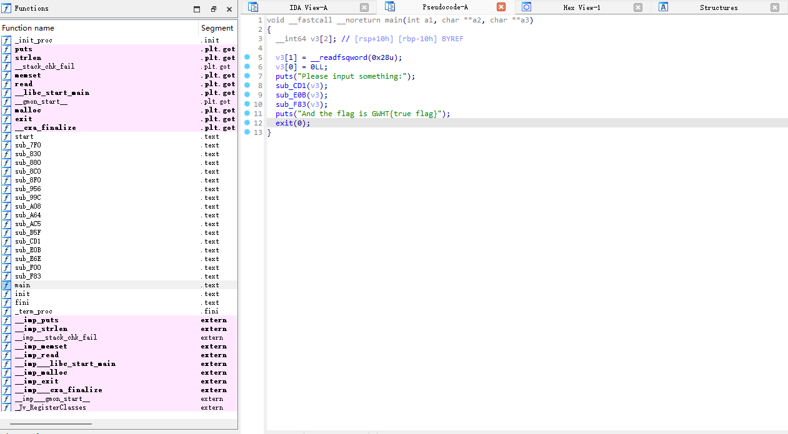
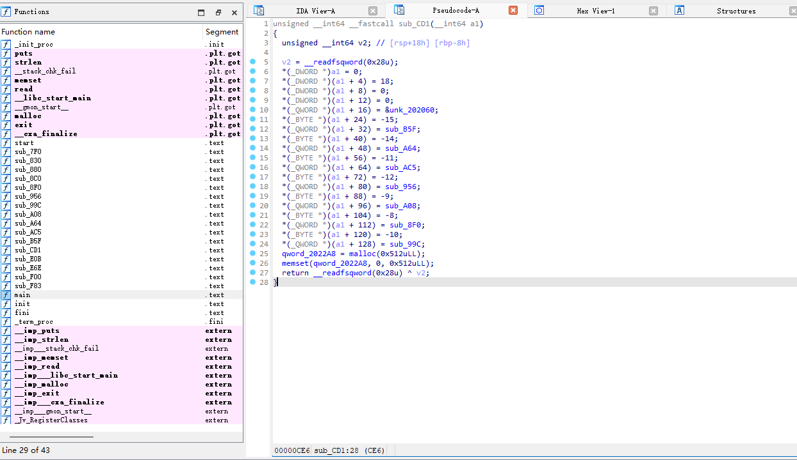
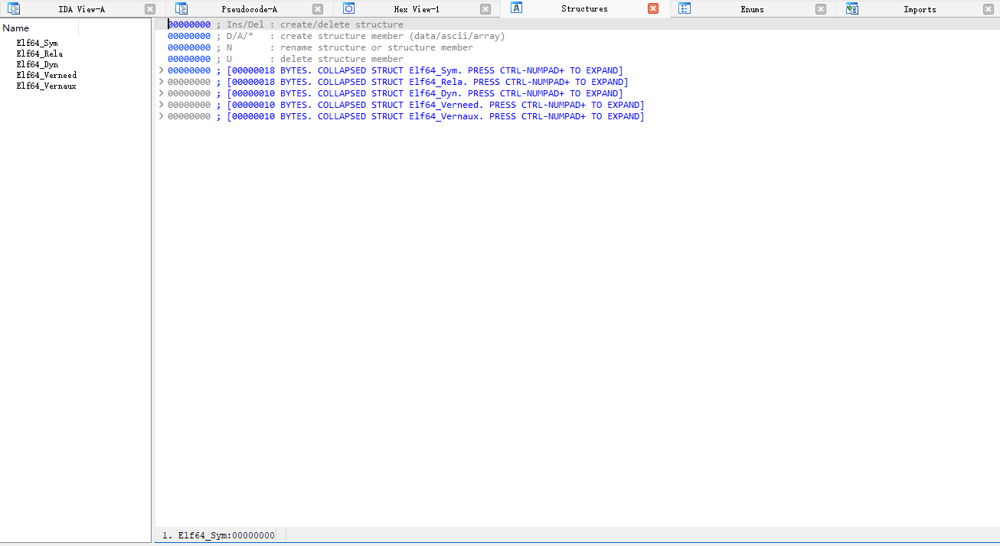
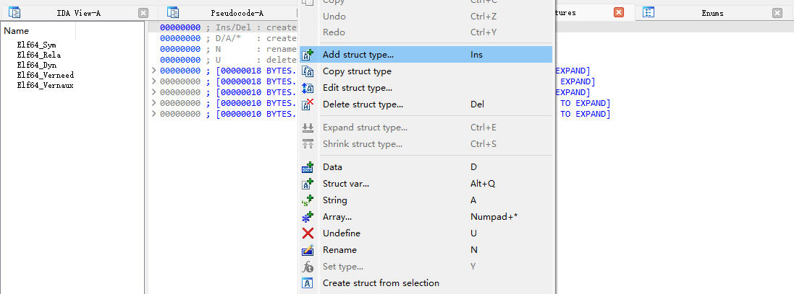
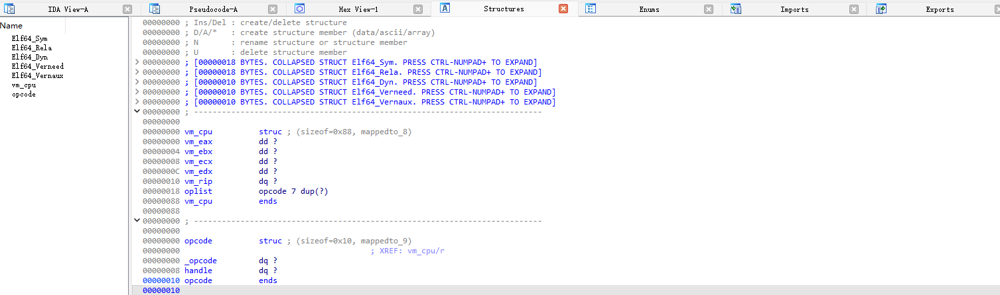
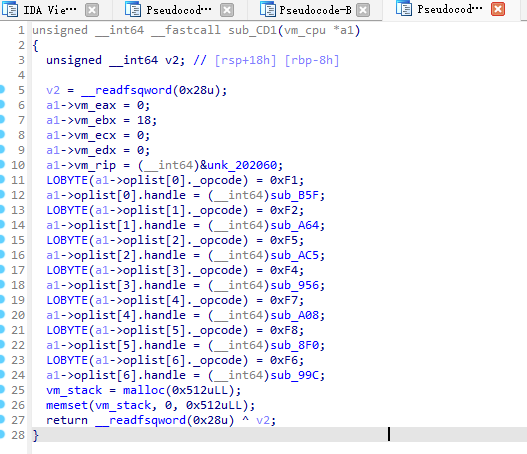

# 前言：

这道题算非常经典的vm题了，用这道题来熟悉一下vm题基本流程

# 正文：

## 创建结构体：



有三个函数我们点进去看一下具体逻辑



第一个函数很明显就是vm_init的结构，我们改名为vm_init,并创建结构体帮助静态分析



在空白部分右键，添加结构体



结构体名就叫vm_cpu，下面按d键快捷键给它增加成员变量

光标对准vm_cpu struc点一次d是在最前面增加成员变量

对准field_0点一次d是更改一次field_0的类型,也可按y直接输入类型

对准vm_cpu ends点一次d是在末尾增加成员变量


接下来修改成员变量的名称按n快捷键，改为eax，ebx等

由于vm_cpu中有个数组叫oplist[]

我们先创建新结构体

```c++
struct opcode
{
    QWORD _opcode;
    QWORD handle;
};
```

这里稍微再提一下怎么确定每个成员变量占多少字节，不要看ida给你强转出来的类型，而要看上下成员之间的差值，比如*(_BYTE *)(a1 + 24) = -15;和*(_QWORD *)(a1 + 32) = sub_B5F;从a1+24到a1+32，占了8个字节。所以这里_opcode类型是qword。下面是全部改完之后的结构体



再回到第一个函数，对准函数参数列表按y，把a1类型改为vm_cpu*，然后函数就变得美观了，下面的qword_2022A8是给vm设置的栈空间，我们也可以改名vm_stack



第二个函数很容易看出来是vm_run,分发器控制程序执行，第三个函数是验证flag正确与否，就不展开讲了

第二个函数把参数也改成vm_cpu*

```c++
unsigned __int64 __fastcall vm_run(vm_cpu *a1)
{
  unsigned __int64 v2; // [rsp+18h] [rbp-8h]

  v2 = __readfsqword(0x28u);
  a1->vm_rip = (__int64)&unk_202060;
  while ( *(_BYTE *)a1->vm_rip != 0xF4 )
    sub_E6E(a1);
  return __readfsqword(0x28u) ^ v2;
}
```

我们看到逻辑已经很明确了，就是rip指向的地址对应的值不等于0xf4时，一直调用sub_E6E

```c++
unsigned __int64 __fastcall sub_E6E(vm_cpu *a1)
{
  int i; // [rsp+14h] [rbp-Ch]
  unsigned __int64 v3; // [rsp+18h] [rbp-8h]

  v3 = __readfsqword(0x28u);
  for ( i = 0; *(_BYTE *)a1->vm_rip != LOBYTE(a1->oplist[i]._opcode); ++i )
    ;
  ((void (__fastcall *)(vm_cpu *))a1->oplist[i].handle)(a1);
  return __readfsqword(0x28u) ^ v3;
}
```

sub_E6E点进去就发现和我们的vm基础里的dispatcher结构一模一样，现在我们回头处理一下没命名的handle函数就可以正式逆向了

## 识别函数：

### 1.mov函数

```c++
unsigned __int64 __fastcall sub_B5F(vm_cpu *a1)
{
  int *v2; // [rsp+28h] [rbp-18h]
  unsigned __int64 v3; // [rsp+38h] [rbp-8h]

  v3 = __readfsqword(0x28u);
  v2 = (int *)(a1->vm_rip + 2);
  switch ( *(_BYTE *)(a1->vm_rip + 1) )
  {
    case 0xE1:
      a1->vm_eax = *((char *)vm_stack + *v2);
      break;
    case 0xE2:
      a1->vm_ebx = *((char *)vm_stack + *v2);
      break;
    case 0xE3:
      a1->vm_ecx = *((char *)vm_stack + *v2);
      break;
    case 0xE4:
      *((_BYTE *)vm_stack + *v2) = a1->vm_eax;
      break;
    case 0xE5:
      a1->vm_edx = *((char *)vm_stack + *v2);
      break;
    case 0xE7:
      *((_BYTE *)vm_stack + *v2) = a1->vm_ebx;
      break;
    default:
      break;
  }
  a1->vm_rip += 6LL;
  return __readfsqword(0x28u) ^ v3;
}
```

这个函数的意思是，v2是栈中偏移，相当于ss:[ebp+v2]=vm_stack[v2],当操作码=-15也就是0xF1的时候，调用这个函数，下一个地址的数*(_BYTE *)(a1->vm_rip+1))就是选择码，*(_BYTE *)(a1->vm_rip+2))就是操作数

- 选择码=0xE1 执行mov eax ss:[ebp+v2]

- 选择码=0xE2 执行mov ebx ss:[ebp+v2]

- 选择码=0xE3 执行mov ecx ss:[ebp+v2]

- 选择码=0xE4 执行mov ss:[ebp+v2] eax 

- 选择码=0xE5 执行mov edx ss:[ebp+v2]

- 选择码=0xE7 执行mov ss:[ebp+v2] ebx 

### 2.xor

```c++
unsigned __int64 __fastcall sub_A64(vm_cpu *a1)
{
  unsigned __int64 v2; // [rsp+18h] [rbp-8h]

  v2 = __readfsqword(0x28u);
  a1->vm_eax ^= a1->vm_ebx;
  ++a1->vm_rip;
  return __readfsqword(0x28u) ^ v2;
}
```

相当于xor eax ebx

### 3.read

```c++
unsigned __int64 __fastcall sub_AC5(vm_cpu *a1)
{
  const char *buf; // [rsp+10h] [rbp-10h]
  unsigned __int64 v3; // [rsp+18h] [rbp-8h]

  v3 = __readfsqword(0x28u);
  buf = (const char *)vm_stack;
  read(0, vm_stack, 0x20uLL);
  dword_2022A4 = strlen(buf);
  if ( dword_2022A4 != 21 )
  {
    puts("WRONG!");
    exit(0);
  }
  ++a1->vm_rip;
  return __readfsqword(0x28u) ^ v3;
}
```

把flag读入栈上

相当于call read,并判断flag长度

### 4.nop

```c++
unsigned __int64 __fastcall sub_956(vm_cpu *a1)
{
  unsigned __int64 v2; // [rsp+18h] [rbp-8h]

  v2 = __readfsqword(0x28u);
  ++a1->vm_rip;
  return __readfsqword(0x28u) ^ v2;
}
```

什么都没干，rip只是加1，这是所有指令都要有的

### 5.mul

```c++
unsigned __int64 __fastcall sub_A08(vm_cpu *a1)
{
  unsigned __int64 v2; // [rsp+18h] [rbp-8h]

  v2 = __readfsqword(0x28u);
  a1->vm_eax *= a1->vm_edx;
  ++a1->vm_rip;
  return __readfsqword(0x28u) ^ v2;
}
```

mul eax edx

### 6.xchg

```c++
unsigned __int64 __fastcall sub_8F0(vm_cpu *a1)
{
  int vm_eax; // [rsp+14h] [rbp-Ch]
  unsigned __int64 v3; // [rsp+18h] [rbp-8h]

  v3 = __readfsqword(0x28u);
  vm_eax = a1->vm_eax;
  a1->vm_eax = a1->vm_ebx;
  a1->vm_ebx = vm_eax;
  ++a1->vm_rip;
  return __readfsqword(0x28u) ^ v3;
}
```

xchg eax ebx

### 7.自定义函数

```c++
unsigned __int64 __fastcall sub_99C(vm_cpu *a1)
{
  unsigned __int64 v2; // [rsp+18h] [rbp-8h]

  v2 = __readfsqword(0x28u);
  a1->vm_eax = a1->vm_ecx + 2 * a1->vm_ebx + 3 * a1->vm_eax;
  ++a1->vm_rip;
  return __readfsqword(0x28u) ^ v2;
}
```

实现了eax=ecx+2*ebx+3*eax应该是自定义指令

## 自己实现dispatcher，汇编层面逆向

```c++
#include<iostream>
using namespace std;
int opcode[]={
0xF5, 0xF1, 0xE1, 0x00, 0x00, 0x00, 0x00, 0xF2, 0xF1, 0xE4, 
  0x20, 0x00, 0x00, 0x00, 0xF1, 0xE1, 0x01, 0x00, 0x00, 0x00, 
  0xF2, 0xF1, 0xE4, 0x21, 0x00, 0x00, 0x00, 0xF1, 0xE1, 0x02, 
  0x00, 0x00, 0x00, 0xF2, 0xF1, 0xE4, 0x22, 0x00, 0x00, 0x00, 
  0xF1, 0xE1, 0x03, 0x00, 0x00, 0x00, 0xF2, 0xF1, 0xE4, 0x23, 
  0x00, 0x00, 0x00, 0xF1, 0xE1, 0x04, 0x00, 0x00, 0x00, 0xF2, 
  0xF1, 0xE4, 0x24, 0x00, 0x00, 0x00, 0xF1, 0xE1, 0x05, 0x00, 
  0x00, 0x00, 0xF2, 0xF1, 0xE4, 0x25, 0x00, 0x00, 0x00, 0xF1, 
  0xE1, 0x06, 0x00, 0x00, 0x00, 0xF2, 0xF1, 0xE4, 0x26, 0x00, 
  0x00, 0x00, 0xF1, 0xE1, 0x07, 0x00, 0x00, 0x00, 0xF2, 0xF1, 
  0xE4, 0x27, 0x00, 0x00, 0x00, 0xF1, 0xE1, 0x08, 0x00, 0x00, 
  0x00, 0xF2, 0xF1, 0xE4, 0x28, 0x00, 0x00, 0x00, 0xF1, 0xE1, 
  0x09, 0x00, 0x00, 0x00, 0xF2, 0xF1, 0xE4, 0x29, 0x00, 0x00, 
  0x00, 0xF1, 0xE1, 0x0A, 0x00, 0x00, 0x00, 0xF2, 0xF1, 0xE4, 
  0x2A, 0x00, 0x00, 0x00, 0xF1, 0xE1, 0x0B, 0x00, 0x00, 0x00, 
  0xF2, 0xF1, 0xE4, 0x2B, 0x00, 0x00, 0x00, 0xF1, 0xE1, 0x0C, 
  0x00, 0x00, 0x00, 0xF2, 0xF1, 0xE4, 0x2C, 0x00, 0x00, 0x00, 
  0xF1, 0xE1, 0x0D, 0x00, 0x00, 0x00, 0xF2, 0xF1, 0xE4, 0x2D, 
  0x00, 0x00, 0x00, 0xF1, 0xE1, 0x0E, 0x00, 0x00, 0x00, 0xF2, 
  0xF1, 0xE4, 0x2E, 0x00, 0x00, 0x00, 0xF1, 0xE1, 0x0F, 0x00, 
  0x00, 0x00, 0xF2, 0xF1, 0xE4, 0x2F, 0x00, 0x00, 0x00, 0xF1, 
  0xE1, 0x10, 0x00, 0x00, 0x00, 0xF2, 0xF1, 0xE4, 0x30, 0x00, 
  0x00, 0x00, 0xF1, 0xE1, 0x11, 0x00, 0x00, 0x00, 0xF2, 0xF1, 
  0xE4, 0x31, 0x00, 0x00, 0x00, 0xF1, 0xE1, 0x12, 0x00, 0x00, 
  0x00, 0xF2, 0xF1, 0xE4, 0x32, 0x00, 0x00, 0x00, 0xF1, 0xE1, 
  0x13, 0x00, 0x00, 0x00, 0xF2, 0xF1, 0xE4, 0x33, 0x00, 0x00, 
  0x00, 0xF4, 0x00, 0x00, 0x00, 0x00, 0x00, 0x00, 0x00, 0x00, 
  0x00, 0x00, 0x00, 0x00, 0x00, 0x00, 0x00, 0x00, 0x00, 0x00, 
  0x00, 0x00, 0x00, 0x00, 0x00, 0x00, 0x00, 0x00, 0xF5, 0xF1, 
  0xE1, 0x00, 0x00, 0x00, 0x00, 0xF1, 0xE2, 0x01, 0x00, 0x00, 
  0x00, 0xF2, 0xF1, 0xE4, 0x00, 0x00, 0x00, 0x00, 0xF1, 0xE1, 
  0x01, 0x00, 0x00, 0x00, 0xF1, 0xE2, 0x02, 0x00, 0x00, 0x00, 
  0xF2, 0xF1, 0xE4, 0x01, 0x00, 0x00, 0x00, 0xF1, 0xE1, 0x02, 
  0x00, 0x00, 0x00, 0xF1, 0xE2, 0x03, 0x00, 0x00, 0x00, 0xF2, 
  0xF1, 0xE4, 0x02, 0x00, 0x00, 0x00, 0xF1, 0xE1, 0x03, 0x00, 
  0x00, 0x00, 0xF1, 0xE2, 0x04, 0x00, 0x00, 0x00, 0xF2, 0xF1, 
  0xE4, 0x03, 0x00, 0x00, 0x00, 0xF1, 0xE1, 0x04, 0x00, 0x00, 
  0x00, 0xF1, 0xE2, 0x05, 0x00, 0x00, 0x00, 0xF2, 0xF1, 0xE4, 
  0x04, 0x00, 0x00, 0x00, 0xF1, 0xE1, 0x05, 0x00, 0x00, 0x00, 
  0xF1, 0xE2, 0x06, 0x00, 0x00, 0x00, 0xF2, 0xF1, 0xE4, 0x05, 
  0x00, 0x00, 0x00, 0xF1, 0xE1, 0x06, 0x00, 0x00, 0x00, 0xF1, 
  0xE2, 0x07, 0x00, 0x00, 0x00, 0xF1, 0xE3, 0x08, 0x00, 0x00, 
  0x00, 0xF1, 0xE5, 0x0C, 0x00, 0x00, 0x00, 0xF6, 0xF7, 0xF1, 
  0xE4, 0x06, 0x00, 0x00, 0x00, 0xF1, 0xE1, 0x07, 0x00, 0x00, 
  0x00, 0xF1, 0xE2, 0x08, 0x00, 0x00, 0x00, 0xF1, 0xE3, 0x09, 
  0x00, 0x00, 0x00, 0xF1, 0xE5, 0x0C, 0x00, 0x00, 0x00, 0xF6, 
  0xF7, 0xF1, 0xE4, 0x07, 0x00, 0x00, 0x00, 0xF1, 0xE1, 0x08, 
  0x00, 0x00, 0x00, 0xF1, 0xE2, 0x09, 0x00, 0x00, 0x00, 0xF1, 
  0xE3, 0x0A, 0x00, 0x00, 0x00, 0xF1, 0xE5, 0x0C, 0x00, 0x00, 
  0x00, 0xF6, 0xF7, 0xF1, 0xE4, 0x08, 0x00, 0x00, 0x00, 0xF1, 
  0xE1, 0x0D, 0x00, 0x00, 0x00, 0xF1, 0xE2, 0x13, 0x00, 0x00, 
  0x00, 0xF8, 0xF1, 0xE4, 0x0D, 0x00, 0x00, 0x00, 0xF1, 0xE7, 
  0x13, 0x00, 0x00, 0x00, 0xF1, 0xE1, 0x0E, 0x00, 0x00, 0x00, 
  0xF1, 0xE2, 0x12, 0x00, 0x00, 0x00, 0xF8, 0xF1, 0xE4, 0x0E, 
  0x00, 0x00, 0x00, 0xF1, 0xE7, 0x12, 0x00, 0x00, 0x00, 0xF1, 
  0xE1, 0x0F, 0x00, 0x00, 0x00, 0xF1, 0xE2, 0x11, 0x00, 0x00, 
  0x00, 0xF8, 0xF1, 0xE4, 0x0F, 0x00, 0x00, 0x00, 0xF1, 0xE7, 
  0x11, 0x00, 0x00, 0x00, 0xF4
};
int main()
{
    int rip=0;
    int vm_eax=0;
    int vm_ebx=18;
    int vm_ecx=0;
    int vm_edx=0;
    int vm_stack[521];
    for(int i=0;i<521;i++)
    {
        vm_stack[i]=0;
    }
    int len = sizeof(opcode) / sizeof(opcode[0]);
    while (rip<len)
    {
        if(opcode[rip]==0xF1)
        {
            int v2=opcode[rip+2];
            switch(opcode[rip+1])
            {
                case 0xE1:
                    vm_eax = vm_stack[v2];
                    cout<<"mov eax,stack["<<v2<<"]"<<endl;
                    break;
                case 0xE2:
                    vm_ebx = vm_stack[v2];
                    cout<<"mov ebx,stack["<<v2<<"]"<<endl;
                    break;
                case 0xE3:
                    vm_ecx = vm_stack[v2];
                    cout<<"mov ecx,stack["<<v2<<"]"<<endl;
                    break;
                case 0xE4:
                    vm_stack[v2] = vm_eax;
                    cout<<"mov stack["<<v2<<"],eax"<<endl;
                    break;
                case 0xE5:
                    vm_edx = vm_stack[v2];
                    cout<<"mov edx,stack["<<v2<<"]"<<endl;
                    break;
                case 0xE7:
                    vm_stack[v2] = vm_ebx;
                    cout<<"mov stack["<<v2<<"],ebx"<<endl;
                    break;
                default:
                    break;
            }
            rip+=6;
            continue;
        }
        else if(opcode[rip]==0xF2)
        {
            vm_eax^=vm_ebx;
            cout<<"xor eax ebx"<<endl;
        }
        else if(opcode[rip]==0xF5)
        {
            // for(int i=0;i<21;i++)
            // {
            //     char c;
            //     cin>>c;
            //     vm_stack[i]=c;
            // }
            cout<<"read flag&&judge len"<<endl;
        }
        else if(opcode[rip]==0xf4)
        {
            cout<<"nop"<<endl;
        }
        else if(opcode[rip]==0xF6)
        {
            vm_eax=vm_ecx+2*vm_ebx+3*vm_eax;
            cout<<"eax=ecx+2*ebx+3*eax"<<endl;
        }
        else if(opcode[rip]==0xF7)
        {
            vm_eax*=vm_edx;
            cout<<"mul eax edx"<<endl;
        }
        else if(opcode[rip]==0xF8)
        {
            int t = vm_eax;
            vm_eax = vm_ebx;
            vm_ebx = t;
            cout<<"xchg eax ebx"<<endl;
        }
        rip++;

    }

}
```

这里其实可以把栈信息一起打印出来的，但是这道题非常简单没有涉及到栈的其他操作，只是简单把flag放在栈上，所以这里不打印了

结果：

```asmatmel
read flag&&judge len
mov eax,stack[0]
xor eax ebx
mov stack[32],eax
mov eax,stack[1]
xor eax ebx
mov stack[33],eax
mov eax,stack[2]
xor eax ebx
mov stack[34],eax
mov eax,stack[3]
xor eax ebx
mov stack[35],eax
mov eax,stack[4]
xor eax ebx
mov stack[36],eax
mov eax,stack[5]
xor eax ebx
mov stack[37],eax
mov eax,stack[6]
xor eax ebx
mov stack[38],eax
mov eax,stack[7]
xor eax ebx
mov stack[39],eax
mov eax,stack[8]
xor eax ebx
mov stack[40],eax
mov eax,stack[9]
xor eax ebx
mov stack[41],eax
mov eax,stack[10]
xor eax ebx
mov stack[42],eax
mov eax,stack[11]
xor eax ebx
mov stack[43],eax
mov eax,stack[12]
xor eax ebx
mov stack[44],eax
mov eax,stack[13]
xor eax ebx
mov stack[45],eax
mov eax,stack[14]
xor eax ebx
mov stack[46],eax
mov eax,stack[15]
xor eax ebx
mov stack[47],eax
mov eax,stack[16]
xor eax ebx
mov stack[48],eax
mov eax,stack[17]
xor eax ebx
mov stack[49],eax
mov eax,stack[18]
xor eax ebx
mov stack[50],eax
mov eax,stack[19]
xor eax ebx
mov stack[51],eax
nop
read flag&&judge len
mov eax,stack[0]
mov ebx,stack[1]
xor eax ebx
mov stack[0],eax
mov eax,stack[1]
mov ebx,stack[2]
xor eax ebx
mov stack[1],eax
mov eax,stack[2]
mov ebx,stack[3]
xor eax ebx
mov stack[2],eax
mov eax,stack[3]
mov ebx,stack[4]
xor eax ebx
mov stack[3],eax
mov eax,stack[4]
mov ebx,stack[5]
xor eax ebx
mov stack[4],eax
mov eax,stack[5]
mov ebx,stack[6]
xor eax ebx
mov stack[5],eax
mov eax,stack[6]
mov ebx,stack[7]
mov ecx,stack[8]
mov edx,stack[12]
eax=ecx+2*ebx+3*eax
mul eax edx
mov stack[6],eax
mov eax,stack[7]
mov ebx,stack[8]
mov ecx,stack[9]
mov edx,stack[12]
eax=ecx+2*ebx+3*eax
mul eax edx
mov stack[7],eax
mov eax,stack[8]
mov ebx,stack[9]
mov ecx,stack[10]
mov edx,stack[12]
eax=ecx+2*ebx+3*eax
mul eax edx
mov stack[8],eax
mov eax,stack[13]
mov ebx,stack[19]
xchg eax ebx
mov stack[13],eax
mov stack[19],ebx
mov eax,stack[14]
mov ebx,stack[18]
xchg eax ebx
mov stack[14],eax
mov stack[18],ebx
mov eax,stack[15]
mov ebx,stack[17]
xchg eax ebx
mov stack[15],eax
mov stack[17],ebx
nop
```

正常一道普通的vm逆向题到这里看汇编逆向写exp就结束了，但这道题还有坑

## 题外话：

### 解题：

这道题汇编前半部分很明显不对，因为flag总长度才21，栈上怎么索引到50多了，所以交叉引用找到真正的check函数,而且汇报中有两次输入，第二次输入才是真的

```c++
unsigned __int64 sub_F00()
{
  int i; // [rsp+Ch] [rbp-14h]
  unsigned __int64 v2; // [rsp+18h] [rbp-8h]

  v2 = __readfsqword(0x28u);
  for ( i = 0; len_flag - 1 > i; ++i )
  {
    if ( *((_BYTE *)vm_stack + i) != byte_202020[i] )
      exit(0);
  }
  return __readfsqword(0x28u) ^ v2;
}
```

exp：

```py
from z3 import *
import re

# 密文（十六进制字符串）
flag = '69 45 2A 37 09 17 C5 0B 5C 72 33 76 33 21 74 31 5F 33 73 72'.split(' ')
flag = [int(x, 16) for x in flag]

# 1) 还原前面的三次交换（你在 forward 阶段做了 13<->19, 14<->18, 15<->17）
flag[15], flag[17] = flag[17], flag[15]
flag[14], flag[18] = flag[18], flag[14]
flag[19], flag[13] = flag[13], flag[19]

# 2) 用 Z3 求解 a6,a7,a8（原始 stack[6..8]）
# 方程（forward）是： f6 = (s8 + 2*s7 + 3*s6) * s12  （全部为字节运算）
a6, a7, a8 = BitVecs('a6 a7 a8', 8)
s = Solver()

# 注意：这里 flag[...] 是 Python 整数（0..255），Z3 会自动把它转为相应的常量。
# 若你想更严格地把所有算术限定为 8-bit，可把常量也包装成 BitVecVal(...,8)。
s.add( BitVecVal(flag[6],8) == (a8 + (a7 << 1) + a6 * BitVecVal(3,8)) * BitVecVal(flag[12],8) )
s.add( BitVecVal(flag[7],8) == (BitVecVal(flag[9],8)  + (a8 << 1) + a7 * BitVecVal(3,8)) * BitVecVal(flag[12],8) )
s.add( BitVecVal(flag[8],8) == (BitVecVal(flag[10],8) + (BitVecVal(flag[9],8) << 1) + a8 * BitVecVal(3,8)) * BitVecVal(flag[12],8) )

if s.check() == sat:
    m = s.model()
    # 把求得的 a6,a7,a8 写回 flag 对应位置
    for v in [a6, a7, a8]:
        idx = int(re.search(r'\d+', str(v)).group())
        flag[idx] = m[v].as_long()

# 3) 逆向 XOR 链（forward 做了 f0 = s0^s1; f1 = s1^s2; ...; f5 = s5^s6）
for i in range(5, -1, -1):
    flag[i] ^= flag[i + 1]

print('[+] flag: ', ''.join(chr(x) for x in flag))

# [+] flag:  Y0u_hav3_r3v3rs3_1t!
```

# 
