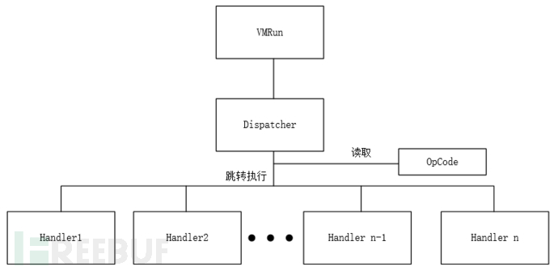

# 前言：

学过计算机组成原理的应该都知道，程序的运行是靠cpu解释可执行文件中操作码来实现的功能，vm逆向顾名思义就是自己定义了小型cpu并定义了指令集，将程序的代码转换自定义的操作码(opcode)，然后在程序执行时再通过解释这些操作码，选择对应的函数执行，从而实现程序原有的功能。


# vm逆向基本原理：

## vm_init：

虚拟机的入口函数，对虚拟机环境进行初始化，初始化一般包括

- 寄存器初始化(eax,ebx,ecx,edx,eip)

- 把handle函数和操作码连接在一起

- 给虚拟机的栈空间vm_stack分配内存

## vm_run:

虚拟机开始运行的地方

## vm_dispatcher:

调度器，解释opcode，并选择对应的handle函数执行，当handle执行完后会跳回这里，形成一个循环。

## vm_handle:

处理器，当rip走到对应操作码时调用对应操作函数，并接受操作数。

## opcode :

程序可执行代码转换成的操作码

在这种情况下，如果要逆向程序，就需要对整个emulator结构进行逆向，理解程序功能，还需要结合opcode进行分析，整个程序逆向工程将会十分繁琐。这是一个一般虚拟机结构：


## vm_lables:

有的虚拟机涉及lable的创造和调用，起到跳转目的

## 分析方法

在比赛中，虚拟机题目常常有两种考法：

- 给可执行程序和opcode，逆向emulator，结合opcode文件，推出flag

- 只给可执行程序，逆向emulator，构造opcode，读取flag

拿到一个虚拟机之后，一般有以下几个逆向过程：

- 分析虚拟机入口，搞清虚拟机的输入，或者opcode位置

- 理清虚拟机结构，包括Dispatcher和各个Handler

- 逆向各个Handler，分析opcode的意义

- 根据opcode运行时打印出对应汇编代码，根据汇编代码逻辑进行逆向
  
  
  
  

# 一个简单vm虚拟机实例：

## vm_cpu结构体

```c++
typedef struct
{
    unsigned long r1;    //虚拟寄存器r1
    unsigned long r2;    //虚拟寄存器r2
    unsigned long r3;    //虚拟寄存器r3
    unsigned char *eip;    //指向正在解释的opcode地址
    vm_opcode op_list[OPCODE_N];    //opcode列表，存放了所有的opcode及其对应的处理函数
}vm_cpu;
```

## vm_opcode结构体

```c++
typedef struct
{
    unsigned char opcode;
    void (*handle)(void*);
}vm_opcode;
```

## vm_init()

```c++

void *vm_init()
{
    vm_vpu *cpu;
    cpu->r1 = 0;
    cpu->r2 = 0;
    cpu->r3 = 0;
    cpu->eip = (unsigned char *)vm_code;//将eip指向opcode的地址

    cpu->op_list[0].opcode = 0x1;
    cpu->op_list[0].handle = (void (*)(void *))mov;//将操作字节码与对应的handle函数关联在一起

    cpu->op_list[1].opcode = 0xf2;
    cpu->op_list[1].handle = (void (*)(void *))xor;

    cpu->op_list[2].opcode = 0xf5;
    cpu->op_list[2].handle = (void (*)(void *))read_;

    vm_stack = malloc(0x512);
    memset(vm_stack,0,0x512);
}
```

### handles(示例)

```cpp
void mov(vm_cpu *cpu);
void xor(vm_cpu *cpu);    //xor flag
void read_(vm_cpu *cpu);    //call read, read the flag

void xor(vm_cpu *cpu)
{
    int temp;
    temp = cpu->r1 ^ cpu->r2;
    temp ^= 0x12;
    cpu->r1 = temp;
    cpu->eip += 1;    //xor指令占一个字节
}

void read_(vm_cpu *cpu)
{
    char *dest = vm_stack;
    read(0,dest,12);    //用于往虚拟机的栈上读取数据
    cpu->eip += 1;    //read_指令占一个字节
}

void mov(vm_cpu *cpu)
{
    //mov指令的参数都因曾在字节码也就是vm_code中，指令表示后的一个字节是寄存器表示，第二到
//第五是要mov的数据在vm_stack上的偏移
    //这里只是实现了从vm_stack上取数据和存数据到vm_stack上
    unsigned char *res = cpu->eip + 1;    //寄存器标识
    int *offset = (int *)(cpu->eip + 2);    //寄存器在vm_stack上的偏移
    char *dest = 0;
    dest = vm_stack;

    switch (*res) {
        case 0xe1:
            cpu->r1 = *(dest + *offset);
            break;   

        case 0xe2:
            cpu->r2 = *(dest + *offset);
            break;   

        case 0xe3:
            cpu->r3 = *(dest + *offset);
            break;   
        case 0xe4:
        {
            int x = cpu->r1;
            *(dest + *offset) = x;
            break;

        }
    }   

    cpu->eip += 6;
    //mov指令占六个字节，所以eip要向后移6位
}
```

### vm_code

```c++
​unsigned char vm_code[] = {
    0xf5,
    0xf1,0xe1,0x0,0x00,0x00,0x00,0xf2,0xf1,0xe4,0x20,0x00,0x00,0x00,
    0xf1,0xe1,0x1,0x00,0x00,0x00,0xf2,0xf1,0xe4,0x21,0x00,0x00,0x00,
    0xf1,0xe1,0x2,0x00,0x00,0x00,0xf2,0xf1,0xe4,0x22,0x00,0x00,0x00,
    0xf1,0xe1,0x3,0x00,0x00,0x00,0xf2,0xf1,0xe4,0x23,0x00,0x00,0x00,
    0xf1,0xe1,0x4,0x00,0x00,0x00,0xf2,0xf1,0xe4,0x24,0x00,0x00,0x00,
    0xf1,0xe1,0x5,0x00,0x00,0x00,0xf2,0xf1,0xe4,0x25,0x00,0x00,0x00,
    0xf1,0xe1,0x6,0x00,0x00,0x00,0xf2,0xf1,0xe4,0x26,0x00,0x00,0x00,
    0xf1,0xe1,0x7,0x00,0x00,0x00,0xf2,0xf1,0xe4,0x27,0x00,0x00,0x00,
    0xf1,0xe1,0x8,0x00,0x00,0x00,0xf2,0xf1,0xe4,0x28,0x00,0x00,0x00,
    0xf1,0xe1,0x9,0x00,0x00,0x00,0xf2,0xf1,0xe4,0x29,0x00,0x00,0x00,
    0xf1,0xe1,0xa,0x00,0x00,0x00,0xf2,0xf1,0xe4,0x2a,0x00,0x00,0x00,
    0xf1,0xe1,0xb,0x00,0x00,0x00,0xf2,0xf1,0xe4,0x2b,0x00,0x00,0x00,
    0xf4
};

​
```

### vm_stack

一般是一个全局数组，用于存放虚拟机的栈

```c++
vm_stack = malloc(0x512);
memset(vm_stack,0,0x512);
```


## vm_run

```c++
void vm_run(vm_cpu *cpu)
{
    /*
    进入虚拟机
    eip指向要被解释的opcode地址
    */
    cpu->eip = (unsigned char*)opcodes;
    while((*cpu->eip) != 0xf4)//如果opcode不为RET，就调用vm_dispatcher来解释执行
    {
        vm_dispatcher(*cpu->eip)
    }
}
```

## vm_dispatcher

```cpp
void vm_dispatcher(vm_cpu *cpu)
{
    int i;
    for(i = 0; i < OPCODE_N; i++)
    {    
        if(*cpu->eip == cpu->op_list[i].opcode)
        {
            cpu->op_list[i].handle(cpu);
            break;
        }
    }
}
```


# 做题流程：

- 先根据上面的特征静态分析判断函数是vm中的哪一部分，如果静态分析困难，那就动调一下

- 找到对应部分后创建上述结构体来帮助分析

- 自己把vm还原在vscode里，并在dispatcher部分加上打印这条指令的代码，有的时候也可以打印stack，和当前执行完指令的内存状态(各个变量的值)

- 根据打印出的汇编指令，手动逆向
  
  

具体使用方法还需在实战中不断练习，具体做题流程可看我的vm题单真题

# 参考文献：

[虚拟机逆向与实现-CSDN博客](https://blog.csdn.net/weixin_43876357/article/details/108570305)

[虚拟机保护逆向入门 - FreeBuf网络安全行业门户](https://www.freebuf.com/column/174623.html)


