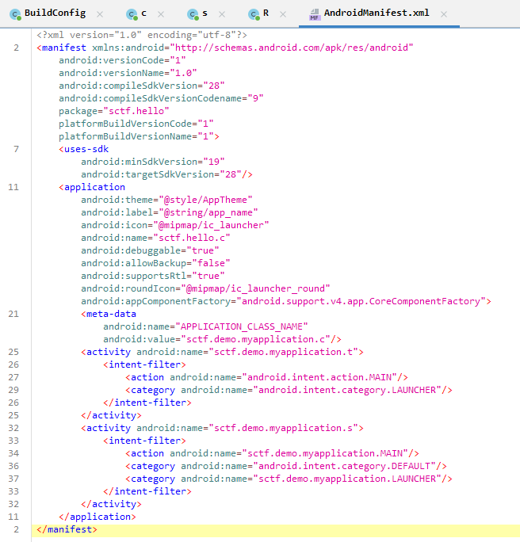
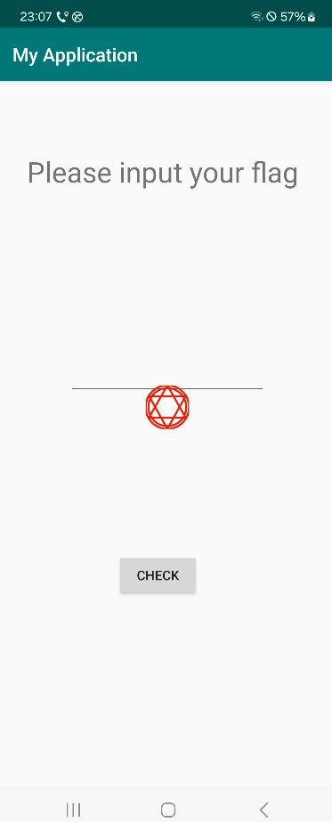

# 前言：

用一道经典安卓题练习一下脱壳

[BUUCTF在线评测](https://buuoj.cn/challenges#[SCTF2019]Strange%20apk)

# 拖进jadx

发现



启动类是sctf.demo.myapplication.t,但是反编译的类没有。（有android.intent.action.MAIN才是启动类）

猜测是加壳或者别的什么需要动态抓dex的混淆方法

# 动态提取/脱壳

## 利用反射大师提取dex：

在xposed模块勾选反射大师，再把我们要分析的app放在反射大师的作用域下。

然后运行反射大师，点选中该软件。然后启动这个软件



在flag报错后点六芒星，选择当前activity，然后写出dex就可以动态提取了

# 分析dex

先看入口函数调用了什么判断逻辑

```java
/* loaded from: C:\Users\Lenovo\OneDrive\Desktop\cookie_2183120.dex */
public class t extends AppCompatActivity {
    /* JADX INFO: Access modifiers changed from: protected */
    @Override // android.support.v7.app.AppCompatActivity, android.support.v4.app.FragmentActivity, android.support.v4.app.SupportActivity, android.app.Activity
    public void onCreate(Bundle savedInstanceState) {
        super.onCreate(savedInstanceState);
        setContentView(R.layout.activity);
        Button bu = (Button) findViewById(R.id.button2);
        bu.setOnClickListener(new View.OnClickListener() { // from class: sctf.demo.myapplication.t.1
            @Override // android.view.View.OnClickListener
            public void onClick(View v) {
                Intent intent = new Intent("sctf.demo.myapplication.MAIN");
                intent.addCategory("sctf.demo.myapplication.LAUNCHER");
                t.this.startActivityForResult(intent, 1);
            }
        });
    }
```

## 调用流程：

### 从 UI 点击到启动子 Activity

* 用户在 `t` 的界面点击按钮（`bu` 的 `onClick`）。

* `t` 的 `onClick` 执行：

```java
Intent intent = new Intent("sctf.demo.myapplication.MAIN");
intent.addCategory("sctf.demo.myapplication.LAUNCHER");
t.this.startActivityForResult(intent, 1);
```

这是**隐式 Intent**（action + category），由系统根据 `AndroidManifest.xml` 的 `intent-filter` 去匹配可响应的 Activity。

在我们的 manifest 中，`s`（即 `sctf.demo.myapplication.s`）声明了相同的 action/category，所以系统会启动 `s`。

关键：这里使用了 `startActivityForResult(..., 1)`，所以启动的是“带返回结果”的子 Activity，`requestCode = 1`。


### 子 Activity  s 的流程

这里切换到s类的oncreate()函数

```java
public class s extends AppCompatActivity {
    /* JADX INFO: Access modifiers changed from: protected */
    @Override // android.support.v7.app.AppCompatActivity, android.support.v4.app.FragmentActivity, android.support.v4.app.SupportActivity, android.app.Activity
    public void onCreate(Bundle savedInstanceState) {
        super.onCreate(savedInstanceState);
        setContentView(R.layout.activity_main);
        Button bu = (Button) findViewById(R.id.button);
        findViewById(R.id.textView);
        final EditText ed = (EditText) findViewById(R.id.editText);
        bu.setOnClickListener(new View.OnClickListener() { // from class: sctf.demo.myapplication.s.1
            @Override // android.view.View.OnClickListener
            public void onClick(View v) {
                String s1 = BuildConfig.FLAVOR;
                String s2 = BuildConfig.FLAVOR;
                int i = 0;
                String s = ed.getText().toString();
                if (s.length() == 30) {
                    while (i < 12) {
                        s1 = s1 + s.charAt(i);
                        i++;
                    }
                    String s12 = f.sctf(s1);
                    while (i < 30) {
                        s2 = s2 + s.charAt(i);
                        i++;
                    }
                    if (s12.equals("c2N0ZntXM2xjMG1l")) {
                        Intent intent = new Intent();
                        intent.putExtra("data_return", s2);
                        s.this.setResult(-1, intent);
                        s.this.finish();
                        return;
                    }
                    Toast.makeText(s.this.getApplicationContext(), "something wrong", 1).show();
                    return;
                }
                Toast.makeText(s.this.getApplicationContext(), "something wrong", 1).show();
            }
        });
    }
}
```

当 `s` 被启动后（用户界面），用户在 `s` 上输入并点击确认（`s` 的按钮 `onClick`）：

1. `s` 读取输入字符串 `s`（`ed.getText().toString()`）。

2. 要求 `s.length() == 30`，否则 `Toast("something wrong")` 并返回。

3. 将输入拆成两部分：
   
   * `s1` = 前 12 个字符（索引 0..11）
   
   * `s2` = 后 18 个字符（索引 12..29）

4. 计算 `s12 = f.sctf(s1)`，并判断
   
   

**第一段加密比较简单，直接base64解密就可以了**

`sctf{W3lc0me `


### 回到父 Activity `t`：系统回调 `onActivityResult`

```ini
补充：intent是Android程序中各组件之间进行交互的一种重要方式，一般被用来启动活动、启动服务以及发送广播等；intent在启动Activity的时候可以这时候就需要用到putExtra()方法。intent中提供一系列的putExtra()方法的重载，可以把想要传递的数据暂存在intent中，当另一个活动启动后putExtra("A", B)方法中，AB为键值对，第一个参数为键名，第二个参数为键对应的值，这个值才是真正要传递的数据。
```

当 `s` `setResult(RESULT_OK, intent)` 并 `finish()` 后，系统会调用 `t.onActivityResult(requestCode, resultCode, data)`：

这里 `requestCode == 1`（与启动时一致），`resultCode == -1`（`RESULT_OK`）

```java
    protected void onActivityResult(int requestCode, int resultCode, Intent data) {
        TextView tv = (TextView) findViewById(R.id.textView2);
        Button bu = (Button) findViewById(R.id.button2);
        if (requestCode == 1 && resultCode == -1) {
            String key = BuildConfig.FLAVOR;
            try {
                MessageDigest md = MessageDigest.getInstance("MD5");
                md.update("syclover".getBytes());
                key = new BigInteger(1, md.digest()).toString(16);
            } catch (Exception e) {
                e.printStackTrace();
            }
            String str = f.encode(data.getStringExtra("data_return"), key);
            if (!str.equals("~8t808_8A8n848r808i8d8-8w808r8l8d8}8")) {
                Toast.makeText(getApplicationContext(), "one more step", 1).show();
            } else {
                tv.setVisibility(0);
                bu.setVisibility(4);
            }
        }
    }
}
```

这里有第二重比较

key=MD5("syclover") = 8bfc8af07bca146c937f283b8ec768d4

f.encode:

```java
public class f {
    public static String encode(String str, String key) {
        int s = str.length();
        int c = key.length();
        StringBuilder t = new StringBuilder();
        for (int f = 0; f < s; f++) {
            t.append(str.charAt(f));
            t.append(key.charAt(f / c));
        }
        return t.toString();
    }   

}
```

只有当 `f.encode(s2, key)` 等于魔法串 `~8t808_8A8n848r808i8d8-8w808r8l8d8}8` 时，界面才显示成功（`textView2` 显示，按钮隐藏）；否则提示失败。

由于key的长度=c=32，那encode函数里的f/c一定为0,所以魔法串里的偶数位8全部去掉就是flag

`~t0_An4r0id-w0rld} `


# flag:

sctf{W3lc0me~t0_An4r0id-w0rld}
