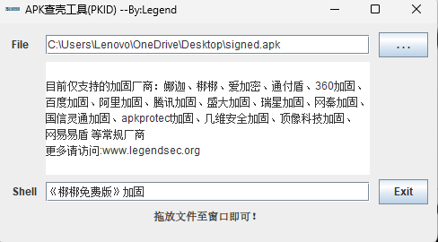
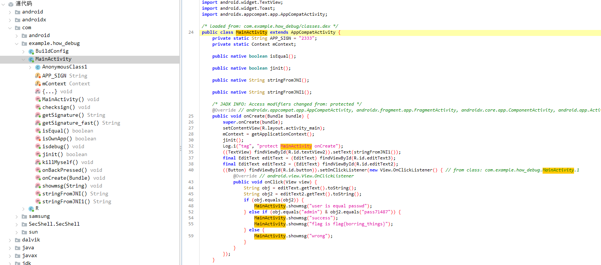

# 前言：

一道例题练习frida方式脱壳

题目来源

[BUUCTF在线评测](https://buuoj.cn/challenges#[%E7%BD%91%E9%BC%8E%E6%9D%AF%202020%20%E9%9D%92%E9%BE%99%E7%BB%84]bang)

# 流程：

## 查壳：



查壳，工具连接在

[https://pan.baidu.com/s/1rDfsEvqQwhUmep1UBLUwSQ](https://links.jianshu.com/go?to=https%3A%2F%2Fpan.baidu.com%2Fs%2F1rDfsEvqQwhUmep1UBLUwSQ) 密码: wefd

## 脱壳：

先列出目前内存中运行的进程：

```shell
(jack) C:\Users\Lenovo\OneDrive\Desktop>frida-ps -U -a
  PID  Name       Identifier
-----  ---------  ---------------------------------
12357  MT管理器      bin.mt.plus
 1123  Magisk     com.topjohnwu.magisk
 8519  QQ         com.tencent.mobileqq
12844  how_debug  com.example.how_debug
13308  三星生活助手     com.samsung.android.app.sreminder
11689  三星钱包       com.samsung.android.spay
31737  日历         com.samsung.android.calendar
31422  联系人        com.samsung.android.app.contacts
```

这里命令中-ps指的是process status

-U 指的是以USB方式连接

-a 指列出all


然后开启手机上的frida-server

```shell
C:\Users\Lenovo>adb shell
b2q:/ $ su
b2q:/ # cd /data/local/tmp
b2q:/data/local/tmp # ls
ActivationDevice_V2  CustomCACert.log  as  fr64  sys-ca-copy
b2q:/data/local/tmp # ./fr64
```


然后开始frida-dexdump脱壳

```shell
(jack) C:\Users\Lenovo\OneDrive\Desktop>frida-dexdump -U -f com.example.how_debug

---------------------------------------------------------------------------------------------------------------------
                         __      _     _                 _              _
                       / _|_ __(_) __| | __ _        __| | _____  ____| |_   _ _ __ ___  _ __
                      | |_| '__| |/ _` |/ _` |_____ / _` |/ _ \ \/ / _` | | | | '_ ` _ \| '_ \
                      |  _| |  | | (_| | (_| |_____| (_| |  __/>  < (_| | |_| | | | | | | |_) |
                      |_| |_|  |_|\__,_|\__,_|      \__,_|\___/_/\_\__,_|\__,_|_| |_| |_| .__/
                                                                                        |_|
                                        https://github.com/hluwa/frida-dexdump
---------------------------------------------------------------------------------------------------------------------

Spawning `com.example.how_debug`...
INFO:Agent:DexDumpAgent<Connection(pid=Session(pid=13600), connected:True), attached=True>: Attach.
INFO:frida-dexdump:Waiting 5s...
INFO:frida-dexdump:[+] Searching...
INFO:frida-dexdump:[*] Successful found 36 dex, used 1 time.
INFO:frida-dexdump:[+] Starting dump to 'C:\Users\Lenovo\OneDrive\Desktop\com.example.how_debug'...
INFO:frida-dexdump:[+] DexMd5=ba1cf759fe177114c859d4901e3635a2, SavePath=C:\Users\Lenovo\OneDrive\Desktop\com.example.how_debug\classes.dex, DexSize=0x1d60b8
INFO:frida-dexdump:[+] DexMd5=28514d4f7ccf16c6bb7ba28602b5d72f, SavePath=C:\Users\Lenovo\OneDrive\Desktop\com.example.how_debug\classes02.dex, DexSize=0x446c
INFO:frida-dexdump:[+] DexMd5=9f6ed667bc041ca01d5781aafa9e949b, SavePath=C:\Users\Lenovo\OneDrive\Desktop\com.example.how_debug\classes03.dex, DexSize=0x11caac
INFO:frida-dexdump:[+] DexMd5=72cedc72c81da6f4a2ea80d41f0396db, SavePath=C:\Users\Lenovo\OneDrive\Desktop\com.example.how_debug\classes04.dex, DexSize=0x1b1fe8
INFO:frida-dexdump:[+] DexMd5=081b79d1a0e1f649f18ac2ce5e8c6687, SavePath=C:\Users\Lenovo\OneDrive\Desktop\com.example.how_debug\classes05.dex, DexSize=0xbaf38
INFO:frida-dexdump:[+] DexMd5=a65dcfdc791633d8b0921fd5f62557b8, SavePath=C:\Users\Lenovo\OneDrive\Desktop\com.example.how_debug\classes06.dex, DexSize=0xadbfc
INFO:frida-dexdump:[+] DexMd5=cac2716758fc7bec33298e16760b0d72, SavePath=C:\Users\Lenovo\OneDrive\Desktop\com.example.how_debug\classes07.dex, DexSize=0x821ec
INFO:frida-dexdump:[+] DexMd5=7e5c1910c90d67e4f4ec040163b1313f, SavePath=C:\Users\Lenovo\OneDrive\Desktop\com.example.how_debug\classes08.dex, DexSize=0x158754
INFO:frida-dexdump:[+] DexMd5=2aa501d10e8553fee07f31cb72d132c5, SavePath=C:\Users\Lenovo\OneDrive\Desktop\com.example.how_debug\classes09.dex, DexSize=0x2cead4
INFO:frida-dexdump:[+] DexMd5=704b06ca5fed180a97fe803fb9e1d289, SavePath=C:\Users\Lenovo\OneDrive\Desktop\com.example.how_debug\classes10.dex, DexSize=0x123238
INFO:frida-dexdump:[+] DexMd5=9b5ace8b5a362e5b6d3cd2eade413d32, SavePath=C:\Users\Lenovo\OneDrive\Desktop\com.example.how_debug\classes11.dex, DexSize=0x1691e0
INFO:frida-dexdump:[+] DexMd5=f7b58a3209dafc422e52ea0c327844e6, SavePath=C:\Users\Lenovo\OneDrive\Desktop\com.example.how_debug\classes12.dex, DexSize=0x5504b4
INFO:frida-dexdump:[+] DexMd5=2fa8055373d7fad871cc7eb1f4773100, SavePath=C:\Users\Lenovo\OneDrive\Desktop\com.example.how_debug\classes13.dex, DexSize=0x8b92c
INFO:frida-dexdump:[+] DexMd5=e12fbb91f1e50490d723d392cfb64462, SavePath=C:\Users\Lenovo\OneDrive\Desktop\com.example.how_debug\classes14.dex, DexSize=0x727ac
INFO:frida-dexdump:[+] DexMd5=a0557abc4a75581fef74a615335e217c, SavePath=C:\Users\Lenovo\OneDrive\Desktop\com.example.how_debug\classes15.dex, DexSize=0x5c968
INFO:frida-dexdump:[+] DexMd5=ad8261bb66fc787adbf0f3ead519cbfa, SavePath=C:\Users\Lenovo\OneDrive\Desktop\com.example.how_debug\classes16.dex, DexSize=0x68b08
INFO:frida-dexdump:[+] DexMd5=8aba98d63fc9efc0b65a1787b04cbaaf, SavePath=C:\Users\Lenovo\OneDrive\Desktop\com.example.how_debug\classes17.dex, DexSize=0x630b8
INFO:frida-dexdump:[+] DexMd5=e4edc50af9e1235448162f3d897fe46d, SavePath=C:\Users\Lenovo\OneDrive\Desktop\com.example.how_debug\classes18.dex, DexSize=0x260
INFO:frida-dexdump:[+] DexMd5=a9c5171d09972adcbcb2533c1b2fce81, SavePath=C:\Users\Lenovo\OneDrive\Desktop\com.example.how_debug\classes19.dex, DexSize=0x33fac
INFO:frida-dexdump:[+] DexMd5=9c0fa3700d8f1ac8a8b5d96548c524bc, SavePath=C:\Users\Lenovo\OneDrive\Desktop\com.example.how_debug\classes20.dex, DexSize=0x21dcc
INFO:frida-dexdump:[+] DexMd5=222e9040d440df80485c27f1ccc67aac, SavePath=C:\Users\Lenovo\OneDrive\Desktop\com.example.how_debug\classes21.dex, DexSize=0x2cbac
INFO:frida-dexdump:[+] DexMd5=39ebc9a37d751ac3076c55e617d5e9c6, SavePath=C:\Users\Lenovo\OneDrive\Desktop\com.example.how_debug\classes22.dex, DexSize=0x37408
INFO:frida-dexdump:[+] DexMd5=a31ad083fd47c76a53adf884e2ae7e2a, SavePath=C:\Users\Lenovo\OneDrive\Desktop\com.example.how_debug\classes23.dex, DexSize=0x225c4
INFO:frida-dexdump:[+] DexMd5=5c9f56f29221493a2fd3a22e1f8f492c, SavePath=C:\Users\Lenovo\OneDrive\Desktop\com.example.how_debug\classes24.dex, DexSize=0x1399c
INFO:frida-dexdump:[+] DexMd5=c65aaa204d733781aeeee779f5f28ce1, SavePath=C:\Users\Lenovo\OneDrive\Desktop\com.example.how_debug\classes25.dex, DexSize=0x18d38
INFO:frida-dexdump:[+] DexMd5=c411e4e46e8fc5d2c14718d26a942215, SavePath=C:\Users\Lenovo\OneDrive\Desktop\com.example.how_debug\classes26.dex, DexSize=0x10e9c
INFO:frida-dexdump:[+] DexMd5=56f6ffc46797695382918d55b57b0513, SavePath=C:\Users\Lenovo\OneDrive\Desktop\com.example.how_debug\classes27.dex, DexSize=0x14b80
INFO:frida-dexdump:[+] DexMd5=efb9359d1a151dc65d2fc91030194b6a, SavePath=C:\Users\Lenovo\OneDrive\Desktop\com.example.how_debug\classes28.dex, DexSize=0x135cc
INFO:frida-dexdump:[+] DexMd5=171711041e67582660c0563841bfae0c, SavePath=C:\Users\Lenovo\OneDrive\Desktop\com.example.how_debug\classes29.dex, DexSize=0x56a4
INFO:frida-dexdump:[+] DexMd5=f5ae84a0c91c8732a1ee39d57523d6b2, SavePath=C:\Users\Lenovo\OneDrive\Desktop\com.example.how_debug\classes30.dex, DexSize=0x131c
INFO:frida-dexdump:[+] DexMd5=f08d322fa4870c3c15ad0013656987c0, SavePath=C:\Users\Lenovo\OneDrive\Desktop\com.example.how_debug\classes31.dex, DexSize=0x31ec
INFO:frida-dexdump:[+] DexMd5=7c151936d903263d1d3bff36799f424f, SavePath=C:\Users\Lenovo\OneDrive\Desktop\com.example.how_debug\classes32.dex, DexSize=0x6ac8
INFO:frida-dexdump:[+] DexMd5=82d3511ca8f86f286a6f668983fc3df7, SavePath=C:\Users\Lenovo\OneDrive\Desktop\com.example.how_debug\classes33.dex, DexSize=0x19e4
INFO:frida-dexdump:[*] All done...
```

这里frida-dexdump是一个基于frida开发的工具

-f指force spawn，从程序最开始启动程序

## 打包apk

把生成的文件夹压缩为zip

然后改名apk

拉进jadx分析



这里直接就拿到flag了

# flag

flag{borring_things}
