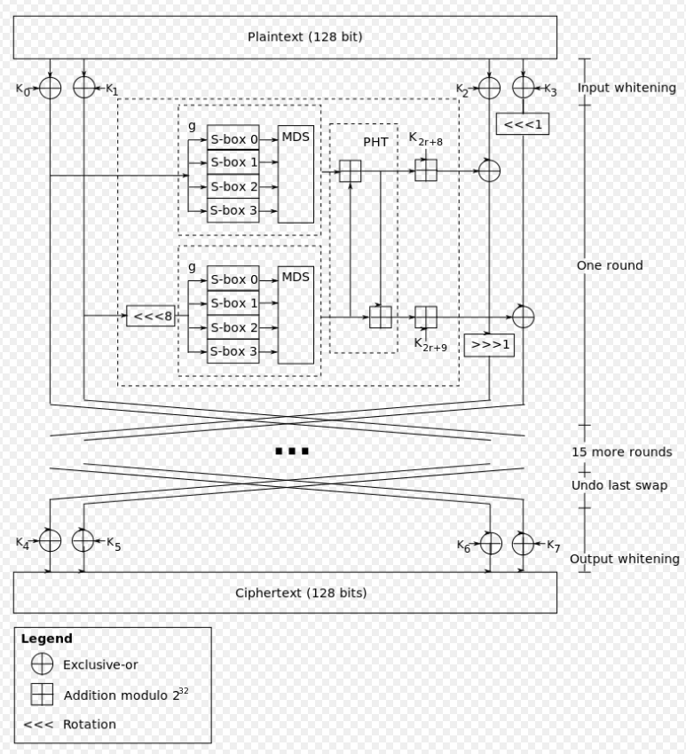
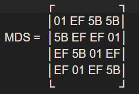
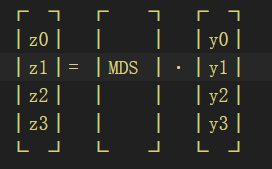

# 前言：

Twofish 的核心特点是**块大小为 128 位**，支持 128、192 或 256 位的密钥，并且采用了 **Feistel 网络结构**。




# 算法流程


## 密钥扩展：

Twofish 的**密钥扩展 (Key Schedule)** 是该算法最复杂、设计最精妙的部分。它不仅负责生成每一轮需要的子密钥（Subkeys），还负责生成**依赖于密钥的 S-box**。

整个过程可以分为三个主要部分：

1. **初始化向量生成**（将主密钥分为 $M_e, M_o$ 和 $S$ 向量）。

2. **子密钥生成**（生成 40 个用于白化和轮函数的密钥）。
   记为$K_0, K_1, \dots, K_{39}$

3. **密钥相关的 S-box 生成**。

由于逆向时重点不在这里，简单带过就可


## 输入白化：

因为加密前的plain text是128 bits，也就是16 bytes。假设这16 bytes分别是p0, … ,p15。将p0, … ,p15分为4组：  
`P(i) = ∑p(4i+j)2^(8j)，其中i,j = 0, ... ,3`

算法将这 16 个字节按顺序每 4 个一组，分配给 4 个字 $P_0, P_1, P_2, P_3$：

* **$P_0$ (Word 0):** 对应字节 $p_0, p_1, p_2, p_3$

* **$P_1$ (Word 1):** 对应字节 $p_4, p_5, p_6, p_7$

* **$P_2$ (Word 2):** 对应字节 $p_8, p_9, p_{10}, p_{11}$

* **$P_3$ (Word 3):** 对应字节 $p_{12}, p_{13}, p_{14}, p_{15}$
  
  

然后进行运算`R(0,i) = P(i) xor K(i)，其中i = 0, ... ,3`


## 开始核心运算（循环16次）：

每一轮 ($r = 0 \dots 15$) 包含以下固定步骤：

**Step A: g 函数处理 (非线性层)**

* 利用左侧的两个字 $R_0$ 和 $R_1$ 作为输入。

* $R_0$ 直接进入 $g$ 函数。

* $R_1$ 先左移 8 位 (`ROL 8`)，再进入 $g$ 函数。

* $g$ 函数内部：字节通过 **密钥相关的 S-box** 替换，然后乘以 **MDS 矩阵** 进行扩散。





**Step B: PHT 变换 (混合层)**

* 将两个 $g$ 函数的输出 ($T_0, T_1$) 进行伪阿达马变换。

* 混合出两个新值，并分别加上本轮的子密钥 ($K_{2r+8}, K_{2r+9}$)。得到 $F_0$ 和 $F_1$。

**Step C: 交叉加密 (Feistel Cross)**

* 利用生成的 $F_0$ 去加密右边的 $R_2$：
  
  * $R_2$ 先与 $F_0$ 异或，然后右移 1 位 (`ROR 1`)。

* 利用生成的 $F_1$ 去加密右边的 $R_3$：
  
  * $R_3$ 先左移 1 位 (`ROL 1`)，然后与 $F_1$ 异或。

**Step D: 交换 (Swap)**

* 除了最后一轮，每轮结束后，左边两个字 ($R_0, R_1$) 与右边处理后的两个字 ($R_2, R_3$) 交换位置。

### **伪代码**

这里假设密钥长度为 **128-bit ($N=128, k=2$)**，这是最常见的情况。

```py
# 假设 R 是一个包含 4 个 32-bit 字的数组: R[0], R[1], R[2], R[3]
# r 是轮数索引，从 0 到 15

FOR r FROM 0 TO 15:

    # --- Step A: g 函数处理 (非线性层) ---
    # R0 直接进入 g 函数
    Input_0 = R[0]
    T0 = g(Input_0)

    # R1 先左移 8 位，再进入 g 函数
    Input_1 = ROL(R[1], 8)
    T1 = g(Input_1)

    # --- Step B: PHT 变换 (混合层) ---
    # 伪阿达马变换 (PHT) 并加上子密钥
    # 注意: 所有加法均为模 2^32 加法
    F0 = (T0 + T1 + K[2*r + 8]) MOD 2^32
    F1 = (T0 + 2*T1 + K[2*r + 9]) MOD 2^32

    # --- Step C: 交叉加密 (Feistel Cross) ---
    # 加密右边的 R2: 先与 F0 异或，后右移 1 位
    # Update_R2 = ROR( (R[2] XOR F0), 1 )
    New_R2 = ROR((R[2] XOR F0), 1)

    # 加密右边的 R3: 先左移 1 位，后与 F1 异或
    # Update_R3 = ROL(R[3], 1) XOR F1
    New_R3 = ROL(R[3], 1) XOR F1

    # --- Step D: 交换 (Swap) ---
    IF r < 15:
        # 如果不是最后一轮，进行交换
        # 左边 -> 变成旧的右边 (已加密)
        # 右边 -> 变成旧的左边 (原样)
        R[2] = R[0]
        R[3] = R[1]
        R[0] = New_R2
        R[1] = New_R3
    ELSE:
        # 如果是最后一轮 (r=15)，不交换，只更新值
        # 这通常是为了解密时的对称性
        R[2] = New_R2
        R[3] = New_R3

# 循环结束
# 此时 R[0]...R[3] 进入输出白化阶段
```

其中用到的g函数

```python
# 输入: 
#   X: 32-bit 整数 (例如 R0 或 ROL(R1, 8))
#   S_Vector: 预先生成的 S 盒密钥向量 (对于 128-bit 密钥，这里包含 2 个 32-bit 字)
# 输出: 
#   32-bit 整数

FUNCTION g(X, S_Vector):
    # 1. 拆分 (Unpacking) - Little Endian
    # 将 32-bit 字拆分为 4 个 8-bit 字节
    x0 = (X >> 0)  AND 0xFF
    x1 = (X >> 8)  AND 0xFF
    x2 = (X >> 16) AND 0xFF
    x3 = (X >> 24) AND 0xFF

    # 2. S-box 替换 (Substitution)
    # 每个字节通过对应的 S-box 逻辑 (即 h 函数逻辑)
    # 注意: s_box_logic 需要知道是第几个字节(i)，因为 q0/q1 顺序不同
    y0 = s_box_logic(x0, 0, S_Vector)
    y1 = s_box_logic(x1, 1, S_Vector)
    y2 = s_box_logic(x2, 2, S_Vector)
    y3 = s_box_logic(x3, 3, S_Vector)

    # 3. MDS 矩阵乘法 (Diffusion)
    # 将 4 个 y 字节混合成 4 个 z 字节
    (z0, z1, z2, z3) = mds_multiply(y0, y1, y2, y3)

    # 4. 打包 (Packing) - Little Endian
    # Z = sum(z_i * 2^(8i))
    Result = (z0) OR (z1 << 8) OR (z2 << 16) OR (z3 << 24)

    RETURN Result
```

g函数中的依赖函数S-box

```python
# 输入: 
#   val: 8-bit 输入字节
#   byte_index: 当前处理的是第几个字节 (0..3)，决定 q 的顺序
#   S_Vector: 包含 S[0]...S[3] (对于 128bit key) 的密钥字节数组
# 依赖: fixed_q0, fixed_q1 (固定的256字节置换表)

FUNCTION s_box_logic(val, byte_index, S_Vector):
    # 1. 第一层 (Inner Layer) - 对应 key 的高位部分
    # S_Vector 被视为 8 个字节 (对于 128bit 是 S[0]..S[7])
    # 这里简化逻辑: 假设 S_Vector 已被拆解为字节数组 S[]

    temp = val

    # 根据 byte_index 选择 q0 还是 q1
    # Twofish 规定: 
    # Index 0, 2 使用 q1 -> q0 ...
    # Index 1, 3 使用 q0 -> q1 ...
    # 但实际上每一层的 q 选择逻辑是: 
    # 第一层: index % 2 == 0 ? q1 : q0
    # 第二层: (index // 2) % 2 == 0 ? q0 : q1  <-- 这是一个简化的观察规律

    # --- 第一级 Q 置换 + XOR ---
    IF (byte_index == 0) OR (byte_index == 2):
        temp = fixed_q1(temp)
    ELSE:
        temp = fixed_q0(temp)

    temp = temp XOR S_Vector[1] # 对应 S 向量的特定字节 (根据 i 变化)

    # --- 第二级 Q 置换 + XOR ---
    IF (byte_index == 0) OR (byte_index == 3): # 这里对应 Twofish 的特定 q 顺序表
        temp = fixed_q0(temp)
    ELSE:
        temp = fixed_q1(temp)

    temp = temp XOR S_Vector[0] # 对应 S 向量的特定字节

    # --- 第三级 (如果 Key 是 192/256 位，会有更多层) ---
    # ... (128位 key 到此为止)

    RETURN temp
```

g函数中的依赖函数MDS 矩阵乘法

```python
# 输入: 4 个 8-bit 字节 (y0, y1, y2, y3)
# 输出: 4 个 8-bit 字节 (z0, z1, z2, z3)
# 依赖: gf_mult (有限域乘法)

FUNCTION mds_multiply(y0, y1, y2, y3):
    # MDS 矩阵定义:
    # 01 EF 5B 5B
    # 5B EF EF 01
    # EF 5B 01 EF
    # EF 01 EF 5B

    # row 0
    z0 = gf_mult(0x01, y0) XOR gf_mult(0xEF, y1) XOR gf_mult(0x5B, y2) XOR gf_mult(0x5B, y3)

    # row 1
    z1 = gf_mult(0x5B, y0) XOR gf_mult(0xEF, y1) XOR gf_mult(0xEF, y2) XOR gf_mult(0x01, y3)

    # row 2
    z2 = gf_mult(0xEF, y0) XOR gf_mult(0x5B, y1) XOR gf_mult(0x01, y2) XOR gf_mult(0xEF, y3)

    # row 3
    z3 = gf_mult(0xEF, y0) XOR gf_mult(0x01, y1) XOR gf_mult(0xEF, y2) XOR gf_mult(0x5B, y3)

    # 注意: gf_mult(0x01, y) 其实就是 y 本身，可以直接简化
    RETURN (z0, z1, z2, z3)
```

g函数中的有限域乘法 (GF Mult)

用于 MDS 矩阵计算。多项式 $v(x) = x^8 + x^6 + x^5 + x^3 + 1$ 对应的 Hex 是 `0x169`。

```python
# 输入: a, b (两个 8-bit 字节)
# 输出: 8-bit 字节
FUNCTION gf_mult(a, b):
    product = 0
    # Twofish 的不可约多项式
    POLY = 0x169 

    # 进行 8 次循环 (类似二进制乘法)
    FOR i FROM 0 TO 7:
        # 1. 如果 b 的当前最低位是 1，则加上 a (在 GF 中加法是 XOR)
        IF (b AND 1) == 1:
            product = product XOR a

        # 2. 准备下一轮: a 左移 1 位
        high_bit = a AND 0x80  # 检查 a 是否会溢出 8 位
        a = a << 1

        # 3. 如果溢出，减去模多项式 (在 GF 中减法也是 XOR)
        IF high_bit != 0:
            a = a XOR POLY

        # 4. 掩码确保 a 保持 8 位 (模拟 byte)
        a = a AND 0xFF

        # 5. b 右移 1 位，处理下一位
        b = b >> 1

    RETURN product
```


这就是 `g` 函数完整的调用链： `g` $\rightarrow$ 调用 `s_box_logic` (查 `q` 表, XOR `S` 向量) $\rightarrow$ 调用 `mds_multiply` $\rightarrow$ 调用 `gf_mult` (底层位运算)。


## 输出白化：

16 轮结束后（注意最后一轮不交换，或者说交换回来），再次与 $K_4, K_5, K_6, K_7$ (K0-K39,只有K4-7没被用过)进行 **XOR**。

**输出：** 拼合 4 个字得到 128-bit 密文。


# Feistel 结构的经典特征

Twofish 采用的是一种略微修改的 Feistel 结构。要理解它为什么这么设计，必须理解 **Feistel 网络** 的核心哲学。

Feistel 结构由 Horst Feistel 在 1970 年代提出（DES 算法是其代表作），它是对称加密中最具统治力的设计模式之一。

## 核心特征：构造无需可逆 (Invertibility is not required for F)

这是 Feistel 结构最天才的地方，也是它最大的特征。

* **原理：** 在 Feistel 结构中，$L_{next} = R, \quad R_{next} = L \oplus F(R, K)$。

* **解释：** 无论中间的轮函数 $F$ 有多么复杂、多么混乱、甚至**不可逆**（例如，$F$ 可以是一个不可逆的哈希函数，或者是像 Twofish 这种复杂的 MDS 变换），整个加密算法依然是可逆的。

* **解密：** 解密过程只需要**完全复用加密的电路/代码**，唯一的区别是**子密钥的使用顺序倒过来**（从 $K_{16}$ 用到 $K_1$）。

* **Twofish 的体现：** 它的 $g$ 函数里有复杂的模运算和矩阵乘法，如果没有 Feistel 结构，想逆向推导 $g$ 函数的输入是非常困难的。但得益于 Feistel 结构，解密时我们不需要逆向计算 $g$，只需要重新生成一遍 $F$ 值然后异或回去即可。

## “分治”策略 (Divide and Conquer)

* **特征：** 数据总是被分成两半（Left 和 Right）。

* **操作：** 每一轮只处理其中一半数据，另一半数据保持不变（或者作为“原版”参考）。

* **Twofish 的体现：** 它把 128 位分成 4 个 32 位字。每一轮实际上是利用左边的 64 位（$R_0, R_1$）去加密右边的 64 位（$R_2, R_3$）。

## 结构对称性 (Structural Symmetry)

* **特征：** 加密和解密的硬件电路或软件代码几乎完全相同。

* **优势：** 这极大地降低了硬件实现的成本（芯片面积减半）和软件代码的大小。

* **Twofish 的体现：** 你写好了一个 `Encrypt` 函数，要写 `Decrypt` 函数时，逻辑几乎不用动，只需要把轮密钥的索引倒序，并在最后处理一下 ROL/ROR 的方向即可。

## 轮数迭代带来的安全性 (Avalanche Effect)

* **特征：** 单独一轮的 Feistel 往往也是弱的（因为有一半数据没变）。但是，通过多轮迭代（Round Iteration）和每一轮结束后的**交换 (Swap)**，可以让左边的数据跑到右边去被处理，右边的数据跑到左边去充当输入。

* **效果：** 经过足够多的轮数（如 16 轮），输入的每一个 bit 都会影响到输出的每一个 bit（雪崩效应）。
  
  
  
  

# 代码加密解密

twofish.h

```cpp
#ifndef __TWOFISH__H
#define __TWOFISH__H
#include "stdint.h"

#define TWOFISH
#ifdef  TWOFISH
typedef struct twofish_t 
{
    uint8_t len;
    uint32_t k[40];
    uint32_t s[4][256];
}twofish_t;
#endif
/*
 * Twofish MDS Multiply Function
 * 
 * Description:
 *
 * @param   tf_twofish
 * @param   data
 * @param   cypher
 * @usage
 * {@code}
 */
void Twofish_encryt(twofish_t* tf_twofish, uint8_t *data, uint8_t *cypher);
/*
 * Twofish Decryption Function
 * 
 * Description:
 *
 * @param    tf_twofish
 * @param   cypher
 * @param   data
 * @usage
 * {@code}
 */
void Twofish_decryt(twofish_t* tf_twofish, uint8_t *cypher, uint8_t *data);
/*
 * Twofish Setup Function
 * 
 * Description:
 *
 * @param   s
 * @param   len
 * @usage
 * {@code}
 */
twofish_t*  Twofish_setup(uint8_t *s, uint32_t len);

#endif
```

table.h

```cpp
 #ifndef __TABLES__H
 #define __TABLES__H

 /* The MDS Matrix */
 uint8_t mds[4][4]=
 {
    {0x01, 0xef, 0x5b, 0x5b},
    {0x5b, 0xef, 0xef, 0x01},
    {0xef, 0x5b, 0x01, 0xef},
    {0xef, 0x01, 0xef, 0x5b}
 };

uint8_t q[2][256] =
{
    /* q0 */
    {

        0xa9,0x67,0xb3,0xe8,0x4,0xfd,0xa3,0x76,0x9a,0x92,0x80,0x78,0xe4,0xdd,0xd1,0x38,
        0xd,0xc6,0x35,0x98,0x18,0xf7,0xec,0x6c,0x43,0x75,0x37,0x26,0xfa,0x13,0x94,0x48,
        0xf2,0xd0,0x8b,0x30,0x84,0x54,0xdf,0x23,0x19,0x5b,0x3d,0x59,0xf3,0xae,0xa2,0x82,
        0x63,0x1,0x83,0x2e,0xd9,0x51,0x9b,0x7c,0xa6,0xeb,0xa5,0xbe,0x16,0xc,0xe3,0x61,
        0xc0,0x8c,0x3a,0xf5,0x73,0x2c,0x25,0xb,0xbb,0x4e,0x89,0x6b,0x53,0x6a,0xb4,0xf1,
        0xe1,0xe6,0xbd,0x45,0xe2,0xf4,0xb6,0x66,0xcc,0x95,0x3,0x56,0xd4,0x1c,0x1e,0xd7,
        0xfb,0xc3,0x8e,0xb5,0xe9,0xcf,0xbf,0xba,0xea,0x77,0x39,0xaf,0x33,0xc9,0x62,0x71,
        0x81,0x79,0x9,0xad,0x24,0xcd,0xf9,0xd8,0xe5,0xc5,0xb9,0x4d,0x44,0x8,0x86,0xe7,
        0xa1,0x1d,0xaa,0xed,0x6,0x70,0xb2,0xd2,0x41,0x7b,0xa0,0x11,0x31,0xc2,0x27,0x90,
        0x20,0xf6,0x60,0xff,0x96,0x5c,0xb1,0xab,0x9e,0x9c,0x52,0x1b,0x5f,0x93,0xa,0xef,
        0x91,0x85,0x49,0xee,0x2d,0x4f,0x8f,0x3b,0x47,0x87,0x6d,0x46,0xd6,0x3e,0x69,0x64,
        0x2a,0xce,0xcb,0x2f,0xfc,0x97,0x5,0x7a,0xac,0x7f,0xd5,0x1a,0x4b,0xe,0xa7,0x5a,
        0x28,0x14,0x3f,0x29,0x88,0x3c,0x4c,0x2,0xb8,0xda,0xb0,0x17,0x55,0x1f,0x8a,0x7d,
        0x57,0xc7,0x8d,0x74,0xb7,0xc4,0x9f,0x72,0x7e,0x15,0x22,0x12,0x58,0x7,0x99,0x34,
        0x6e,0x50,0xde,0x68,0x65,0xbc,0xdb,0xf8,0xc8,0xa8,0x2b,0x40,0xdc,0xfe,0x32,0xa4,
        0xca,0x10,0x21,0xf0,0xd3,0x5d,0xf,0x0,0x6f,0x9d,0x36,0x42,0x4a,0x5e,0xc1,0xe0
    },
    /* q1 */
    {

        0x75,0xf3,0xc6,0xf4,0xdb,0x7b,0xfb,0xc8,0x4a,0xd3,0xe6,0x6b,0x45,0x7d,0xe8,0x4b,
        0xd6,0x32,0xd8,0xfd,0x37,0x71,0xf1,0xe1,0x30,0xf,0xf8,0x1b,0x87,0xfa,0x6,0x3f,
        0x5e,0xba,0xae,0x5b,0x8a,0x0,0xbc,0x9d,0x6d,0xc1,0xb1,0xe,0x80,0x5d,0xd2,0xd5,
        0xa0,0x84,0x7,0x14,0xb5,0x90,0x2c,0xa3,0xb2,0x73,0x4c,0x54,0x92,0x74,0x36,0x51,
        0x38,0xb0,0xbd,0x5a,0xfc,0x60,0x62,0x96,0x6c,0x42,0xf7,0x10,0x7c,0x28,0x27,0x8c,
        0x13,0x95,0x9c,0xc7,0x24,0x46,0x3b,0x70,0xca,0xe3,0x85,0xcb,0x11,0xd0,0x93,0xb8,
        0xa6,0x83,0x20,0xff,0x9f,0x77,0xc3,0xcc,0x3,0x6f,0x8,0xbf,0x40,0xe7,0x2b,0xe2,
        0x79,0xc,0xaa,0x82,0x41,0x3a,0xea,0xb9,0xe4,0x9a,0xa4,0x97,0x7e,0xda,0x7a,0x17,
        0x66,0x94,0xa1,0x1d,0x3d,0xf0,0xde,0xb3,0xb,0x72,0xa7,0x1c,0xef,0xd1,0x53,0x3e,
        0x8f,0x33,0x26,0x5f,0xec,0x76,0x2a,0x49,0x81,0x88,0xee,0x21,0xc4,0x1a,0xeb,0xd9,
        0xc5,0x39,0x99,0xcd,0xad,0x31,0x8b,0x1,0x18,0x23,0xdd,0x1f,0x4e,0x2d,0xf9,0x48,
        0x4f,0xf2,0x65,0x8e,0x78,0x5c,0x58,0x19,0x8d,0xe5,0x98,0x57,0x67,0x7f,0x5,0x64,
        0xaf,0x63,0xb6,0xfe,0xf5,0xb7,0x3c,0xa5,0xce,0xe9,0x68,0x44,0xe0,0x4d,0x43,0x69,
        0x29,0x2e,0xac,0x15,0x59,0xa8,0xa,0x9e,0x6e,0x47,0xdf,0x34,0x35,0x6a,0xcf,0xdc,
        0x22,0xc9,0xc0,0x9b,0x89,0xd4,0xed,0xab,0x12,0xa2,0xd,0x52,0xbb,0x2,0x2f,0xa9,
        0xd7,0x61,0x1e,0xb4,0x50,0x4,0xf6,0xc2,0x16,0x25,0x86,0x56,0x55,0x9,0xbe,0x91
    }
};

#endif
```

twofish.c

```cpp
#include <stdio.h>
#include <malloc.h>
#include "twofish.h"
#include "tables.h"

#define xor(g,r)    (g^r)                   /* Xor operation */
#define ror(g,n)    ((g>>n)|(g<<(32-n)))    /* Rotate right  */
#define rol(g,n)    ((g<<n)|(g>>(32-n)))    /* Rotate left   */
#define nxt(g,r)    (*(g+r))                /* Get next byte */
#define LITTILE_ENDIAN
#ifdef  LITTILE_ENDIAN
#define unpack(g,r) ((g>>(r*8))&0xff)                               /* Extracts a byte from a word.  */
#define pack(g)     ((*(g))|(*(g+1)<<8)|(*(g+2)<<16)|(*(g+3)<<24))  /* Converts four byte to a word. */
#endif
#define rsm(i,a,b,c,d,e,f,g,h)  \
        gf(nxt(tf_key->k,r*8),a,0x14d)^gf(nxt(tf_key->k,r*8+1),b,0x14d)^\
        gf(nxt(tf_key->k,r*8+2),c,0x14d)^gf(nxt(tf_key->k,r*8+3),d,0x14d)^\
        gf(nxt(tf_key->k,r*8+4),e,0x14d)^gf(nxt(tf_key->k,r*8+5),f,0x14d)^\
        gf(nxt(tf_key->k,r*8+6),g,0x14d)^gf(nxt(tf_key->k,r*8+7),h,0x14d)
#define u(x,a)\
        x[0] = unpack(a,0); \
        x[1] = unpack(a,1); \
        x[2] = unpack(a,2); \
        x[3] = unpack(a,3);
#define release(a,b,c)  { free(a); free(b);free(c); }
#ifdef  TWOFISH
typedef struct key_t 
{
    uint8_t len;
    uint8_t *k;
}key_t;
typedef struct subkey_t 
{
    uint8_t len;
    uint8_t s[4][4];
    uint8_t me[4][4];
    uint8_t mo[4][4];
}subkey_t;
#endif
/*
 * Twofish Expand Key Function
 * 
 * Description:
 *
 * @param   s
 * @param   len
 * @usage
 * {@code}
 */
key_t* expand_key(uint8_t *s, uint32_t len);
/*
 * Twofish Galois Field Multiplication Function
 * 
 * Description:
 *
 * @param   x
 * @param   y
 * @param   m
 * @usage
 * {@code}
 */
uint8_t gf(uint8_t x, uint8_t y, uint16_t m);
/*
 * Twofish Generate Subkeys Function
 * 
 * Description:
 *
 * @param   tf_key
 * @usage
 * {@code}
 */
subkey_t* Twofish_generate_subkey(key_t* tf_key);
/*
 * Twofish h Function
 * 
 * Description:
 *
 * @param   x[]
 * @param   y[]
 * @param   s
 * @param   stage
 * @usage
 * {@code}
 */
void Twofish_h(uint8_t x[],  uint8_t y[], uint8_t s[][4], int stage);
/*
 * Twofish MDS Multiply Function
 * 
 * Description:
 *
 * @param   y[]
 * @param   out[]
 * @usage
 * {@code}
 */
void Twofish_mds_mul(uint8_t y[],  uint8_t out[]);
/*
 * Twofish Genrate Extended K Keys Function
 * 
 * Description:
 *
 * @param   tf_twofish
 * @param   tf_subkey
 * @param   p
 * @param   k
 * @usage
 * {@code}
 */
twofish_t* Twofish_generate_ext_k_keys(twofish_t* tf_twofish, subkey_t *tf_subkey,uint32_t p, uint8_t k);
/*
 * Twofish Genrate Extended S Keys Function
 * 
 * Description:
 *
 * @param   tf_twofish
 * @param   tf_subkey
 * @param   k
 * @usage
 * {@code}
 */
twofish_t* Twofish_generate_ext_s_keys(twofish_t* tf_twofish, subkey_t *tf_subkey, uint8_t k);
/*
 * Twofish f Function
 * 
 * Description:
 *
 * @param   tf_twofish
 * @param   r
 * @param   r0, r1
 * @param   f0, f1
 * @usage
 * {@code}
 */
void Twofish_f(twofish_t* tf_twofish, uint8_t r,uint32_t r0, uint32_t r1, uint32_t* f0, uint32_t* f1);
/*
 * Twofish g Function
 * 
 * Description:
 *
 * @param   tf_twofish
 * @param   x
 * @usage
 * {@code}
 */
uint32_t Twofish_g(twofish_t* tf_twofish, uint32_t x);

twofish_t* Twofish_setup(uint8_t *s, uint32_t len)
{
    /* Expand the key if necessary. */
    key_t* tf_key = expand_key(s, len/8);

    /* Generate subkeys: s and k */
    subkey_t *tf_subkey = Twofish_generate_subkey(tf_key);

    /* Generate 40 K keys */
    twofish_t* tf_twofish = (twofish_t*)malloc(sizeof(twofish_t));
    tf_twofish = Twofish_generate_ext_k_keys(tf_twofish,tf_subkey,0x01010101,(tf_key->len/8));
    /* Generate 4x256 S keys */
    tf_twofish = Twofish_generate_ext_s_keys(tf_twofish,tf_subkey,(tf_key->len/8));

    /* Free memory */
    release(tf_key->k, tf_key, tf_subkey);

    return tf_twofish;
}

void Twofish_encryt(twofish_t* tf_twofish, uint8_t *data, uint8_t *cypher)
{
    uint32_t r0, r1, r2, r3, f0, f1, c2,c3;
    /* Input Whitenening */
    r0 = tf_twofish->k[0]^pack(data);
    r1 = tf_twofish->k[1]^pack(data+4);
    r2 = tf_twofish->k[2]^pack(data+8);
    r3 = tf_twofish->k[3]^pack(data+12);

    /* The black box */
    for (int i=0; i<16;++i)
    {
        Twofish_f(tf_twofish, i, r0, r1, &f0, &f1);
        c2 = ror((f0^r2), 1);
        c3 = (f1^rol(r3,1));
        /* swap */
        r2 = r0;
        r3 = r1;
        r0 = c2;
        r1 = c3;
    }

    /* Output Whitening */
    c2 = r0;
    c3 = r1;
    r0 = tf_twofish->k[4]^r2;
    r1 = tf_twofish->k[5]^r3;
    r2 = tf_twofish->k[6]^c2;
    r3 = tf_twofish->k[7]^c3;

    for (int i=0;i<4;++i)
    {
        cypher[i]   = unpack(r0,i);
        cypher[i+4] = unpack(r1,i);
        cypher[i+8] = unpack(r2,i);
        cypher[i+12]= unpack(r3,i);
    }
}

void Twofish_decryt(twofish_t* tf_twofish, uint8_t *cypher, uint8_t *data)
{
    uint32_t r0, r1, r2, r3, f0, f1, c2,c3;
    /* Input Whitenening */
    r0 = tf_twofish->k[4]^pack(cypher);
    r1 = tf_twofish->k[5]^pack(cypher+4);
    r2 = tf_twofish->k[6]^pack(cypher+8);
    r3 = tf_twofish->k[7]^pack(cypher+12);

    /* The black box */
    for (int i=15; i >= 0;--i)
    {
        Twofish_f(tf_twofish, i, r0, r1, &f0, &f1);
        c2 = (rol(r2,1)^f0);
        c3 = ror((f1^r3),1);
        /* swap */
        r2 = r0;
        r3 = r1;
        r0 = c2;
        r1 = c3;
    }

    /* Output Whitening */
    c2 = r0;
    c3 = r1;
    r0 = tf_twofish->k[0]^r2;
    r1 = tf_twofish->k[1]^r3;
    r2 = tf_twofish->k[2]^c2;
    r3 = tf_twofish->k[3]^c3;

    for (int i=0;i<4;++i)
    {
        data[i]   = unpack(r0,i);
        data[i+4] = unpack(r1,i);
        data[i+8] = unpack(r2,i);
        data[i+12]= unpack(r3,i);
    }
}

void Twofish_f(twofish_t* tf_twofish, uint8_t r,uint32_t r0, uint32_t r1, uint32_t* f0, uint32_t* f1)
{
    uint32_t t0, t1, o;
    t0 = Twofish_g(tf_twofish, r0);
    t1 = rol(r1, 8);
    t1 = Twofish_g(tf_twofish, t1);
    o = 2*r;
    *f0= (t0 + t1 + tf_twofish->k[o+8]);
    *f1= (t0 + (2*t1) + tf_twofish->k[o+9]);
}

twofish_t* Twofish_generate_ext_k_keys(twofish_t* tf_twofish, subkey_t *tf_subkey,uint32_t p, uint8_t k)
{
    uint32_t a, b;
    uint8_t x[4], y[4], z[4];
    for(int i=0;i<40;i+=2)                  /* i = 40/2 */
    {
        a = (i*p);                          /* 2*i*p */
        b = (a+p);                          /* ((2*i +1)*p */
        u(x,a);
        Twofish_h(x, y, tf_subkey->me, k);
        Twofish_mds_mul(y,z);
        a = pack(z);                        /* Convert four bytes z[4] to a word (a). */
        u(x,b);                             /* Convert a word (b) to four bytes x[4]. */
        Twofish_h(x, y, tf_subkey->mo, k);
        Twofish_mds_mul(y,z);        
        b = pack(z);
        b = rol(b,8);
        tf_twofish->k[i] = ((a + b));
        tf_twofish->k[i+1] = rol(((a + (2*b))),9);
    }
    return tf_twofish;
}

twofish_t* Twofish_generate_ext_s_keys(twofish_t* tf_twofish, subkey_t *tf_subkey, uint8_t k)
{
    uint8_t x[4], y[4];
    for(int i=0;i<256;++i)
    {
        x[0] = x[1] = x[2] = x[3] = i;
        Twofish_h(x, y, tf_subkey->s, k);
        /* Special MDS multiplication */
        tf_twofish->s[0][i] = (gf(y[0], mds[0][0],0x169) |(gf(y[1],mds[0][1],0x169)<< 8)|(gf(y[2], mds[0][2],0x169)<<16) |(gf(y[3], mds[0][3], 0x169) <<24));
        tf_twofish->s[1][i] = (gf(y[0], mds[1][0],0x169) |(gf(y[1],mds[1][1],0x169)<< 8)|(gf(y[2], mds[1][2],0x169)<<16) |(gf(y[3], mds[1][3], 0x169) <<24));
        tf_twofish->s[2][i] = (gf(y[0], mds[2][0],0x169) |(gf(y[1],mds[2][1],0x169)<< 8)|(gf(y[2], mds[2][2],0x169)<<16) |(gf(y[3], mds[2][3], 0x169) <<24));
        tf_twofish->s[3][i] = (gf(y[0], mds[3][0],0x169) |(gf(y[1],mds[3][1],0x169)<< 8)|(gf(y[2], mds[3][2],0x169)<<16) |(gf(y[3], mds[3][3], 0x169) <<24));
    }
    return tf_twofish;
}

void Twofish_mds_mul(uint8_t y[],  uint8_t out[])
{
    /* MDS multiplication */
    out[0] = (gf(y[0], mds[0][0], 0x169)^gf(y[1], mds[0][1], 0x169)^gf(y[2], mds[0][2], 0x169)^gf(y[3], mds[0][3], 0x169));
    out[1] = (gf(y[0], mds[1][0], 0x169)^gf(y[1], mds[1][1], 0x169)^gf(y[2], mds[1][2], 0x169)^gf(y[3], mds[1][3], 0x169));
    out[2] = (gf(y[0], mds[2][0], 0x169)^gf(y[1], mds[2][1], 0x169)^gf(y[2], mds[2][2], 0x169)^gf(y[3], mds[2][3], 0x169));
    out[3] = (gf(y[0], mds[3][0], 0x169)^gf(y[1], mds[3][1], 0x169)^gf(y[2], mds[3][2], 0x169)^gf(y[3], mds[3][3], 0x169));
}

uint32_t Twofish_g(twofish_t* tf_twofish, uint32_t x)
{
    return (tf_twofish->s[0][unpack(x,0)]^tf_twofish->s[1][unpack(x, 1)]^tf_twofish->s[2][unpack(x,2)]^tf_twofish->s[3][unpack(x,3)]);
}

void Twofish_h(uint8_t x[],  uint8_t out[], uint8_t s[][4], int stage)
{
    uint8_t y[4];
    for (int j=0; j<4;++j)
    {
        y[j] = x[j];
    }

    if (stage == 4)
    {
        y[0] = q[1][y[0]] ^ (s[3][0]);
        y[1] = q[0][y[1]] ^ (s[3][1]);
        y[2] = q[0][y[2]] ^ (s[3][2]);
        y[3] = q[1][y[3]] ^ (s[3][3]);
    }
    if (stage > 2)
    {
        y[0] = q[1][y[0]] ^ (s[2][0]);
        y[1] = q[1][y[1]] ^ (s[2][1]);
        y[2] = q[0][y[2]] ^ (s[2][2]);
        y[3] = q[0][y[3]] ^ (s[2][3]);
    }

    out[0] = q[1][q[0][ q[0][y[0]] ^ (s[1][0])] ^ (s[0][0])];
    out[1] = q[0][q[0][ q[1][y[1]] ^ (s[1][1])] ^ (s[0][1])];
    out[2] = q[1][q[1][ q[0][y[2]] ^ (s[1][2])] ^ (s[0][2])];
    out[3] = q[0][q[1][ q[1][y[3]] ^ (s[1][3])] ^ (s[0][3])];
}

subkey_t* Twofish_generate_subkey(key_t* tf_key)
{
    int k, r, g;
    subkey_t *tf_subkey = (subkey_t*)malloc(sizeof(subkey_t));
    k = tf_key->len/8;                                  /* k=N/64 */
    for(r=0; r<k;++r)
    {
        /* Generate subkeys Me and Mo */
        tf_subkey->me[r][0] = nxt(tf_key->k, r*8    );
        tf_subkey->me[r][1] = nxt(tf_key->k, r*8 + 1);
        tf_subkey->me[r][2] = nxt(tf_key->k, r*8 + 2);
        tf_subkey->me[r][3] = nxt(tf_key->k, r*8 + 3);
        tf_subkey->mo[r][0] = nxt(tf_key->k, r*8 + 4);
        tf_subkey->mo[r][1] = nxt(tf_key->k, r*8 + 5);
        tf_subkey->mo[r][2] = nxt(tf_key->k, r*8 + 6);
        tf_subkey->mo[r][3] = nxt(tf_key->k, r*8 + 7);

        g=k-r-1;                                        /* Reverse order */
        /* Generate subkeys S using RS matrix */
        tf_subkey->s[g][0] = rsm(r, 0x01, 0xa4, 0x55, 0x87, 0x5a, 0x58, 0xdb, 0x9e);
        tf_subkey->s[g][1] = rsm(r, 0xa4, 0x56, 0x82, 0xf3, 0x1e, 0xc6, 0x68, 0xe5);
        tf_subkey->s[g][2] = rsm(r, 0x02, 0xa1, 0xfc, 0xc1, 0x47, 0xae, 0x3d, 0x19);
        tf_subkey->s[g][3] = rsm(r, 0xa4, 0x55, 0x87, 0x5a, 0x58, 0xdb, 0x9e, 0x03);
    }
    return tf_subkey;
}

key_t* expand_key(uint8_t *s, uint32_t len)
{
    int n;
    /* Pad factor */
    if (len<16)       n = 16;
    else if (len<24)  n = 24;
    else if (len<32)  n = 32;
    key_t* tf_key = (key_t*)malloc(sizeof(key_t));
    uint8_t* ss = (uint8_t*)malloc(n);
    /* Do actual padding. */
    for (int g=0; g<n; ++g)
    {
        if (g < len)
        {
            *(ss+g) = *(s+g);
            continue;
        }
        *(ss+g) = 0x00;
    }
    tf_key->k = ss;
    tf_key->len=n;
    return tf_key;
}

uint8_t gf(uint8_t x, uint8_t y, uint16_t m)
{
    uint8_t c, p = 0;
    for (int i=0; i<8; ++i)
    {
        if (y & 0x1)
            p ^= x;
        c = x & 0x80;
        x <<= 1;
        if (c)
            x ^= m;
        y >>= 1;
    }
    return p;
}
```

## 魔改点

1. rsm函数，0x14d可替换为其他数字（**`0x14d` (关键常数)**：
   
   * 这是 RS 码生成所使用的 **本原多项式 (Primitive Polynomial)**。
   
   * 对应数学公式：$v(x) = x^8 + x^6 + x^3 + x^2 + 1$。）

2. Twofish_generate_ext_s_keys函数中gf的参数0x166可替换

3. Twofish_mds_mul函数中gf的参数0x166可替换

# reference:

[逆向分析加解密之TwoFish算法 | K's House](https://kabeor.cn/%E9%80%86%E5%90%91%E5%88%86%E6%9E%90%E5%8A%A0%E8%A7%A3%E5%AF%86%E4%B9%8BTwoFish%E7%AE%97%E6%B3%95)
