# 前言：

aes在逆向有很多应用，尤其是现在越来越多软件加密逻辑都选择aes，所以总结一下aes的算法和在ctf逆向中的考点


# aes算法基础

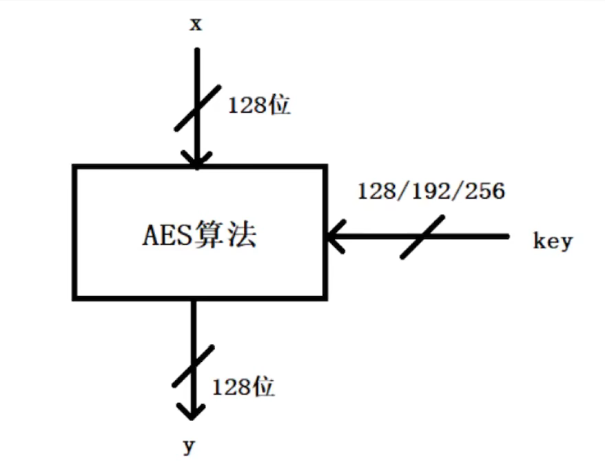

aes最重要的一个特征就是输入是128位分组，输出也是128位分组，但其中key分128位，192位，256位三种版本

| AES 类型  | 密钥长度  | 轮数 (Nr) | 密钥字数 (Nk) |
| ------- | ----- | ------- | --------- |
| AES-128 | 128 位 | 10      | 4         |
| AES-192 | 192 位 | 12      | 6         |
| AES-256 | 256 位 | 14      | 8         |

aes分组后16个字节是按矩阵方式排列

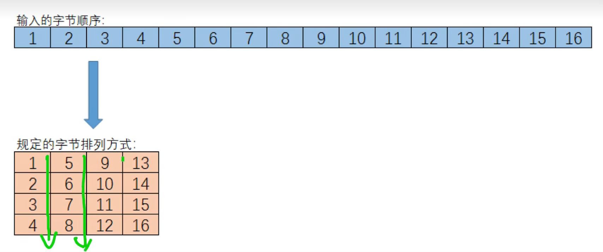

# 加密总流程：

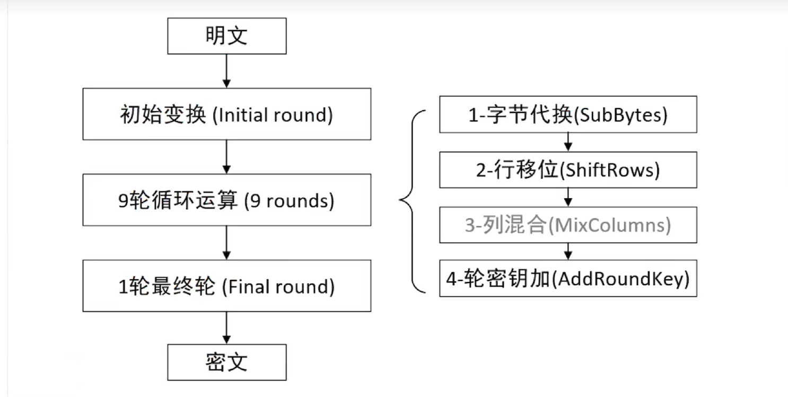

最终轮和前面9轮的区别是没有第三个步骤列混合

## 初始变换(Initial round)

初始变换就是输入的16个字节和密钥(不确定几位)进行密钥扩展后生成的$\text{RoundKey}_0$(16位)异或的结果

$$
\text{State}' = \text{State} \oplus \text{RoundKey}_0
$$

展开为矩阵形式：

$$
\begin{bmatrix}
s_{0,0} & s_{0,1} & s_{0,2} & s_{0,3} \\
s_{1,0} & s_{1,1} & s_{1,2} & s_{1,3} \\
s_{2,0} & s_{2,1} & s_{2,2} & s_{2,3} \\
s_{3,0} & s_{3,1} & s_{3,2} & s_{3,3}
\end{bmatrix}
\;\oplus\;
\begin{bmatrix}
k_{0,0} & k_{0,1} & k_{0,2} & k_{0,3} \\
k_{1,0} & k_{1,1} & k_{1,2} & k_{1,3} \\
k_{2,0} & k_{2,1} & k_{2,2} & k_{2,3} \\
k_{3,0} & k_{3,1} & k_{3,2} & k_{3,3}
\end{bmatrix}
\;=\;
\begin{bmatrix}
s'_{0,0} & s'_{0,1} & s'_{0,2} & s'_{0,3} \\
s'_{1,0} & s'_{1,1} & s'_{1,2} & s'_{1,3} \\
s'_{2,0} & s'_{2,1} & s'_{2,2} & s'_{2,3} \\
s'_{3,0} & s'_{3,1} & s'_{3,2} & s'_{3,3}
\end{bmatrix}
$$

其中：

- $s_{i,j}$ 为明文状态矩阵中第 $(i,j)$ 个字节  
- $k_{i,j}$ 为轮密钥矩阵中第 $(i,j)$ 个字节  
- $\oplus$ 表示按字节异或（XOR）运算

## 循环运算：

### 字节代换：

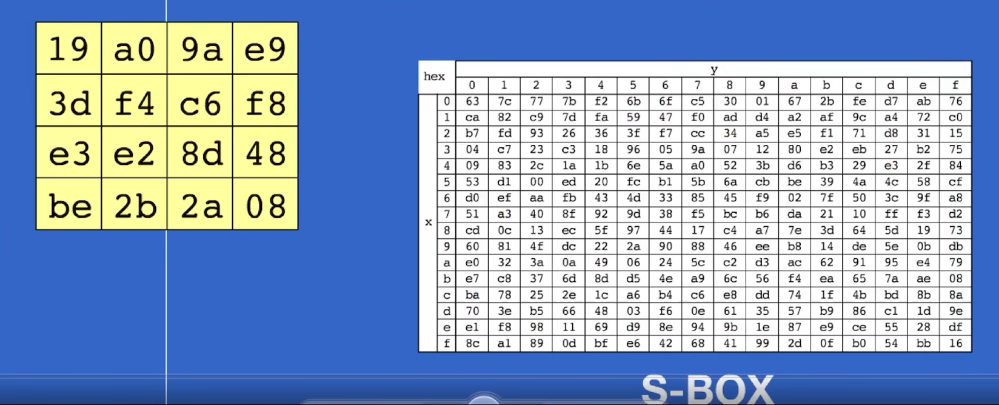

字节代换就是把第一步初始变换后的16字节矩阵块用s表代换，例如矩阵左上角的数是十六进制19，那就要代换成s盒中第1行第9列，查表可知是d4，以此类推

结果：

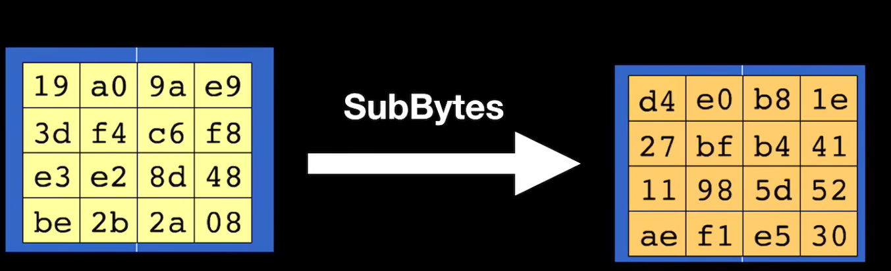

### 行移位：

ShiftRows 操作在状态矩阵上进行，规则如下：

- 第 0 行不变
- 第 1 行循环左移 1 字节
- 第 2 行循环左移 2 字节
- 第 3 行循环左移 3 字节

原始状态矩阵：

$$
\text{State} =
\begin{bmatrix}
s_{0,0} & s_{0,1} & s_{0,2} & s_{0,3} \\
s_{1,0} & s_{1,1} & s_{1,2} & s_{1,3} \\
s_{2,0} & s_{2,1} & s_{2,2} & s_{2,3} \\
s_{3,0} & s_{3,1} & s_{3,2} & s_{3,3}
\end{bmatrix}
$$

经过行移位后：

$$
\text{State}' =
\begin{bmatrix}
s_{0,0} & s_{0,1} & s_{0,2} & s_{0,3} \\
s_{1,1} & s_{1,2} & s_{1,3} & s_{1,0} \\
s_{2,2} & s_{2,3} & s_{2,0} & s_{2,1} \\
s_{3,3} & s_{3,0} & s_{3,1} & s_{3,2}
\end{bmatrix}
$$

每一行的移位规律如下：

| 行号  | 移位字节数 | 移位方向 |
|:---:|:-----:|:----:|
| 0   | 0     | 不变   |
| 1   | 1     | 左移   |
| 2   | 2     | 左移   |
| 3   | 3     | 左移   |

### 列混淆：

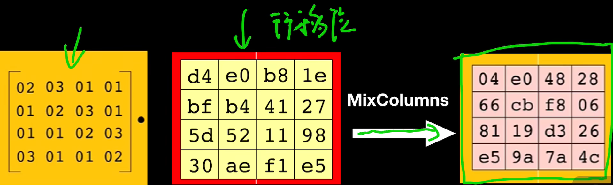

左乘一个确定的矩阵，但是这里的乘法不是普通乘法

#### 列混淆中的乘法

$$
\begin{aligned}
s'_{0,c} &= (02 \cdot s_{0,c}) \oplus (03 \cdot s_{1,c}) \oplus s_{2,c} \oplus s_{3,c} \\
s'_{1,c} &= s_{0,c} \oplus (02 \cdot s_{1,c}) \oplus (03 \cdot s_{2,c}) \oplus s_{3,c} \\
s'_{2,c} &= s_{0,c} \oplus s_{1,c} \oplus (02 \cdot s_{2,c}) \oplus (03 \cdot s_{3,c}) \\
s'_{3,c} &= (03 \cdot s_{0,c}) \oplus s_{1,c} \oplus s_{2,c} \oplus (02 \cdot s_{3,c})
\end{aligned}
$$

其中乘法在有限域 $GF(2^8)$ 上进行：

- $02 \cdot x$ 表示按字节左移一位（若最高位为 1，则再与 `0x1B` 异或）  
- $03 \cdot x = (02 \cdot x) \oplus x$

注：与0x1B异或是因为要构造有限域$GF(2^8)$构造出来的多项式把$x^8$模之后的结果，学逆向不用学那么深，只需要知道aes的加密解密和漏洞攻击就可以了


### 轮密钥加：

AddRoundKey 是 AES 每一轮中最简单但最关键的操作之一。  
它将 **状态矩阵 (State)** 与 **轮密钥矩阵 (RoundKey)** 按字节异或（XOR）：

$$
\text{State}' = \text{State} \oplus \text{RoundKey}_i
$$


设状态矩阵为：

$$
\text{State} =
\begin{bmatrix}
s_{0,0} & s_{0,1} & s_{0,2} & s_{0,3} \\
s_{1,0} & s_{1,1} & s_{1,2} & s_{1,3} \\
s_{2,0} & s_{2,1} & s_{2,2} & s_{2,3} \\
s_{3,0} & s_{3,1} & s_{3,2} & s_{3,3}
\end{bmatrix}
$$

轮密钥矩阵为：

$$
\text{RoundKey}_i =
\begin{bmatrix}
k_{0,0} & k_{0,1} & k_{0,2} & k_{0,3} \\
k_{1,0} & k_{1,1} & k_{1,2} & k_{1,3} \\
k_{2,0} & k_{2,1} & k_{2,2} & k_{2,3} \\
k_{3,0} & k_{3,1} & k_{3,2} & k_{3,3}
\end{bmatrix}
$$

异或后得到：

$$
\text{State}' =
\begin{bmatrix}
s_{0,0} \oplus k_{0,0} & s_{0,1} \oplus k_{0,1} & s_{0,2} \oplus k_{0,2} & s_{0,3} \oplus k_{0,3} \\
s_{1,0} \oplus k_{1,0} & s_{1,1} \oplus k_{1,1} & s_{1,2} \oplus k_{1,2} & s_{1,3} \oplus k_{1,3} \\
s_{2,0} \oplus k_{2,0} & s_{2,1} \oplus k_{2,1} & s_{2,2} \oplus k_{2,2} & s_{2,3} \oplus k_{2,3} \\
s_{3,0} \oplus k_{3,0} & s_{3,1} \oplus k_{3,1} & s_{3,2} \oplus k_{3,2} & s_{3,3} \oplus k_{3,3}
\end{bmatrix}
$$

### 按字节运算公式

每个字节的计算方式为：

$$
s'_{i,j} = s_{i,j} \oplus k_{i,j}, \quad 0 \le i,j \le 3
$$


## 密钥扩展：

初始只有128/192/256位的密钥是怎么更新的呢，这就涉及到密钥扩展

这是初始状态，这里以128位密钥为例，先全部填入前4列，设第5列为Wi

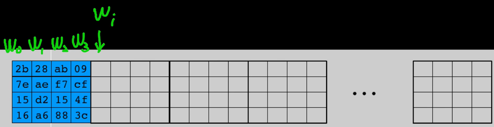


1. **初始部分：**

$$
W[i] = \text{原始密钥的第 } i \text{ 个 32 位字}, \quad 0 \le i < N_k
$$

2. **递推部分：（适用于所有aes算法）**

对于 $i \ge N_k$：

$$
W[i] =
\begin{cases}
W[i - N_k] \oplus \text{SubWord}(\text{RotWord}(W[i - 1])) \oplus \text{Rcon}[i/N_k], & \text{if } i \bmod N_k = 0 \\
W[i - N_k] \oplus \text{SubWord}(W[i - 1]), & \text{if } N_k > 6 \text{ and } i \bmod N_k = 4  (只有aes256有这条)\\
W[i - N_k] \oplus W[i - 1], & \text{otherwise}
\end{cases}
$$

### 函数定义

**RotWord：**  
循环左移 1 字节  

$$
[a_0, a_1, a_2, a_3] \Rightarrow [a_1, a_2, a_3, a_0]
$$

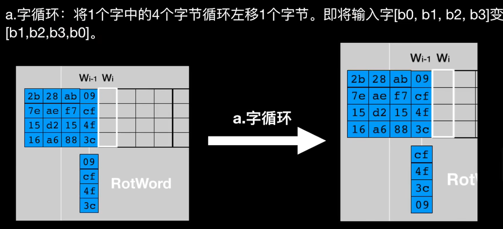


**SubWord：**  
对 4 个字节分别进行 S-box 替代  

$$
[a_0, a_1, a_2, a_3] \Rightarrow [S(a_0), S(a_1), S(a_2), S(a_3)]
$$

**Rcon：**  
轮常数，仅作用于字的第一个字节：

$$
\text{Rcon}[i] =
\begin{bmatrix}
\text{RC}[i] & 00 & 00 & 00
\end{bmatrix}
$$

其中  
$\text{RC}[1] = 0x01$，  
$\text{RC}[2] = 0x02$，  
$\text{RC}[3] = 0x04$，  
$\text{RC}[4] = 0x08$，  
$\text{RC}[5] = 0x10$，  
$\text{RC}[6] = 0x20$，  
$\text{RC}[7] = 0x40$，  
$\text{RC}[8] = 0x80$，  
$\text{RC}[9] = 0x1B$，  
$\text{RC}[10] = 0x36$

### 最终结果

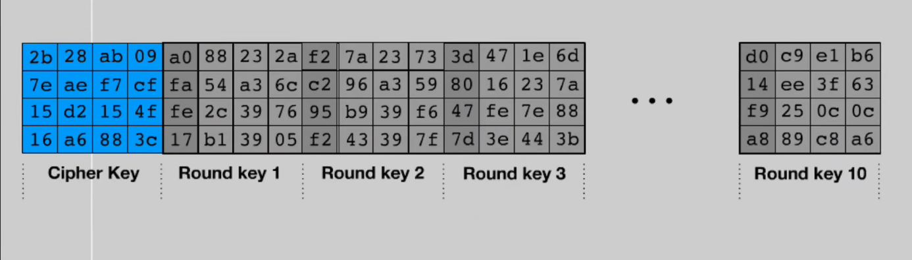

# 解密方式

就是把上述过程反过来一遍（解密的第一轮没有列混合逆向）

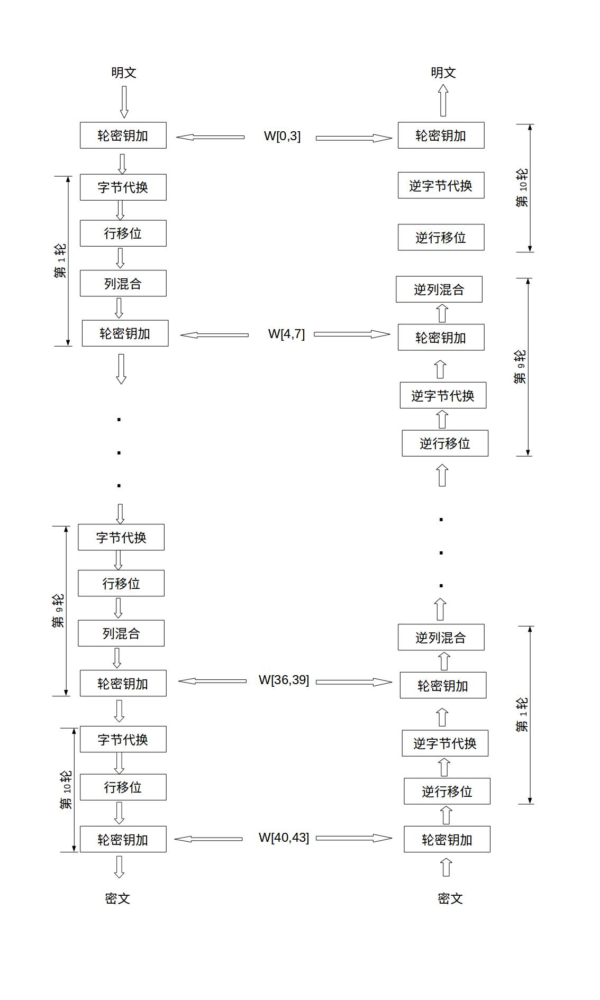


其中的轮密钥加只需要每轮相同状态的W[i,i+3]就可以

## 逆列混淆

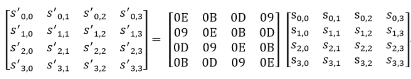

## 逆行移位：

就是逆向移位就可以，很简单

## 逆s表

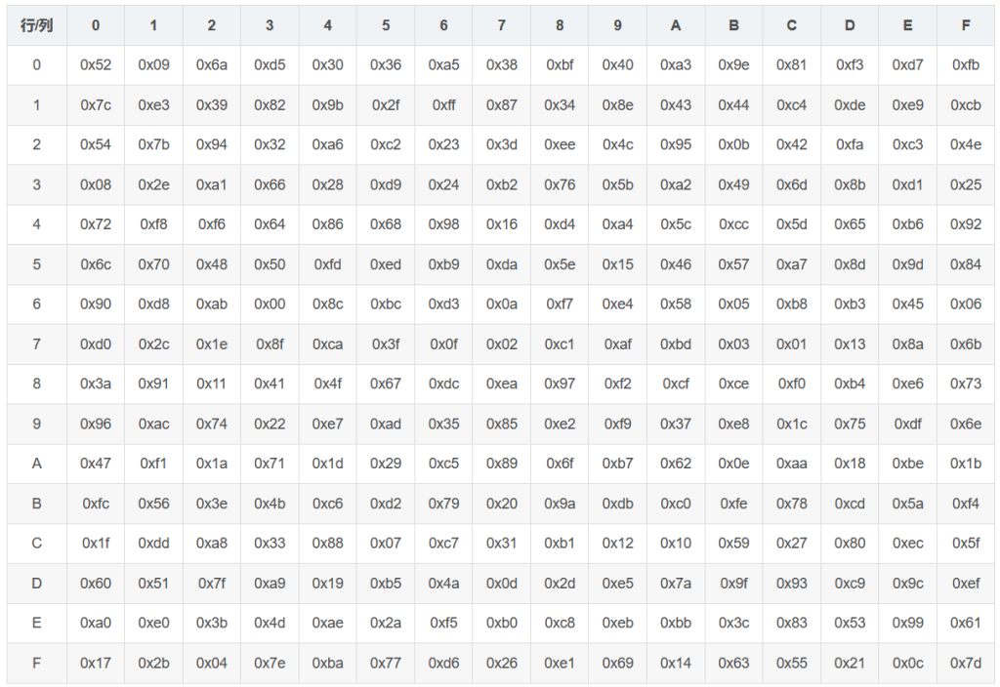

查表即可

# 逆向题型：

## 普通AES

找到密钥，找到密文，逆向脚本，进行解密。

加解密脚本:

```python
s_box = (
    0x63, 0x7C, 0x77, 0x7B, 0xF2, 0x6B, 0x6F, 0xC5, 0x30, 0x01, 0x67, 0x2B, 0xFE, 0xD7, 0xAB, 0x76,
    0xCA, 0x82, 0xC9, 0x7D, 0xFA, 0x59, 0x47, 0xF0, 0xAD, 0xD4, 0xA2, 0xAF, 0x9C, 0xA4, 0x72, 0xC0,
    0xB7, 0xFD, 0x93, 0x26, 0x36, 0x3F, 0xF7, 0xCC, 0x34, 0xA5, 0xE5, 0xF1, 0x71, 0xD8, 0x31, 0x15,
    0x04, 0xC7, 0x23, 0xC3, 0x18, 0x96, 0x05, 0x9A, 0x07, 0x12, 0x80, 0xE2, 0xEB, 0x27, 0xB2, 0x75,
    0x09, 0x83, 0x2C, 0x1A, 0x1B, 0x6E, 0x5A, 0xA0, 0x52, 0x3B, 0xD6, 0xB3, 0x29, 0xE3, 0x2F, 0x84,
    0x53, 0xD1, 0x00, 0xED, 0x20, 0xFC, 0xB1, 0x5B, 0x6A, 0xCB, 0xBE, 0x39, 0x4A, 0x4C, 0x58, 0xCF,
    0xD0, 0xEF, 0xAA, 0xFB, 0x43, 0x4D, 0x33, 0x85, 0x45, 0xF9, 0x02, 0x7F, 0x50, 0x3C, 0x9F, 0xA8,
    0x51, 0xA3, 0x40, 0x8F, 0x92, 0x9D, 0x38, 0xF5, 0xBC, 0xB6, 0xDA, 0x21, 0x10, 0xFF, 0xF3, 0xD2,
    0xCD, 0x0C, 0x13, 0xEC, 0x5F, 0x97, 0x44, 0x17, 0xC4, 0xA7, 0x7E, 0x3D, 0x64, 0x5D, 0x19, 0x73,
    0x60, 0x81, 0x4F, 0xDC, 0x22, 0x2A, 0x90, 0x88, 0x46, 0xEE, 0xB8, 0x14, 0xDE, 0x5E, 0x0B, 0xDB,
    0xE0, 0x32, 0x3A, 0x0A, 0x49, 0x06, 0x24, 0x5C, 0xC2, 0xD3, 0xAC, 0x62, 0x91, 0x95, 0xE4, 0x79,
    0xE7, 0xC8, 0x37, 0x6D, 0x8D, 0xD5, 0x4E, 0xA9, 0x6C, 0x56, 0xF4, 0xEA, 0x65, 0x7A, 0xAE, 0x08,
    0xBA, 0x78, 0x25, 0x2E, 0x1C, 0xA6, 0xB4, 0xC6, 0xE8, 0xDD, 0x74, 0x1F, 0x4B, 0xBD, 0x8B, 0x8A,
    0x70, 0x3E, 0xB5, 0x66, 0x48, 0x03, 0xF6, 0x0E, 0x61, 0x35, 0x57, 0xB9, 0x86, 0xC1, 0x1D, 0x9E,
    0xE1, 0xF8, 0x98, 0x11, 0x69, 0xD9, 0x8E, 0x94, 0x9B, 0x1E, 0x87, 0xE9, 0xCE, 0x55, 0x28, 0xDF,
    0x8C, 0xA1, 0x89, 0x0D, 0xBF, 0xE6, 0x42, 0x68, 0x41, 0x99, 0x2D, 0x0F, 0xB0, 0x54, 0xBB, 0x16,
)

# inv_s_box = tuple([s_box.index(i) for i in range(256)])
inv_s_box = (
    0x52, 0x09, 0x6A, 0xD5, 0x30, 0x36, 0xA5, 0x38, 0xBF, 0x40, 0xA3, 0x9E, 0x81, 0xF3, 0xD7, 0xFB,
    0x7C, 0xE3, 0x39, 0x82, 0x9B, 0x2F, 0xFF, 0x87, 0x34, 0x8E, 0x43, 0x44, 0xC4, 0xDE, 0xE9, 0xCB,
    0x54, 0x7B, 0x94, 0x32, 0xA6, 0xC2, 0x23, 0x3D, 0xEE, 0x4C, 0x95, 0x0B, 0x42, 0xFA, 0xC3, 0x4E,
    0x08, 0x2E, 0xA1, 0x66, 0x28, 0xD9, 0x24, 0xB2, 0x76, 0x5B, 0xA2, 0x49, 0x6D, 0x8B, 0xD1, 0x25,
    0x72, 0xF8, 0xF6, 0x64, 0x86, 0x68, 0x98, 0x16, 0xD4, 0xA4, 0x5C, 0xCC, 0x5D, 0x65, 0xB6, 0x92,
    0x6C, 0x70, 0x48, 0x50, 0xFD, 0xED, 0xB9, 0xDA, 0x5E, 0x15, 0x46, 0x57, 0xA7, 0x8D, 0x9D, 0x84,
    0x90, 0xD8, 0xAB, 0x00, 0x8C, 0xBC, 0xD3, 0x0A, 0xF7, 0xE4, 0x58, 0x05, 0xB8, 0xB3, 0x45, 0x06,
    0xD0, 0x2C, 0x1E, 0x8F, 0xCA, 0x3F, 0x0F, 0x02, 0xC1, 0xAF, 0xBD, 0x03, 0x01, 0x13, 0x8A, 0x6B,
    0x3A, 0x91, 0x11, 0x41, 0x4F, 0x67, 0xDC, 0xEA, 0x97, 0xF2, 0xCF, 0xCE, 0xF0, 0xB4, 0xE6, 0x73,
    0x96, 0xAC, 0x74, 0x22, 0xE7, 0xAD, 0x35, 0x85, 0xE2, 0xF9, 0x37, 0xE8, 0x1C, 0x75, 0xDF, 0x6E,
    0x47, 0xF1, 0x1A, 0x71, 0x1D, 0x29, 0xC5, 0x89, 0x6F, 0xB7, 0x62, 0x0E, 0xAA, 0x18, 0xBE, 0x1B,
    0xFC, 0x56, 0x3E, 0x4B, 0xC6, 0xD2, 0x79, 0x20, 0x9A, 0xDB, 0xC0, 0xFE, 0x78, 0xCD, 0x5A, 0xF4,
    0x1F, 0xDD, 0xA8, 0x33, 0x88, 0x07, 0xC7, 0x31, 0xB1, 0x12, 0x10, 0x59, 0x27, 0x80, 0xEC, 0x5F,
    0x60, 0x51, 0x7F, 0xA9, 0x19, 0xB5, 0x4A, 0x0D, 0x2D, 0xE5, 0x7A, 0x9F, 0x93, 0xC9, 0x9C, 0xEF,
    0xA0, 0xE0, 0x3B, 0x4D, 0xAE, 0x2A, 0xF5, 0xB0, 0xC8, 0xEB, 0xBB, 0x3C, 0x83, 0x53, 0x99, 0x61,
    0x17, 0x2B, 0x04, 0x7E, 0xBA, 0x77, 0xD6, 0x26, 0xE1, 0x69, 0x14, 0x63, 0x55, 0x21, 0x0C, 0x7D,
)


def sub_bytes(s):
    for i in range(4):
        for j in range(4):
            s[i][j] = s_box[s[i][j]]


def inv_sub_bytes(s):
    for i in range(4):
        for j in range(4):
            s[i][j] = inv_s_box[s[i][j]]


def shift_rows(s):
    s[0][1], s[1][1], s[2][1], s[3][1] = s[1][1], s[2][1], s[3][1], s[0][1]
    s[0][2], s[1][2], s[2][2], s[3][2] = s[2][2], s[3][2], s[0][2], s[1][2]
    s[0][3], s[1][3], s[2][3], s[3][3] = s[3][3], s[0][3], s[1][3], s[2][3]


def inv_shift_rows(s):
    s[0][1], s[1][1], s[2][1], s[3][1] = s[3][1], s[0][1], s[1][1], s[2][1]
    s[0][2], s[1][2], s[2][2], s[3][2] = s[2][2], s[3][2], s[0][2], s[1][2]
    s[0][3], s[1][3], s[2][3], s[3][3] = s[1][3], s[2][3], s[3][3], s[0][3]

def add_round_key(s, k):
    for i in range(4):
        for j in range(4):
            s[i][j] ^= k[i][j]


# learned from https://web.archive.org/web/20100626212235/http://cs.ucsb.edu/~koc/cs178/projects/JT/aes.c
xtime = lambda a: (((a << 1) ^ 0x1B) & 0xFF) if (a & 0x80) else (a << 1)


def mix_single_column(a):
    # see Sec 4.1.2 in The Design of Rijndael
    t = a[0] ^ a[1] ^ a[2] ^ a[3]
    u = a[0]
    a[0] ^= t ^ xtime(a[0] ^ a[1])
    a[1] ^= t ^ xtime(a[1] ^ a[2])
    a[2] ^= t ^ xtime(a[2] ^ a[3])
    a[3] ^= t ^ xtime(a[3] ^ u)


def mix_columns(s):
    for i in range(4):
        mix_single_column(s[i])


def inv_mix_columns(s):
    # see Sec 4.1.3 in The Design of Rijndael
    for i in range(4):
        u = xtime(xtime(s[i][0] ^ s[i][2]))
        v = xtime(xtime(s[i][1] ^ s[i][3]))
        s[i][0] ^= u
        s[i][1] ^= v
        s[i][2] ^= u
        s[i][3] ^= v

    mix_columns(s)


r_con = (
    0x00, 0x01, 0x02, 0x04, 0x08, 0x10, 0x20, 0x40,
    0x80, 0x1B, 0x36, 0x6C, 0xD8, 0xAB, 0x4D, 0x9A,
    0x2F, 0x5E, 0xBC, 0x63, 0xC6, 0x97, 0x35, 0x6A,
    0xD4, 0xB3, 0x7D, 0xFA, 0xEF, 0xC5, 0x91, 0x39,
)


def bytes2matrix(text):
    """ Converts a 16-byte array into a 4x4 matrix.  """
    return [list(text[i:i+4]) for i in range(0, len(text), 4)]

def matrix2bytes(matrix):
    """ Converts a 4x4 matrix into a 16-byte array.  """
    return bytes(sum(matrix, []))

def xor_bytes(a, b):
    """ Returns a new byte array with the elements xor'ed. """
    return bytes(i^j for i, j in zip(a, b))

def inc_bytes(a):
    """ Returns a new byte array with the value increment by 1 """
    out = list(a)
    for i in reversed(range(len(out))):
        if out[i] == 0xFF:
            out[i] = 0
        else:
            out[i] += 1
            break
    return bytes(out)

def pad(plaintext):
    """
    Pads the given plaintext with PKCS#7 padding to a multiple of 16 bytes.
    Note that if the plaintext size is a multiple of 16,
    a whole block will be added.
    """
    padding_len = 16 - (len(plaintext) % 16)
    padding = bytes([padding_len] * padding_len)
    return plaintext + padding

def unpad(plaintext):
    """
    Removes a PKCS#7 padding, returning the unpadded text and ensuring the
    padding was correct.
    """
    padding_len = plaintext[-1]
    assert padding_len > 0
    message, padding = plaintext[:-padding_len], plaintext[-padding_len:]
    assert all(p == padding_len for p in padding)
    return message

def split_blocks(message, block_size=16, require_padding=True):
        assert len(message) % block_size == 0 or not require_padding
        return [message[i:i+16] for i in range(0, len(message), block_size)]


class AES:
    """
    Class for AES-128 encryption with CBC mode and PKCS#7.

    This is a raw implementation of AES, without key stretching or IV
    management. Unless you need that, please use `encrypt` and `decrypt`.
    """
    rounds_by_key_size = {16: 10, 24: 12, 32: 14}
    def __init__(self, master_key):
        """
        Initializes the object with a given key.
        """
        assert len(master_key) in AES.rounds_by_key_size
        self.n_rounds = AES.rounds_by_key_size[len(master_key)]
        self._key_matrices = self._expand_key(master_key)

    def _expand_key(self, master_key):
        """
        Expands and returns a list of key matrices for the given master_key.
        """
        # Initialize round keys with raw key material.
        key_columns = bytes2matrix(master_key)
        iteration_size = len(master_key) // 4

        i = 1
        # expand round: (rounds+1)*4
        while len(key_columns) < (self.n_rounds + 1) * 4:
            # Copy previous word.
            word = list(key_columns[-1])

            # Perform schedule_core once every "row".
            if len(key_columns) % iteration_size == 0:
                # Circular shift.
                word.append(word.pop(0))
                # Map to S-BOX.
                word = [s_box[b] for b in word]
                # XOR with first byte of R-CON, since the others bytes of R-CON are 0.
                word[0] ^= r_con[i]
                i += 1
            elif len(master_key) == 32 and len(key_columns) % iteration_size == 4:
                # Run word through S-box in the fourth iteration when using a
                # 256-bit key.
                word = [s_box[b] for b in word]

            # XOR with equivalent word from previous iteration.
            word = xor_bytes(word, key_columns[-iteration_size])
            key_columns.append(list(word))

        # Group key words in 4x4 byte matrices.
        return [key_columns[4*i : 4*(i+1)] for i in range(len(key_columns) // 4)]

    def encrypt_ecb(self, ciphertext):
        assert len(ciphertext) >= 16
        assert len(ciphertext) % 16 == 0

        result = b''
        for i in range(0, len(ciphertext), 16):
            result += self.encrypt_ecb_block(ciphertext[i:i+16])
        return result

    def encrypt_ecb_block(self, plaintext):
        """
        Encrypts a single block of 16 byte long plaintext.
        """
        assert len(plaintext) == 16

        plain_state = bytes2matrix(plaintext)

        add_round_key(plain_state, self._key_matrices[0])

        for i in range(1, self.n_rounds):
            sub_bytes(plain_state)
            shift_rows(plain_state)
            mix_columns(plain_state)
            add_round_key(plain_state, self._key_matrices[i])

        sub_bytes(plain_state)
        shift_rows(plain_state)
        add_round_key(plain_state, self._key_matrices[-1])

        return matrix2bytes(plain_state)

    def decrypt_ecb(self, ciphertext):
        assert len(ciphertext) >= 16
        assert len(ciphertext) % 16 == 0

        result = b''
        for i in range(0, len(ciphertext), 16):
            result += self.decrypt_ecb_block(ciphertext[i:i+16])
        return result


    def decrypt_ecb_block(self, ciphertext):
        """
        Decrypts a single block of 16 byte long ciphertext.
        """
        assert len(ciphertext) == 16

        cipher_state = bytes2matrix(ciphertext)

        add_round_key(cipher_state, self._key_matrices[-1])
        inv_shift_rows(cipher_state)
        inv_sub_bytes(cipher_state)

        for i in range(self.n_rounds - 1, 0, -1):
            add_round_key(cipher_state, self._key_matrices[i])
            inv_mix_columns(cipher_state)
            inv_shift_rows(cipher_state)
            inv_sub_bytes(cipher_state)

        add_round_key(cipher_state, self._key_matrices[0])

        return matrix2bytes(cipher_state)

    def encrypt_cbc(self, plaintext, iv):
        """
        Encrypts `plaintext` using CBC mode and PKCS#7 padding, with the given
        initialization vector (iv).
        """
        assert len(iv) == 16

        plaintext = pad(plaintext)

        blocks = []
        previous = iv
        for plaintext_block in split_blocks(plaintext):
            # CBC mode encrypt: encrypt(plaintext_block XOR previous)
            block = self.encrypt_ecb_block(xor_bytes(plaintext_block, previous))
            blocks.append(block)
            previous = block

        return b''.join(blocks)

    def decrypt_cbc(self, ciphertext, iv):
        """
        Decrypts `ciphertext` using CBC mode and PKCS#7 padding, with the given
        initialization vector (iv).
        """
        assert len(iv) == 16

        blocks = []
        previous = iv
        for ciphertext_block in split_blocks(ciphertext):
            # CBC mode decrypt: previous XOR decrypt(ciphertext)
            blocks.append(xor_bytes(previous, self.decrypt_ecb_block(ciphertext_block)))
            previous = ciphertext_block

        return unpad(b''.join(blocks))

    def encrypt_pcbc(self, plaintext, iv):
        """
        Encrypts `plaintext` using PCBC mode and PKCS#7 padding, with the given
        initialization vector (iv).
        """
        assert len(iv) == 16

        plaintext = pad(plaintext)

        blocks = []
        prev_ciphertext = iv
        prev_plaintext = bytes(16)
        for plaintext_block in split_blocks(plaintext):
            # PCBC mode encrypt: encrypt(plaintext_block XOR (prev_ciphertext XOR prev_plaintext))
            ciphertext_block = self.encrypt_ecb_block(xor_bytes(plaintext_block, xor_bytes(prev_ciphertext, prev_plaintext)))
            blocks.append(ciphertext_block)
            prev_ciphertext = ciphertext_block
            prev_plaintext = plaintext_block

        return b''.join(blocks)

    def decrypt_pcbc(self, ciphertext, iv):
        """
        Decrypts `ciphertext` using PCBC mode and PKCS#7 padding, with the given
        initialization vector (iv).
        """
        assert len(iv) == 16

        blocks = []
        prev_ciphertext = iv
        prev_plaintext = bytes(16)
        for ciphertext_block in split_blocks(ciphertext):
            # PCBC mode decrypt: (prev_plaintext XOR prev_ciphertext) XOR decrypt(ciphertext_block)
            plaintext_block = xor_bytes(xor_bytes(prev_ciphertext, prev_plaintext), self.decrypt_ecb_block(ciphertext_block))
            blocks.append(plaintext_block)
            prev_ciphertext = ciphertext_block
            prev_plaintext = plaintext_block

        return unpad(b''.join(blocks))

    def encrypt_cfb(self, plaintext, iv):
        """
        Encrypts `plaintext` with the given initialization vector (iv).
        """
        assert len(iv) == 16

        blocks = []
        prev_ciphertext = iv
        for plaintext_block in split_blocks(plaintext, require_padding=False):
            # CFB mode encrypt: plaintext_block XOR encrypt(prev_ciphertext)
            ciphertext_block = xor_bytes(plaintext_block, self.encrypt_ecb_block(prev_ciphertext))
            blocks.append(ciphertext_block)
            prev_ciphertext = ciphertext_block

        return b''.join(blocks)

    def decrypt_cfb(self, ciphertext, iv):
        """
        Decrypts `ciphertext` with the given initialization vector (iv).
        """
        assert len(iv) == 16

        blocks = []
        prev_ciphertext = iv
        for ciphertext_block in split_blocks(ciphertext, require_padding=False):
            # CFB mode decrypt: ciphertext XOR decrypt(prev_ciphertext)
            plaintext_block = xor_bytes(ciphertext_block, self.encrypt_ecb_block(prev_ciphertext))
            blocks.append(plaintext_block)
            prev_ciphertext = ciphertext_block

        return b''.join(blocks)

    def encrypt_ofb(self, plaintext, iv):
        """
        Encrypts `plaintext` using OFB mode initialization vector (iv).
        """
        assert len(iv) == 16

        blocks = []
        previous = iv
        for plaintext_block in split_blocks(plaintext, require_padding=False):
            # OFB mode encrypt: plaintext_block XOR encrypt(previous)
            block = self.encrypt_ecb_block(previous)
            ciphertext_block = xor_bytes(plaintext_block, block)
            blocks.append(ciphertext_block)
            previous = block

        return b''.join(blocks)

    def decrypt_ofb(self, ciphertext, iv):
        """
        Decrypts `ciphertext` using OFB mode initialization vector (iv).
        """
        assert len(iv) == 16

        blocks = []
        previous = iv
        for ciphertext_block in split_blocks(ciphertext, require_padding=False):
            # OFB mode decrypt: ciphertext XOR encrypt(previous)
            block = self.encrypt_ecb_block(previous)
            plaintext_block = xor_bytes(ciphertext_block, block)
            blocks.append(plaintext_block)
            previous = block

        return b''.join(blocks)

    def encrypt_ctr(self, plaintext, iv):
        """
        Encrypts `plaintext` using CTR mode with the given nounce/IV.
        """
        assert len(iv) == 16

        blocks = []
        nonce = iv
        for plaintext_block in split_blocks(plaintext, require_padding=False):
            # CTR mode encrypt: plaintext_block XOR encrypt(nonce)
            block = xor_bytes(plaintext_block, self.encrypt_ecb_block(nonce))
            blocks.append(block)
            nonce = inc_bytes(nonce)

        return b''.join(blocks)

    def decrypt_ctr(self, ciphertext, iv):
        """
        Decrypts `ciphertext` using CTR mode with the given nounce/IV.
        """
        assert len(iv) == 16

        blocks = []
        nonce = iv
        for ciphertext_block in split_blocks(ciphertext, require_padding=False):
            # CTR mode decrypt: ciphertext XOR encrypt(nonce)
            block = xor_bytes(ciphertext_block, self.encrypt_ecb_block(nonce))
            blocks.append(block)
            nonce = inc_bytes(nonce)

        return b''.join(blocks)


def AES_ecb_encrypt(data: bytes, key: bytes):
    a = AES(key)
    return a.encrypt_ecb(data)

def AES_ecb_decrypt(data: bytes, key: bytes):
    a = AES(key)
    return a.decrypt_ecb(data)

def AES_cbc_encrypt(data: bytes, key: bytes, iv: bytes):
    a = AES(key)
    return a.encrypt_cbc(data, iv)

def AES_cbc_decrypt(data: bytes, key: bytes, iv: bytes):
    a = AES(key)
    return a.decrypt_cbc(data, iv)
```

## 白盒AES

| 项目   | 普通 AES（黑盒）        | 白盒 AES        |
| ---- | ----------------- | ------------- |
| 密钥   | 独立变量、明确定义         | 被混入查表中，不可直接访问 |
| 算法结构 | 明确的五步（SubBytes 等） | 各步骤混淆成查表和线性映射 |
| 可移植性 | 高（用同样的密钥随处运行）     | 低（查表与密钥绑定）    |
| 安全假设 | 攻击者看不到内部          | 攻击者能看到全部      |

 目前市面上大多数app都是基于白盒aes开发的，还有查表法实现的aes真的严格按照上面讲的aes流程走的很少，白盒aes东西太多了，而且还有很多攻击手法，就放在”逆向中的AES(二)“里讲好了


# 参考资料：

[【AES加密算法】| AES加密过程详解| 对称加密| Rijndael-128| 密码学| 信息安全_哔哩哔哩_bilibili](https://www.bilibili.com/video/BV1i341187fK/?spm_id_from=333.337.search-card.all.click)

[密码学——AES/DES加密算法原理介绍 - 枫のBlog](https://goodapple.top/archives/162)
