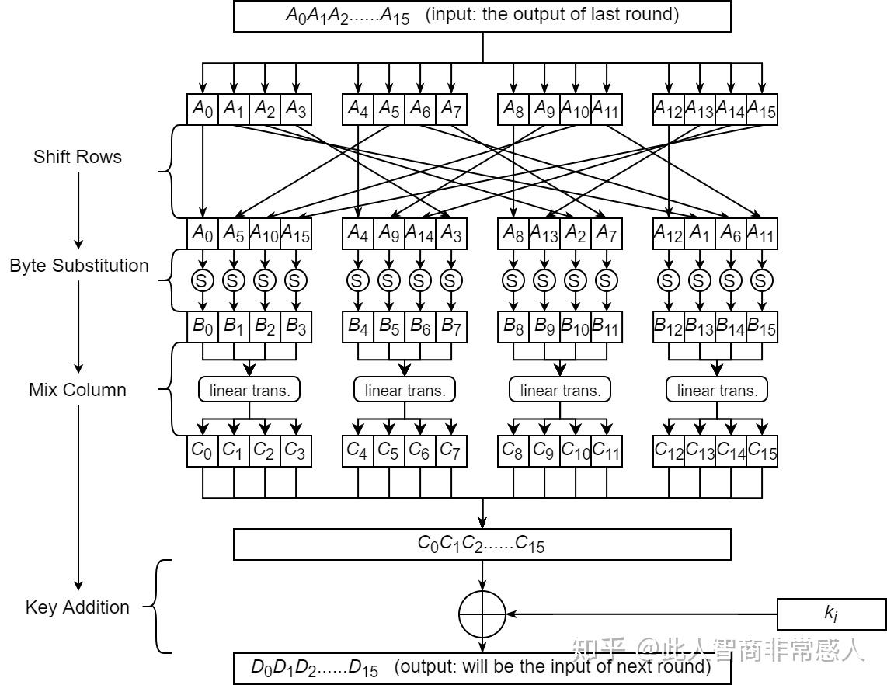
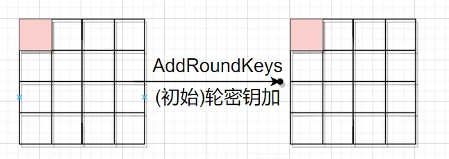
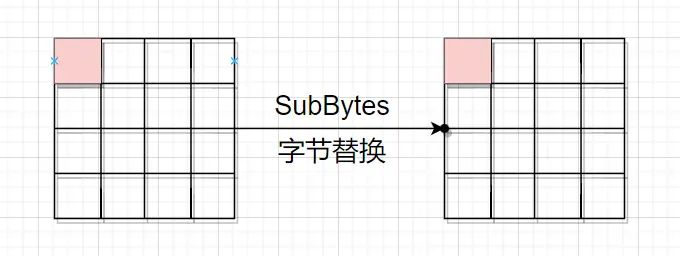
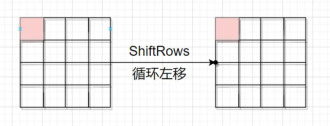
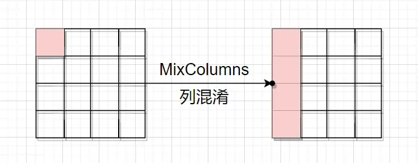
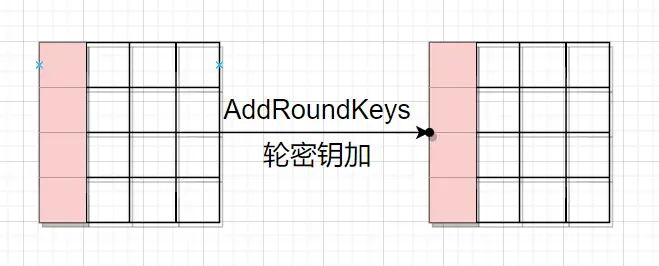
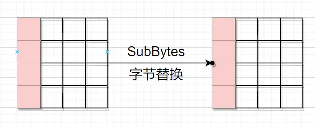
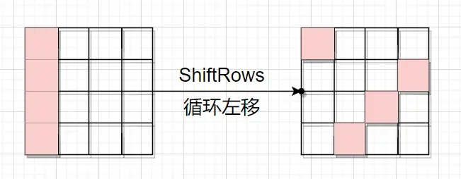
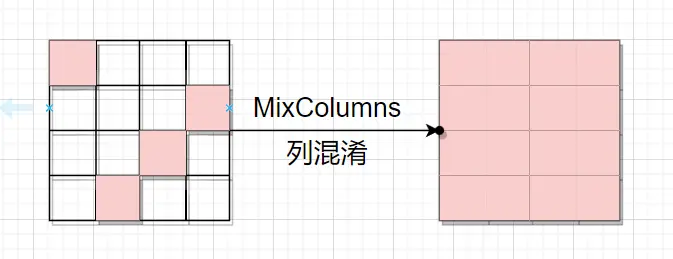

# 前言：

逆向工程中往往使用aes加密的程序不是用的查表法aes，就是用的白盒aes，让你难以分析，傻乎乎的使用aes基础算法很容易被破解

# 查表法实现的aes：

在前一篇文章中我们详细讲解了AES的每一轮中具体的四层结构，以加密过程为例分别是：字节代换层、行移位层、列混淆层和轮密钥加层

对于查表法实现，就是要将每一轮中的前三层操作(字节代换层、行移位层和列混淆层)合并为查找表。

查表法的核心思想是将字节代换层、ShiftRows层和MixColumn层融合为查找表：每个表的大小是32 bits(4字节)乘以256项，一般称为T盒(T-Box)或T表。加密过程4个表(Te)，解密过程4个表(Td)，共8个。每一轮操作都通过16次查表产生。


算法中定义T表实现为：

```bash
T0[x] = (2·S[x])<<24 | (S[x])<<16 | (S[x])<<8 | (3·S[x])
T1[x] = (3·S[x])<<24 | (2·S[x])<<16 | (S[x])<<8 | (S[x])
T2[x] = (S[x])<<24 | (3·S[x])<<16 | (2·S[x])<<8 | (S[x])
T3[x] = (S[x])<<24 | (S[x])<<16 | (3·S[x])<<8 | (2·S[x])

```

其中：

* `S[x]` 是 S-box 输出；

* `2·S[x]` 表示有限域 GF(2^8) 下的乘法（即 xtime 运算）。

## 原理：

由于aes加密流程中的字节代换和行移位可随意更改顺序而不影响加密结果，所以，我们把行移位放在最前面



先不管行移位，把行移位之后的矩阵状态设为

$$
\begin{bmatrix}
a_0 & a_4 & a_8 & a_{12} \\
a_1 & a_5 & a_9 & a_{13} \\
a_2 & a_6 & a_{10} & a_{14} \\
a_3 & a_7 & a_{11} & a_{15}
\end{bmatrix}
$$

只看第一列的变化，设

```py
a0' = S[a0]
a1' = S[a1]
a2' = S[a2]
a3' = S[a3]

```

$$
\begin{bmatrix}
c_0 \\ c_1 \\ c_2 \\ c_3
\end{bmatrix}
=
\begin{bmatrix}
2 & 3 & 1 & 1 \\
1 & 2 & 3 & 1 \\
1 & 1 & 2 & 3 \\
3 & 1 & 1 & 2
\end{bmatrix}
\begin{bmatrix}
a_0' \\ a_1' \\ a_2' \\ a_3'
\end{bmatrix}
$$

```ini
c0 = 2·a0' ⊕ 3·a1' ⊕ 1·a2' ⊕ 1·a3'
c1 = 1·a0' ⊕ 2·a1' ⊕ 3·a2' ⊕ 1·a3'
c2 = 1·a0' ⊕ 1·a1' ⊕ 2·a2' ⊕ 3·a3'
c3 = 3·a0' ⊕ 1·a1' ⊕ 1·a2' ⊕ 2·a3'


```

```ini
T0[x] = (2·S[x], S[x], S[x], 3·S[x])   // 合并为一个 32 位值
T1[x] = (3·S[x], 2·S[x], S[x], S[x])
T2[x] = (S[x], 3·S[x], 2·S[x], S[x])
T3[x] = (S[x], S[x], 3·S[x], 2·S[x])

```

所以

```ini
T0[a0] = [2·S[a0], S[a0], S[a0], 3·S[a0]]
T1[a1] = [3·S[a1], 2·S[a1], S[a1], S[a1]]
T2[a2] = [S[a2], 3·S[a2], 2·S[a2], S[a2]]
T3[a3] = [S[a3], S[a3], 3·S[a3], 2·S[a3]]

```

于是

```ini
c0c1c2c3 = T0[a0] ⊕ T1[a1] ⊕ T2[a2] ⊕ T3[a3]
```


现在再来考虑行移位的影响，只要把a1-a15的对应标号改掉就行

```ini
t0 = T0[a0] ^ T1[a5] ^ T2[a10] ^ T3[a15] ^ roundKey[0];
t1 = T0[a4] ^ T1[a9] ^ T2[a14] ^ T3[a3]  ^ roundKey[1];
t2 = T0[a8] ^ T1[a13]^ T2[a2]  ^ T3[a7]  ^ roundKey[2];
t3 = T0[a12]^ T1[a1] ^ T2[a6]  ^ T3[a11] ^ roundKey[3];
```

$t_i$是最后加密的结果

## 代码实现：

```c++
#include <stdlib.h>
#ifndef AES_H
#define AES_H
#include <stdint.h>
typedef struct AES_Key {
    uint32_t* ek;  // AES加密轮密钥
    uint32_t* dk;  // AES 解密轮密钥
    uint32_t nr;   //加密轮数
} AES_Key;
int AES_KeyInit(uint8_t* key, AES_Key* aes_key, size_t bits);
void AES_Encrypt(uint8_t* plaintext, uint8_t* ciphertext, AES_Key aes_key);
void AES_Decrypt(uint8_t* ciphertext, uint8_t* plaintext, AES_Key aes_key);
void AES_KeyDelete(AES_Key aes_key);
#endif
static const uint8_t Sbox[256] = {
    0x63, 0x7C, 0x77, 0x7B, 0xF2, 0x6B, 0x6F, 0xC5, 0x30, 0x01, 0x67, 0x2B,
    0xFE, 0xD7, 0xAB, 0x76, 0xCA, 0x82, 0xC9, 0x7D, 0xFA, 0x59, 0x47, 0xF0,
    0xAD, 0xD4, 0xA2, 0xAF, 0x9C, 0xA4, 0x72, 0xC0, 0xB7, 0xFD, 0x93, 0x26,
    0x36, 0x3F, 0xF7, 0xCC, 0x34, 0xA5, 0xE5, 0xF1, 0x71, 0xD8, 0x31, 0x15,
    0x04, 0xC7, 0x23, 0xC3, 0x18, 0x96, 0x05, 0x9A, 0x07, 0x12, 0x80, 0xE2,
    0xEB, 0x27, 0xB2, 0x75, 0x09, 0x83, 0x2C, 0x1A, 0x1B, 0x6E, 0x5A, 0xA0,
    0x52, 0x3B, 0xD6, 0xB3, 0x29, 0xE3, 0x2F, 0x84, 0x53, 0xD1, 0x00, 0xED,
    0x20, 0xFC, 0xB1, 0x5B, 0x6A, 0xCB, 0xBE, 0x39, 0x4A, 0x4C, 0x58, 0xCF,
    0xD0, 0xEF, 0xAA, 0xFB, 0x43, 0x4D, 0x33, 0x85, 0x45, 0xF9, 0x02, 0x7F,
    0x50, 0x3C, 0x9F, 0xA8, 0x51, 0xA3, 0x40, 0x8F, 0x92, 0x9D, 0x38, 0xF5,
    0xBC, 0xB6, 0xDA, 0x21, 0x10, 0xFF, 0xF3, 0xD2, 0xCD, 0x0C, 0x13, 0xEC,
    0x5F, 0x97, 0x44, 0x17, 0xC4, 0xA7, 0x7E, 0x3D, 0x64, 0x5D, 0x19, 0x73,
    0x60, 0x81, 0x4F, 0xDC, 0x22, 0x2A, 0x90, 0x88, 0x46, 0xEE, 0xB8, 0x14,
    0xDE, 0x5E, 0x0B, 0xDB, 0xE0, 0x32, 0x3A, 0x0A, 0x49, 0x06, 0x24, 0x5C,
    0xC2, 0xD3, 0xAC, 0x62, 0x91, 0x95, 0xE4, 0x79, 0xE7, 0xC8, 0x37, 0x6D,
    0x8D, 0xD5, 0x4E, 0xA9, 0x6C, 0x56, 0xF4, 0xEA, 0x65, 0x7A, 0xAE, 0x08,
    0xBA, 0x78, 0x25, 0x2E, 0x1C, 0xA6, 0xB4, 0xC6, 0xE8, 0xDD, 0x74, 0x1F,
    0x4B, 0xBD, 0x8B, 0x8A, 0x70, 0x3E, 0xB5, 0x66, 0x48, 0x03, 0xF6, 0x0E,
    0x61, 0x35, 0x57, 0xB9, 0x86, 0xC1, 0x1D, 0x9E, 0xE1, 0xF8, 0x98, 0x11,
    0x69, 0xD9, 0x8E, 0x94, 0x9B, 0x1E, 0x87, 0xE9, 0xCE, 0x55, 0x28, 0xDF,
    0x8C, 0xA1, 0x89, 0x0D, 0xBF, 0xE6, 0x42, 0x68, 0x41, 0x99, 0x2D, 0x0F,
    0xB0, 0x54, 0xBB, 0x16 };
static const unsigned char SboxIV[256] = {
  0x52,0x09,0x6A,0xD5,0x30,0x36,0xA5,0x38,0xBF,0x40,0xA3,0x9E,0x81,0xF3,0xD7,0xFB,
  0x7C,0xE3,0x39,0x82,0x9B,0x2F,0xFF,0x87,0x34,0x8E,0x43,0x44,0xC4,0xDE,0xE9,0xCB,
  0x54,0x7B,0x94,0x32,0xA6,0xC2,0x23,0x3D,0xEE,0x4C,0x95,0x0B,0x42,0xFA,0xC3,0x4E,
  0x08,0x2E,0xA1,0x66,0x28,0xD9,0x24,0xB2,0x76,0x5B,0xA2,0x49,0x6D,0x8B,0xD1,0x25,
  0x72,0xF8,0xF6,0x64,0x86,0x68,0x98,0x16,0xD4,0xA4,0x5C,0xCC,0x5D,0x65,0xB6,0x92,
  0x6C,0x70,0x48,0x50,0xFD,0xED,0xB9,0xDA,0x5E,0x15,0x46,0x57,0xA7,0x8D,0x9D,0x84,
  0x90,0xD8,0xAB,0x00,0x8C,0xBC,0xD3,0x0A,0xF7,0xE4,0x58,0x05,0xB8,0xB3,0x45,0x06,
  0xD0,0x2C,0x1E,0x8F,0xCA,0x3F,0x0F,0x02,0xC1,0xAF,0xBD,0x03,0x01,0x13,0x8A,0x6B,
  0x3A,0x91,0x11,0x41,0x4F,0x67,0xDC,0xEA,0x97,0xF2,0xCF,0xCE,0xF0,0xB4,0xE6,0x73,
  0x96,0xAC,0x74,0x22,0xE7,0xAD,0x35,0x85,0xE2,0xF9,0x37,0xE8,0x1C,0x75,0xDF,0x6E,
  0x47,0xF1,0x1A,0x71,0x1D,0x29,0xC5,0x89,0x6F,0xB7,0x62,0x0E,0xAA,0x18,0xBE,0x1B,
  0xFC,0x56,0x3E,0x4B,0xC6,0xD2,0x79,0x20,0x9A,0xDB,0xC0,0xFE,0x78,0xCD,0x5A,0xF4,
  0x1F,0xDD,0xA8,0x33,0x88,0x07,0xC7,0x31,0xB1,0x12,0x10,0x59,0x27,0x80,0xEC,0x5F,
  0x60,0x51,0x7F,0xA9,0x19,0xB5,0x4A,0x0D,0x2D,0xE5,0x7A,0x9F,0x93,0xC9,0x9C,0xEF,
  0xA0,0xE0,0x3B,0x4D,0xAE,0x2A,0xF5,0xB0,0xC8,0xEB,0xBB,0x3C,0x83,0x53,0x99,0x61,
  0x17,0x2B,0x04,0x7E,0xBA,0x77,0xD6,0x26,0xE1,0x69,0x14,0x63,0x55,0x21,0x0C,0x7D
};
static const uint32_t TE[256] = {
    0xc66363a5, 0xf87c7c84, 0xee777799, 0xf67b7b8d, 0xfff2f20d, 0xd66b6bbd,
    0xde6f6fb1, 0x91c5c554, 0x60303050, 0x02010103, 0xce6767a9, 0x562b2b7d,
    0xe7fefe19, 0xb5d7d762, 0x4dababe6, 0xec76769a, 0x8fcaca45, 0x1f82829d,
    0x89c9c940, 0xfa7d7d87, 0xeffafa15, 0xb25959eb, 0x8e4747c9, 0xfbf0f00b,
    0x41adadec, 0xb3d4d467, 0x5fa2a2fd, 0x45afafea, 0x239c9cbf, 0x53a4a4f7,
    0xe4727296, 0x9bc0c05b, 0x75b7b7c2, 0xe1fdfd1c, 0x3d9393ae, 0x4c26266a,
    0x6c36365a, 0x7e3f3f41, 0xf5f7f702, 0x83cccc4f, 0x6834345c, 0x51a5a5f4,
    0xd1e5e534, 0xf9f1f108, 0xe2717193, 0xabd8d873, 0x62313153, 0x2a15153f,
    0x0804040c, 0x95c7c752, 0x46232365, 0x9dc3c35e, 0x30181828, 0x379696a1,
    0x0a05050f, 0x2f9a9ab5, 0x0e070709, 0x24121236, 0x1b80809b, 0xdfe2e23d,
    0xcdebeb26, 0x4e272769, 0x7fb2b2cd, 0xea75759f, 0x1209091b, 0x1d83839e,
    0x582c2c74, 0x341a1a2e, 0x361b1b2d, 0xdc6e6eb2, 0xb45a5aee, 0x5ba0a0fb,
    0xa45252f6, 0x763b3b4d, 0xb7d6d661, 0x7db3b3ce, 0x5229297b, 0xdde3e33e,
    0x5e2f2f71, 0x13848497, 0xa65353f5, 0xb9d1d168, 0x00000000, 0xc1eded2c,
    0x40202060, 0xe3fcfc1f, 0x79b1b1c8, 0xb65b5bed, 0xd46a6abe, 0x8dcbcb46,
    0x67bebed9, 0x7239394b, 0x944a4ade, 0x984c4cd4, 0xb05858e8, 0x85cfcf4a,
    0xbbd0d06b, 0xc5efef2a, 0x4faaaae5, 0xedfbfb16, 0x864343c5, 0x9a4d4dd7,
    0x66333355, 0x11858594, 0x8a4545cf, 0xe9f9f910, 0x04020206, 0xfe7f7f81,
    0xa05050f0, 0x783c3c44, 0x259f9fba, 0x4ba8a8e3, 0xa25151f3, 0x5da3a3fe,
    0x804040c0, 0x058f8f8a, 0x3f9292ad, 0x219d9dbc, 0x70383848, 0xf1f5f504,
    0x63bcbcdf, 0x77b6b6c1, 0xafdada75, 0x42212163, 0x20101030, 0xe5ffff1a,
    0xfdf3f30e, 0xbfd2d26d, 0x81cdcd4c, 0x180c0c14, 0x26131335, 0xc3ecec2f,
    0xbe5f5fe1, 0x359797a2, 0x884444cc, 0x2e171739, 0x93c4c457, 0x55a7a7f2,
    0xfc7e7e82, 0x7a3d3d47, 0xc86464ac, 0xba5d5de7, 0x3219192b, 0xe6737395,
    0xc06060a0, 0x19818198, 0x9e4f4fd1, 0xa3dcdc7f, 0x44222266, 0x542a2a7e,
    0x3b9090ab, 0x0b888883, 0x8c4646ca, 0xc7eeee29, 0x6bb8b8d3, 0x2814143c,
    0xa7dede79, 0xbc5e5ee2, 0x160b0b1d, 0xaddbdb76, 0xdbe0e03b, 0x64323256,
    0x743a3a4e, 0x140a0a1e, 0x924949db, 0x0c06060a, 0x4824246c, 0xb85c5ce4,
    0x9fc2c25d, 0xbdd3d36e, 0x43acacef, 0xc46262a6, 0x399191a8, 0x319595a4,
    0xd3e4e437, 0xf279798b, 0xd5e7e732, 0x8bc8c843, 0x6e373759, 0xda6d6db7,
    0x018d8d8c, 0xb1d5d564, 0x9c4e4ed2, 0x49a9a9e0, 0xd86c6cb4, 0xac5656fa,
    0xf3f4f407, 0xcfeaea25, 0xca6565af, 0xf47a7a8e, 0x47aeaee9, 0x10080818,
    0x6fbabad5, 0xf0787888, 0x4a25256f, 0x5c2e2e72, 0x381c1c24, 0x57a6a6f1,
    0x73b4b4c7, 0x97c6c651, 0xcbe8e823, 0xa1dddd7c, 0xe874749c, 0x3e1f1f21,
    0x964b4bdd, 0x61bdbddc, 0x0d8b8b86, 0x0f8a8a85, 0xe0707090, 0x7c3e3e42,
    0x71b5b5c4, 0xcc6666aa, 0x904848d8, 0x06030305, 0xf7f6f601, 0x1c0e0e12,
    0xc26161a3, 0x6a35355f, 0xae5757f9, 0x69b9b9d0, 0x17868691, 0x99c1c158,
    0x3a1d1d27, 0x279e9eb9, 0xd9e1e138, 0xebf8f813, 0x2b9898b3, 0x22111133,
    0xd26969bb, 0xa9d9d970, 0x078e8e89, 0x339494a7, 0x2d9b9bb6, 0x3c1e1e22,
    0x15878792, 0xc9e9e920, 0x87cece49, 0xaa5555ff, 0x50282878, 0xa5dfdf7a,
    0x038c8c8f, 0x59a1a1f8, 0x09898980, 0x1a0d0d17, 0x65bfbfda, 0xd7e6e631,
    0x844242c6, 0xd06868b8, 0x824141c3, 0x299999b0, 0x5a2d2d77, 0x1e0f0f11,
    0x7bb0b0cb, 0xa85454fc, 0x6dbbbbd6, 0x2c16163a };
static const uint32_t TD[256] = {
    0x51f4a750, 0x7e416553, 0x1a17a4c3, 0x3a275e96, 0x3bab6bcb, 0x1f9d45f1,
    0xacfa58ab, 0x4be30393, 0x2030fa55, 0xad766df6, 0x88cc7691, 0xf5024c25,
    0x4fe5d7fc, 0xc52acbd7, 0x26354480, 0xb562a38f, 0xdeb15a49, 0x25ba1b67,
    0x45ea0e98, 0x5dfec0e1, 0xc32f7502, 0x814cf012, 0x8d4697a3, 0x6bd3f9c6,
    0x038f5fe7, 0x15929c95, 0xbf6d7aeb, 0x955259da, 0xd4be832d, 0x587421d3,
    0x49e06929, 0x8ec9c844, 0x75c2896a, 0xf48e7978, 0x99583e6b, 0x27b971dd,
    0xbee14fb6, 0xf088ad17, 0xc920ac66, 0x7dce3ab4, 0x63df4a18, 0xe51a3182,
    0x97513360, 0x62537f45, 0xb16477e0, 0xbb6bae84, 0xfe81a01c, 0xf9082b94,
    0x70486858, 0x8f45fd19, 0x94de6c87, 0x527bf8b7, 0xab73d323, 0x724b02e2,
    0xe31f8f57, 0x6655ab2a, 0xb2eb2807, 0x2fb5c203, 0x86c57b9a, 0xd33708a5,
    0x302887f2, 0x23bfa5b2, 0x02036aba, 0xed16825c, 0x8acf1c2b, 0xa779b492,
    0xf307f2f0, 0x4e69e2a1, 0x65daf4cd, 0x0605bed5, 0xd134621f, 0xc4a6fe8a,
    0x342e539d, 0xa2f355a0, 0x058ae132, 0xa4f6eb75, 0x0b83ec39, 0x4060efaa,
    0x5e719f06, 0xbd6e1051, 0x3e218af9, 0x96dd063d, 0xdd3e05ae, 0x4de6bd46,
    0x91548db5, 0x71c45d05, 0x0406d46f, 0x605015ff, 0x1998fb24, 0xd6bde997,
    0x894043cc, 0x67d99e77, 0xb0e842bd, 0x07898b88, 0xe7195b38, 0x79c8eedb,
    0xa17c0a47, 0x7c420fe9, 0xf8841ec9, 0x00000000, 0x09808683, 0x322bed48,
    0x1e1170ac, 0x6c5a724e, 0xfd0efffb, 0x0f853856, 0x3daed51e, 0x362d3927,
    0x0a0fd964, 0x685ca621, 0x9b5b54d1, 0x24362e3a, 0x0c0a67b1, 0x9357e70f,
    0xb4ee96d2, 0x1b9b919e, 0x80c0c54f, 0x61dc20a2, 0x5a774b69, 0x1c121a16,
    0xe293ba0a, 0xc0a02ae5, 0x3c22e043, 0x121b171d, 0x0e090d0b, 0xf28bc7ad,
    0x2db6a8b9, 0x141ea9c8, 0x57f11985, 0xaf75074c, 0xee99ddbb, 0xa37f60fd,
    0xf701269f, 0x5c72f5bc, 0x44663bc5, 0x5bfb7e34, 0x8b432976, 0xcb23c6dc,
    0xb6edfc68, 0xb8e4f163, 0xd731dcca, 0x42638510, 0x13972240, 0x84c61120,
    0x854a247d, 0xd2bb3df8, 0xaef93211, 0xc729a16d, 0x1d9e2f4b, 0xdcb230f3,
    0x0d8652ec, 0x77c1e3d0, 0x2bb3166c, 0xa970b999, 0x119448fa, 0x47e96422,
    0xa8fc8cc4, 0xa0f03f1a, 0x567d2cd8, 0x223390ef, 0x87494ec7, 0xd938d1c1,
    0x8ccaa2fe, 0x98d40b36, 0xa6f581cf, 0xa57ade28, 0xdab78e26, 0x3fadbfa4,
    0x2c3a9de4, 0x5078920d, 0x6a5fcc9b, 0x547e4662, 0xf68d13c2, 0x90d8b8e8,
    0x2e39f75e, 0x82c3aff5, 0x9f5d80be, 0x69d0937c, 0x6fd52da9, 0xcf2512b3,
    0xc8ac993b, 0x10187da7, 0xe89c636e, 0xdb3bbb7b, 0xcd267809, 0x6e5918f4,
    0xec9ab701, 0x834f9aa8, 0xe6956e65, 0xaaffe67e, 0x21bccf08, 0xef15e8e6,
    0xbae79bd9, 0x4a6f36ce, 0xea9f09d4, 0x29b07cd6, 0x31a4b2af, 0x2a3f2331,
    0xc6a59430, 0x35a266c0, 0x744ebc37, 0xfc82caa6, 0xe090d0b0, 0x33a7d815,
    0xf104984a, 0x41ecdaf7, 0x7fcd500e, 0x1791f62f, 0x764dd68d, 0x43efb04d,
    0xccaa4d54, 0xe49604df, 0x9ed1b5e3, 0x4c6a881b, 0xc12c1fb8, 0x4665517f,
    0x9d5eea04, 0x018c355d, 0xfa877473, 0xfb0b412e, 0xb3671d5a, 0x92dbd252,
    0xe9105633, 0x6dd64713, 0x9ad7618c, 0x37a10c7a, 0x59f8148e, 0xeb133c89,
    0xcea927ee, 0xb761c935, 0xe11ce5ed, 0x7a47b13c, 0x9cd2df59, 0x55f2733f,
    0x1814ce79, 0x73c737bf, 0x53f7cdea, 0x5ffdaa5b, 0xdf3d6f14, 0x7844db86,
    0xcaaff381, 0xb968c43e, 0x3824342c, 0xc2a3405f, 0x161dc372, 0xbce2250c,
    0x283c498b, 0xff0d9541, 0x39a80171, 0x080cb3de, 0xd8b4e49c, 0x6456c190,
    0x7bcb8461, 0xd532b670, 0x486c5c74, 0xd0b85742 };
#define rotr32(value, shift) ((value >> shift) ^ (value << (32 - shift)))
int AES_KeyInit(uint8_t* key, AES_Key* aes_key, size_t bits) {
    uint32_t Rcon[10] = { 0x01, 0x02, 0x04, 0x08, 0x10,
                         0x20, 0x40, 0x80, 0x1B, 0x36 };  //轮常数
    uint32_t nr = 10 + (bits - 128) / 32;                //加密轮数 Nr
    uint32_t nk = bits / 32;                             //密钥字数 Nk
    uint32_t tmp, tmp1;
    aes_key->nr = nr;
    //-----------malloc-------------
    uint32_t* w = (uint32_t*)malloc(sizeof(uint32_t) * 4 * (nr + 1));
    if (w == (void*)0) {
        return 0;
    }
    uint32_t* d = (uint32_t*)malloc(sizeof(uint32_t) * 4 * (nr + 1));
    if (d == (void*)0) {
        free(d);
        return 0;
    }
    //--------------Load as BigEndian---------------
    for (int i = 0; i < nk; i++) {//将总的bits，每32个（四个字节）分一组，每一组用大端序来进行表示
        w[i] = (key[4 * i + 0] << 24) | (key[4 * i + 1] << 16) |
            (key[4 * i + 2] << 8) | (key[4 * i + 3]);
    }
    //------------KeyExpand-----------------
    for (int i = nk; i < 4 * (nr + 1); i++) {
        tmp = w[i - 1];
        if (i % nk == 0) {
            /* tmp = SubWord(RotWord(w[i-1])) */
            tmp1 = tmp;
            tmp = Sbox[(tmp1 >> 24) & 0xFF];
            tmp |= Sbox[(tmp1 >> 0) & 0xFF] << 8;
            tmp |= Sbox[(tmp1 >> 8) & 0xFF] << 16;
            tmp |= (Sbox[(tmp1 >> 16) & 0xFF] ^ Rcon[i / nk - 1]) << 24;
        }
        else if (nk > 6 && i % nk == 4) {
            /* temp = SubWord(w[i-1]) */
            tmp1 = tmp;
            tmp = Sbox[(tmp1 >> 0) & 0xFF];
            tmp |= Sbox[(tmp1 >> 8) & 0xFF] << 8;
            tmp |= Sbox[(tmp1 >> 16) & 0xFF] << 16;
            tmp |= Sbox[(tmp1 >> 24) & 0xFF] << 24;
        }
        w[i] = w[i - nk] ^ tmp;
    }
    aes_key->ek = w;
    //------------TransKey-----------
    for (int i = 0; i < 4; i++) {
        d[i] = w[i];
    }
    for (int i = 4; i < 4 * nr; i++) {
        //-----------MixCol IV-----------
        d[i] = TD[Sbox[(w[i] >> 24) & 0xFF]];
        tmp = TD[Sbox[(w[i] >> 16) & 0xFF]];
        d[i] ^= rotr32(tmp, 8);
        tmp = TD[Sbox[(w[i] >> 8) & 0xFF]];
        d[i] ^= rotr32(tmp, 16);
        tmp = TD[Sbox[(w[i] >> 0) & 0xFF]];
        d[i] ^= rotr32(tmp, 24);
    }
    for (int i = 0; i < 4; i++) {
        d[4 * nr + i] = w[4 * nr + i];
    }
    aes_key->dk = d;
    return 1;
}
void AES_KeyDelete(AES_Key aes_key) {
    free(aes_key.ek);
    free(aes_key.dk);
}

void AES_Encrypt(uint8_t* plaintext, uint8_t* ciphertext, AES_Key aes_key) {
    uint32_t s[4];
    uint32_t t[4];
    uint32_t tmp;
    //------------Load as BigEndian------------------
    for (int i = 0; i < 4; i++) {
        s[i] = (plaintext[4 * i + 0] << 24) | (plaintext[4 * i + 1] << 16) |
            (plaintext[4 * i + 2] << 8) | (plaintext[4 * i + 3]);
    }
    //----------------AddRoundKey----------------
    s[0] ^= aes_key.ek[0];
    s[1] ^= aes_key.ek[1];
    s[2] ^= aes_key.ek[2];
    s[3] ^= aes_key.ek[3];
    for (int i = 1; i < aes_key.nr; i++) {
        //-------ShiftRow + SubByte + MixCol-------------
        // t0
        t[0] = TE[(s[0] >> 24) & 0xFF];
        tmp = TE[(s[1] >> 16) & 0xFF];
        t[0] ^= rotr32(tmp, 8);
        tmp = TE[(s[2] >> 8) & 0xFF];
        t[0] ^= rotr32(tmp, 16);
        tmp = TE[(s[3] >> 0) & 0xFF];
        t[0] ^= rotr32(tmp, 24);
        // t1
        t[1] = TE[(s[1] >> 24) & 0xFF];
        tmp = TE[(s[2] >> 16) & 0xFF];
        t[1] ^= rotr32(tmp, 8);
        tmp = TE[(s[3] >> 8) & 0xFF];
        t[1] ^= rotr32(tmp, 16);
        tmp = TE[(s[0] >> 0) & 0xFF];
        t[1] ^= rotr32(tmp, 24);
        // t2
        t[2] = TE[(s[2] >> 24) & 0xFF];
        tmp = TE[(s[3] >> 16) & 0xFF];
        t[2] ^= rotr32(tmp, 8);
        tmp = TE[(s[0] >> 8) & 0xFF];
        t[2] ^= rotr32(tmp, 16);
        tmp = TE[(s[1] >> 0) & 0xFF];
        t[2] ^= rotr32(tmp, 24);
        // t3
        t[3] = TE[(s[3] >> 24) & 0xFF];
        tmp = TE[(s[0] >> 16) & 0xFF];
        t[3] ^= rotr32(tmp, 8);
        tmp = TE[(s[1] >> 8) & 0xFF];
        t[3] ^= rotr32(tmp, 16);
        tmp = TE[(s[2] >> 0) & 0xFF];
        t[3] ^= rotr32(tmp, 24);
        //-------------AddRoundKey---------------
        s[0] = t[0] ^ aes_key.ek[4 * i + 0];
        s[1] = t[1] ^ aes_key.ek[4 * i + 1];
        s[2] = t[2] ^ aes_key.ek[4 * i + 2];
        s[3] = t[3] ^ aes_key.ek[4 * i + 3];
    }
    //------------ShiftRow + SubByte-----------
    // t0
    t[0] = Sbox[(s[0] >> 24) & 0xFF] << 24;
    t[0] |= Sbox[(s[1] >> 16) & 0xFF] << 16;
    t[0] |= Sbox[(s[2] >> 8) & 0xFF] << 8;
    t[0] |= Sbox[(s[3] >> 0) & 0xFF] << 0;
    // t1
    t[1] = Sbox[(s[1] >> 24) & 0xFF] << 24;
    t[1] |= Sbox[(s[2] >> 16) & 0xFF] << 16;
    t[1] |= Sbox[(s[3] >> 8) & 0xFF] << 8;
    t[1] |= Sbox[(s[0] >> 0) & 0xFF] << 0;
    // t2
    t[2] = Sbox[(s[2] >> 24) & 0xFF] << 24;
    t[2] |= Sbox[(s[3] >> 16) & 0xFF] << 16;
    t[2] |= Sbox[(s[0] >> 8) & 0xFF] << 8;
    t[2] |= Sbox[(s[1] >> 0) & 0xFF] << 0;
    // t3
    t[3] = Sbox[(s[3] >> 24) & 0xFF] << 24;
    t[3] |= Sbox[(s[0] >> 16) & 0xFF] << 16;
    t[3] |= Sbox[(s[1] >> 8) & 0xFF] << 8;
    t[3] |= Sbox[(s[2] >> 0) & 0xFF] << 0;
    //------------AddRoundKey-------------
    s[0] = t[0] ^ aes_key.ek[4 * aes_key.nr + 0];
    s[1] = t[1] ^ aes_key.ek[4 * aes_key.nr + 1];
    s[2] = t[2] ^ aes_key.ek[4 * aes_key.nr + 2];
    s[3] = t[3] ^ aes_key.ek[4 * aes_key.nr + 3];
    //-----------Store as BigEndian--------------
    for (int i = 0; i < 4; i++) {
        ciphertext[4 * i + 0] = (s[i] >> 24) & 0xFF;
        ciphertext[4 * i + 1] = (s[i] >> 16) & 0xFF;
        ciphertext[4 * i + 2] = (s[i] >> 8) & 0xFF;
        ciphertext[4 * i + 3] = (s[i] >> 0) & 0xFF;
    }
}

void AES_Decrypt(uint8_t* ciphertext, uint8_t* plaintext, AES_Key aes_key) {
    uint32_t s[4];
    uint32_t t[4];
    uint32_t tmp;
    //------------Load as BigEndian------------------
    for (int i = 0; i < 4; i++) {
        s[i] = (ciphertext[4 * i + 0] << 24) | (ciphertext[4 * i + 1] << 16) |
            (ciphertext[4 * i + 2] << 8) | (ciphertext[4 * i + 3]);
    }
    //----------------AddRoundKey----------------
    s[0] ^= aes_key.dk[4 * aes_key.nr + 0];
    s[1] ^= aes_key.dk[4 * aes_key.nr + 1];
    s[2] ^= aes_key.dk[4 * aes_key.nr + 2];
    s[3] ^= aes_key.dk[4 * aes_key.nr + 3];
    for (int i = aes_key.nr - 1; i > 0; i--) {
        //-------ShiftRow IV + SubByte IV + MixCol IV-------------
        // t0
        t[0] = TD[(s[0] >> 24) & 0xFF];
        tmp = TD[(s[3] >> 16) & 0xFF];
        t[0] ^= rotr32(tmp, 8);
        tmp = TD[(s[2] >> 8) & 0xFF];
        t[0] ^= rotr32(tmp, 16);
        tmp = TD[(s[1] >> 0) & 0xFF];
        t[0] ^= rotr32(tmp, 24);
        // t1
        t[1] = TD[(s[1] >> 24) & 0xFF];
        tmp = TD[(s[0] >> 16) & 0xFF];
        t[1] ^= rotr32(tmp, 8);
        tmp = TD[(s[3] >> 8) & 0xFF];
        t[1] ^= rotr32(tmp, 16);
        tmp = TD[(s[2] >> 0) & 0xFF];
        t[1] ^= rotr32(tmp, 24);
        // t2
        t[2] = TD[(s[2] >> 24) & 0xFF];
        tmp = TD[(s[1] >> 16) & 0xFF];
        t[2] ^= rotr32(tmp, 8);
        tmp = TD[(s[0] >> 8) & 0xFF];
        t[2] ^= rotr32(tmp, 16);
        tmp = TD[(s[3] >> 0) & 0xFF];
        t[2] ^= rotr32(tmp, 24);
        // t3
        t[3] = TD[(s[3] >> 24) & 0xFF];
        tmp = TD[(s[2] >> 16) & 0xFF];
        t[3] ^= rotr32(tmp, 8);
        tmp = TD[(s[1] >> 8) & 0xFF];
        t[3] ^= rotr32(tmp, 16);
        tmp = TD[(s[0] >> 0) & 0xFF];
        t[3] ^= rotr32(tmp, 24);
        //-------------AddRoundKey---------------
        s[0] = t[0] ^ aes_key.dk[4 * i + 0];
        s[1] = t[1] ^ aes_key.dk[4 * i + 1];
        s[2] = t[2] ^ aes_key.dk[4 * i + 2];
        s[3] = t[3] ^ aes_key.dk[4 * i + 3];
    }
    //------------ShiftRow + SubByte-----------
    // t0
    t[0] = SboxIV[(s[0] >> 24) & 0xFF] << 24;
    t[0] |= SboxIV[(s[3] >> 16) & 0xFF] << 16;
    t[0] |= SboxIV[(s[2] >> 8) & 0xFF] << 8;
    t[0] |= SboxIV[(s[1] >> 0) & 0xFF] << 0;
    // t1
    t[1] = SboxIV[(s[1] >> 24) & 0xFF] << 24;
    t[1] |= SboxIV[(s[0] >> 16) & 0xFF] << 16;
    t[1] |= SboxIV[(s[3] >> 8) & 0xFF] << 8;
    t[1] |= SboxIV[(s[2] >> 0) & 0xFF] << 0;
    // t2
    t[2] = SboxIV[(s[2] >> 24) & 0xFF] << 24;
    t[2] |= SboxIV[(s[1] >> 16) & 0xFF] << 16;
    t[2] |= SboxIV[(s[0] >> 8) & 0xFF] << 8;
    t[2] |= SboxIV[(s[3] >> 0) & 0xFF] << 0;
    // t3
    t[3] = SboxIV[(s[3] >> 24) & 0xFF] << 24;
    t[3] |= SboxIV[(s[2] >> 16) & 0xFF] << 16;
    t[3] |= SboxIV[(s[1] >> 8) & 0xFF] << 8;
    t[3] |= SboxIV[(s[0] >> 0) & 0xFF] << 0;
    //------------AddRoundKey-------------
    s[0] = t[0] ^ aes_key.dk[0];
    s[1] = t[1] ^ aes_key.dk[1];
    s[2] = t[2] ^ aes_key.dk[2];
    s[3] = t[3] ^ aes_key.dk[3];
    //-----------Store as BigEndian--------------
    for (int i = 0; i < 4; i++) {
        plaintext[4 * i + 0] = (s[i] >> 24) & 0xFF;
        plaintext[4 * i + 1] = (s[i] >> 16) & 0xFF;
        plaintext[4 * i + 2] = (s[i] >> 8) & 0xFF;
        plaintext[4 * i + 3] = (s[i] >> 0) & 0xFF;
    }
}
int main() {
    AES_Key aes_key;
    // 00 01 02 03 04 05 06 07 08 09 0a 0b 0c 0d 0e 0f 10 11 12 13 14 15 16 17
    // 18 19 1a 1b 1c 1d 1e 1f
    uint8_t key[256 / 8] = { 0x00, 0x01, 0x02, 0x03, 0x04, 0x05, 0x06, 0x07,
                            0x08, 0x09, 0x0a, 0x0b, 0x0c, 0x0d, 0x0e, 0x0f,
                            0x10, 0x11, 0x12, 0x13, 0x14, 0x15, 0x16, 0x17,
                            0x18, 0x19, 0x1a, 0x1b, 0x1c, 0x1d, 0x1e, 0x1f };
    // 00 11 22 33 44 55 66 77 88 99 aa bb cc dd ee ff
    uint8_t plaintext[16] = { 0x00, 0x11, 0x22, 0x33, 0x44, 0x55, 0x66, 0x77,
                             0x88, 0x99, 0xaa, 0xbb, 0xcc, 0xdd, 0xee, 0xff };
    uint8_t ciphertext[16];
    //-----------AES 128-------------------
    int success = AES_KeyInit(key, &aes_key, 128);
    if (success) {
        printf("-----------AES 128-------------\n");
        // 69 c4 e0 d8 6a 7b 04 30 d8 cd b7 80 70 b4 c5 5a
        AES_Encrypt(plaintext, ciphertext, aes_key);
        for (int i = 0; i < 16; i++) {
            printf("%02x ", ciphertext[i]);
        }
        printf("\n");
        // 00 11 22 33 44 55 66 77 88 99 aa bb cc dd ee ff
        AES_Decrypt(ciphertext, plaintext, aes_key);
        for (int i = 0; i < 16; i++) {
            printf("%02x ", plaintext[i]);
        }
        printf("\n");
        AES_KeyDelete(aes_key);
    }
    //-----------AES 196-------------------
    success = AES_KeyInit(key, &aes_key, 196);
    if (success) {
        printf("-----------AES 196-------------\n");
        // dd a9 7c a4 86 4c df e0 6e af 70 a0 ec 0d 71 91
        AES_Encrypt(plaintext, ciphertext, aes_key);
        for (int i = 0; i < 16; i++) {
            printf("%02x ", ciphertext[i]);
        }
        printf("\n");
        // 00 11 22 33 44 55 66 77 88 99 aa bb cc dd ee ff
        AES_Decrypt(ciphertext, plaintext, aes_key);
        for (int i = 0; i < 16; i++) {
            printf("%02x ", plaintext[i]);
        }
        printf("\n");
        AES_KeyDelete(aes_key);
    }
    //------------AES 256-----------------
    success = AES_KeyInit(key, &aes_key, 256);
    if (success) {
        printf("-----------AES 256-------------\n");
        // 8e a2 b7 ca 51 67 45 bf ea fc 49 90 4b 49 60 89
        AES_Encrypt(plaintext, ciphertext, aes_key);
        for (int i = 0; i < 16; i++) {
            printf("%02x ", ciphertext[i]);
        }
        printf("\n");
        // 00 11 22 33 44 55 66 77 88 99 aa bb cc dd ee ff
        AES_Decrypt(ciphertext, plaintext, aes_key);
        for (int i = 0; i < 16; i++) {
            printf("%02x ", plaintext[i]);
        }
        printf("\n");
        AES_KeyDelete(aes_key);
    }
    return 0;
}
```

## 注意点：

加解密密钥在查表法aes中不同

逆向时拿到其中一个可以推导另一个

```ini
dk[0]  = ek[10];                     // 最后一轮密钥直接用
dk[10] = ek[0];                      // 第一轮密钥直接用
dk[i]  = InvMixColumns(ek[10 - i]);  // 中间轮要过一次逆MixColumns

```

不需要研究透算法逻辑，只需要知道大致原理和遇到时能识别出这是aes变种就可以了

# 白盒aes

白盒aes算是在逆向中最常见到的了，特点是隐藏密钥。

查表法 AES 提供了“把轮操作变成查表”的思路，白盒 AES 则利用这个查表方法隐藏密钥，

白盒 AES 和 “查表法 AES” 算法是同一回事，可以把白盒AES看成查表AES的加强版(把密钥也混淆进表里了)，一些密码学库会在 AES_init 的时候预处理并展开 key；如果 key 是字面量，还可能在编译时进行常量计算。这样编译后的可执行文件中就没有明文 key 了。

## DFA攻击

白盒aes最主要的破解方式就是dfa攻击

我们需要的攻击条件：

- 我们可以反汇编出源代码并调试它

- pip install phoenixAES

- 编译这里面的[GitHub - SideChannelMarvels/Stark: Repository of small utilities related to key recovery](https://github.com/SideChannelMarvels/Stark)的aes_keyschedule.c
  
  

## 原理：

在白盒攻击模型中，我们可以通过DBI工具（比如Frida），Debuggger（比如IDA），修改二进制文件本身 （SO patch）来实现对 中一个字节的更改，这可以称为引导、诱发一个错误。 因此差分故障攻击或差分错误攻击都是DFA合适的名字，下面修改明文中中第一个字节的值

首先是初始轮密钥加，错误限于这一个字节



然后是第一轮的字节替换，错误限于这一个字节



然后是第一轮的循环左移，因为是第一行，所以没动。



然后是第一轮的列混淆步骤，结果的第m行第n列的值等于矩阵A的第m行的元素与矩阵B的第n列对应元素乘积之和，因此结果中第一列的每一个元素都受到矩阵B（即下图左边）第一列中每个元素的影响。因而，一个字节的错误被扩散到了一整列。或者说，正常情况和故障情况在第一轮列混淆结束后，有四个字节的值不同。



然后是第一轮的轮密钥加，它只作用用当前字节，不会将差异扩散出去。



可以看到，在一轮循环后，一个字节的故障，被扩散到了四个字节上。继续第二轮。  
第二轮的字节替换



第二轮的循环左移，需要注意到，虽然差异还是四个字节，但被扩散到不同的四列去了。



第二轮的列混淆，每列存在的差异扩散到整列，这导致state的全部字节都与原先有差异。



所以DFA攻击就是从第9轮攻击的行移位和列混淆中间更改1个数据，创造差错点，然后从最后拿到密文来分析故障结果(有四个差错点)，由于aes一次可加密16个字节，所以可以得出16种不同的故障情况，那我们就可以通过数学间的关系，把密钥反解出来

## 攻击实现

在调试时更改第九轮对应字节即可，明文要求输入的话直接全输入\x00，在第9轮进行故障注入，假设正常明文(无故障)加密结果为0x8df4e9aac5c7573a27d8d055d6e4d64b

注入时把第一个字节改为0x10,第十轮结束后结果：

**8d** f4 e9 aa c5 c7 57 **3a** 27 d8 **d0** 55 d6 **e4** d6 4b  
**da** f4 e9 aa c5 c7 57 **c9** 27 d8 **53** 55 d6 **37** d6 4b  
确实有4个字节不一样。以此类推，得到16个不一样的带差错的密文

```ini
daf4e9aac5c757c927d85355d637d64b
47f4e9aac5c7577d27d8a655d61ed64b
79f4e9aac5c7572a27d89855d62ad64b
30f4e9aac5c7570b27d86555d6a5d64b
8d7de9aac8c7573a27d8d09ed6e4be4b
8d5ce9aa43c7573a27d8d04cd6e4054b
8d0de9aaddc7573a27d8d060d6e4234b
8dabe9aacac7573a27d8d009d6e4484b
8df48caac598573a62d8d055d6e4d636
8df4bbaac5f4573acdd8d055d6e4d693
8df47aaac576573ac1d8d055d6e4d61c
8df444aac5c8573a23d8d055d6e4d6fb
8df4e9e0c5c7b73a2768d055ade4d64b
8df4e9f2c5c7063a27a4d055dfe4d64b
8df4e942c5c7793a275ed05535e4d64b
8df4e98fc5c7fa3a2778d055b3e4d64b
```

有了这个以后我们就可以还原得到第十轮的密钥了，这里使用[phoenixAES](https://github.com/SideChannelMarvels/JeanGrey/tree/master/phoenixAES)工具，先安装：

```shell
pip install phoenixAES
```

```py
#!/usr/bin/env python3
import phoenixAES

with open('tracefile', 'wb') as t:
    t.write("""
8df4e9aac5c7573a27d8d055d6e4d64b
daf4e9aac5c757c927d85355d637d64b
47f4e9aac5c7577d27d8a655d61ed64b
79f4e9aac5c7572a27d89855d62ad64b
30f4e9aac5c7570b27d86555d6a5d64b
8d7de9aac8c7573a27d8d09ed6e4be4b
8d5ce9aa43c7573a27d8d04cd6e4054b
8d0de9aaddc7573a27d8d060d6e4234b
8dabe9aacac7573a27d8d009d6e4484b
8df48caac598573a62d8d055d6e4d636
8df4bbaac5f4573acdd8d055d6e4d693
8df47aaac576573ac1d8d055d6e4d61c
8df444aac5c8573a23d8d055d6e4d6fb
8df4e9e0c5c7b73a2768d055ade4d64b
8df4e9f2c5c7063a27a4d055dfe4d64b
8df4e942c5c7793a275ed05535e4d64b
8df4e98fc5c7fa3a2778d055b3e4d64b
""".encode('utf8'))
phoenixAES.crack_file('tracefile', [], True, False, 3)
```

一共写入了17行数据到文件，其中第一行为正确的密文，剩余16行都是故障密文，最终通过crack_file即可得到第10轮密钥：

```ini
Last round key #N found:
D014F9A8C9EE2589E13F0CC8B6630CA6
```

### 还原最初密钥：

接下来用开头DFA攻击第三个工具里的aes_keyschedule.c，在本地编译后运行

```shell
./aes_keyschedule 5D432583B2AA833FC22D53130FDA904C 10
```

执行结果：

```shell
./aes_keyschedule D014F9A8C9EE2589E13F0CC8B6630CA6 10
K00: 2B7E151628AED2A6ABF7158809CF4F3C
K01: A0FAFE1788542CB123A339392A6C7605
K02: F2C295F27A96B9435935807A7359F67F
K03: 3D80477D4716FE3E1E237E446D7A883B
K04: EF44A541A8525B7FB671253BDB0BAD00
K05: D4D1C6F87C839D87CAF2B8BC11F915BC
K06: 6D88A37A110B3EFDDBF98641CA0093FD
K07: 4E54F70E5F5FC9F384A64FB24EA6DC4F
K08: EAD27321B58DBAD2312BF5607F8D292F
K09: AC7766F319FADC2128D12941575C006E
K10: D014F9A8C9EE2589E13F0CC8B6630CA6
```

即可得到密钥为2B7E151628AED2A6ABF7158809CF4F3C

最后附上白盒aes的实现代码，有兴趣的可以自己看一看[GitHub - Nexus-TYF/Xiao-Lai-White-box-AES: A Xiao-Lai&#39;s white-box AES implementation.](https://github.com/Nexus-TYF/Xiao-Lai-White-box-AES)

# Reference

https://zhuanlan.zhihu.com/p/42264499

[找回消失的密钥 --- DFA分析白盒AES算法 - 奋飞安全](http://91fans.com.cn/post/ilikeaestwo/#gsc.tab=0)

https://www.zskkk.cn/posts/15785/#%E8%BF%98%E5%8E%9F%E5%AF%86%E6%96%87
