# 概述：

DES数据加密标准（Data Encryption Standard）是发明最早的最广泛使用的分组对称加密算法。DES 加密算法中，明文和密文为 64bit分组，也就是8字节。密钥的长度为 64 位，但是密钥的每个第八位设置为奇偶校验位，因此**密钥的实际长度为56位**。

# 算法流程：

总流程：

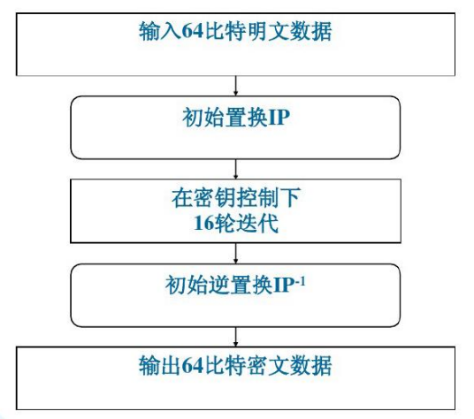

## IP置换：

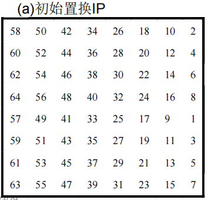

这里的置换顺序是

原始数据的第一位变成原始数据的第58位

原始数据的第二位变成原始数据的第50位

....以此类推


## 16轮迭代：

先把上面生成的64位新数据分成左右各32位L0,R0，按下面的公式去更新数据

$$
\begin{aligned}
& L_i = R_{i-1} \\
& R_i = L_{i-1} \oplus f(R_{i-1}, K_i)
\end{aligned}
$$


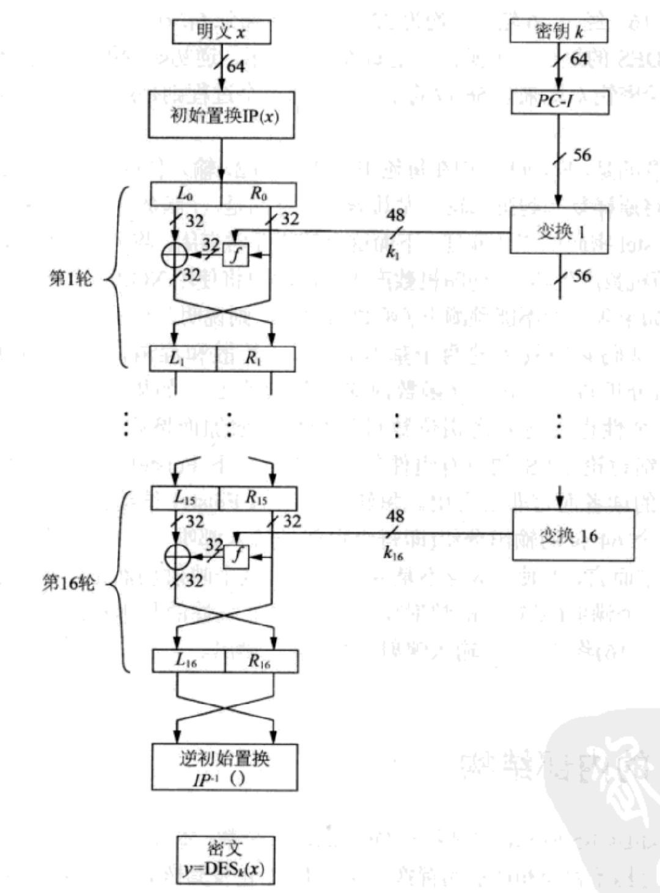

最后生成的$ L_{16},R_{16}$最后还要再交换一次

### 密钥$ K_i$更新 ：

DES算法采用了每轮子密钥生成的方式来增加密钥的复杂性和安全性。每轮子密钥都是由主密钥（64位）通过密钥调度算法（Key Schedule Algorithm）生成的。DES算法的密钥调度算法可以将64位的主密钥分成16个子密钥，每个子密钥48位，用于每轮加密中与输入数据进行异或运算。

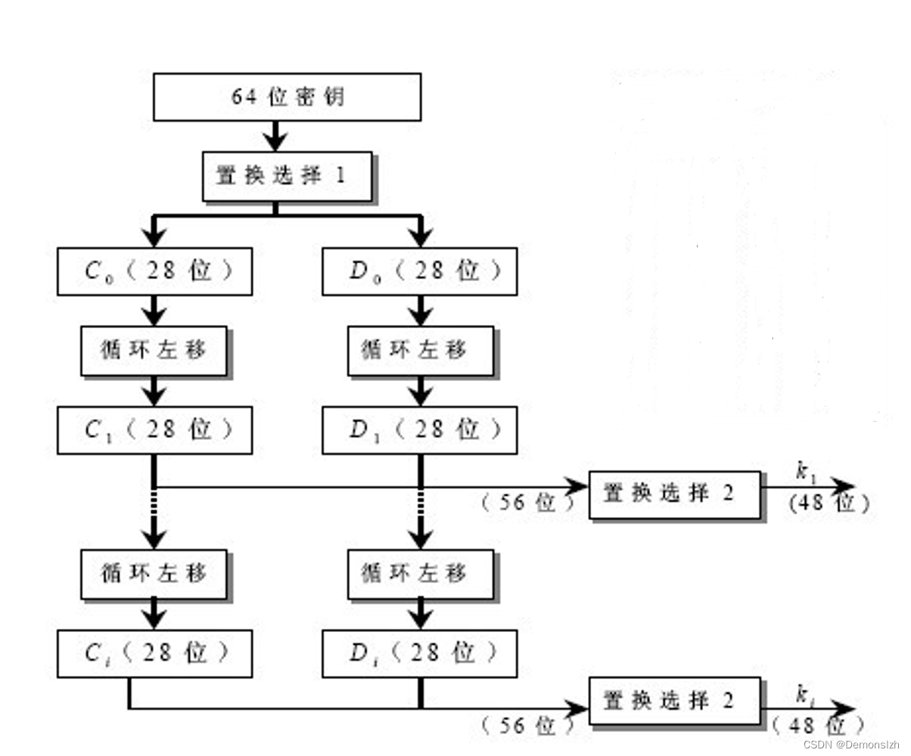

下面是上图各个函数的具体实现

#### 置换选择-1：

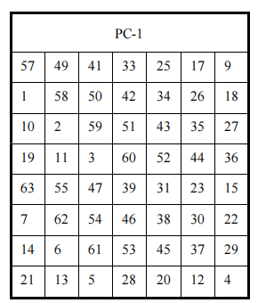

**实现了64位->56位**

从PC-1的置换表中可以看到，舍弃掉的8位数据是原始数据中**每8位数据的最后一位**，也就是我们所熟知的奇偶检验位。这8位被丢弃是因为它们对于密钥的安全性没有贡献，而且能够使DES算法的计算速度更快。

然后将置换后的56bit分为各为28bit的左右两半，分别记为C0和D0

#### 置换选择-2：

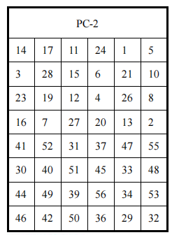

**实现了56位->48位**，满足了**f函数**的运算条件

#### 移位：

在第i轮分别对Ci-1和Di-1进行左循环位移，所位移数由下表给出。

使用这种编排，子密钥寄存器的内容经16次迭代之后又回到原来的位置

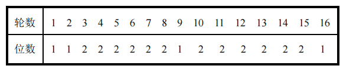

### f函数：

轮函数由四个处理过程组成

1. E扩展置换
2. 异或运算
3. S替代
4. P置换

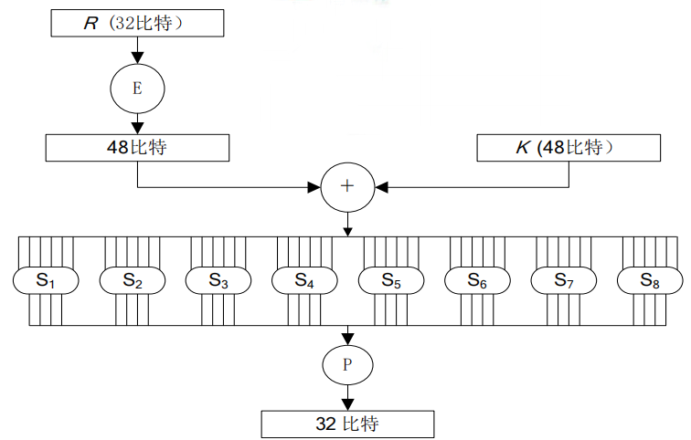

#### E扩展置换 :

R首先被扩展成48比特，扩展过程由下表选择扩展运算E 定义，其中将R的16个比特各重复一次

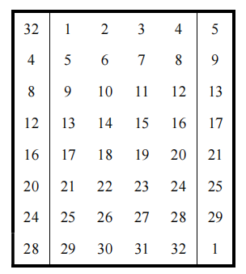

#### 异或：

普通异或操作

#### S替代：

经过S表替换输入六位bit输出4位bit

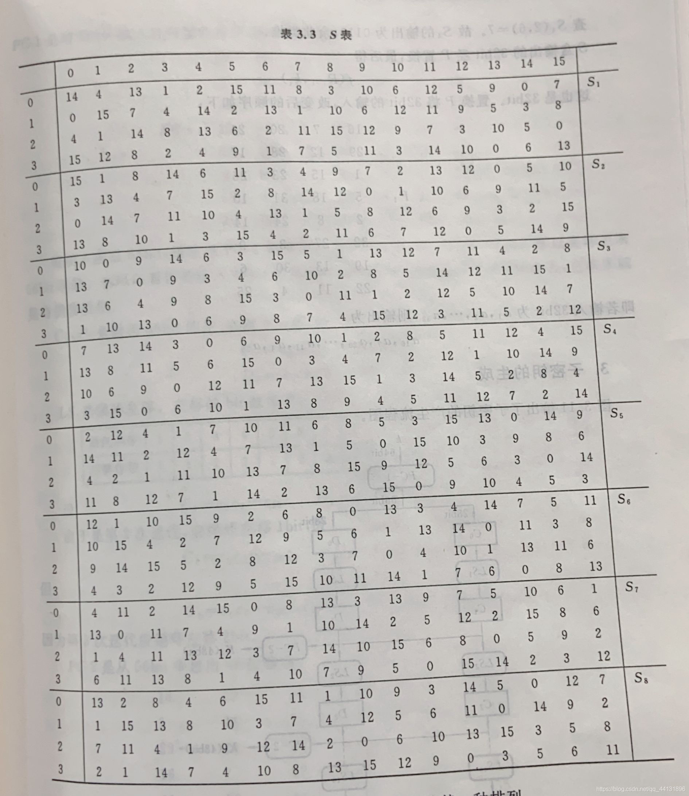

使用方法

* 对每个盒Si，其6比特输入中，第1个和第6个比 特形成一个2位二进制数，用来选择Si的四个代 换中的一个
* 6比特输入中，中间4位用来选择列
* 行和列选定后，得到其交叉位置的十进制数， 表示为4位二进制数即得这一S盒的输出
  
  

#### P置换：

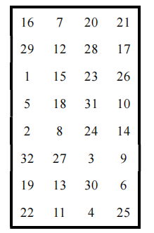

P盒替换将S盒替换的32位输出作为输入，经过上述固定的替换表进行替换后即为最后F轮函数的结果。

**该结果F(R0,K0)与L0进行异或运算得到下一轮的右半部分R1**


## IP-1置换：

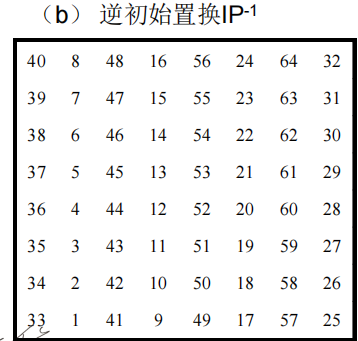

经过16轮迭代之后，将两边的32bit密文合并成64bit置换输入，然后使用初始逆置换表进行逆置换得到64bit密文。


# DES解密：

和Feistel密码一样，DES的解密和加密使用同一算法， 但子密钥使用的顺序相反。

$$
\begin{aligned}
R_{i-1} &= L_i, \\
L_{i-1} &= R_i \oplus f(L_i, K_i), \qquad i = 16,15,\ldots,1
\end{aligned}

$$


解密结构与加密结构完全相同，只不过是所使用的子密钥的顺序正好相反！

$$
\begin{aligned}
\text{加密子密钥：} &\quad k_1, \; k_2, \; \ldots, \; k_{15}, \; k_{16} \\[6pt]
\text{解密子密钥：} &\quad k_{16}, \; k_{15}, \; \ldots, \; k_2, \; k_1
\end{aligned}
$$


# 应用&3DES：

一般现在都是用改编的3DES算法来加密数据，因为之前的DES位数太少，不太安全，因此也诞生了3DES这样的算法来对DES进行加强。3DES顾名思义，就i是使用DES加密3次，使用3个密钥进行加解密。

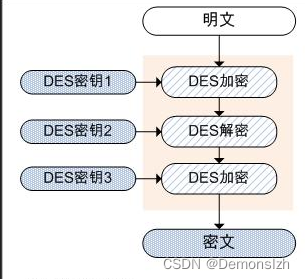

其中一次解密，两次加密的原因是，如果三个密钥相同的情况下，那相当于一次DES加密，可以兼容一些没有实现3DES的老设备

# 代码实现：

## python版本：

```py
import binascii

class ArrangeSimpleDES():
    def __init__(self):
        # 出初始化DES加密的参数
        self.ip = [
            58, 50, 42, 34, 26, 18, 10, 2, 60, 52, 44, 36, 28, 20, 12, 4,
            62, 54, 46, 38, 30, 22, 14, 6, 64, 56, 48, 40, 32, 24, 16, 8,
            57, 49, 41, 33, 25, 17, 9, 1, 59, 51, 43, 35, 27, 19, 11, 3,
            61, 53, 45, 37, 29, 21, 13, 5, 63, 55, 47, 39, 31, 23, 15, 7,
        ]  # ip置换

        self.ip1 = [
            40, 8, 48, 16, 56, 24, 64, 32, 39, 7, 47, 15, 55, 23, 63, 31,
            38, 6, 46, 14, 54, 22, 62, 30, 37, 5, 45, 13, 53, 21, 61, 29,
            36, 4, 44, 12, 52, 20, 60, 28, 35, 3, 43, 11, 51, 19, 59, 27,
            34, 2, 42, 10, 50, 18, 58, 26, 33, 1, 41, 9, 49, 17, 57, 25,
        ]  # 逆ip置换
        self.E = [
            32, 1, 2, 3, 4, 5,
            4, 5, 6, 7, 8, 9,
            8, 9, 10, 11, 12, 13,
            12, 13, 14, 15, 16, 17,
            16, 17, 18, 19, 20, 21,
            20, 21, 22, 23, 24, 25,
            24, 25, 26, 27, 28, 29,
            28, 29, 30, 31, 32, 1,
        ]  # E置换，将32位明文置换位48位
        self.P = [
            16, 7, 20, 21, 29, 12, 28, 17,
            1, 15, 23, 26, 5, 18, 31, 10,
            2, 8, 24, 14, 32, 27, 3, 9,
            19, 13, 30, 6, 22, 11, 4, 25,
        ]  # P置换，对经过S盒之后的数据再次进行置换
        # 设置默认密钥
        self.K = '0111010001101000011010010111001101101001011100110110100101110110'
        self.k1 = [
            57, 49, 41, 33, 25, 17, 9,
            1, 58, 50, 42, 34, 26, 18,
            10, 2, 59, 51, 43, 35, 27,
            19, 11, 3, 60, 52, 44, 36,
            63, 55, 47, 39, 31, 23, 15,
            7, 62, 54, 46, 38, 30, 22,
            14, 6, 61, 53, 45, 37, 29,
            21, 13, 5, 28, 20, 12, 4,
        ]  # 密钥的K1初始置换
        self.k2 = [
            14, 17, 11, 24, 1, 5, 3, 28,
            15, 6, 21, 10, 23, 19, 12, 4,
            26, 8, 16, 7, 27, 20, 13, 2,
            41, 52, 31, 37, 47, 55, 30, 40,
            51, 45, 33, 48, 44, 49, 39, 56,
            34, 53, 46, 42, 50, 36, 29, 32,
        ]

        self.k0 = [1, 1, 2, 2, 2, 2, 2, 2, 1, 2, 2, 2, 2, 2, 2, 1, ]  # 秘钥循环移位的位数

        self.S = [
            [
                0xe, 0x4, 0xd, 0x1, 0x2, 0xf, 0xb, 0x8, 0x3, 0xa, 0x6, 0xc, 0x5, 0x9, 0x0, 0x7,
                0x0, 0xf, 0x7, 0x4, 0xe, 0x2, 0xd, 0x1, 0xa, 0x6, 0xc, 0xb, 0x9, 0x5, 0x3, 0x8,
                0x4, 0x1, 0xe, 0x8, 0xd, 0x6, 0x2, 0xb, 0xf, 0xc, 0x9, 0x7, 0x3, 0xa, 0x5, 0x0,
                0xf, 0xc, 0x8, 0x2, 0x4, 0x9, 0x1, 0x7, 0x5, 0xb, 0x3, 0xe, 0xa, 0x0, 0x6, 0xd,
            ],
            [
                0xf, 0x1, 0x8, 0xe, 0x6, 0xb, 0x3, 0x4, 0x9, 0x7, 0x2, 0xd, 0xc, 0x0, 0x5, 0xa,
                0x3, 0xd, 0x4, 0x7, 0xf, 0x2, 0x8, 0xe, 0xc, 0x0, 0x1, 0xa, 0x6, 0x9, 0xb, 0x5,
                0x0, 0xe, 0x7, 0xb, 0xa, 0x4, 0xd, 0x1, 0x5, 0x8, 0xc, 0x6, 0x9, 0x3, 0x2, 0xf,
                0xd, 0x8, 0xa, 0x1, 0x3, 0xf, 0x4, 0x2, 0xb, 0x6, 0x7, 0xc, 0x0, 0x5, 0xe, 0x9,
            ],
            [
                0xa, 0x0, 0x9, 0xe, 0x6, 0x3, 0xf, 0x5, 0x1, 0xd, 0xc, 0x7, 0xb, 0x4, 0x2, 0x8,
                0xd, 0x7, 0x0, 0x9, 0x3, 0x4, 0x6, 0xa, 0x2, 0x8, 0x5, 0xe, 0xc, 0xb, 0xf, 0x1,
                0xd, 0x6, 0x4, 0x9, 0x8, 0xf, 0x3, 0x0, 0xb, 0x1, 0x2, 0xc, 0x5, 0xa, 0xe, 0x7,
                0x1, 0xa, 0xd, 0x0, 0x6, 0x9, 0x8, 0x7, 0x4, 0xf, 0xe, 0x3, 0xb, 0x5, 0x2, 0xc,
            ],
            [
                0x7, 0xd, 0xe, 0x3, 0x0, 0x6, 0x9, 0xa, 0x1, 0x2, 0x8, 0x5, 0xb, 0xc, 0x4, 0xf,
                0xd, 0x8, 0xb, 0x5, 0x6, 0xf, 0x0, 0x3, 0x4, 0x7, 0x2, 0xc, 0x1, 0xa, 0xe, 0x9,
                0xa, 0x6, 0x9, 0x0, 0xc, 0xb, 0x7, 0xd, 0xf, 0x1, 0x3, 0xe, 0x5, 0x2, 0x8, 0x4,
                0x3, 0xf, 0x0, 0x6, 0xa, 0x1, 0xd, 0x8, 0x9, 0x4, 0x5, 0xb, 0xc, 0x7, 0x2, 0xe,
            ],
            [
                0x2, 0xc, 0x4, 0x1, 0x7, 0xa, 0xb, 0x6, 0x8, 0x5, 0x3, 0xf, 0xd, 0x0, 0xe, 0x9,
                0xe, 0xb, 0x2, 0xc, 0x4, 0x7, 0xd, 0x1, 0x5, 0x0, 0xf, 0xa, 0x3, 0x9, 0x8, 0x6,
                0x4, 0x2, 0x1, 0xb, 0xa, 0xd, 0x7, 0x8, 0xf, 0x9, 0xc, 0x5, 0x6, 0x3, 0x0, 0xe,
                0xb, 0x8, 0xc, 0x7, 0x1, 0xe, 0x2, 0xd, 0x6, 0xf, 0x0, 0x9, 0xa, 0x4, 0x5, 0x3,
            ],
            [
                0xc, 0x1, 0xa, 0xf, 0x9, 0x2, 0x6, 0x8, 0x0, 0xd, 0x3, 0x4, 0xe, 0x7, 0x5, 0xb,
                0xa, 0xf, 0x4, 0x2, 0x7, 0xc, 0x9, 0x5, 0x6, 0x1, 0xd, 0xe, 0x0, 0xb, 0x3, 0x8,
                0x9, 0xe, 0xf, 0x5, 0x2, 0x8, 0xc, 0x3, 0x7, 0x0, 0x4, 0xa, 0x1, 0xd, 0xb, 0x6,
                0x4, 0x3, 0x2, 0xc, 0x9, 0x5, 0xf, 0xa, 0xb, 0xe, 0x1, 0x7, 0x6, 0x0, 0x8, 0xd,
            ],
            [
                0x4, 0xb, 0x2, 0xe, 0xf, 0x0, 0x8, 0xd, 0x3, 0xc, 0x9, 0x7, 0x5, 0xa, 0x6, 0x1,
                0xd, 0x0, 0xb, 0x7, 0x4, 0x9, 0x1, 0xa, 0xe, 0x3, 0x5, 0xc, 0x2, 0xf, 0x8, 0x6,
                0x1, 0x4, 0xb, 0xd, 0xc, 0x3, 0x7, 0xe, 0xa, 0xf, 0x6, 0x8, 0x0, 0x5, 0x9, 0x2,
                0x6, 0xb, 0xd, 0x8, 0x1, 0x4, 0xa, 0x7, 0x9, 0x5, 0x0, 0xf, 0xe, 0x2, 0x3, 0xc,
            ],
            [
                0xd, 0x2, 0x8, 0x4, 0x6, 0xf, 0xb, 0x1, 0xa, 0x9, 0x3, 0xe, 0x5, 0x0, 0xc, 0x7,
                0x1, 0xf, 0xd, 0x8, 0xa, 0x3, 0x7, 0x4, 0xc, 0x5, 0x6, 0xb, 0x0, 0xe, 0x9, 0x2,
                0x7, 0xb, 0x4, 0x1, 0x9, 0xc, 0xe, 0x2, 0x0, 0x6, 0xa, 0xd, 0xf, 0x3, 0x5, 0x8,
                0x2, 0x1, 0xe, 0x7, 0x4, 0xa, 0x8, 0xd, 0xf, 0xc, 0x9, 0x0, 0x3, 0x5, 0x6, 0xb,
            ],
        ]  # 16进制表示S盒的数据，S盒是为了将48位转换为32位，有8个盒子

    def __substitution(self, table: str, self_table: list) -> str:
        """
        :param table: 需要进行置换的列表,是一个01字符串
        :param self_table: 置换表，在__init__中初始化了
        :return: 返回置换后的01字符串
        """
        sub_result = ""
        for i in self_table:
            sub_result += table[i - 1]
        return sub_result

    def str2bin(self, string: str) -> str:
        """
        将明文转为二进制字符串:
        :param string: 任意字符串
        :return:二进制字符串
        """
        plaintext_list = list(bytes(string, 'utf8'))  # 将字符串转成bytes类型，再转成list
        result = []  # 定义返回结果
        for num in plaintext_list:
            result.append(bin(num)[2:].zfill(8))  # 将列表的每个元素转成二进制字符串，8位宽度
        return "".join(result)

    def bin2str(self, binary: str) -> str:
        """
        二进制字符串转成字符串
        :param binary:
        :return:
        """
        list_bin = [binary[i:i + 8] for i in range(0, len(binary), 8)]  # 对二进制字符串进行切分，每8位为一组
        list_int = []
        for b in list_bin:
            list_int.append(int(b, 2))  # 对二进制转成int
        result = bytes(list_int).decode()  # 将列表转成bytes，在进行解码，得到字符串
        return result

    def __bin2int(self, binary: str) -> list:
        """
        由于加密之后的二进制无法直接转成字符，有不可见字符在，utf8可能无法解码，所以需要将二进制字符串每8位转成int型号列表，用于转成bytes再转hex
        :param binary: 二进制字符串
        :return: int型列表
        """
        list_bin = [binary[i:i + 8] for i in range(0, len(binary), 8)]  # 对二进制字符串进行切分，每8位为一组
        list_int = []
        for b in list_bin:
            list_int.append(int(b, 2))
        return list_int

    def __int2bin(self, list_int: list) -> str:
        result = []
        for num in list_int:
            result.append(bin(num)[2:].zfill(8))
        return ''.join(result)

    def __get_block_list(self, binary: str) -> list:
        """
        对明文二进制串进行切分，每64位为一块，DES加密以64位为一组进行加密的
        :type binary: 二进制串
        """
        len_binary = len(binary)
        if len_binary % 64 != 0:
            binary_block = binary + ("0" * (64 - (len_binary % 64)))
            return [binary_block[i:i + 64] for i in range(0, len(binary_block), 64)]
        else:
            return [binary[j:j + 64] for j in range(0, len(binary), 64)]

    def modify_secretkey(self):
        """
        修改默认密钥函数
        :return: None
        """
        print('当前二进制形式密钥为:{}'.format(self.K))
        print("当前字符串形式密钥为：{}".format(self.bin2str(self.K)))
        newkey = input("输入新的密钥（长度为8）：")
        if len(newkey) != 8:
            print("密钥长度不符合，请重新输入：")
            self.modify_secretkey()
        else:
            bin_key = self.str2bin(newkey)
            self.K = bin_key
            print("当前二进制形式密钥为:{}".format(self.K))

    def __f_funtion(self, right: str, key: str):
        """
        :param right: 明文二进制的字符串加密过程的右半段
        :param key: 当前轮数的密钥
        :return: 进行E扩展，与key异或操作，S盒操作后返回32位01字符串
        """
        # 对right进行E扩展
        e_result = self.__substitution(right, self.E)
        # 与key 进行异或操作
        xor_result = self.__xor_function(e_result, key)
        # 进入S盒子
        s_result = self.__s_box(xor_result)
        # 进行P置换
        p_result = self.__substitution(s_result, self.P)
        return p_result

    def __get_key_list(self):
        """
        :return: 返回加密过程中16轮的子密钥
        """
        key = self.__substitution(self.K, self.k1)
        left_key = key[0:28]
        right_key = key[28:56]
        keys = []
        for i in range(1, 17):
            move = self.k0[i - 1]
            move_left = left_key[move:28] + left_key[0:move]
            move_right = right_key[move:28] + right_key[0:move]
            left_key = move_left
            right_key = move_right
            move_key = left_key + right_key
            ki = self.__substitution(move_key, self.k2)
            keys.append(ki)
        return keys

    def __xor_function(self, xor1: str, xor2: str):
        """
        :param xor1: 01字符串
        :param xor2: 01字符串
        :return: 异或操作返回的结果
        """
        size = len(xor1)
        result = ""
        for i in range(0, size):
            result += '0' if xor1[i] == xor2[i] else '1'
        return result

    def __s_box(self, xor_result: str):
        """
        :param xor_result: 48位01字符串
        :return: 返回32位01字符串
        """
        result = ""
        for i in range(0, 8):
            # 将48位数据分为6组，循环进行
            block = xor_result[i * 6:(i + 1) * 6]
            line = int(block[0] + block[5], 2)
            colmn = int(block[1:5], 2)
            res = bin(self.S[i][line*16 + colmn])[2:]
            if len(res) < 4:
                res = '0' * (4 - len(res)) + res
            result += res
        return result

    def __iteration(self, bin_plaintext: str, key_list: list):
        """
        :param bin_plaintext: 01字符串，64位
        :param key_list: 密钥列表，共16个
        :return: 进行F函数以及和left异或操作之后的字符串
        """
        left = bin_plaintext[0:32]
        right = bin_plaintext[32:64]
        for i in range(0, 16):
            next_lift = right
            f_result = self.__f_funtion(right, key_list[i])
            next_right = self.__xor_function(left, f_result)
            left = next_lift
            right = next_right
        bin_plaintext_result = left + right
        return bin_plaintext_result[32:] + bin_plaintext_result[:32]

    def encode(self, plaintext):
        """
        :param plaintext: 明文字符串
        :return: 密文字符串
        """
        bin_plaintext = self.str2bin(plaintext)
        bin_plaintext_block = self.__get_block_list(bin_plaintext)
        ciphertext_bin_list = []
        key_list = self.__get_key_list()
        for block in bin_plaintext_block:
            # 初代ip置换
            sub_ip = self.__substitution(block, self.ip)
            ite_result = self.__iteration(sub_ip, key_list)
            # 逆ip置换
            sub_ip1 = self.__substitution(ite_result, self.ip1)
            ciphertext_bin_list.append(sub_ip1)
        ciphertext_bin = ''.join(ciphertext_bin_list)
        result = self.__bin2int(ciphertext_bin)
        return bytes(result).hex().upper()

    def decode(self, ciphertext):
        '''
        :param ciphertext: 密文字符串
        :return: 明文字符串
        '''
        b_ciphertext = binascii.a2b_hex(ciphertext)
        bin_ciphertext = self.__int2bin(list(b_ciphertext))
        bin_plaintext_list = []
        key_list = self.__get_key_list()
        key_list = key_list[::-1]
        bin_ciphertext_block = [bin_ciphertext[i:i + 64] for i in range(0, len(bin_ciphertext), 64)]
        for block in bin_ciphertext_block:
            sub_ip = self.__substitution(block, self.ip)
            ite = self.__iteration(sub_ip, key_list)
            sub_ip1 = self.__substitution(ite, self.ip1)
            bin_plaintext_list.append(sub_ip1)
        bin_plaintext = ''.join(bin_plaintext_list).replace('00000000', '')
        return self.bin2str(bin_plaintext)

    def main(self):
        select = input("Please selecting:\n1、Encryption\t 2、Decrpytion\nYour selecting:")
        if select == '1':
            plaintext = input("Input plaintext：")
            # print("Your plaintext is:{}".format(plaintext))
            ciphertext = self.encode(plaintext)
            print("The ciphertext is:{}".format(ciphertext))
        elif select == '2':
            plaintext = input("Input ciphertext：")
            # print("Your ciphertext is:{}".format(plaintext))
            plaintext = self.decode(plaintext)
            print("The plaintext is:{}".format(plaintext))
            # print(len(plaintext))
        else:
            input("Please selecting again！")
            self.main()


if __name__ == '__main__':
    mydes = ArrangeSimpleDES()
    mydes.modify_secretkey()
    while True:
        mydes.main()
        print("")
```

## c++版本：

```cpp
#include <iostream>
#include <string>
#include <algorithm>
#include <bitset>
#include <windows.h>
using namespace std;
string desKeys[20];
/**
 *数据初始置换表
 */
int T1[8][8] = { 58,50,42,34,26,18,10,2,
              60,52,44,36,28,20,12,4,
              62,54,46,38,30,22,14,6,
              64,56,48,40,32,24,16,8,
              57,49,41,33,25,17,9,1,
              59,51,43,35,27,19,11,3,
              61,53,45,37,29,21,13,5,
              63,55,47,39,31,23,15,7 };
/**
 *密钥初始置换表
 */
int T2[8][7] = { 57,49,41,33,25,17,9,
              1,58,50,42,34,26,18,
              10,2,59,51,43,35,27,
              19,11,3,60,52,44,36,
              3,55,47,39,31,23,15,
              7,62,54,46,38,30,22,
              14,6,61,53,45,37,29,
              21,13,5,28,20,12,4 };

/**
 *密钥循环左移位数表
 */
int T3[16] = { 1,1,2,2,2,2,2,2,1,2,2,2,2,2,2,1 };

/**
 *密钥压缩置换表
 */
int T4[8][6] = { 14,17,11,24,1,5,
              3,28,15,6,21,10,
              23,19,12,4,26,8,
              16,7,27,20,13,2,
              41,52,31,37,47,55,
              30,40,51,45,33,48,
              44,49,39,56,34,53,
              46,42,50,36,29,32 };

/**
 *数据扩展表
 */
int T5[8][6] = { 32,1,2,3,4,5,
              4,5,6,7,8,9,
              8,9,10,11,12,13,
              12,13,14,15,16,17,
              16,17,18,19,20,21,
              20,21,22,23,24,25,
              24,25,26,27,28,29,
              28,29,30,31,32,1 };

/**
 *S盒置换表
 */
int S[8][4][16] = { {{14,4,13,1,2,15,11,8,3,10,6,12,5,9,0,7},{0,15,7,4,14,2,13,1,10,6,12,11,9,5,3,8},{4,1,14,8,13,6,2,11,15,12,9,7,3,10,5,0},{15,12,8,2,4,9,1,7,5,11,3,14,10,0,6,13}},
                {{15,1,8,14,6,11,3,4,9,7,2,13,12,0,5,10},{3,13,4,7,15,2,8,14,12,0,1,10,6,9,11,5},{ 0,14,7,11,10,4,13,1,5,8,12,6,9,3,2,15},{ 13,8,10,1,3,15,4,2,11,6,7,12,0,5,14,9}},
                {{10,0,9,14,6,3,15,5,1,13,12,7,11,4,2,8},{13,7,0,9,3,4,6,10,2,8,5,14,12,11,15,1},{13,6,4,9,8,15,3,0,11,1,2,12,5,10,14,7},{1,10,13,0,6,9,8,7,4,15,14,3,11,5,2,12}},
                {{7,13,14,3,0,6,9,10,1,2,8,5,11,12,4,15},{13,8,11,5,6,15,0,3,4,7,2,12,1,10,14,9},{10,6,9,0,12,11,7,13,15,1,3,14,5,2,8,4},{3,15,0,6,10,1,13,8,9,4,5,11,12,7,2,14}},
                {{2,12,4,1,7,10,11,6,8,5,3,15,13,0,14,9},{14,11,2,12,4,7,13,1,5,0,15,10,3,9,8,6},{4,2,1,11,10,13,7,8,15,9,12,5,6,3,0,14},{11,8,12,7,1,14,2,13,6,15,0,9,10,4,5,3}},
                {{12,1,10,15,9,2,6,8,0,13,3,4,14,7,5,11},{10,15,4,2,7,12,9,5,6,1,13,14,0,11,3,8},{9,14,15,5,2,8,12,3,7,0,4,10,1,13,11,6},{4,3,2,12,9,5,15,10,11,14,1,7,6,0,8,13}},
                {{4,11,2,14,15,0,8,13,3,12,9,7,5,10,6,1},{13,0,11,7,4,9,1,10,14,3,5,12,2,15,8,6},{1,4,11,13,12,3,7,14,10,15,6,8,0,5,9,2},{6,11,13,8,1,4,10,7,9,5,0,15,14,2,3,12}},
                {{13,2,8,4,6,15,11,1,10,9,3,14,5,0,12,7},{1,15,13,8,10,3,7,4,12,5,6,11,0,14,9,2},{7,11,4,1,9,12,14,2,0,6,10,13,15,3,5,8},{2,1,14,7,4,10,8,13,15,12,9,0,3,5,6,11}} };

/**
 *P盒置换表
 */
int P[4][8] = { 16,7,20,21,
             29,12,28,17,
             1,15,23,26,
             5,18,31,10,
             2,8,24,14,
             32,27,3,9,
             19,13,30,6,
             22,11,4,25 };


/**

 *最终置换表

 */
int T6[8][8] = { 40,8,48,16,56,24,64,32,
                  39,7,47,15,55,23,63,31,
                  38,6,46,14,54,22,62,30,
                  37,5,45,13,53,21,61,29,
                  36,4,44,12,52,20,60,28,
                  35,3,43,11,51,19,59,27,
                  34,2,42,10,50,18,58,26,
                  33,1,41,9,49,17,57,25 };

/**

 *最终置换函数 64位->64位

 *函数说明：s为完成最后一轮循环得到的64为数据

 *返回值为密文或明文

 */
string final_permutation(string s)
{
    string rs = "";
    for (int i = 0; i < 8; i++)
    {
        for (int j = 0; j < 8; j++)
        {
            rs += s[T6[i][j] - 1];
        }
    }
    return rs;
}

/**

 *P盒置换函数 32位->32位

 *函数说明：s为S盒的输出

 */
string P_box(string s)
{
    string rs = "";
    for (int i = 0; i < 4; i++)
    {
        for (int j = 0; j < 8; j++)
        {
            rs += (s[P[i][j] - 1]);
        }
    }
    return rs;
}

/**

 *S盒置换函数 48位->32位

 *函数说明：s为48位数据

 *返回值为32位

 */
string S_box(string s)
{
    string rs = "";
    string s1;
    int k1, k2;//S盒的行号和列号
    int h = 1;//决定使用那个S盒
    for (int i = 0; i <= 42; i = i + 6, h++)
    {
        k1 = (s[i] - '0') * 2 + (s[i + 5] - '0') * 1;
        k2 = (s[i + 1] - '0') * 8 + (s[i + 2] - '0') * 4 + (s[i + 3] - '0') * 2 + (s[i + 4] - '0') * 1;
        int x = S[h - 1][k1][k2];
        s1 = "";
        int y = 8;
        for (int j = 1; j <= 4; j++)
        {
            if (x < y)
            {
                s1 += "0";
                y /= 2;
            }
            else
            {
                s1 += "1";
                x = x % y;
                y /= 2;
            }
        }
        rs += s1;
    }
    return rs;
}

/**

 *异或运算函数

 *要求位数相同

 */
string desXOR(string s1, string s2)
{
    string rs = "";
    for (int i = 0; i < s1.length() && i < s2.length(); i++)
    {
        rs += ((s1[i] - '0') ^ (s2[i] - '0')) + '0';
    }
    return rs;
}

/**

 *数据扩展函数 32->48

 *函数说明：s为数据的右半部分 32位

 *扩展成48位的输出

 */
string plaintext_righthalf_extended_permutation(string s)
{
    string rs = "";
    for (int i = 0; i < 8; i++)
    {
        for (int j = 0; j < 6; j++)
        {
            rs += s[T5[i][j] - 1];
        }
    }
    return rs;
}

/**

 *密钥压缩置换函数 56位->48位

 *函数说明：s为56为的密钥

 *输出为48位的子密钥

 */
string secret_key_compression_replacement(string s)
{
    string rs = "";
    for (int i = 0; i < 8; i++)
    {
        for (int j = 0; j < 6; j++)
        {
            rs += s[T4[i][j] - 1];
        }
    }
    return rs;
}

/**

 *密钥循环左移函数 56位->56位

 *函数说明：k为左移位数 s为密钥

 *返回值位数不变

 */
string secret_ket_left_move(int k, string s)//密钥循环左移k位
{
    string s1 = s.substr(0, 28);
    string s2 = s.substr(28, 28);
    string rs = s1.substr(k, 28 - k) + s1.substr(0, k) + s2.substr(k, 28 - k) + s2.substr(0, k);
    return rs;
}

/**

 *密钥初始置换函数 64位->56位

 *函数说明：s为64位的初始密钥

 *返回值为56位

 */
string secret_key_initial_permutation(string s)
{

    string rs = "";
    for (int i = 0; i < 8; i++)
    {
        for (int j = 0; j < 7; j++)
        {
            rs += s[T2[i][j] - 1];
        }
    }

    return rs;
}

/**

 *明文初始置换函数 64位->64位

 *函数说明：s为初始明文 64位

 *返回值为6位

 */
string plaintext_initial_permutation(string s)//明文初始置换
{
    string rs = "";
    for (int i = 0; i < 8; i++)
    {
        for (int j = 0; j < 8; j++)
        {
            rs += s[T1[i][j] - 1];
        }
    }
    return rs;
}

/**

 *16进制转2进制函数

 *函数说明：s为16进制字符串

 *返回为2进制字符串

 */
string des_H(string s)
{
    string s1;
    string rs = "";
    for (int i = 0; i < s.length(); i++)
    {
        int x;
        if (s[i] >= '0' && s[i] <= '9')
        {
            x = s[i] - '0';
        }
        else
        {
            x = s[i] - 'A' + 10;
        }
        s1 = "";
        int y = 8;
        for (int j = 1; j <= 4; j++)
        {
            if (x < y)
            {
                y /= 2;
                s1 += "0";
            }
            else
            {
                s1 += "1";
                x = x % y;
                y = y / 2;
            }
        }
        rs += s1;
    }
    return rs;
}

/**

*2进制转16进制函数

*str为2进制字符串

*返回值为16进制字符串

*/
string des_G(string str)
{
    string rs = "";
    char temp;
    for (int i = 0; i <= str.length() - 4; i = i + 4)
    {
        int x = (str[i] - '0') * 8 + (str[i + 1] - '0') * 4 + (str[i + 2] - '0') * 2 + str[i + 3] - '0';

        if (x >= 10)
        {
            temp = (char)(x - 10 + 'A');
        }
        else
        {
            temp = (char)(x + '0');
        }
        rs += temp;
    }
    return rs;
}

/**

 *封装函数f

 *函数说明：接收32位数据和48位的子密钥 产生一个32位的输出

 *str1:32位数据  str2:48位的子密钥

 *返回值32位

 */

string des_f(string str1, string str2)
{
    string expendR = plaintext_righthalf_extended_permutation(str1);
    //cout<<"32位数据扩展为48位结果:"<<expendR<<endl;

    string rs = desXOR(expendR, str2);
    //cout<<"密钥和扩展数据异或结果:"<<rs<<endl;

    rs = S_box(rs);
    //cout<<"S盒替代结果(48->32):"<<rs<<endl;

    rs = P_box(rs);
    //cout<<"P盒替代结果(32->32):"<<rs<<endl;

    return rs;
}

/**

 *子密钥生成函数

 *函数说明：s为给定的密钥

 *生成16个子密钥

 */


void des_generateKeys(string s)
{

    s = secret_key_initial_permutation(s);

    for (int i = 1; i <= 16; i++)
    {
        s = secret_ket_left_move(T3[i - 1], s);
        desKeys[i] = secret_key_compression_replacement(s);
    }
}
/*
* 明文字符串转换成0/1字符串
*/
string des_StrToBitStr(string str)
{
    bitset<64> bstr;
    for (int i = 0; i < 8; i++)
    {
        bitset<8> bits = bitset<8>(str[i]);
        for (int j = 0; j < 8; j++)
        {
            bstr[i * 8 + j] = bits[7 - j];
        }
    }
    string s = bstr.to_string();
    //添加一个翻转操作
    reverse(begin(s), end(s));
    return s;
}
/*
* 0/1字符串装换为字符形式的字符串
*/
string des_BitStrToStr(string bstr)
{
    string str = "";
    //每八位转化成十进制，然后将数字结果转化成字符
    int sum;
    for (int i = 0; i < bstr.size(); i += 8)
    {
        sum = 0;
        for (int j = 0; j < 8; j++)
            if (bstr[i + j] == '1')
                sum = sum * 2 + 1;
            else
                sum = sum * 2;
        str = str + char(sum);
    }
    return str;

}

string chardeel(string& str1, string& str2) {
    string temp_str = "";
    int divi_times = (str1.size() % 8 ? str1.size() / 8 + 1 : str1.size() / 8);        //计算分组个数 
    for (int i = 0; i < divi_times; ++i) {                                        //每个分组单独转换成二进制串 
        string str1_temp = str1.substr(8 * i, 8);  //substr(start,len) 

        bool jude = false;
        int addchar = 0;
        if (str1_temp.size() % 8) {
            jude = true;
            addchar = 8 - str1_temp.size() % 8;
        }
        int sub = str1_temp.size() * 8;
        if (jude) {
            for (int i = 0; i < addchar; ++i) {
                str1_temp += 'a';
            }
        }
        str1_temp = des_StrToBitStr(str1_temp);
        if (jude) {
            for (int i = 0; i < addchar * 8; ++i) {
                str1_temp[sub+i] = '0';
            }
        }
        temp_str = temp_str + str1_temp;

    }
    str2 = des_H(str2);
    return temp_str;
}

/**

 *DES加密函数 64位->64位

 *函数说明：str1为64位的给定明文

 *返回值为64位的密文

 */

string des_encrypt(string str1, string str2)
{
    str1 = chardeel(str1, str2);  //明文分组和填充，返回01字符串 

    des_generateKeys(str2);  //生成16个子密钥


    int divi_times = str1.size() / 64;  //分成多少组去进行des
    string rs_temp = "";

    for (int i = 0; i < divi_times; ++i) {
        string str1_temp = str1.substr(i * 64, 64);

        //第一步:明文初始置换 64->64
        str1_temp = plaintext_initial_permutation(str1_temp);

        //第二步:数据分组
        string left = str1_temp.substr(0, 32);
        string right = str1_temp.substr(32, 32);
        string newleft;

        //第三步:16轮迭代
        for (int i = 1; i <= 16; i++)
        {
            newleft = right;
            right = desXOR(left, des_f(right, desKeys[i]));
            left = newleft;
        }

        //第四步:合并数据 注意位R16L16
        string rs = right + left;

        //结尾置换
        rs = final_permutation(rs);
        rs_temp = rs_temp + rs;
    }

    return rs_temp;

}
/**

*解密函数

*str为密文

*输出明文

*/
string des_decrypt(string str)
{
    int divi_times = str.size() / 64;  //分成多少组去进行des
    string rs_temp = "";

    for (int i = 0; i < divi_times; ++i) {
        string str_temp = str.substr(i * 64, 64);
        //把密文当作明文进行初始明文置换
        str_temp = plaintext_initial_permutation(str_temp);

        //左右分组
        string left = str_temp.substr(0, 32);
        string right = str_temp.substr(32, 32);

        string newleft;

        //逆序的子密钥使用 16轮迭代
        for (int i = 16; i >= 1; i--)
        {
            newleft = right;
            right = desXOR(left, des_f(right, desKeys[i]));
            left = newleft;
        }

        //合并
        string rs = right + left;

        //最后置换
        rs = final_permutation(rs);
        rs_temp = rs_temp + rs;
    }
    rs_temp = des_BitStrToStr(rs_temp);
    return rs_temp;
}


int main()
{
    /*string str1 = "abc";
    cout << str1.max_size();*/
    SetConsoleOutputCP(CP_UTF8);  // 设置控制台输出为 UTF-8 编码
    SetConsoleCP(CP_UTF8);  // 设置控制台输入为 UTF-8 编码
    string str1 = "";
    cout << "请输入明文：";
    getline(cin, str1);
    string str2 = "";
    cout << "请输入密钥(16位):";
    getline(cin, str2);
    //加密
    string rs = des_encrypt(str1, str2);
    cout << "密文（二进制）:" << rs << endl;
    //解密
    rs = des_decrypt(rs);
    cout << "明文（16进制）：" << rs << endl;
    return 0;
}

```


# reference：

[密码学——AES/DES加密算法原理介绍 - 枫のBlog](https://goodapple.top/archives/162)

[通俗易懂，十分钟读懂DES，详解DES加密算法原理，DES攻击手段以及3DES原理-CSDN博客](https://blog.csdn.net/2301_82000445/article/details/135645954?ops_request_misc=elastic_search_misc&request_id=adde7d3e905d4030db5aacc8c6fbf640&biz_id=0&utm_medium=distribute.pc_search_result.none-task-blog-2~all~top_positive~default-1-135645954-null-null.142^v102^pc_search_result_base6&utm_term=des&spm=1018.2226.3001.4187)
