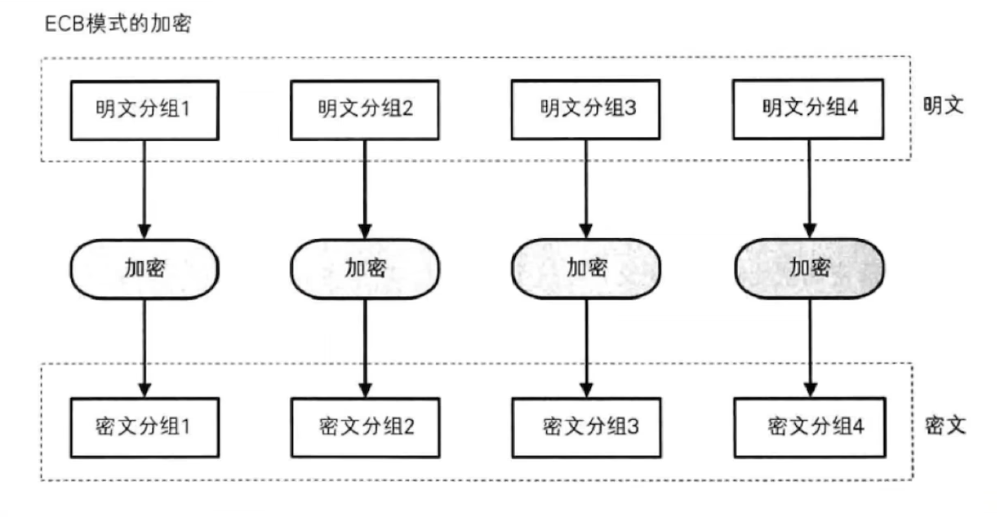
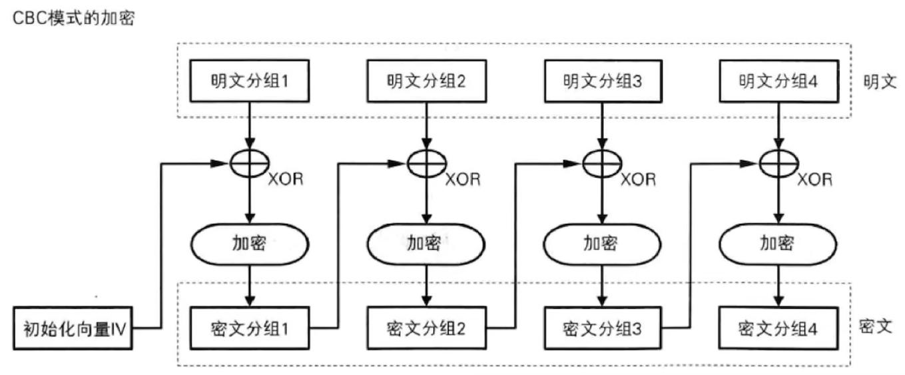
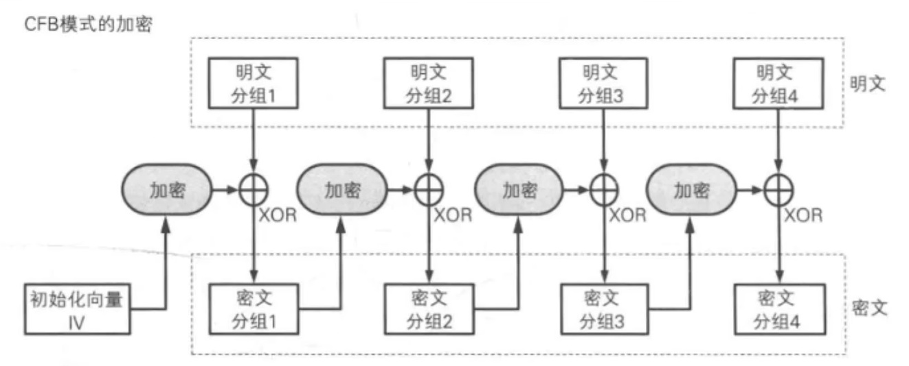
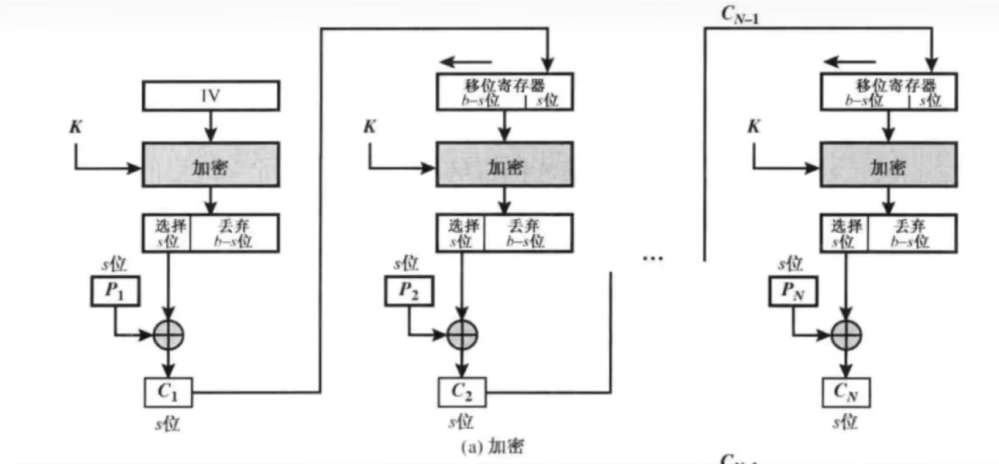
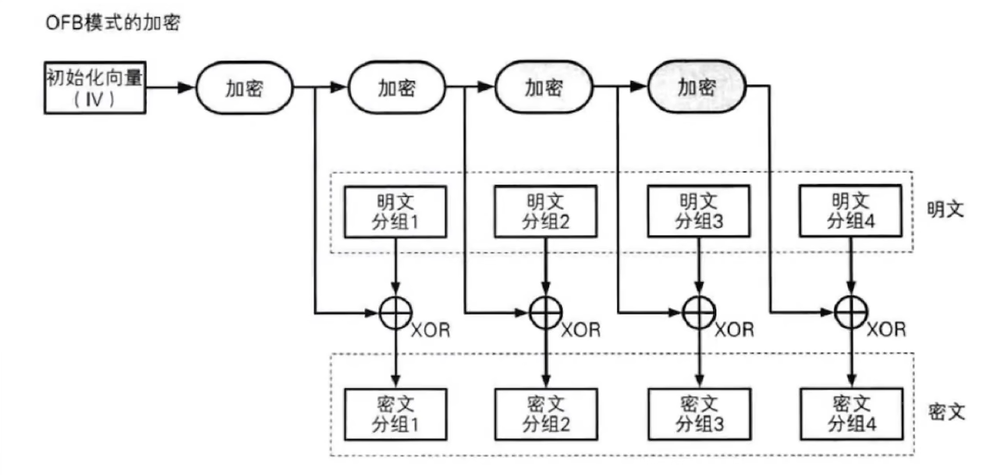
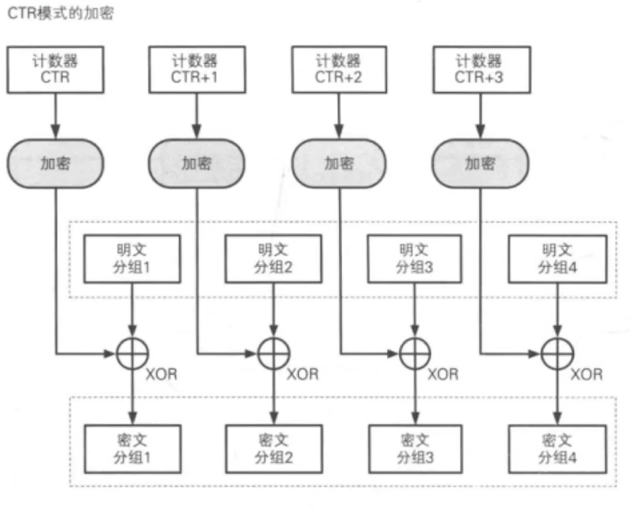
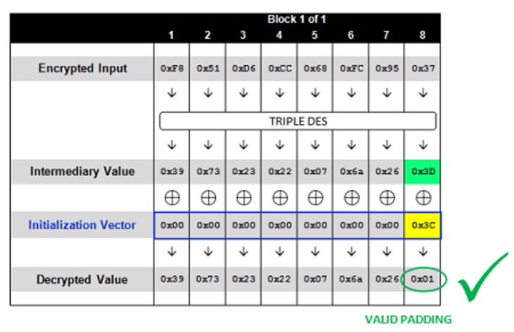

# 分组密码工作模式

工作模式对算法本身结构没有影响，影响的是明文密文

## ECB：电子密码本模式(electronic codebook mode)



从ECB的工作原理可以看出，如果明文数据在等分后，两块数据相同则会产生相同的加密数据块，这会辅助攻击者快速判断加密算法的工作模式，而将攻击资源聚集在破解某一块数据即可，一旦成功则意味着全文破解，大大提升了攻击效率。

$$
\text{加密：}\quad C_i = E_k(P_i)
$$

$$
\text{解密：}\quad P_i = D_k(C_i)
$$

## CBC：密码分组链接模式（cipher block chaining Triple）



cbc的解密


CBC模式相比ECB实现了更好的模式隐藏，但因为其将密文引入运算，加解密操作无法并行操作。同时引入的IV向量，并且还需要加、解密双方共同知晓方可。

$$
C_0 = \text{IV}
$$

$$
\text{加密：}\quad C_i = E_k(P_i \oplus C_{i-1})
$$

$$
\text{解密：}\quad P_i = D_k(C_i) \oplus C_{i-1}
$$

## CFB：密文反馈模式（Cipher FeedBack）



与CBC模式类似，但不同的地方在于，CFB模式先生成密码流字典，然后用密码字典与明文进行异或操作并最终生成密文。后一分组的密码字典的生成需要前一分组的密文参与运算。



其中s位可任意，不同s位加密结果不同，默认s是算法块规定长度，例des是64，aes是128

$$
C_0 = \text{IV}
$$

$$
\text{加密：}\quad O_i = E_k(C_{i-1}),\quad C_i = P_i \oplus O_i
$$

$$
\text{解密：}\quad O_i = E_k(C_{i-1}),\quad P_i = C_i \oplus O_i
$$

## OFB：输出反馈模式（Output Feedbaek）



OFB和CFB一样，明文块可自定义长度

$$
O_0 = \text{IV}
$$

$$
\text{生成 keystream：}\quad O_i = E_k(O_{i-1}),\quad S_i = O_i
$$

$$
\text{加密：}\quad C_i = P_i \oplus S_i
$$

$$
\text{解密：}\quad P_i = C_i \oplus S_i
$$

## CTR：计数器模式（counter mode）



$$
\text{令 }CTR_i = \text{NONCE} \,\|\, (\text{counter}+i)
$$

$$
\text{加密：}\quad S_i = E_k(CTR_i),\quad C_i = P_i \oplus S_i
$$

$$
\text{解密：}\quad P_i = C_i \oplus S_i \quad(\text{其中 }S_i = E_k(CTR_i))
$$

## 加密模式总结：

| 模式      | 全称                    | 优点                    | 缺点                     | 是否需 IV | 是否可并行加密 | 是否可并行解密 | 是否适合流加密 |
| ------- | --------------------- | --------------------- | ---------------------- | ------ | ------- | ------- | ------- |
| **ECB** | Electronic Codebook   | 实现简单；可并行加解密           | 同块明文→同块密文，易被模式识别（最不安全） | 否      | 是       | 是       | 否       |
| **CBC** | Cipher Block Chaining | 同块明文不同IV→不同密文；常用于文件加密 | 无法并行加密；需填充；IV重用会泄密     | 是      | 否       | 是       | 否       |
| **CFB** | Cipher Feedback       | 不需填充；可加密任意长度数据；适合流式   | 错误传播严重；速度略慢            | 是      | 否       | 否       | 是       |
| **OFB** | Output Feedback       | 不需填充；错误不会传播；适合流加密     | 同IV下重用密钥极危险；同步要求高      | 是      | 是       | 是       | 是       |
| **CTR** | Counter               | 可随机访问块；可并行加解密；性能优     | 计数器不能重用，否则致命泄密         | 是（计数器） | 是       | 是       | 是       |

# 加密模式攻击

## CBC反转字节攻击：

已知密文，和明文。可以在不知道key的情况下，肆意更改明文的值，比如网站验证权限，可以把传进去的密文修改，从而使明文从'user'到'admin'，可能能绕过权限

设A是第N-1块的密文一个字节，B是第N块密文解密后的中间值的对应部分字节，C是第N块明文对应字节，X是想要修改的字节值

公式右边是明文变化，左边括号内是输入密文的变化


$$
\begin{aligned}
A \oplus B &= C \\
(A \oplus C) \oplus B &= 0 \\
(A \oplus C \oplus X)\oplus B &= X
\end{aligned}
$$

```py
from Crypto.Cipher import AES
import uuid
import binascii


BS=AES.block_size  #分组长度
key=b'test'  #密钥
iv=uuid.uuid4().bytes  #随机初始向量
pad=lambda s: s+((BS-len(s)%BS)*chr(BS-len(s)%BS)).encode()  #Pkcs5Padding
data=b'1234567890abcdefabcdef1234567890'  #明文M

#加密
def enc(data):
    aes=AES.new(pad(key),AES.MODE_CBC,iv)
    ciphertext=aes.encrypt(pad(data))
    ciphertext=binascii.b2a_hex(ciphertext)
    return ciphertext

#解密
def dec(c):
    c=binascii.a2b_hex(c)
    aes=AES.new(pad(key),AES.MODE_CBC,iv)
    data=aes.decrypt(c)
    return data

#测试CBC翻转
def CBC_test(c):
    c=bytearray(binascii.a2b_hex(c))
    c[0]=c[0]^ord('a')^ord('A') #c[0]为第一组的密文字符，a为第二组相应位置的明文字符，A是我们想要的明文字符
    c=binascii.b2a_hex(c)
    return c

print("ciphertext:",enc(data))
print("data:",dec(enc(data)))
print("CBC Attack:",dec(CBC_test(enc(data))))

```

```context
ciphertext: b'ffa645d1b5e40afbbae47de053a66f978fa0a824e99864a7e8baf38ceccda613c304883f11fc0857c1bb7603f859798e'
data: b'1234567890abcdefabcdef1234567890\x10\x10\x10\x10\x10\x10\x10\x10\x10\x10\x10\x10\x10\x10\x10\x10'
CBC Attack:b':8O<\xe7\x04\xd8v\xe8Q\xfe\xa5I\xc9c]Abcdef1234567890\x10\x10\x10\x10\x10\x10\x10\x10\x10\x10\x10\x10\x10\x10\x10\x10'
```

## Padding Oracle Attack

已知条件：如果明文的padding格式出错服务端会提示某个特定状态码，密文，iv(IV经常会随着密文一起发送。常见的做法是将IV作为一个前缀，附着在密文的前面)

效果：在不清楚 key 的前提下解密任意给定的密文。



### 原理：

我们有密文，解密后的中间状态(Intermediary Value)我们不知道，爆破每个字节的iv值，当服务端不报错时，说明padding正确，如上图所示，我们知道爆破的第8个字节，就肯定直接padding为0x1,也知道我们此时爆破的iv是多少，就可以推出正确的中间状态(Intermediary Value)是多少，依次类推，把所有字节的中间状态都算出来后，就可以用初始iv异或中间状态得到明文。

### 如果已知多组密文解密：

从前往后进行解密

### 如果已知多组明文加密：

先从最后一组开始，爆破最后一组的intermediary并构造出iv，然后将本组的iv当作前一组的密文，以此类推。由此我们可以得到构造密文的步骤

1. 从最后一组开始，爆破出该组的intermediary并构造出iv，然后将本组的iv当作前一组的密文
2. 爆破前一组的intermediary并构造出iv，然后将本组的iv当作前一组的密文
3. …
4. 最后会得到第一组的iv，至此我们已经构造出了所有合法密文以及iv

# reference:

[CBC字节翻转攻击&amp;Padding Oracle Attack原理解析 - 枫のBlog](https://goodapple.top/archives/217)
