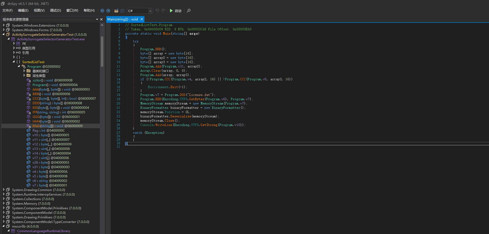
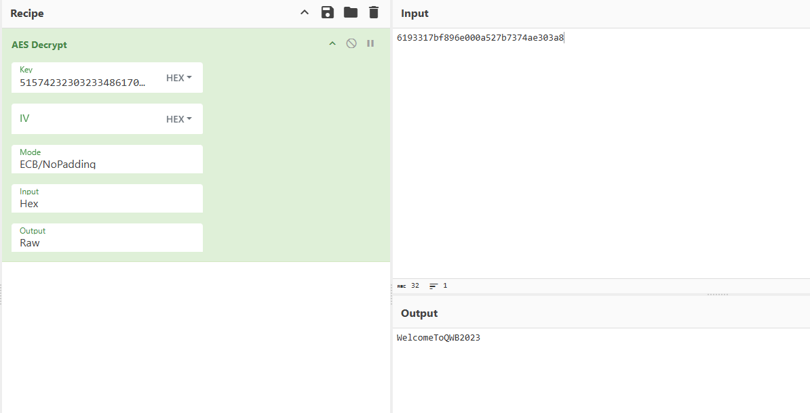
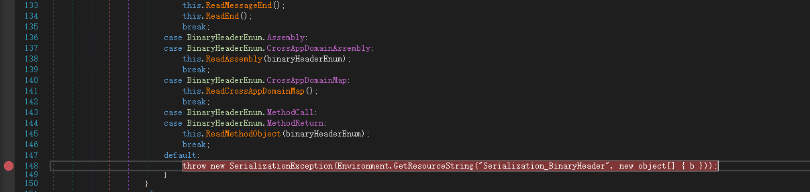
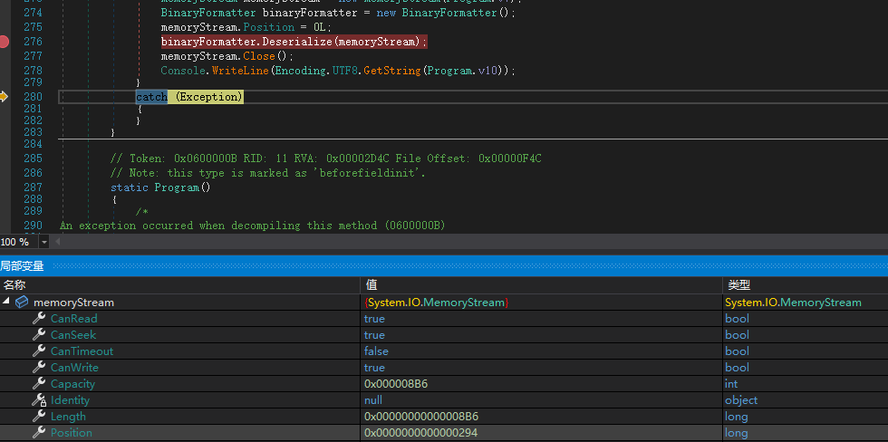
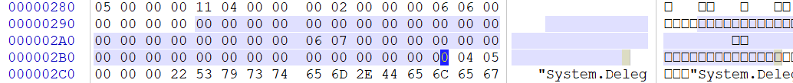
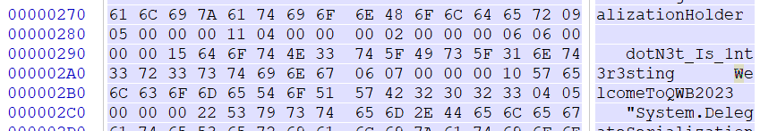

# AES解密：

## 分析函数

用die打开发现是.NET，用dnspy打开找到主函数



其中：

BBB是输入

CCC是比较明文

DDD是读取文件

EEE是rc4加密

这是容易看出来的，现在我们主要分析AAA是干嘛的

```csharp
public static void AAA(byte[] aaa, byte[] bbb)
        {
            for (int i = 0; i < 9; i++)
            {
                Program.GGG(aaa);
                for (int j = 0; j < 4; j++)
                {
                    uint num = Program.v11[i, 4 * j, (int)aaa[4 * j]];
                    uint num2 = Program.v11[i, 4 * j + 1, (int)aaa[4 * j + 1]];
                    uint num3 = Program.v11[i, 4 * j + 2, (int)aaa[4 * j + 2]];
                    uint num4 = Program.v11[i, 4 * j + 3, (int)aaa[4 * j + 3]];
                    uint num5 = (uint)Program.v12[i, 24 * j, (int)((num >> 28) & 15U), (int)((num2 >> 28) & 15U)];
                    uint num6 = (uint)Program.v12[i, 24 * j + 1, (int)((num3 >> 28) & 15U), (int)((num4 >> 28) & 15U)];
                    uint num7 = (uint)Program.v12[i, 24 * j + 2, (int)((num >> 24) & 15U), (int)((num2 >> 24) & 15U)];
                    uint num8 = (uint)Program.v12[i, 24 * j + 3, (int)((num3 >> 24) & 15U), (int)((num4 >> 24) & 15U)];
                    aaa[4 * j] = (byte)(((int)Program.v12[i, 24 * j + 4, (int)num5, (int)num6] << 4) | (int)Program.v12[i, 24 * j + 5, (int)num7, (int)num8]);
                    num5 = (uint)Program.v12[i, 24 * j + 6, (int)((num >> 20) & 15U), (int)((num2 >> 20) & 15U)];
                    num6 = (uint)Program.v12[i, 24 * j + 7, (int)((num3 >> 20) & 15U), (int)((num4 >> 20) & 15U)];
                    num7 = (uint)Program.v12[i, 24 * j + 8, (int)((num >> 16) & 15U), (int)((num2 >> 16) & 15U)];
                    num8 = (uint)Program.v12[i, 24 * j + 9, (int)((num3 >> 16) & 15U), (int)((num4 >> 16) & 15U)];
                    aaa[4 * j + 1] = (byte)(((int)Program.v12[i, 24 * j + 10, (int)num5, (int)num6] << 4) | (int)Program.v12[i, 24 * j + 11, (int)num7, (int)num8]);
                    num5 = (uint)Program.v12[i, 24 * j + 12, (int)((num >> 12) & 15U), (int)((num2 >> 12) & 15U)];
                    num6 = (uint)Program.v12[i, 24 * j + 13, (int)((num3 >> 12) & 15U), (int)((num4 >> 12) & 15U)];
                    num7 = (uint)Program.v12[i, 24 * j + 14, (int)((num >> 8) & 15U), (int)((num2 >> 8) & 15U)];
                    num8 = (uint)Program.v12[i, 24 * j + 15, (int)((num3 >> 8) & 15U), (int)((num4 >> 8) & 15U)];
                    aaa[4 * j + 2] = (byte)(((int)Program.v12[i, 24 * j + 16, (int)num5, (int)num6] << 4) | (int)Program.v12[i, 24 * j + 17, (int)num7, (int)num8]);
                    num5 = (uint)Program.v12[i, 24 * j + 18, (int)((num >> 4) & 15U), (int)((num2 >> 4) & 15U)];
                    num6 = (uint)Program.v12[i, 24 * j + 19, (int)((num3 >> 4) & 15U), (int)((num4 >> 4) & 15U)];
                    num7 = (uint)Program.v12[i, 24 * j + 20, (int)(num & 15U), (int)(num2 & 15U)];
                    num8 = (uint)Program.v12[i, 24 * j + 21, (int)(num3 & 15U), (int)(num4 & 15U)];
                    aaa[4 * j + 3] = (byte)(((int)Program.v12[i, 24 * j + 22, (int)num5, (int)num6] << 4) | (int)Program.v12[i, 24 * j + 23, (int)num7, (int)num8]);
                    num = Program.v13[i, 4 * j, (int)aaa[4 * j]];
                    num2 = Program.v13[i, 4 * j + 1, (int)aaa[4 * j + 1]];
                    num3 = Program.v13[i, 4 * j + 2, (int)aaa[4 * j + 2]];
                    num4 = Program.v13[i, 4 * j + 3, (int)aaa[4 * j + 3]];
                    num5 = (uint)Program.v12[i, 24 * j, (int)((num >> 28) & 15U), (int)((num2 >> 28) & 15U)];
                    num6 = (uint)Program.v12[i, 24 * j + 1, (int)((num3 >> 28) & 15U), (int)((num4 >> 28) & 15U)];
                    num7 = (uint)Program.v12[i, 24 * j + 2, (int)((num >> 24) & 15U), (int)((num2 >> 24) & 15U)];
                    num8 = (uint)Program.v12[i, 24 * j + 3, (int)((num3 >> 24) & 15U), (int)((num4 >> 24) & 15U)];
                    aaa[4 * j] = (byte)(((int)Program.v12[i, 24 * j + 4, (int)num5, (int)num6] << 4) | (int)Program.v12[i, 24 * j + 5, (int)num7, (int)num8]);
                    num5 = (uint)Program.v12[i, 24 * j + 6, (int)((num >> 20) & 15U), (int)((num2 >> 20) & 15U)];
                    num6 = (uint)Program.v12[i, 24 * j + 7, (int)((num3 >> 20) & 15U), (int)((num4 >> 20) & 15U)];
                    num7 = (uint)Program.v12[i, 24 * j + 8, (int)((num >> 16) & 15U), (int)((num2 >> 16) & 15U)];
                    num8 = (uint)Program.v12[i, 24 * j + 9, (int)((num3 >> 16) & 15U), (int)((num4 >> 16) & 15U)];
                    aaa[4 * j + 1] = (byte)(((int)Program.v12[i, 24 * j + 10, (int)num5, (int)num6] << 4) | (int)Program.v12[i, 24 * j + 11, (int)num7, (int)num8]);
                    num5 = (uint)Program.v12[i, 24 * j + 12, (int)((num >> 12) & 15U), (int)((num2 >> 12) & 15U)];
                    num6 = (uint)Program.v12[i, 24 * j + 13, (int)((num3 >> 12) & 15U), (int)((num4 >> 12) & 15U)];
                    num7 = (uint)Program.v12[i, 24 * j + 14, (int)((num >> 8) & 15U), (int)((num2 >> 8) & 15U)];
                    num8 = (uint)Program.v12[i, 24 * j + 15, (int)((num3 >> 8) & 15U), (int)((num4 >> 8) & 15U)];
                    aaa[4 * j + 2] = (byte)(((int)Program.v12[i, 24 * j + 16, (int)num5, (int)num6] << 4) | (int)Program.v12[i, 24 * j + 17, (int)num7, (int)num8]);
                    num5 = (uint)Program.v12[i, 24 * j + 18, (int)((num >> 4) & 15U), (int)((num2 >> 4) & 15U)];
                    num6 = (uint)Program.v12[i, 24 * j + 19, (int)((num3 >> 4) & 15U), (int)((num4 >> 4) & 15U)];
                    num7 = (uint)Program.v12[i, 24 * j + 20, (int)(num & 15U), (int)(num2 & 15U)];
                    num8 = (uint)Program.v12[i, 24 * j + 21, (int)(num3 & 15U), (int)(num4 & 15U)];
                    aaa[4 * j + 3] = (byte)(((int)Program.v12[i, 24 * j + 22, (int)num5, (int)num6] << 4) | (int)Program.v12[i, 24 * j + 23, (int)num7, (int)num8]);
                }
            }
            Program.GGG(aaa);
            for (int k = 0; k < 16; k++)
            {
                aaa[k] = Program.v14[9, k, (int)aaa[k]];
            }
            for (int l = 0; l < 16; l++)
            {
                bbb[l] = aaa[l];
            }
        }
```

其中的GGG：

```csharp
public static void GGG(byte[] v16)
        {
            byte[] array = new byte[16];
            uint[] array2 = new uint[]
            {
                0U, 5U, 10U, 15U, 4U, 9U, 14U, 3U, 8U, 13U,
                2U, 7U, 12U, 1U, 6U, 11U
            };
            for (int i = 0; i < 16; i++)
            {
                array[i] = v16[(int)array2[i]];
            }
            array.CopyTo(v16, 0);
        }
```

GGG很明显就是AES中的行移位操作

现在对比一下aes查表法代码和这个aaa

```c
void AES_Encrypt(uint8_t* plaintext, uint8_t* ciphertext, AES_Key aes_key) {
    uint32_t s[4];
    uint32_t t[4];
    uint32_t tmp;
    //------------Load as BigEndian------------------
    for (int i = 0; i < 4; i++) {
        s[i] = (plaintext[4 * i + 0] << 24) | (plaintext[4 * i + 1] << 16) |
            (plaintext[4 * i + 2] << 8) | (plaintext[4 * i + 3]);
    }
    //----------------AddRoundKey----------------
    s[0] ^= aes_key.ek[0];
    s[1] ^= aes_key.ek[1];
    s[2] ^= aes_key.ek[2];
    s[3] ^= aes_key.ek[3];
    for (int i = 1; i < aes_key.nr; i++) {
        //-------ShiftRow + SubByte + MixCol-------------
        // t0
        t[0] = TE[(s[0] >> 24) & 0xFF];
        tmp = TE[(s[1] >> 16) & 0xFF];
        t[0] ^= rotr32(tmp, 8);
        tmp = TE[(s[2] >> 8) & 0xFF];
        t[0] ^= rotr32(tmp, 16);
        tmp = TE[(s[3] >> 0) & 0xFF];
        t[0] ^= rotr32(tmp, 24);
        // t1
        t[1] = TE[(s[1] >> 24) & 0xFF];
        tmp = TE[(s[2] >> 16) & 0xFF];
        t[1] ^= rotr32(tmp, 8);
        tmp = TE[(s[3] >> 8) & 0xFF];
        t[1] ^= rotr32(tmp, 16);
        tmp = TE[(s[0] >> 0) & 0xFF];
        t[1] ^= rotr32(tmp, 24);
        // t2
        t[2] = TE[(s[2] >> 24) & 0xFF];
        tmp = TE[(s[3] >> 16) & 0xFF];
        t[2] ^= rotr32(tmp, 8);
        tmp = TE[(s[0] >> 8) & 0xFF];
        t[2] ^= rotr32(tmp, 16);
        tmp = TE[(s[1] >> 0) & 0xFF];
        t[2] ^= rotr32(tmp, 24);
        // t3
        t[3] = TE[(s[3] >> 24) & 0xFF];
        tmp = TE[(s[0] >> 16) & 0xFF];
        t[3] ^= rotr32(tmp, 8);
        tmp = TE[(s[1] >> 8) & 0xFF];
        t[3] ^= rotr32(tmp, 16);
        tmp = TE[(s[2] >> 0) & 0xFF];
        t[3] ^= rotr32(tmp, 24);
        //-------------AddRoundKey---------------
        s[0] = t[0] ^ aes_key.ek[4 * i + 0];
        s[1] = t[1] ^ aes_key.ek[4 * i + 1];
        s[2] = t[2] ^ aes_key.ek[4 * i + 2];
        s[3] = t[3] ^ aes_key.ek[4 * i + 3];
    }
    //------------ShiftRow + SubByte-----------
    // t0
    t[0] = Sbox[(s[0] >> 24) & 0xFF] << 24;
    t[0] |= Sbox[(s[1] >> 16) & 0xFF] << 16;
    t[0] |= Sbox[(s[2] >> 8) & 0xFF] << 8;
    t[0] |= Sbox[(s[3] >> 0) & 0xFF] << 0;
    // t1
    t[1] = Sbox[(s[1] >> 24) & 0xFF] << 24;
    t[1] |= Sbox[(s[2] >> 16) & 0xFF] << 16;
    t[1] |= Sbox[(s[3] >> 8) & 0xFF] << 8;
    t[1] |= Sbox[(s[0] >> 0) & 0xFF] << 0;
    // t2
    t[2] = Sbox[(s[2] >> 24) & 0xFF] << 24;
    t[2] |= Sbox[(s[3] >> 16) & 0xFF] << 16;
    t[2] |= Sbox[(s[0] >> 8) & 0xFF] << 8;
    t[2] |= Sbox[(s[1] >> 0) & 0xFF] << 0;
    // t3
    t[3] = Sbox[(s[3] >> 24) & 0xFF] << 24;
    t[3] |= Sbox[(s[0] >> 16) & 0xFF] << 16;
    t[3] |= Sbox[(s[1] >> 8) & 0xFF] << 8;
    t[3] |= Sbox[(s[2] >> 0) & 0xFF] << 0;
    //------------AddRoundKey-------------
    s[0] = t[0] ^ aes_key.ek[4 * aes_key.nr + 0];
    s[1] = t[1] ^ aes_key.ek[4 * aes_key.nr + 1];
    s[2] = t[2] ^ aes_key.ek[4 * aes_key.nr + 2];
    s[3] = t[3] ^ aes_key.ek[4 * aes_key.nr + 3];
    //-----------Store as BigEndian--------------
    for (int i = 0; i < 4; i++) {
        ciphertext[4 * i + 0] = (s[i] >> 24) & 0xFF;
        ciphertext[4 * i + 1] = (s[i] >> 16) & 0xFF;
        ciphertext[4 * i + 2] = (s[i] >> 8) & 0xFF;
        ciphertext[4 * i + 3] = (s[i] >> 0) & 0xFF;
    }
}
```

轮数和加解密位数都能对的上，又因为这函数传入参数没有密钥，这时候我们可以猜这是白盒AES。


先创建一个c#文件，运行调试一下这个代码拿到密钥：

先创建c#项目

```powershell
dotnet new console -n test
cd test
```

写入c#代码：

```csharp
using System;
using System.Collections.Generic;
using System.Text;
using System.IO;
public class Program
{    
    //v11,v12,v13,v14太长省略
    public static void GGG(byte[] v16)
    {
        byte[] array = new byte[16];
        uint[] array2 = new uint[16]
        {
        0u, 5u, 10u, 15u, 4u, 9u, 14u, 3u, 8u, 13u,
        2u, 7u, 12u, 1u, 6u, 11u
        };
        for (int i = 0; i < 16; i++)
        {
            array[i] = v16[array2[i]];
        }
        array.CopyTo(v16, 0);
    }

    public static void AAA(byte[] aaa, byte[] bbb)
    {
        for (int index1 = 0; index1 < 9; ++index1)
        {
            if (index1 == 8)
            {
                // 输出：第9轮开始前的 state（16 字节）——16 字节一行 hex
                StringBuilder sb = new StringBuilder();
                for (int i = 0; i < 16; i++)
                    sb.AppendFormat("{0:X2}", aaa[i]);
                Console.WriteLine($"ROUND9_BEFORE:{sb.ToString()}");
                // 如果想同时看到 GGG(permute) 后的状态，也可在下面再打印一次（在 Program.GGG(aaa) 之后）
            }
            Program.GGG(aaa);
            for (int index2 = 0; index2 < 4; ++index2)
            {
                uint num1 = Program.v11[index1, 4 * index2, (int)aaa[4 * index2]];
                uint num2 = Program.v11[index1, 4 * index2 + 1, (int)aaa[4 * index2 + 1]];
                uint num3 = Program.v11[index1, 4 * index2 + 2, (int)aaa[4 * index2 + 2]];
                uint num4 = Program.v11[index1, 4 * index2 + 3, (int)aaa[4 * index2 + 3]];
                uint index3 = (uint)Program.v12[index1, 24 * index2, (int)(num1 >> 28) & 15, (int)(num2 >> 28) & 15];
                uint index4 = (uint)Program.v12[index1, 24 * index2 + 1, (int)(num3 >> 28) & 15, (int)(num4 >> 28) & 15];
                uint index5 = (uint)Program.v12[index1, 24 * index2 + 2, (int)(num1 >> 24) & 15, (int)(num2 >> 24) & 15];
                uint index6 = (uint)Program.v12[index1, 24 * index2 + 3, (int)(num3 >> 24) & 15, (int)(num4 >> 24) & 15];
                aaa[4 * index2] = (byte)((uint)Program.v12[index1, 24 * index2 + 4, (int)index3, (int)index4] << 4 | (uint)Program.v12[index1, 24 * index2 + 5, (int)index5, (int)index6]);
                uint index7 = (uint)Program.v12[index1, 24 * index2 + 6, (int)(num1 >> 20) & 15, (int)(num2 >> 20) & 15];
                uint index8 = (uint)Program.v12[index1, 24 * index2 + 7, (int)(num3 >> 20) & 15, (int)(num4 >> 20) & 15];
                uint index9 = (uint)Program.v12[index1, 24 * index2 + 8, (int)(num1 >> 16) & 15, (int)(num2 >> 16) & 15];
                uint index10 = (uint)Program.v12[index1, 24 * index2 + 9, (int)(num3 >> 16) & 15, (int)(num4 >> 16) & 15];
                aaa[4 * index2 + 1] = (byte)((uint)Program.v12[index1, 24 * index2 + 10, (int)index7, (int)index8] << 4 | (uint)Program.v12[index1, 24 * index2 + 11, (int)index9, (int)index10]);
                uint index11 = (uint)Program.v12[index1, 24 * index2 + 12, (int)(num1 >> 12) & 15, (int)(num2 >> 12) & 15];
                uint index12 = (uint)Program.v12[index1, 24 * index2 + 13, (int)(num3 >> 12) & 15, (int)(num4 >> 12) & 15];
                uint index13 = (uint)Program.v12[index1, 24 * index2 + 14, (int)(num1 >> 8) & 15, (int)(num2 >> 8) & 15];
                uint index14 = (uint)Program.v12[index1, 24 * index2 + 15, (int)(num3 >> 8) & 15, (int)(num4 >> 8) & 15];
                aaa[4 * index2 + 2] = (byte)((uint)Program.v12[index1, 24 * index2 + 16, (int)index11, (int)index12] << 4 | (uint)Program.v12[index1, 24 * index2 + 17, (int)index13, (int)index14]);
                uint index15 = (uint)Program.v12[index1, 24 * index2 + 18, (int)(num1 >> 4) & 15, (int)(num2 >> 4) & 15];
                uint index16 = (uint)Program.v12[index1, 24 * index2 + 19, (int)(num3 >> 4) & 15, (int)(num4 >> 4) & 15];
                uint index17 = (uint)Program.v12[index1, 24 * index2 + 20, (int)num1 & 15, (int)num2 & 15];
                uint index18 = (uint)Program.v12[index1, 24 * index2 + 21, (int)num3 & 15, (int)num4 & 15];
                aaa[4 * index2 + 3] = (byte)((uint)Program.v12[index1, 24 * index2 + 22, (int)index15, (int)index16] << 4 | (uint)Program.v12[index1, 24 * index2 + 23, (int)index17, (int)index18]);
                uint num5 = Program.v13[index1, 4 * index2, (int)aaa[4 * index2]];
                uint num6 = Program.v13[index1, 4 * index2 + 1, (int)aaa[4 * index2 + 1]];
                uint num7 = Program.v13[index1, 4 * index2 + 2, (int)aaa[4 * index2 + 2]];
                uint num8 = Program.v13[index1, 4 * index2 + 3, (int)aaa[4 * index2 + 3]];
                uint index19 = (uint)Program.v12[index1, 24 * index2, (int)(num5 >> 28) & 15, (int)(num6 >> 28) & 15];
                uint index20 = (uint)Program.v12[index1, 24 * index2 + 1, (int)(num7 >> 28) & 15, (int)(num8 >> 28) & 15];
                uint index21 = (uint)Program.v12[index1, 24 * index2 + 2, (int)(num5 >> 24) & 15, (int)(num6 >> 24) & 15];
                uint index22 = (uint)Program.v12[index1, 24 * index2 + 3, (int)(num7 >> 24) & 15, (int)(num8 >> 24) & 15];
                aaa[4 * index2] = (byte)((uint)Program.v12[index1, 24 * index2 + 4, (int)index19, (int)index20] << 4 | (uint)Program.v12[index1, 24 * index2 + 5, (int)index21, (int)index22]);
                uint index23 = (uint)Program.v12[index1, 24 * index2 + 6, (int)(num5 >> 20) & 15, (int)(num6 >> 20) & 15];
                uint index24 = (uint)Program.v12[index1, 24 * index2 + 7, (int)(num7 >> 20) & 15, (int)(num8 >> 20) & 15];
                uint index25 = (uint)Program.v12[index1, 24 * index2 + 8, (int)(num5 >> 16) & 15, (int)(num6 >> 16) & 15];
                uint index26 = (uint)Program.v12[index1, 24 * index2 + 9, (int)(num7 >> 16) & 15, (int)(num8 >> 16) & 15];
                aaa[4 * index2 + 1] = (byte)((uint)Program.v12[index1, 24 * index2 + 10, (int)index23, (int)index24] << 4 | (uint)Program.v12[index1, 24 * index2 + 11, (int)index25, (int)index26]);
                uint index27 = (uint)Program.v12[index1, 24 * index2 + 12, (int)(num5 >> 12) & 15, (int)(num6 >> 12) & 15];
                uint index28 = (uint)Program.v12[index1, 24 * index2 + 13, (int)(num7 >> 12) & 15, (int)(num8 >> 12) & 15];
                uint index29 = (uint)Program.v12[index1, 24 * index2 + 14, (int)(num5 >> 8) & 15, (int)(num6 >> 8) & 15];
                uint index30 = (uint)Program.v12[index1, 24 * index2 + 15, (int)(num7 >> 8) & 15, (int)(num8 >> 8) & 15];
                aaa[4 * index2 + 2] = (byte)((uint)Program.v12[index1, 24 * index2 + 16, (int)index27, (int)index28] << 4 | (uint)Program.v12[index1, 24 * index2 + 17, (int)index29, (int)index30]);
                uint index31 = (uint)Program.v12[index1, 24 * index2 + 18, (int)(num5 >> 4) & 15, (int)(num6 >> 4) & 15];
                uint index32 = (uint)Program.v12[index1, 24 * index2 + 19, (int)(num7 >> 4) & 15, (int)(num8 >> 4) & 15];
                uint index33 = (uint)Program.v12[index1, 24 * index2 + 20, (int)num5 & 15, (int)num6 & 15];
                uint index34 = (uint)Program.v12[index1, 24 * index2 + 21, (int)num7 & 15, (int)num8 & 15];
                aaa[4 * index2 + 3] = (byte)((uint)Program.v12[index1, 24 * index2 + 22, (int)index31, (int)index32] << 4 | (uint)Program.v12[index1, 24 * index2 + 23, (int)index33, (int)index34]);
            }
        }
        Program.GGG(aaa);
        for (int index = 0; index < 16; ++index)
            aaa[index] = Program.v14[9, index, (int)aaa[index]];
        for (int index = 0; index < 16; ++index)
            bbb[index] = aaa[index];
    }
    private static void Main(string[] args)
        {
            HashSet<String> hashset = new HashSet<String>();
            Random rand = new Random();
            byte[] aaa = new byte[16];
            byte[] numArray2 = new byte[16];
            Array.Clear((Array)aaa, 0, 16);
        Program.AAA(aaa, numArray2);
        StringBuilder sb = new StringBuilder();
        for (int i = 0; i < 16; i++)
        {
            sb.AppendFormat("{0:X2}", aaa[i]);
        }
        Console.WriteLine($"TRUEKEY:{sb.ToString()}");

        }
}
```


## 解密密钥

运行：

```powershell
dotnet run Program.cs
```

拿到第九轮加密之前的值和正确加密的结果：

```textile
ROUND9_BEFORE:1013F6B12E5E5353D2D5370307D07E95
ans:EB95719A7C696EAABE11F4D47360E913
```

然后第一轮输入0x00,在第9轮16个字节依次置为0x00(原第9次加密前无0x00)：

得到16次输出：

```csharp
using System;
using System.Collections.Generic;
using System.Text;
using System.IO;
public class Program
{        
    public static void GGG(byte[] v16)
    {
        byte[] array = new byte[16];
        uint[] array2 = new uint[16]
        {
        0u, 5u, 10u, 15u, 4u, 9u, 14u, 3u, 8u, 13u,
        2u, 7u, 12u, 1u, 6u, 11u
        };
        for (int i = 0; i < 16; i++)
        {
            array[i] = v16[array2[i]];
        }
        array.CopyTo(v16, 0);
    }

    public static void AAA(byte[] aaa, byte[] bbb, int randIndx, byte randByte)
    {
        for (int index1 = 0; index1 < 9; ++index1)
        {
            if (index1 == 8)
            {
                // 输出：第9轮开始前的 state（16 字节）——32 个 hex 字符一行
                StringBuilder sb = new StringBuilder();
                for (int i = 0; i < 16; i++)
                    sb.AppendFormat("{0:X2}", aaa[i]);
                string round9Hex = sb.ToString();
                Console.WriteLine($"ROUND9_BEFORE:{round9Hex}");

                // 也把 round9 前的状态追加到文件（附带时间戳），便于离线分析
                try
                {
                    File.AppendAllText("round9_states.txt", $"{DateTime.UtcNow:O},{round9Hex}\n");
                }
                catch { /* 忽略写文件错误 */ }

                // 在打印后再做注入（如果需要注入）
                if (randIndx != -1)
                    aaa[randIndx] = randByte;
            }

            Program.GGG(aaa);

            for (int index2 = 0; index2 < 4; ++index2)
            {
                uint num1 = Program.v11[index1, 4 * index2, (int)aaa[4 * index2]];
                uint num2 = Program.v11[index1, 4 * index2 + 1, (int)aaa[4 * index2 + 1]];
                uint num3 = Program.v11[index1, 4 * index2 + 2, (int)aaa[4 * index2 + 2]];
                uint num4 = Program.v11[index1, 4 * index2 + 3, (int)aaa[4 * index2 + 3]];
                uint index3 = (uint)Program.v12[index1, 24 * index2, (int)(num1 >> 28) & 15, (int)(num2 >> 28) & 15];
                uint index4 = (uint)Program.v12[index1, 24 * index2 + 1, (int)(num3 >> 28) & 15, (int)(num4 >> 28) & 15];
                uint index5 = (uint)Program.v12[index1, 24 * index2 + 2, (int)(num1 >> 24) & 15, (int)(num2 >> 24) & 15];
                uint index6 = (uint)Program.v12[index1, 24 * index2 + 3, (int)(num3 >> 24) & 15, (int)(num4 >> 24) & 15];
                aaa[4 * index2] = (byte)((uint)Program.v12[index1, 24 * index2 + 4, (int)index3, (int)index4] << 4 | (uint)Program.v12[index1, 24 * index2 + 5, (int)index5, (int)index6]);
                uint index7 = (uint)Program.v12[index1, 24 * index2 + 6, (int)(num1 >> 20) & 15, (int)(num2 >> 20) & 15];
                uint index8 = (uint)Program.v12[index1, 24 * index2 + 7, (int)(num3 >> 20) & 15, (int)(num4 >> 20) & 15];
                uint index9 = (uint)Program.v12[index1, 24 * index2 + 8, (int)(num1 >> 16) & 15, (int)(num2 >> 16) & 15];
                uint index10 = (uint)Program.v12[index1, 24 * index2 + 9, (int)(num3 >> 16) & 15, (int)(num4 >> 16) & 15];
                aaa[4 * index2 + 1] = (byte)((uint)Program.v12[index1, 24 * index2 + 10, (int)index7, (int)index8] << 4 | (uint)Program.v12[index1, 24 * index2 + 11, (int)index9, (int)index10]);
                uint index11 = (uint)Program.v12[index1, 24 * index2 + 12, (int)(num1 >> 12) & 15, (int)(num2 >> 12) & 15];
                uint index12 = (uint)Program.v12[index1, 24 * index2 + 13, (int)(num3 >> 12) & 15, (int)(num4 >> 12) & 15];
                uint index13 = (uint)Program.v12[index1, 24 * index2 + 14, (int)(num1 >> 8) & 15, (int)(num2 >> 8) & 15];
                uint index14 = (uint)Program.v12[index1, 24 * index2 + 15, (int)(num3 >> 8) & 15, (int)(num4 >> 8) & 15];
                aaa[4 * index2 + 2] = (byte)((uint)Program.v12[index1, 24 * index2 + 16, (int)index11, (int)index12] << 4 | (uint)Program.v12[index1, 24 * index2 + 17, (int)index13, (int)index14]);
                uint index15 = (uint)Program.v12[index1, 24 * index2 + 18, (int)(num1 >> 4) & 15, (int)(num2 >> 4) & 15];
                uint index16 = (uint)Program.v12[index1, 24 * index2 + 19, (int)(num3 >> 4) & 15, (int)(num4 >> 4) & 15];
                uint index17 = (uint)Program.v12[index1, 24 * index2 + 20, (int)num1 & 15, (int)num2 & 15];
                uint index18 = (uint)Program.v12[index1, 24 * index2 + 21, (int)num3 & 15, (int)num4 & 15];
                aaa[4 * index2 + 3] = (byte)((uint)Program.v12[index1, 24 * index2 + 22, (int)index15, (int)index16] << 4 | (uint)Program.v12[index1, 24 * index2 + 23, (int)index17, (int)index18]);
                uint num5 = Program.v13[index1, 4 * index2, (int)aaa[4 * index2]];
                uint num6 = Program.v13[index1, 4 * index2 + 1, (int)aaa[4 * index2 + 1]];
                uint num7 = Program.v13[index1, 4 * index2 + 2, (int)aaa[4 * index2 + 2]];
                uint num8 = Program.v13[index1, 4 * index2 + 3, (int)aaa[4 * index2 + 3]];
                uint index19 = (uint)Program.v12[index1, 24 * index2, (int)(num5 >> 28) & 15, (int)(num6 >> 28) & 15];
                uint index20 = (uint)Program.v12[index1, 24 * index2 + 1, (int)(num7 >> 28) & 15, (int)(num8 >> 28) & 15];
                uint index21 = (uint)Program.v12[index1, 24 * index2 + 2, (int)(num5 >> 24) & 15, (int)(num6 >> 24) & 15];
                uint index22 = (uint)Program.v12[index1, 24 * index2 + 3, (int)(num7 >> 24) & 15, (int)(num8 >> 24) & 15];
                aaa[4 * index2] = (byte)((uint)Program.v12[index1, 24 * index2 + 4, (int)index19, (int)index20] << 4 | (uint)Program.v12[index1, 24 * index2 + 5, (int)index21, (int)index22]);
                uint index23 = (uint)Program.v12[index1, 24 * index2 + 6, (int)(num5 >> 20) & 15, (int)(num6 >> 20) & 15];
                uint index24 = (uint)Program.v12[index1, 24 * index2 + 7, (int)(num7 >> 20) & 15, (int)(num8 >> 20) & 15];
                uint index25 = (uint)Program.v12[index1, 24 * index2 + 8, (int)(num5 >> 16) & 15, (int)(num6 >> 16) & 15];
                uint index26 = (uint)Program.v12[index1, 24 * index2 + 9, (int)(num7 >> 16) & 15, (int)(num8 >> 16) & 15];
                aaa[4 * index2 + 1] = (byte)((uint)Program.v12[index1, 24 * index2 + 10, (int)index23, (int)index24] << 4 | (uint)Program.v12[index1, 24 * index2 + 11, (int)index25, (int)index26]);
                uint index27 = (uint)Program.v12[index1, 24 * index2 + 12, (int)(num5 >> 12) & 15, (int)(num6 >> 12) & 15];
                uint index28 = (uint)Program.v12[index1, 24 * index2 + 13, (int)(num7 >> 12) & 15, (int)(num8 >> 12) & 15];
                uint index29 = (uint)Program.v12[index1, 24 * index2 + 14, (int)(num5 >> 8) & 15, (int)(num6 >> 8) & 15];
                uint index30 = (uint)Program.v12[index1, 24 * index2 + 15, (int)(num7 >> 8) & 15, (int)(num8 >> 8) & 15];
                aaa[4 * index2 + 2] = (byte)((uint)Program.v12[index1, 24 * index2 + 16, (int)index27, (int)index28] << 4 | (uint)Program.v12[index1, 24 * index2 + 17, (int)index29, (int)index30]);
                uint index31 = (uint)Program.v12[index1, 24 * index2 + 18, (int)(num5 >> 4) & 15, (int)(num6 >> 4) & 15];
                uint index32 = (uint)Program.v12[index1, 24 * index2 + 19, (int)(num7 >> 4) & 15, (int)(num8 >> 4) & 15];
                uint index33 = (uint)Program.v12[index1, 24 * index2 + 20, (int)num5 & 15, (int)num6 & 15];
                uint index34 = (uint)Program.v12[index1, 24 * index2 + 21, (int)num7 & 15, (int)num8 & 15];
                aaa[4 * index2 + 3] = (byte)((uint)Program.v12[index1, 24 * index2 + 22, (int)index31, (int)index32] << 4 | (uint)Program.v12[index1, 24 * index2 + 23, (int)index33, (int)index34]);
            }
        }
        Program.GGG(aaa);
        for (int index = 0; index < 16; ++index)
            aaa[index] = Program.v14[9, index, (int)aaa[index]];
        for (int index = 0; index < 16; ++index)
            bbb[index] = aaa[index];
    }
    private static void Main(string[] args)
    {
        Random rand = new Random();
        int targetIndex = 0; // 默认注入字节位置 0。你可以修改为 0..15 或用循环收集多位置样本。
        int pairsToCollect = 16; // 你提到做 16 次攻击，保留为16；需要更多样本可增大


        using (StreamWriter sw = new StreamWriter("pairs.txt"))
        {
            for (int i = 0; i < pairsToCollect; i++)
            {
                // 这里我们使用全零明文（你可以改为随机或指定的明文）
                byte[] plain = new byte[16];
                Array.Clear(plain, 0, 16);


                // 生成无故障密文
                byte[] state1 = new byte[16];
                byte[] ct1 = new byte[16];
                Array.Clear(state1, 0, 16);
                Program.AAA(state1, ct1, -1, 0); // 无故障
                string sct1 = BitConverter.ToString(ct1).Replace("-", "");


                // 生成有故障密文（在第9轮注入）
                byte faultByte = 0x00; // 按你要求每次改为 0x00
                byte[] state2 = new byte[16];
                byte[] ct2 = new byte[16];
                Array.Clear(state2, 0, 16);
                Program.AAA(state2, ct2, targetIndex, faultByte); // 注入故障到 targetIndex
                string sct2 = BitConverter.ToString(ct2).Replace("-", "");


                string plainHex = BitConverter.ToString(plain).Replace("-", "");
                sw.WriteLine($"{plainHex},{sct1},{sct2},{targetIndex:X2},{faultByte:X2}");
                Console.WriteLine($"PAIR {i}: CT={sct1} FCT={sct2} idx={targetIndex} fb={faultByte:X2}");


                // 可选：每次采集后移动 targetIndex 到下一个字节，便于收集全部16字节的单字节故障
                targetIndex = (targetIndex + 1) % 16;
            }

        }
        Console.WriteLine("Finished. pairs.txt written. Also check round9_states.txt for ROUND9_BEFORE logs.");
    }

}
```


```ini
ROUND9_BEFORE:1013F6B12E5E5353D2D5370307D07E95
ROUND9_BEFORE:1013F6B12E5E5353D2D5370307D07E95
PAIR 0: CT=EB95719A7C696EAABE11F4D47360E913 FCT=6B95719A7C696E74BE1147D473AFE913 idx=0 fb=00
ROUND9_BEFORE:1013F6B12E5E5353D2D5370307D07E95
ROUND9_BEFORE:1013F6B12E5E5353D2D5370307D07E95
PAIR 1: CT=EB95719A7C696EAABE11F4D47360E913 FCT=EB95717F7C6924AABE4DF4D4B760E913 idx=1 fb=00
ROUND9_BEFORE:1013F6B12E5E5353D2D5370307D07E95
ROUND9_BEFORE:1013F6B12E5E5353D2D5370307D07E95
PAIR 2: CT=EB95719A7C696EAABE11F4D47360E913 FCT=EB95B89A7C066EAA6611F4D47360E9FD idx=2 fb=00
ROUND9_BEFORE:1013F6B12E5E5353D2D5370307D07E95
ROUND9_BEFORE:1013F6B12E5E5353D2D5370307D07E95
PAIR 3: CT=EB95719A7C696EAABE11F4D47360E913 FCT=EBE7719AA2696EAABE11F4B373603413 idx=3 fb=00
ROUND9_BEFORE:1013F6B12E5E5353D2D5370307D07E95
ROUND9_BEFORE:1013F6B12E5E5353D2D5370307D07E95
PAIR 4: CT=EB95719A7C696EAABE11F4D47360E913 FCT=EB69719ACB696EAABE11F4C573608113 idx=4 fb=00
ROUND9_BEFORE:1013F6B12E5E5353D2D5370307D07E95
ROUND9_BEFORE:1013F6B12E5E5353D2D5370307D07E95
PAIR 5: CT=EB95719A7C696EAABE11F4D47360E913 FCT=FF95719A7C696EB0BE1146D473C2E913 idx=5 fb=00
ROUND9_BEFORE:1013F6B12E5E5353D2D5370307D07E95
ROUND9_BEFORE:1013F6B12E5E5353D2D5370307D07E95
PAIR 6: CT=EB95719A7C696EAABE11F4D47360E913 FCT=EB9571CC7C69D8AABE76F4D47060E913 idx=6 fb=00
ROUND9_BEFORE:1013F6B12E5E5353D2D5370307D07E95
ROUND9_BEFORE:1013F6B12E5E5353D2D5370307D07E95
PAIR 7: CT=EB95719A7C696EAABE11F4D47360E913 FCT=EB95199A7CF36EAA4811F4D47360E968 idx=7 fb=00
ROUND9_BEFORE:1013F6B12E5E5353D2D5370307D07E95
ROUND9_BEFORE:1013F6B12E5E5353D2D5370307D07E95
PAIR 8: CT=EB95719A7C696EAABE11F4D47360E913 FCT=EB95999A7C576EAA0211F4D47360E9FB idx=8 fb=00
ROUND9_BEFORE:1013F6B12E5E5353D2D5370307D07E95
ROUND9_BEFORE:1013F6B12E5E5353D2D5370307D07E95
PAIR 9: CT=EB95719A7C696EAABE11F4D47360E913 FCT=EB01719A1C696EAABE11F43573608713 idx=9 fb=00
ROUND9_BEFORE:1013F6B12E5E5353D2D5370307D07E95
ROUND9_BEFORE:1013F6B12E5E5353D2D5370307D07E95
PAIR 10: CT=EB95719A7C696EAABE11F4D47360E913 FCT=6495719A7C696EF5BE116FD473F9E913 idx=10 fb=00
ROUND9_BEFORE:1013F6B12E5E5353D2D5370307D07E95
ROUND9_BEFORE:1013F6B12E5E5353D2D5370307D07E95
PAIR 11: CT=EB95719A7C696EAABE11F4D47360E913 FCT=EB95718A7C69EFAABE52F4D49260E913 idx=11 fb=00
ROUND9_BEFORE:1013F6B12E5E5353D2D5370307D07E95
ROUND9_BEFORE:1013F6B12E5E5353D2D5370307D07E95
PAIR 12: CT=EB95719A7C696EAABE11F4D47360E913 FCT=EB95714C7C6908AABE75F4D4D460E913 idx=12 fb=00
ROUND9_BEFORE:1013F6B12E5E5353D2D5370307D07E95
ROUND9_BEFORE:1013F6B12E5E5353D2D5370307D07E95
PAIR 13: CT=EB95719A7C696EAABE11F4D47360E913 FCT=EB95E29A7CBC6EAABB11F4D47360E927 idx=13 fb=00
ROUND9_BEFORE:1013F6B12E5E5353D2D5370307D07E95
ROUND9_BEFORE:1013F6B12E5E5353D2D5370307D07E95
PAIR 14: CT=EB95719A7C696EAABE11F4D47360E913 FCT=EBF2719A1B696EAABE11F4DE7360B813 idx=14 fb=00
ROUND9_BEFORE:1013F6B12E5E5353D2D5370307D07E95
ROUND9_BEFORE:1013F6B12E5E5353D2D5370307D07E95
PAIR 15: CT=EB95719A7C696EAABE11F4D47360E913 FCT=9D95719A7C696E87BE11B3D4730CE913 idx=15 fb=00
Finished. pairs.txt written. Also check round9_states.txt for ROUND9_BEFORE logs.
```

然后按照我们白盒aes公式：

先求第10轮正确密钥：

```py
import phoenixAES

with open('tracefile', 'wb') as t:
    t.write("""
EB95719A7C696EAABE11F4D47360E913
6B95719A7C696E74BE1147D473AFE913
EB95717F7C6924AABE4DF4D4B760E913
EB95B89A7C066EAA6611F4D47360E9FD
EBE7719AA2696EAABE11F4B373603413
EB69719ACB696EAABE11F4C573608113
FF95719A7C696EB0BE1146D473C2E913
EB9571CC7C69D8AABE76F4D47060E913
EB95199A7CF36EAA4811F4D47360E968
EB95999A7C576EAA0211F4D47360E9FB
EB01719A1C696EAABE11F43573608713
6495719A7C696EF5BE116FD473F9E913
EB95718A7C69EFAABE52F4D49260E913
EB95714C7C6908AABE75F4D4D460E913
EB95E29A7CBC6EAABB11F4D47360E927
EBF2719A1B696EAABE11F4DE7360B813
9D95719A7C696E87BE11B3D4730CE913
""".encode('utf8'))
phoenixAES.crack_file('tracefile', [], True, False, 3)
```

解出第10轮正确密钥是`EA9F6BE2DF5C358495648BEAB9FCFF81`

然后解密原始密钥：

```powershell
D:\ctf\reverse_tools\白盒aes>aes_keyschedule.exe EA9F6BE2DF5C358495648BEAB9FCFF81 10
K00: 51574232303233486170707947616D65
K01: BF6B0F928F593CDAEE294CA3A94821C6
K02: EF96BB4160CF879B8EE6CB3827AEEAFE
K03: 0F11008D6FDE8716E1384C2EC696A6D0
K04: 97357039F8EBF72F19D3BB01DF451DD1
K05: E9914EA7117AB98808A90289D7EC1F58
K06: 075124A9162B9D211E829FA8C96E80F0
K07: D89CA874CEB73555D035AAFD195B2A0D
K08: 61797FA0AFCE4AF57FFBE00866A0CA05
K09: 9A0D149335C35E664A38BE6E2C98746B
K10: EA9F6BE2DF5C358495648BEAB9FCFF81

D:\ctf\reverse_tools\白盒aes>
```

现在我们拿到正确的密钥了

` 51574232303233486170707947616D6`

## 解密

AES加密数据在v4

转成16进制直接解密：

```py
v4=[97, 147, 49, 123, 248, 150, 224, 0, 165, 39,
    183, 55, 74, 227, 3, 168]

for i in v4:
    print(f"{i:02x}", end='')    


#6193317bf896e000a527b7374ae303a833a8
```



# 调试程序

拿到正确输入后我们可以接着调试这项目，当走到图上的代码时，报错并进入exception代码块

  

报错：

```ini
{System.Runtime.Serialization.SerializationException: 二进制流“0”不包含有效的 BinaryHeader。这可能是由于无效流，或由于在序列化和反序列化之间的对象版本更改。
   在 System.Runtime.Serialization.Formatters.Binary.__BinaryParser.Run()
   在 System.Runtime.Serialization.Formatters.Binary.ObjectReader.Deserialize(HeaderHandler handler, __BinaryParser serParser, Boolean fCheck, Boolean isCrossAppDomain, IMethodCallMessage methodCallMessage)
   在 System.Runtime.Serialization.Formatters.Binary.BinaryFormatter.Deserialize(Stream serializationStream, HeaderHandler handler, Boolean fCheck, Boolean isCrossAppDomain, IMethodCallMessage methodCallMessage)
   在 System.Runtime.Serialization.Formatters.Binary.BinaryFormatter.Deserialize(Stream serializationStream, HeaderHandler handler, Boolean fCheck, IMethodCallMessage methodCallMessage)
   在 System.Runtime.Serialization.Formatters.Binary.BinaryFormatter.Deserialize(Stream serializationStream, HeaderHandler handler, Boolean fCheck)
   在 System.Runtime.Serialization.Formatters.Binary.BinaryFormatter.Deserialize(Stream serializationStream, HeaderHandler handler)
   在 System.Runtime.Serialization.Formatters.Binary.BinaryFormatter.Deserialize(Stream serializationStream)
   在 SortedListTest.Program.Main(String[] args)}
```

由于

```csharp
binaryFormatter.Deserialize(memoryStream);
```

这个函数的反序列化可以在反序列化的过程中可以顺便进行函数调用，所以我们的License.dat文件应该是解密后有shellcode一样的东西，但我们License解密后运行仍报错，那可能是License目前是有问题的，需要我们修复


# 解密license.dat文件

分析main函数可以看出 现在的license文件是被rc4加密过的，rc4密钥就是我们刚解出来的东西：

```py
from Crypto.Cipher import ARC4

key = b"WelcomeToQWB2023"
with open(r"C:\Users\Lenovo\OneDrive\Desktop\Reverse-dotdot\License.dat","rb") as f:
    a=f.read()

rc4 = ARC4.new(key)
data = rc4.decrypt(a)


with open(r"C:\Users\Lenovo\OneDrive\Desktop\Reverse-dotdot\1.dat","wb") as f:
    f.write(data)

```


得到的结果像是反序列化的结果，我们在里面搜索函数方法名，还真搜索到FFF函数，说明在加载license.dat文件的过程中，执行了FFF方法，然后进行flag逻辑比较



当调试报错时Position断在文件的0x294，说明就是这个地方出了问题，打开winhex一看解密后文件，果然这里一片0，需要我们填数据



现在问题是该填什么：

# 恢复License.dat

根据其他wp给的序列化后的文件内存格式来说

0x28d处的06 06 00 00 00 后应该跟要填充的对象长度，第一个06代表是string类型，第二个是某种标识。00 00 00是填充，下一个填充长度不算的话，剩下的0到06 07之前一共有21个，那我们就可以猜测第一个填充的是FFF函数的第一个参数，第二个是FFF函数的第二个参数

先逆xtea算第一个参数：

```c
#include <stdio.h>
#include <string.h>

void decodeTEA(unsigned int* v,  long long num ,unsigned int key[])
{
    unsigned int sum = 32 * num;
    unsigned int v0 = v[0];
    unsigned int v1 = v[1];
    for (int i = 0; i < 32; i++)
    {
        v1 -= ((v0 << 4) + key[2]) ^ (v0 + sum) ^ ((v0 >> 5) + key[3]);
        v0 -= ((v1 << 4) + key[0] )^ (v1 + sum) ^ ((v1 >> 5) + key[1]);
        sum -= num;
    }
    v[0] = v0;
    v[1] = v1;
}

int main()
{
    unsigned char enflag[25] = { 69,
      182,
      171,
      33,
      121,
      107,
      254,
      150,
      92,
      29,
      4,
      178,
      138,
      166,
      184,
      106,
      53,
      241,
      42,
      191,
      23,
      211,
      3,
      107 };
    unsigned char k[] = "WelcomeToQWB2023"; /*这里要实现字符类型16个数据转化为4个数据，
    联想到char类型大小为1字节byte（8bit），int类型为4字节，只要进行一下数据类型转化就可以实现
    （key个数为4）*/
    unsigned int key[4] = { 0 };
    unsigned int flag[6] = { 0 };


    for (int j = 0; j < 4; j++)
    {
        key[j] = *((unsigned int*)k + j);
        /*这里进行的优先级顺序为，先把unsigned char* 的k转化为unsigned int *，这里表示的是指针，
        所以加的j相当于一下向后4字节，进行完之后，再用*取地址符取值，赋值 */
    }
    for (int i = 0; i < 6; i ++)
    {
        flag[i] = *((unsigned int*)enflag + i);
    }
    for (int i = 0; i <6 ; i += 2)
    {
        decodeTEA(flag+i, 3735928559, key);

    }
    printf("解密结果为：\n");
    printf("%s", flag);

    return 0;
        //dotN3t_Is_1nt3r3sting
}
```

然后填入：



# exp

然后根据FFF中的flag输出函数，我们直接求这个修改函数的md5值逆向就可以了

```py
from hashlib import md5
md5_hex = md5(open("./1.dat", "rb").read()).digest()
data = bytearray.fromhex('3B416C6EDF5AF5E2067ADBAA93B016BE3C183A569661BCA67168E8C5EAE116B7284E6674')
for i in range(len(data)):
    data[i] ^= md5_hex[i % len(md5_hex)]
print(data)     
#bytearray(b'flag{d0tN3t_I5_Ea57_2_y09!G00d_Luck}')
```


# reference:

[白盒AES--从0到1_aes sbox-CSDN博客](https://blog.csdn.net/weixin_73270563/article/details/135634596)

[2023 强网杯逆向 Writeup - gaoyucan - 博客园](https://www.cnblogs.com/gaoyucan/p/17914856.html)
